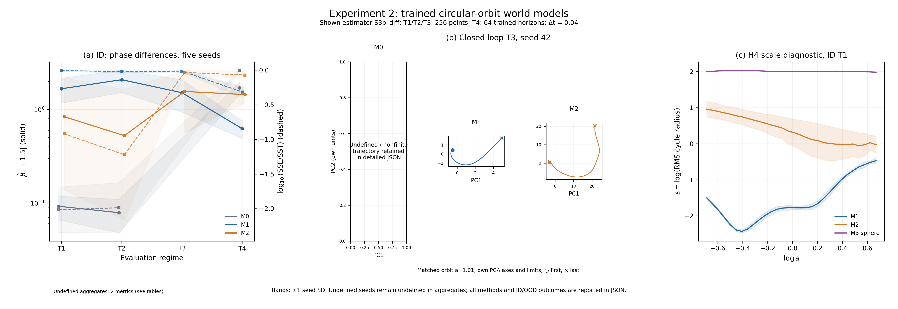

# Experiment 2: GPU training and circular-orbit diagnostics

Execution status: **completed**. Completed training records: **15**. Scientific criteria: **12 failed, 0 pending**.

Execution completion and scientific acceptance are separate outcomes. A completed run can fail a prespecified hypothesis; numerical results are retained without tuning them to pass.



## Protocol and numerical settings

```json
{
  "smoke_test": false,
  "seeds": [
    42,
    43,
    44,
    45,
    46
  ],
  "training": {
    "steps": 2000,
    "batch_size": 256,
    "context_length": 16,
    "delta": 4,
    "horizon": 64,
    "ar_steps": 16,
    "device": "cuda",
    "learning_rate": 0.001,
    "minimum_learning_rate": 1e-05,
    "weight_decay": 0.0001,
    "gradient_clip": 1.0,
    "ema_start": 0.99,
    "ema_end": 0.999,
    "velocity_weight": 1.0,
    "variance_weight": 0.1,
    "state_std_floor": 0.5,
    "velocity_std_floor": 0.05,
    "variance_epsilon": 1e-06,
    "orthogonality_weight": 0.2,
    "sparsity_weight": 0.0,
    "sigreg_weight": 1.0,
    "log_every": 20,
    "checkpoint_every": 100,
    "smoke_test": false
  },
  "arch_type": "mlp",
  "d": 64,
  "C": 4,
  "primary_method": "S3b_diff",
  "frequency_methods": [
    "S2",
    "S3a_diff",
    "S3b_diff",
    "S3b_std"
  ],
  "spectral_input": "full d=64 latent, per-orbit unwhitened PCA",
  "M3_normalization": "pointwise centered sphere radius sqrt(d), encoder/target/predictor; no orbit whitening",
  "M3_objective": "direct+AR+beta*SIGReg, beta=1; no M1/M2 variance barrier",
  "sparsity_weight": 0.0,
  "regimes": {
    "N_eval": 256,
    "L": 16,
    "delta": 4,
    "H_train": 64,
    "dt": 0.01,
    "macro_dt": 0.04,
    "origin_window_start_index": 0,
    "excludes_z0": true,
    "window_start_indices": {
      "T1": [
        4,
        8,
        12,
        16,
        20,
        24,
        28,
        32,
        36,
        40,
        44,
        48,
        52,
        56,
        60,
        64,
        68,
        72,
        76,
        80,
        84,
        88,
        92,
        96,
        100,
        104,
        108,
        112,
        116,
        120,
        124,
        128,
        132,
        136,
        140,
        144,
        148,
        152,
        156,
        160,
        164,
        168,
        172,
        176,
        180,
        184,
        188,
        192,
        196,
        200,
        204,
        208,
        212,
        216,
        220,
        224,
        228,
        232,
        236,
        240,
        244,
        248,
        252,
        256,
        260,
        264,
        268,
        272,
        276,
        280,
        284,
        288,
        292,
        296,
        300,
        304,
        308,
        312,
        316,
        320,
        324,
        328,
        332,
        336,
        340,
        344,
        348,
        352,
        356,
        360,
        364,
        368,
        372,
        376,
        380,
        384,
        388,
        392,
        396,
        400,
        404,
        408,
        412,
        416,
        420,
        424,
        428,
        432,
        436,
        440,
        444,
        448,
        452,
        456,
        460,
        464,
        468,
        472,
        476,
        480,
        484,
        488,
        492,
        496,
        500,
        504,
        508,
        512,
        516,
        520,
        524,
        528,
        532,
        536,
        540,
        544,
        548,
        552,
        556,
        560,
        564,
        568,
        572,
        576,
        580,
        584,
        588,
        592,
        596,
        600,
        604,
        608,
        612,
        616,
        620,
        624,
        628,
        632,
        636,
        640,
        644,
        648,
        652,
        656,
        660,
        664,
        668,
        672,
        676,
        680,
        684,
        688,
        692,
        696,
        700,
        704,
        708,
        712,
        716,
        720,
        724,
        728,
        732,
        736,
        740,
        744,
        748,
        752,
        756,
        760,
        764,
        768,
        772,
        776,
        780,
        784,
        788,
        792,
        796,
        800,
        804,
        808,
        812,
        816,
        820,
        824,
        828,
        832,
        836,
        840,
        844,
        848,
        852,
        856,
        860,
        864,
        868,
        872,
        876,
        880,
        884,
        888,
        892,
        896,
        900,
        904,
        908,
        912,
        916,
        920,
        924,
        928,
        932,
        936,
        940,
        944,
        948,
        952,
        956,
        960,
        964,
        968,
        972,
        976,
        980,
        984,
        988,
        992,
        996,
        1000,
        1004,
        1008,
        1012,
        1016,
        1020,
        1024
      ],
      "T2": [
        4,
        8,
        12,
        16,
        20,
        24,
        28,
        32,
        36,
        40,
        44,
        48,
        52,
        56,
        60,
        64,
        68,
        72,
        76,
        80,
        84,
        88,
        92,
        96,
        100,
        104,
        108,
        112,
        116,
        120,
        124,
        128,
        132,
        136,
        140,
        144,
        148,
        152,
        156,
        160,
        164,
        168,
        172,
        176,
        180,
        184,
        188,
        192,
        196,
        200,
        204,
        208,
        212,
        216,
        220,
        224,
        228,
        232,
        236,
        240,
        244,
        248,
        252,
        256,
        260,
        264,
        268,
        272,
        276,
        280,
        284,
        288,
        292,
        296,
        300,
        304,
        308,
        312,
        316,
        320,
        324,
        328,
        332,
        336,
        340,
        344,
        348,
        352,
        356,
        360,
        364,
        368,
        372,
        376,
        380,
        384,
        388,
        392,
        396,
        400,
        404,
        408,
        412,
        416,
        420,
        424,
        428,
        432,
        436,
        440,
        444,
        448,
        452,
        456,
        460,
        464,
        468,
        472,
        476,
        480,
        484,
        488,
        492,
        496,
        500,
        504,
        508,
        512,
        516,
        520,
        524,
        528,
        532,
        536,
        540,
        544,
        548,
        552,
        556,
        560,
        564,
        568,
        572,
        576,
        580,
        584,
        588,
        592,
        596,
        600,
        604,
        608,
        612,
        616,
        620,
        624,
        628,
        632,
        636,
        640,
        644,
        648,
        652,
        656,
        660,
        664,
        668,
        672,
        676,
        680,
        684,
        688,
        692,
        696,
        700,
        704,
        708,
        712,
        716,
        720,
        724,
        728,
        732,
        736,
        740,
        744,
        748,
        752,
        756,
        760,
        764,
        768,
        772,
        776,
        780,
        784,
        788,
        792,
        796,
        800,
        804,
        808,
        812,
        816,
        820,
        824,
        828,
        832,
        836,
        840,
        844,
        848,
        852,
        856,
        860,
        864,
        868,
        872,
        876,
        880,
        884,
        888,
        892,
        896,
        900,
        904,
        908,
        912,
        916,
        920,
        924,
        928,
        932,
        936,
        940,
        944,
        948,
        952,
        956,
        960,
        964,
        968,
        972,
        976,
        980,
        984,
        988,
        992,
        996,
        1000,
        1004,
        1008,
        1012,
        1016,
        1020,
        1024
      ],
      "T3": [
        4,
        8,
        12,
        16,
        20,
        24,
        28,
        32,
        36,
        40,
        44,
        48,
        52,
        56,
        60,
        64,
        68,
        72,
        76,
        80,
        84,
        88,
        92,
        96,
        100,
        104,
        108,
        112,
        116,
        120,
        124,
        128,
        132,
        136,
        140,
        144,
        148,
        152,
        156,
        160,
        164,
        168,
        172,
        176,
        180,
        184,
        188,
        192,
        196,
        200,
        204,
        208,
        212,
        216,
        220,
        224,
        228,
        232,
        236,
        240,
        244,
        248,
        252,
        256,
        260,
        264,
        268,
        272,
        276,
        280,
        284,
        288,
        292,
        296,
        300,
        304,
        308,
        312,
        316,
        320,
        324,
        328,
        332,
        336,
        340,
        344,
        348,
        352,
        356,
        360,
        364,
        368,
        372,
        376,
        380,
        384,
        388,
        392,
        396,
        400,
        404,
        408,
        412,
        416,
        420,
        424,
        428,
        432,
        436,
        440,
        444,
        448,
        452,
        456,
        460,
        464,
        468,
        472,
        476,
        480,
        484,
        488,
        492,
        496,
        500,
        504,
        508,
        512,
        516,
        520,
        524,
        528,
        532,
        536,
        540,
        544,
        548,
        552,
        556,
        560,
        564,
        568,
        572,
        576,
        580,
        584,
        588,
        592,
        596,
        600,
        604,
        608,
        612,
        616,
        620,
        624,
        628,
        632,
        636,
        640,
        644,
        648,
        652,
        656,
        660,
        664,
        668,
        672,
        676,
        680,
        684,
        688,
        692,
        696,
        700,
        704,
        708,
        712,
        716,
        720,
        724,
        728,
        732,
        736,
        740,
        744,
        748,
        752,
        756,
        760,
        764,
        768,
        772,
        776,
        780,
        784,
        788,
        792,
        796,
        800,
        804,
        808,
        812,
        816,
        820,
        824,
        828,
        832,
        836,
        840,
        844,
        848,
        852,
        856,
        860,
        864,
        868,
        872,
        876,
        880,
        884,
        888,
        892,
        896,
        900,
        904,
        908,
        912,
        916,
        920,
        924,
        928,
        932,
        936,
        940,
        944,
        948,
        952,
        956,
        960,
        964,
        968,
        972,
        976,
        980,
        984,
        988,
        992,
        996,
        1000,
        1004,
        1008,
        1012,
        1016,
        1020,
        1024
      ],
      "T4": [
        4,
        8,
        12,
        16,
        20,
        24,
        28,
        32,
        36,
        40,
        44,
        48,
        52,
        56,
        60,
        64,
        68,
        72,
        76,
        80,
        84,
        88,
        92,
        96,
        100,
        104,
        108,
        112,
        116,
        120,
        124,
        128,
        132,
        136,
        140,
        144,
        148,
        152,
        156,
        160,
        164,
        168,
        172,
        176,
        180,
        184,
        188,
        192,
        196,
        200,
        204,
        208,
        212,
        216,
        220,
        224,
        228,
        232,
        236,
        240,
        244,
        248,
        252,
        256
      ]
    },
    "sample_times": {
      "T1": [
        0.04,
        0.08,
        0.12,
        0.16,
        0.2,
        0.24,
        0.28,
        0.32,
        0.36,
        0.4,
        0.44,
        0.48,
        0.52,
        0.56,
        0.6,
        0.64,
        0.68,
        0.72,
        0.76,
        0.8,
        0.84,
        0.88,
        0.92,
        0.96,
        1.0,
        1.04,
        1.08,
        1.12,
        1.16,
        1.2,
        1.24,
        1.28,
        1.32,
        1.36,
        1.4000000000000001,
        1.44,
        1.48,
        1.52,
        1.56,
        1.6,
        1.6400000000000001,
        1.68,
        1.72,
        1.76,
        1.8,
        1.84,
        1.8800000000000001,
        1.92,
        1.96,
        2.0,
        2.04,
        2.08,
        2.12,
        2.16,
        2.2,
        2.24,
        2.2800000000000002,
        2.32,
        2.36,
        2.4,
        2.44,
        2.48,
        2.52,
        2.56,
        2.6,
        2.64,
        2.68,
        2.72,
        2.7600000000000002,
        2.8000000000000003,
        2.84,
        2.88,
        2.92,
        2.96,
        3.0,
        3.04,
        3.08,
        3.12,
        3.16,
        3.2,
        3.24,
        3.2800000000000002,
        3.3200000000000003,
        3.36,
        3.4,
        3.44,
        3.48,
        3.52,
        3.56,
        3.6,
        3.64,
        3.68,
        3.72,
        3.7600000000000002,
        3.8000000000000003,
        3.84,
        3.88,
        3.92,
        3.96,
        4.0,
        4.04,
        4.08,
        4.12,
        4.16,
        4.2,
        4.24,
        4.28,
        4.32,
        4.36,
        4.4,
        4.44,
        4.48,
        4.5200000000000005,
        4.5600000000000005,
        4.6000000000000005,
        4.64,
        4.68,
        4.72,
        4.76,
        4.8,
        4.84,
        4.88,
        4.92,
        4.96,
        5.0,
        5.04,
        5.08,
        5.12,
        5.16,
        5.2,
        5.24,
        5.28,
        5.32,
        5.36,
        5.4,
        5.44,
        5.48,
        5.5200000000000005,
        5.5600000000000005,
        5.6000000000000005,
        5.64,
        5.68,
        5.72,
        5.76,
        5.8,
        5.84,
        5.88,
        5.92,
        5.96,
        6.0,
        6.04,
        6.08,
        6.12,
        6.16,
        6.2,
        6.24,
        6.28,
        6.32,
        6.36,
        6.4,
        6.44,
        6.48,
        6.5200000000000005,
        6.5600000000000005,
        6.6000000000000005,
        6.640000000000001,
        6.68,
        6.72,
        6.76,
        6.8,
        6.84,
        6.88,
        6.92,
        6.96,
        7.0,
        7.04,
        7.08,
        7.12,
        7.16,
        7.2,
        7.24,
        7.28,
        7.32,
        7.36,
        7.4,
        7.44,
        7.48,
        7.5200000000000005,
        7.5600000000000005,
        7.6000000000000005,
        7.640000000000001,
        7.68,
        7.72,
        7.76,
        7.8,
        7.84,
        7.88,
        7.92,
        7.96,
        8.0,
        8.040000000000001,
        8.08,
        8.120000000000001,
        8.16,
        8.2,
        8.24,
        8.28,
        8.32,
        8.36,
        8.4,
        8.44,
        8.48,
        8.52,
        8.56,
        8.6,
        8.64,
        8.68,
        8.72,
        8.76,
        8.8,
        8.84,
        8.88,
        8.92,
        8.96,
        9.0,
        9.040000000000001,
        9.08,
        9.120000000000001,
        9.16,
        9.200000000000001,
        9.24,
        9.28,
        9.32,
        9.36,
        9.4,
        9.44,
        9.48,
        9.52,
        9.56,
        9.6,
        9.64,
        9.68,
        9.72,
        9.76,
        9.8,
        9.84,
        9.88,
        9.92,
        9.96,
        10.0,
        10.040000000000001,
        10.08,
        10.120000000000001,
        10.16,
        10.200000000000001,
        10.24
      ],
      "T2": [
        0.04,
        0.08,
        0.12,
        0.16,
        0.2,
        0.24,
        0.28,
        0.32,
        0.36,
        0.4,
        0.44,
        0.48,
        0.52,
        0.56,
        0.6,
        0.64,
        0.68,
        0.72,
        0.76,
        0.8,
        0.84,
        0.88,
        0.92,
        0.96,
        1.0,
        1.04,
        1.08,
        1.12,
        1.16,
        1.2,
        1.24,
        1.28,
        1.32,
        1.36,
        1.4000000000000001,
        1.44,
        1.48,
        1.52,
        1.56,
        1.6,
        1.6400000000000001,
        1.68,
        1.72,
        1.76,
        1.8,
        1.84,
        1.8800000000000001,
        1.92,
        1.96,
        2.0,
        2.04,
        2.08,
        2.12,
        2.16,
        2.2,
        2.24,
        2.2800000000000002,
        2.32,
        2.36,
        2.4,
        2.44,
        2.48,
        2.52,
        2.56,
        2.6,
        2.64,
        2.68,
        2.72,
        2.7600000000000002,
        2.8000000000000003,
        2.84,
        2.88,
        2.92,
        2.96,
        3.0,
        3.04,
        3.08,
        3.12,
        3.16,
        3.2,
        3.24,
        3.2800000000000002,
        3.3200000000000003,
        3.36,
        3.4,
        3.44,
        3.48,
        3.52,
        3.56,
        3.6,
        3.64,
        3.68,
        3.72,
        3.7600000000000002,
        3.8000000000000003,
        3.84,
        3.88,
        3.92,
        3.96,
        4.0,
        4.04,
        4.08,
        4.12,
        4.16,
        4.2,
        4.24,
        4.28,
        4.32,
        4.36,
        4.4,
        4.44,
        4.48,
        4.5200000000000005,
        4.5600000000000005,
        4.6000000000000005,
        4.64,
        4.68,
        4.72,
        4.76,
        4.8,
        4.84,
        4.88,
        4.92,
        4.96,
        5.0,
        5.04,
        5.08,
        5.12,
        5.16,
        5.2,
        5.24,
        5.28,
        5.32,
        5.36,
        5.4,
        5.44,
        5.48,
        5.5200000000000005,
        5.5600000000000005,
        5.6000000000000005,
        5.64,
        5.68,
        5.72,
        5.76,
        5.8,
        5.84,
        5.88,
        5.92,
        5.96,
        6.0,
        6.04,
        6.08,
        6.12,
        6.16,
        6.2,
        6.24,
        6.28,
        6.32,
        6.36,
        6.4,
        6.44,
        6.48,
        6.5200000000000005,
        6.5600000000000005,
        6.6000000000000005,
        6.640000000000001,
        6.68,
        6.72,
        6.76,
        6.8,
        6.84,
        6.88,
        6.92,
        6.96,
        7.0,
        7.04,
        7.08,
        7.12,
        7.16,
        7.2,
        7.24,
        7.28,
        7.32,
        7.36,
        7.4,
        7.44,
        7.48,
        7.5200000000000005,
        7.5600000000000005,
        7.6000000000000005,
        7.640000000000001,
        7.68,
        7.72,
        7.76,
        7.8,
        7.84,
        7.88,
        7.92,
        7.96,
        8.0,
        8.040000000000001,
        8.08,
        8.120000000000001,
        8.16,
        8.2,
        8.24,
        8.28,
        8.32,
        8.36,
        8.4,
        8.44,
        8.48,
        8.52,
        8.56,
        8.6,
        8.64,
        8.68,
        8.72,
        8.76,
        8.8,
        8.84,
        8.88,
        8.92,
        8.96,
        9.0,
        9.040000000000001,
        9.08,
        9.120000000000001,
        9.16,
        9.200000000000001,
        9.24,
        9.28,
        9.32,
        9.36,
        9.4,
        9.44,
        9.48,
        9.52,
        9.56,
        9.6,
        9.64,
        9.68,
        9.72,
        9.76,
        9.8,
        9.84,
        9.88,
        9.92,
        9.96,
        10.0,
        10.040000000000001,
        10.08,
        10.120000000000001,
        10.16,
        10.200000000000001,
        10.24
      ],
      "T3": [
        0.04,
        0.08,
        0.12,
        0.16,
        0.2,
        0.24,
        0.28,
        0.32,
        0.36,
        0.4,
        0.44,
        0.48,
        0.52,
        0.56,
        0.6,
        0.64,
        0.68,
        0.72,
        0.76,
        0.8,
        0.84,
        0.88,
        0.92,
        0.96,
        1.0,
        1.04,
        1.08,
        1.12,
        1.16,
        1.2,
        1.24,
        1.28,
        1.32,
        1.36,
        1.4000000000000001,
        1.44,
        1.48,
        1.52,
        1.56,
        1.6,
        1.6400000000000001,
        1.68,
        1.72,
        1.76,
        1.8,
        1.84,
        1.8800000000000001,
        1.92,
        1.96,
        2.0,
        2.04,
        2.08,
        2.12,
        2.16,
        2.2,
        2.24,
        2.2800000000000002,
        2.32,
        2.36,
        2.4,
        2.44,
        2.48,
        2.52,
        2.56,
        2.6,
        2.64,
        2.68,
        2.72,
        2.7600000000000002,
        2.8000000000000003,
        2.84,
        2.88,
        2.92,
        2.96,
        3.0,
        3.04,
        3.08,
        3.12,
        3.16,
        3.2,
        3.24,
        3.2800000000000002,
        3.3200000000000003,
        3.36,
        3.4,
        3.44,
        3.48,
        3.52,
        3.56,
        3.6,
        3.64,
        3.68,
        3.72,
        3.7600000000000002,
        3.8000000000000003,
        3.84,
        3.88,
        3.92,
        3.96,
        4.0,
        4.04,
        4.08,
        4.12,
        4.16,
        4.2,
        4.24,
        4.28,
        4.32,
        4.36,
        4.4,
        4.44,
        4.48,
        4.5200000000000005,
        4.5600000000000005,
        4.6000000000000005,
        4.64,
        4.68,
        4.72,
        4.76,
        4.8,
        4.84,
        4.88,
        4.92,
        4.96,
        5.0,
        5.04,
        5.08,
        5.12,
        5.16,
        5.2,
        5.24,
        5.28,
        5.32,
        5.36,
        5.4,
        5.44,
        5.48,
        5.5200000000000005,
        5.5600000000000005,
        5.6000000000000005,
        5.64,
        5.68,
        5.72,
        5.76,
        5.8,
        5.84,
        5.88,
        5.92,
        5.96,
        6.0,
        6.04,
        6.08,
        6.12,
        6.16,
        6.2,
        6.24,
        6.28,
        6.32,
        6.36,
        6.4,
        6.44,
        6.48,
        6.5200000000000005,
        6.5600000000000005,
        6.6000000000000005,
        6.640000000000001,
        6.68,
        6.72,
        6.76,
        6.8,
        6.84,
        6.88,
        6.92,
        6.96,
        7.0,
        7.04,
        7.08,
        7.12,
        7.16,
        7.2,
        7.24,
        7.28,
        7.32,
        7.36,
        7.4,
        7.44,
        7.48,
        7.5200000000000005,
        7.5600000000000005,
        7.6000000000000005,
        7.640000000000001,
        7.68,
        7.72,
        7.76,
        7.8,
        7.84,
        7.88,
        7.92,
        7.96,
        8.0,
        8.040000000000001,
        8.08,
        8.120000000000001,
        8.16,
        8.2,
        8.24,
        8.28,
        8.32,
        8.36,
        8.4,
        8.44,
        8.48,
        8.52,
        8.56,
        8.6,
        8.64,
        8.68,
        8.72,
        8.76,
        8.8,
        8.84,
        8.88,
        8.92,
        8.96,
        9.0,
        9.040000000000001,
        9.08,
        9.120000000000001,
        9.16,
        9.200000000000001,
        9.24,
        9.28,
        9.32,
        9.36,
        9.4,
        9.44,
        9.48,
        9.52,
        9.56,
        9.6,
        9.64,
        9.68,
        9.72,
        9.76,
        9.8,
        9.84,
        9.88,
        9.92,
        9.96,
        10.0,
        10.040000000000001,
        10.08,
        10.120000000000001,
        10.16,
        10.200000000000001,
        10.24
      ],
      "T4": [
        0.04,
        0.08,
        0.12,
        0.16,
        0.2,
        0.24,
        0.28,
        0.32,
        0.36,
        0.4,
        0.44,
        0.48,
        0.52,
        0.56,
        0.6,
        0.64,
        0.68,
        0.72,
        0.76,
        0.8,
        0.84,
        0.88,
        0.92,
        0.96,
        1.0,
        1.04,
        1.08,
        1.12,
        1.16,
        1.2,
        1.24,
        1.28,
        1.32,
        1.36,
        1.4000000000000001,
        1.44,
        1.48,
        1.52,
        1.56,
        1.6,
        1.6400000000000001,
        1.68,
        1.72,
        1.76,
        1.8,
        1.84,
        1.8800000000000001,
        1.92,
        1.96,
        2.0,
        2.04,
        2.08,
        2.12,
        2.16,
        2.2,
        2.24,
        2.2800000000000002,
        2.32,
        2.36,
        2.4,
        2.44,
        2.48,
        2.52,
        2.56
      ]
    },
    "required_raw_samples": 1040,
    "pca": "per-orbit, per-regime, centered unwhitened leading two components"
  },
  "acceptance_split": "test_id_sub",
  "ood": "diagnostic; no OOD threshold specified"
}
```

T1 encodes true future windows. T2 predicts one step from each true predecessor. T3 repeatedly uses horizon token 1 from one initial window. T4 predicts only trained horizons 1–64 from that same initial window. All sequences exclude z0 and align to future window starts. Each orbit/regime uses independent centered, unwhitened PCA for frequency estimation.

In the full production protocol, at δ=4 and simulator dt=0.01, T1/T2/T3 have 256 points separated by 0.04, spanning **10.20** time units between the first and last samples; T4 has 64 points spanning **2.52**. These windows do not cover multiple complete periods for every radius. In particular, long-period OOD orbits are short arcs. Centering, finite-arc geometry and FFT resolution can affect estimates.

## Training execution

|   seed | model   | status    |   steps | device   |   seconds |
|--------|---------|-----------|---------|----------|-----------|
|     42 | M1      | completed |    2000 | cuda     |   21.9838 |
|     42 | M2      | completed |    2000 | cuda     |   54.1774 |
|     42 | M3      | completed |    2000 | cuda     |   30.4354 |
|     43 | M1      | completed |    2000 | cuda     |   23.5058 |
|     43 | M2      | completed |    2000 | cuda     |   58.8132 |
|     43 | M3      | completed |    2000 | cuda     |   34.4424 |
|     44 | M1      | completed |    2000 | cuda     |   27.3192 |
|     44 | M2      | completed |    2000 | cuda     |   63.2163 |
|     44 | M3      | completed |    2000 | cuda     |   38.5547 |
|     45 | M1      | completed |    2000 | cuda     |   31.4016 |
|     45 | M2      | completed |    2000 | cuda     |   66.5009 |
|     45 | M3      | completed |    2000 | cuda     |   43.1259 |
|     46 | M1      | completed |    2000 | cuda     |   36.1304 |
|     46 | M2      | completed |    2000 | cuda     |   71.6572 |
|     46 | M3      | completed |    2000 | cuda     |   47.6766 |

## Frequency regressions

Entries are mean ± sample standard deviation over the recorded seeds. The seed count is explicit. An undefined seed makes the aggregate undefined; no `nanmean`, invalid-orbit filtering, or best-seed selection is used. SSE/SST is computed directly rather than by subtracting rounded R².

### test_id_sub

| model   | regime   | method   | seeds   | slope mean ± SD         | |slope+1.5|           | R²                    | SSE/SST               |   invalid orbits |
|---------|----------|----------|---------|-------------------------|-----------------------|-----------------------|-----------------------|------------------|
| M0      | T1       | S2       | 5/5     | -0.855916 ± 0.00052     | 0.644084 ± 0.00052    | 0.831394 ± 0.0029     | 0.168606 ± 0.0029     |                0 |
| M0      | T1       | S3a_diff | 5/5     | -1.40712 ± 0.103        | 0.0953315 ± 0.101     | 0.987133 ± 0.00529    | 0.0128673 ± 0.00529   |                0 |
| M0      | T1       | S3b_diff | 5/5     | -1.40797 ± 0.0263       | 0.0920311 ± 0.0263    | 0.987131 ± 0.0132     | 0.0128688 ± 0.0132    |                0 |
| M0      | T1       | S3b_std  | 5/5     | -1.34539 ± 0.00612      | 0.154613 ± 0.00612    | 0.981149 ± 0.00474    | 0.0188512 ± 0.00474   |                0 |
| M0      | T2       | S2       | 5/5     | -0.855961 ± 0.000581    | 0.644039 ± 0.000581   | 0.831357 ± 0.00283    | 0.168643 ± 0.00283    |                0 |
| M0      | T2       | S3a_diff | 5/5     | -1.43287 ± 0.113        | 0.0865301 ± 0.0946    | 0.985087 ± 0.00666    | 0.0149126 ± 0.00666   |                0 |
| M0      | T2       | S3b_diff | 5/5     | -1.42146 ± 0.0308       | 0.0785388 ± 0.0308    | 0.985343 ± 0.0165     | 0.0146571 ± 0.0165    |                0 |
| M0      | T2       | S3b_std  | 5/5     | -1.34697 ± 0.00951      | 0.153032 ± 0.00951    | 0.980796 ± 0.00543    | 0.0192042 ± 0.00543   |                0 |
| M0      | T3       | S2       | 5/5     | undefined (5/5 seeds)   | undefined (5/5 seeds) | undefined (5/5 seeds) | undefined (5/5 seeds) |              150 |
| M0      | T3       | S3a_diff | 5/5     | undefined (5/5 seeds)   | undefined (5/5 seeds) | undefined (5/5 seeds) | undefined (5/5 seeds) |              150 |
| M0      | T3       | S3b_diff | 5/5     | undefined (5/5 seeds)   | undefined (5/5 seeds) | undefined (5/5 seeds) | undefined (5/5 seeds) |              150 |
| M0      | T3       | S3b_std  | 5/5     | undefined (5/5 seeds)   | undefined (5/5 seeds) | undefined (5/5 seeds) | undefined (5/5 seeds) |              150 |
| M0      | T4       | S2       | 5/5     | -0.0812809 ± 0.181      | 1.41872 ± 0.181       | 0.0409874 ± 0.0648    | 0.959013 ± 0.0648     |                0 |
| M0      | T4       | S3a_diff | 5/5     | undefined (5/5 seeds)   | undefined (5/5 seeds) | undefined (5/5 seeds) | undefined (5/5 seeds) |               48 |
| M0      | T4       | S3b_diff | 5/5     | 0.206831 ± 0.252        | 1.70683 ± 0.252       | 0.0156309 ± 0.0215    | 0.984369 ± 0.0215     |                0 |
| M0      | T4       | S3b_std  | 5/5     | 0.112365 ± 0.317        | 1.61237 ± 0.317       | 0.0259121 ± 0.014     | 0.974088 ± 0.014      |                0 |
| M1      | T1       | S2       | 5/5     | -0.855988 ± 0.000327    | 0.644012 ± 0.000327   | 0.831624 ± 0.00169    | 0.168376 ± 0.00169    |                0 |
| M1      | T1       | S3a_diff | 5/5     | undefined (3/5 seeds)   | undefined (3/5 seeds) | undefined (3/5 seeds) | undefined (3/5 seeds) |                4 |
| M1      | T1       | S3b_diff | 5/5     | 0.166792 ± 0.497        | 1.66679 ± 0.497       | 0.0188201 ± 0.0248    | 0.98118 ± 0.0248      |                0 |
| M1      | T1       | S3b_std  | 5/5     | -1.08018 ± 0.275        | 0.419818 ± 0.275      | 0.513167 ± 0.437      | 0.486833 ± 0.437      |                0 |
| M1      | T2       | S2       | 5/5     | -0.856048 ± 0.000475    | 0.643952 ± 0.000475   | 0.83214 ± 0.00246     | 0.16786 ± 0.00246     |                0 |
| M1      | T2       | S3a_diff | 5/5     | undefined (3/5 seeds)   | undefined (3/5 seeds) | undefined (3/5 seeds) | undefined (3/5 seeds) |                9 |
| M1      | T2       | S3b_diff | 5/5     | 0.584993 ± 0.566        | 2.08499 ± 0.566       | 0.0403299 ± 0.0458    | 0.95967 ± 0.0458      |                0 |
| M1      | T2       | S3b_std  | 5/5     | -1.24407 ± 0.158        | 0.255933 ± 0.158      | 0.739293 ± 0.339      | 0.260707 ± 0.339      |                0 |
| M1      | T3       | S2       | 5/5     | -0.000618732 ± 0.00101  | 1.49938 ± 0.00101     | 0.0941943 ± 0.107     | 0.905806 ± 0.107      |                0 |
| M1      | T3       | S3a_diff | 5/5     | undefined (5/5 seeds)   | undefined (5/5 seeds) | undefined (5/5 seeds) | undefined (5/5 seeds) |               59 |
| M1      | T3       | S3b_diff | 5/5     | 0.0122742 ± 0.572       | 1.51227 ± 0.572       | 0.0309482 ± 0.033     | 0.969052 ± 0.033      |                0 |
| M1      | T3       | S3b_std  | 5/5     | -0.229667 ± 0.35        | 1.27033 ± 0.35        | 0.164646 ± 0.242      | 0.835354 ± 0.242      |                0 |
| M1      | T4       | S2       | 5/5     | -0.000148777 ± 4.37e-05 | 1.49985 ± 4.37e-05    | 0.355556 ± 0.0407     | 0.644444 ± 0.0407     |                0 |
| M1      | T4       | S3a_diff | 5/5     | undefined (5/5 seeds)   | undefined (5/5 seeds) | undefined (5/5 seeds) | undefined (5/5 seeds) |              150 |
| M1      | T4       | S3b_diff | 5/5     | -0.876613 ± 0.134       | 0.623387 ± 0.134      | 0.509475 ± 0.0829     | 0.490525 ± 0.0829     |                0 |
| M1      | T4       | S3b_std  | 5/5     | -0.0215232 ± 0.0051     | 1.47848 ± 0.0051      | 0.579191 ± 0.064      | 0.420809 ± 0.064      |                0 |
| M2      | T1       | S2       | 5/5     | -0.855939 ± 0.000668    | 0.644061 ± 0.000668   | 0.83252 ± 0.00247     | 0.16748 ± 0.00247     |                0 |
| M2      | T1       | S3a_diff | 5/5     | undefined (2/5 seeds)   | undefined (2/5 seeds) | undefined (2/5 seeds) | undefined (2/5 seeds) |                5 |
| M2      | T1       | S3b_diff | 5/5     | -0.782621 ± 1.57        | 0.837266 ± 1.49       | 0.70163 ± 0.329       | 0.29837 ± 0.329       |                0 |
| M2      | T1       | S3b_std  | 5/5     | -1.23454 ± 0.249        | 0.265461 ± 0.249      | 0.808697 ± 0.382      | 0.191303 ± 0.382      |                0 |
| M2      | T2       | S2       | 5/5     | -0.855772 ± 0.000498    | 0.644228 ± 0.000498   | 0.831914 ± 0.00267    | 0.168086 ± 0.00267    |                0 |
| M2      | T2       | S3a_diff | 5/5     | -1.48099 ± 0.117        | 0.0890671 ± 0.0657    | 0.800641 ± 0.24       | 0.199359 ± 0.24       |                0 |
| M2      | T2       | S3b_diff | 5/5     | -1.04757 ± 0.939        | 0.524821 ± 0.891      | 0.735988 ± 0.414      | 0.264012 ± 0.414      |                0 |
| M2      | T2       | S3b_std  | 5/5     | -0.79833 ± 1.23         | 0.70167 ± 1.23        | 0.815408 ± 0.369      | 0.184592 ± 0.369      |                0 |
| M2      | T3       | S2       | 5/5     | -0.010946 ± 0.026       | 1.48905 ± 0.026       | 0.106557 ± 0.155      | 0.893443 ± 0.155      |                0 |
| M2      | T3       | S3a_diff | 5/5     | undefined (5/5 seeds)   | undefined (5/5 seeds) | undefined (5/5 seeds) | undefined (5/5 seeds) |              129 |
| M2      | T3       | S3b_diff | 5/5     | 0.0599167 ± 1           | 1.55992 ± 1           | 0.0716378 ± 0.0603    | 0.928362 ± 0.0603     |                0 |
| M2      | T3       | S3b_std  | 5/5     | 0.166987 ± 0.162        | 1.66699 ± 0.162       | 0.127184 ± 0.163      | 0.872816 ± 0.163      |                0 |
| M2      | T4       | S2       | 5/5     | 5.28213e-06 ± 9.26e-05  | 1.50001 ± 9.26e-05    | 0.0541388 ± 0.0746    | 0.945861 ± 0.0746     |                0 |
| M2      | T4       | S3a_diff | 5/5     | undefined (5/5 seeds)   | undefined (5/5 seeds) | undefined (5/5 seeds) | undefined (5/5 seeds) |              147 |
| M2      | T4       | S3b_diff | 5/5     | -0.0547982 ± 0.256      | 1.4452 ± 0.256        | 0.143756 ± 0.117      | 0.856244 ± 0.117      |                0 |
| M2      | T4       | S3b_std  | 5/5     | -0.0133589 ± 0.129      | 1.48664 ± 0.129       | 0.15653 ± 0.139       | 0.84347 ± 0.139       |                0 |
| M3      | T1       | S2       | 5/5     | -0.914731 ± 0.0678      | 0.585269 ± 0.0678     | 0.769439 ± 0.0414     | 0.230561 ± 0.0414     |                0 |
| M3      | T1       | S3a_diff | 5/5     | undefined (3/5 seeds)   | undefined (3/5 seeds) | undefined (3/5 seeds) | undefined (3/5 seeds) |                9 |
| M3      | T1       | S3b_diff | 5/5     | -1.29114 ± 0.927        | 0.770266 ± 0.415      | 0.156991 ± 0.198      | 0.843009 ± 0.198      |                0 |
| M3      | T1       | S3b_std  | 5/5     | -0.735689 ± 0.747       | 0.764311 ± 0.747      | 0.144317 ± 0.084      | 0.855683 ± 0.084      |                0 |
| M3      | T2       | S2       | 5/5     | -1.1496 ± 0.071         | 0.350398 ± 0.071      | 0.70299 ± 0.0252      | 0.29701 ± 0.0252      |                0 |
| M3      | T2       | S3a_diff | 5/5     | undefined (4/5 seeds)   | undefined (4/5 seeds) | undefined (4/5 seeds) | undefined (4/5 seeds) |               10 |
| M3      | T2       | S3b_diff | 5/5     | -1.25132 ± 0.444        | 0.373136 ± 0.317      | 0.155471 ± 0.128      | 0.844529 ± 0.128      |                0 |
| M3      | T2       | S3b_std  | 5/5     | -1.0032 ± 0.255         | 0.496798 ± 0.255      | 0.267894 ± 0.344      | 0.732106 ± 0.344      |                0 |
| M3      | T3       | S2       | 5/5     | -0.00878946 ± 0.0874    | 1.49121 ± 0.0874      | 0.0380179 ± 0.0134    | 0.961982 ± 0.0134     |                0 |
| M3      | T3       | S3a_diff | 5/5     | undefined (5/5 seeds)   | undefined (5/5 seeds) | undefined (5/5 seeds) | undefined (5/5 seeds) |               16 |
| M3      | T3       | S3b_diff | 5/5     | -0.218012 ± 0.205       | 1.28199 ± 0.205       | 0.0212925 ± 0.0245    | 0.978707 ± 0.0245     |                0 |
| M3      | T3       | S3b_std  | 5/5     | -0.121922 ± 0.183       | 1.37808 ± 0.183       | 0.0312121 ± 0.0373    | 0.968788 ± 0.0373     |                0 |
| M3      | T4       | S2       | 5/5     | 0.000608128 ± 0.000282  | 1.50061 ± 0.000282    | 0.700188 ± 0.158      | 0.299812 ± 0.158      |                0 |
| M3      | T4       | S3a_diff | 5/5     | undefined (5/5 seeds)   | undefined (5/5 seeds) | undefined (5/5 seeds) | undefined (5/5 seeds) |               83 |
| M3      | T4       | S3b_diff | 5/5     | 0.219383 ± 0.326        | 1.71938 ± 0.326       | 0.0467742 ± 0.0509    | 0.953226 ± 0.0509     |                0 |
| M3      | T4       | S3b_std  | 5/5     | 0.0980312 ± 0.0268      | 1.59803 ± 0.0268      | 0.755007 ± 0.164      | 0.244993 ± 0.164      |                0 |

### test_ood

| model   | regime   | method   | seeds   | slope mean ± SD         | |slope+1.5|           | R²                    | SSE/SST               |   invalid orbits |
|---------|----------|----------|---------|-------------------------|-----------------------|-----------------------|-----------------------|------------------|
| M0      | T1       | S2       | 5/5     | -0.582445 ± 2.74e-06    | 0.917555 ± 2.74e-06   | 0.9803 ± 7.32e-07     | 0.0197003 ± 7.32e-07  |                0 |
| M0      | T1       | S3a_diff | 5/5     | -1.22319 ± 0.0294       | 0.276806 ± 0.0294     | 0.996362 ± 0.000313   | 0.00363751 ± 0.000313 |                0 |
| M0      | T1       | S3b_diff | 5/5     | -1.21049 ± 0.00751      | 0.289514 ± 0.00751    | 0.996559 ± 0.00084    | 0.00344056 ± 0.00084  |                0 |
| M0      | T1       | S3b_std  | 5/5     | -0.80657 ± 0.000296     | 0.69343 ± 0.000296    | 0.992265 ± 4.84e-05   | 0.00773454 ± 4.84e-05 |                0 |
| M0      | T2       | S2       | 5/5     | -0.582442 ± 3.61e-06    | 0.917558 ± 3.61e-06   | 0.9803 ± 1.1e-06      | 0.0197005 ± 1.1e-06   |                0 |
| M0      | T2       | S3a_diff | 5/5     | -1.22559 ± 0.0385       | 0.274409 ± 0.0385     | 0.99637 ± 0.00154     | 0.00363007 ± 0.00154  |                0 |
| M0      | T2       | S3b_diff | 5/5     | -1.20557 ± 0.00841      | 0.294432 ± 0.00841    | 0.995734 ± 0.000957   | 0.00426648 ± 0.000957 |                0 |
| M0      | T2       | S3b_std  | 5/5     | -0.806367 ± 0.000325    | 0.693633 ± 0.000325   | 0.992271 ± 6.54e-05   | 0.00772855 ± 6.54e-05 |                0 |
| M0      | T3       | S2       | 5/5     | undefined (5/5 seeds)   | undefined (5/5 seeds) | undefined (5/5 seeds) | undefined (5/5 seeds) |              250 |
| M0      | T3       | S3a_diff | 5/5     | undefined (5/5 seeds)   | undefined (5/5 seeds) | undefined (5/5 seeds) | undefined (5/5 seeds) |              250 |
| M0      | T3       | S3b_diff | 5/5     | undefined (5/5 seeds)   | undefined (5/5 seeds) | undefined (5/5 seeds) | undefined (5/5 seeds) |              250 |
| M0      | T3       | S3b_std  | 5/5     | undefined (5/5 seeds)   | undefined (5/5 seeds) | undefined (5/5 seeds) | undefined (5/5 seeds) |              250 |
| M0      | T4       | S2       | 5/5     | -0.0989574 ± 0.083      | 1.40104 ± 0.083       | 0.111894 ± 0.191      | 0.888106 ± 0.191      |                0 |
| M0      | T4       | S3a_diff | 5/5     | undefined (5/5 seeds)   | undefined (5/5 seeds) | undefined (5/5 seeds) | undefined (5/5 seeds) |              119 |
| M0      | T4       | S3b_diff | 5/5     | 0.107954 ± 0.252        | 1.60795 ± 0.252       | 0.111623 ± 0.0884     | 0.888377 ± 0.0884     |                0 |
| M0      | T4       | S3b_std  | 5/5     | -0.0681424 ± 0.11       | 1.43186 ± 0.11        | 0.0271521 ± 0.0519    | 0.972848 ± 0.0519     |                0 |
| M1      | T1       | S2       | 5/5     | -0.586761 ± 0.0096      | 0.913239 ± 0.0096     | 0.973868 ± 0.0144     | 0.0261319 ± 0.0144    |                0 |
| M1      | T1       | S3a_diff | 5/5     | undefined (4/5 seeds)   | undefined (4/5 seeds) | undefined (4/5 seeds) | undefined (4/5 seeds) |               28 |
| M1      | T1       | S3b_diff | 5/5     | -0.61643 ± 0.721        | 0.88357 ± 0.721       | 0.47743 ± 0.477       | 0.52257 ± 0.477       |                0 |
| M1      | T1       | S3b_std  | 5/5     | -0.536989 ± 0.606       | 0.963011 ± 0.606      | 0.819505 ± 0.386      | 0.180495 ± 0.386      |                0 |
| M1      | T2       | S2       | 5/5     | -0.586663 ± 0.00938     | 0.913337 ± 0.00938    | 0.974262 ± 0.0135     | 0.025738 ± 0.0135     |                0 |
| M1      | T2       | S3a_diff | 5/5     | undefined (4/5 seeds)   | undefined (4/5 seeds) | undefined (4/5 seeds) | undefined (4/5 seeds) |               37 |
| M1      | T2       | S3b_diff | 5/5     | -0.32583 ± 0.613        | 1.17417 ± 0.613       | 0.242863 ± 0.427      | 0.757137 ± 0.427      |                0 |
| M1      | T2       | S3b_std  | 5/5     | -0.377083 ± 0.731       | 1.12292 ± 0.731       | 0.687505 ± 0.433      | 0.312495 ± 0.433      |                0 |
| M1      | T3       | S2       | 5/5     | -4.70223e-05 ± 8.09e-05 | 1.49995 ± 8.09e-05    | 0.0433911 ± 0.0438    | 0.956609 ± 0.0438     |                0 |
| M1      | T3       | S3a_diff | 5/5     | undefined (5/5 seeds)   | undefined (5/5 seeds) | undefined (5/5 seeds) | undefined (5/5 seeds) |              116 |
| M1      | T3       | S3b_diff | 5/5     | -0.26642 ± 0.164        | 1.23358 ± 0.164       | 0.109133 ± 0.0966     | 0.890867 ± 0.0966     |                0 |
| M1      | T3       | S3b_std  | 5/5     | -0.0189151 ± 0.0264     | 1.48108 ± 0.0264      | 0.0511474 ± 0.0446    | 0.948853 ± 0.0446     |                0 |
| M1      | T4       | S2       | 5/5     | -8.06013e-06 ± 4.96e-06 | 1.49999 ± 4.96e-06    | 0.0969788 ± 0.0836    | 0.903021 ± 0.0836     |                0 |
| M1      | T4       | S3a_diff | 5/5     | undefined (5/5 seeds)   | undefined (5/5 seeds) | undefined (5/5 seeds) | undefined (5/5 seeds) |              250 |
| M1      | T4       | S3b_diff | 5/5     | -0.254534 ± 0.126       | 1.24547 ± 0.126       | 0.545735 ± 0.227      | 0.454265 ± 0.227      |                0 |
| M1      | T4       | S3b_std  | 5/5     | -0.00158081 ± 0.000283  | 1.49842 ± 0.000283    | 0.448087 ± 0.165      | 0.551913 ± 0.165      |                0 |
| M2      | T1       | S2       | 5/5     | -0.582433 ± 5.1e-06     | 0.917567 ± 5.1e-06    | 0.9803 ± 2.43e-06     | 0.0197001 ± 2.43e-06  |                0 |
| M2      | T1       | S3a_diff | 5/5     | undefined (4/5 seeds)   | undefined (4/5 seeds) | undefined (4/5 seeds) | undefined (4/5 seeds) |               11 |
| M2      | T1       | S3b_diff | 5/5     | -0.827904 ± 0.89        | 0.672096 ± 0.89       | 0.928389 ± 0.102      | 0.0716113 ± 0.102     |                0 |
| M2      | T1       | S3b_std  | 5/5     | -0.806347 ± 0.00106     | 0.693653 ± 0.00106    | 0.992221 ± 0.00025    | 0.00777893 ± 0.00025  |                0 |
| M2      | T2       | S2       | 5/5     | -0.6171 ± 0.0775        | 0.8829 ± 0.0775       | 0.971591 ± 0.0195     | 0.0284087 ± 0.0195    |                0 |
| M2      | T2       | S3a_diff | 5/5     | undefined (3/5 seeds)   | undefined (3/5 seeds) | undefined (3/5 seeds) | undefined (3/5 seeds) |               17 |
| M2      | T2       | S3b_diff | 5/5     | -0.822965 ± 0.913       | 0.677035 ± 0.913      | 0.901311 ± 0.162      | 0.0986893 ± 0.162     |                0 |
| M2      | T2       | S3b_std  | 5/5     | -0.403134 ± 0.902       | 1.09687 ± 0.902       | 0.96483 ± 0.0611      | 0.0351703 ± 0.0611    |                0 |
| M2      | T3       | S2       | 5/5     | 1.99385e-05 ± 5.73e-05  | 1.50002 ± 5.73e-05    | 0.0329599 ± 0.0287    | 0.96704 ± 0.0287      |                0 |
| M2      | T3       | S3a_diff | 5/5     | undefined (5/5 seeds)   | undefined (5/5 seeds) | undefined (5/5 seeds) | undefined (5/5 seeds) |              238 |
| M2      | T3       | S3b_diff | 5/5     | undefined (1/5 seeds)   | undefined (1/5 seeds) | undefined (1/5 seeds) | undefined (1/5 seeds) |                3 |
| M2      | T3       | S3b_std  | 5/5     | 0.00638001 ± 0.0124     | 1.50638 ± 0.0124      | 0.0364839 ± 0.0308    | 0.963516 ± 0.0308     |                0 |
| M2      | T4       | S2       | 5/5     | -2.07041e-05 ± 3.08e-05 | 1.49998 ± 3.08e-05    | 0.0458577 ± 0.0862    | 0.954142 ± 0.0862     |                0 |
| M2      | T4       | S3a_diff | 5/5     | undefined (5/5 seeds)   | undefined (5/5 seeds) | undefined (5/5 seeds) | undefined (5/5 seeds) |              244 |
| M2      | T4       | S3b_diff | 5/5     | -0.0964295 ± 0.0288     | 1.40357 ± 0.0288      | 0.154093 ± 0.141      | 0.845907 ± 0.141      |                0 |
| M2      | T4       | S3b_std  | 5/5     | 0.0133468 ± 0.0161      | 1.51335 ± 0.0161      | 0.195717 ± 0.219      | 0.804283 ± 0.219      |                0 |
| M3      | T1       | S2       | 5/5     | -0.635637 ± 0.0698      | 0.864363 ± 0.0698     | 0.963045 ± 0.0234     | 0.0369549 ± 0.0234    |                0 |
| M3      | T1       | S3a_diff | 5/5     | undefined (2/5 seeds)   | undefined (2/5 seeds) | undefined (2/5 seeds) | undefined (2/5 seeds) |               12 |
| M3      | T1       | S3b_diff | 5/5     | -0.717054 ± 0.5         | 0.782946 ± 0.5        | 0.507931 ± 0.467      | 0.492069 ± 0.467      |                0 |
| M3      | T1       | S3b_std  | 5/5     | -0.288106 ± 0.604       | 1.21189 ± 0.604       | 0.480666 ± 0.403      | 0.519334 ± 0.403      |                0 |
| M3      | T2       | S2       | 5/5     | -0.608831 ± 0.0416      | 0.891169 ± 0.0416     | 0.962317 ± 0.0254     | 0.0376828 ± 0.0254    |                0 |
| M3      | T2       | S3a_diff | 5/5     | undefined (2/5 seeds)   | undefined (2/5 seeds) | undefined (2/5 seeds) | undefined (2/5 seeds) |               25 |
| M3      | T2       | S3b_diff | 5/5     | -0.793441 ± 0.33        | 0.706559 ± 0.33       | 0.60641 ± 0.37        | 0.39359 ± 0.37        |                0 |
| M3      | T2       | S3b_std  | 5/5     | -0.381425 ± 0.479       | 1.11858 ± 0.479       | 0.474579 ± 0.495      | 0.525421 ± 0.495      |                0 |
| M3      | T3       | S2       | 5/5     | -0.011434 ± 0.0217      | 1.48857 ± 0.0217      | 0.034572 ± 0.0372     | 0.965428 ± 0.0372     |                0 |
| M3      | T3       | S3a_diff | 5/5     | undefined (5/5 seeds)   | undefined (5/5 seeds) | undefined (5/5 seeds) | undefined (5/5 seeds) |               37 |
| M3      | T3       | S3b_diff | 5/5     | -0.0957165 ± 0.0876     | 1.40428 ± 0.0876      | 0.0274587 ± 0.0411    | 0.972541 ± 0.0411     |                0 |
| M3      | T3       | S3b_std  | 5/5     | -0.0369897 ± 0.0387     | 1.46301 ± 0.0387      | 0.0259345 ± 0.0285    | 0.974065 ± 0.0285     |                0 |
| M3      | T4       | S2       | 5/5     | 0.000255748 ± 7.5e-05   | 1.50026 ± 7.5e-05     | 0.877281 ± 0.049      | 0.122719 ± 0.049      |                0 |
| M3      | T4       | S3a_diff | 5/5     | undefined (5/5 seeds)   | undefined (5/5 seeds) | undefined (5/5 seeds) | undefined (5/5 seeds) |               64 |
| M3      | T4       | S3b_diff | 5/5     | 0.189785 ± 0.0739       | 1.68979 ± 0.0739      | 0.529766 ± 0.165      | 0.470234 ± 0.165      |                0 |
| M3      | T4       | S3b_std  | 5/5     | 0.0538796 ± 0.0106      | 1.55388 ± 0.0106      | 0.915965 ± 0.0304     | 0.0840346 ± 0.0304    |                0 |

## H4: scale and energy probes

| split       | model   | regime   | seeds   | cycle-radius R²    | state-norm R²      | energy R²          | Spearman(s, log a)   |   failed seeds |
|-------------|---------|----------|---------|--------------------|--------------------|--------------------|----------------------|----------------|
| test_id_sub | M1      | T1       | 5/5     | 0.690589 ± 0.023   | 0.457298 ± 0.126   | 0.738821 ± 0.0393  | 0.79515 ± 0.0183     |              0 |
| test_id_sub | M1      | T3       | 5/5     | 0.184104 ± 0.159   | 0.18378 ± 0.156    | 0.249505 ± 0.178   | 0.245918 ± 0.351     |              0 |
| test_id_sub | M2      | T1       | 5/5     | 0.929848 ± 0.0792  | 0.894906 ± 0.105   | 0.94665 ± 0.0583   | -0.945717 ± 0.0685   |              0 |
| test_id_sub | M2      | T3       | 5/5     | 0.162134 ± 0.234   | 0.161532 ± 0.234   | 0.183104 ± 0.223   | -0.362581 ± 0.223    |              0 |
| test_id_sub | M3      | T1       | 5/5     | 0.414818 ± 0.25    | 0 ± 0              | 0.414818 ± 0.25    | -0.583092 ± 0.357    |              0 |
| test_id_sub | M3      | T3       | 5/5     | 0.0373855 ± 0.0437 | 0 ± 0              | 0.0373855 ± 0.0437 | -0.153726 ± 0.18     |              0 |
| test_ood    | M1      | T1       | 5/5     | 0.733098 ± 0.0483  | 0.942349 ± 0.00446 | 0.967441 ± 0.0122  | 0.631116 ± 0.0439    |              0 |
| test_ood    | M1      | T3       | 5/5     | 0.642175 ± 0.0731  | 0.643974 ± 0.0743  | 0.684578 ± 0.0788  | 0.728134 ± 0.0389    |              0 |
| test_ood    | M2      | T1       | 5/5     | 0.788569 ± 0.0347  | 0.50601 ± 0.181    | 0.825678 ± 0.025   | -0.897508 ± 0.0234   |              0 |
| test_ood    | M2      | T3       | 5/5     | 0.0953353 ± 0.0929 | 0.0953858 ± 0.093  | 0.14705 ± 0.0854   | -0.0483361 ± 0.309   |              0 |
| test_ood    | M3      | T1       | 5/5     | 0.852409 ± 0.0425  | 0 ± 0              | 0.852409 ± 0.0425  | -0.720797 ± 0.00845  |              0 |
| test_ood    | M3      | T3       | 5/5     | 0.0596098 ± 0.053  | 0 ± 0              | 0.0596098 ± 0.053  | -0.171016 ± 0.214    |              0 |

The specified probes regress log(a) on log cycle radius s or log state norm r. A predictor with log-feature standard deviation ≤1e−6 is treated as numerically constant by default; the threshold, feature variation and dropped columns are retained in each JSON fit. A constant predictor against varying axes has R²=0, while constant responses have undefined R².

Spearman(s, log a) supplies the direction and rank diagnostic: high linear R² alone does not establish increasing monotonicity. The energy target log|E|=log(μ/2)−log(a) is affine in log(a), so energy R² is a related scale probe rather than independent evidence of learned conservation.

Unit state norm does not imply a constant centered cycle radius on a finite arc. Low R² of these linear norm probes also does not establish absence of nonlinear scale information elsewhere in the representation. The M3 normalization result is therefore measured, not assumed.

## Prespecified scientific acceptance

| criterion                                                 | status   | details                                                                                                                                                                                                                                                                                                                                                                                                                                                                                                                                                                                                                                               |
|-----------------------------------------------------------|----------|-------------------------------------------------------------------------------------------------------------------------------------------------------------------------------------------------------------------------------------------------------------------------------------------------------------------------------------------------------------------------------------------------------------------------------------------------------------------------------------------------------------------------------------------------------------------------------------------------------------------------------------------------------|
| All 15 CUDA training runs completed 2000 steps, batch 256 | PASS     | {}                                                                                                                                                                                                                                                                                                                                                                                                                                                                                                                                                                                                                                                    |
| ID T1 M0: slope error<.005 and R2>.9999 (S3b_diff)        | FAIL     | [{"seed": 42, "slope_abs_error": 0.08830613717536906, "r2": 0.9636508882728961, "invalid": 0, "scale_r2_cycle_radius": null}, {"seed": 43, "slope_abs_error": 0.07644046895003531, "r2": 0.9931800708534363, "invalid": 0, "scale_r2_cycle_radius": null}, {"seed": 44, "slope_abs_error": 0.059643001548932206, "r2": 0.994651681195033, "invalid": 0, "scale_r2_cycle_radius": null}, {"seed": 45, "slope_abs_error": 0.1259441770665175, "r2": 0.991709855778867, "invalid": 0, "scale_r2_cycle_radius": null}, {"seed": 46, "slope_abs_error": 0.10982151648476957, "r2": 0.9924637367112794, "invalid": 0, "scale_r2_cycle_radius": null}]       |
| ID T1 M1: slope error<.005 and R2>.9999 (S3b_diff)        | FAIL     | [{"seed": 42, "slope_abs_error": 2.374353817413563, "r2": 0.060588816067808415, "invalid": 0, "scale_r2_cycle_radius": null}, {"seed": 43, "slope_abs_error": 1.4293874404080136, "r2": 0.0006594245676039279, "invalid": 0, "scale_r2_cycle_radius": null}, {"seed": 44, "slope_abs_error": 1.9971965285538276, "r2": 0.02240025779014354, "invalid": 0, "scale_r2_cycle_radius": null}, {"seed": 45, "slope_abs_error": 1.2922083772593955, "r2": 0.004167270985208971, "invalid": 0, "scale_r2_cycle_radius": null}, {"seed": 46, "slope_abs_error": 1.2408122922975813, "r2": 0.006284690443902119, "invalid": 0, "scale_r2_cycle_radius": null}] |
| ID T1 M2: slope error<.005 and R2>.9999 (S3b_diff)        | FAIL     | [{"seed": 42, "slope_abs_error": 0.2997162930426054, "r2": 0.5566476536940168, "invalid": 0, "scale_r2_cycle_radius": null}, {"seed": 43, "slope_abs_error": 0.1782968178748725, "r2": 0.9507802827762161, "invalid": 0, "scale_r2_cycle_radius": null}, {"seed": 44, "slope_abs_error": 0.08360457306702362, "r2": 0.9923225740803183, "invalid": 0, "scale_r2_cycle_radius": null}, {"seed": 45, "slope_abs_error": 3.507354677343702, "r2": 0.19733091307464523, "invalid": 0, "scale_r2_cycle_radius": null}, {"seed": 46, "slope_abs_error": 0.11735651850046303, "r2": 0.8110686056719544, "invalid": 0, "scale_r2_cycle_radius": null}]        |
| ID T3 M0 fails law recovery (S3b_diff)                    | PASS     | [{"seed": 42, "slope_abs_error": null, "r2": null, "invalid": 30, "scale_r2_cycle_radius": null}, {"seed": 43, "slope_abs_error": null, "r2": null, "invalid": 30, "scale_r2_cycle_radius": null}, {"seed": 44, "slope_abs_error": null, "r2": null, "invalid": 30, "scale_r2_cycle_radius": null}, {"seed": 45, "slope_abs_error": null, "r2": null, "invalid": 30, "scale_r2_cycle_radius": null}, {"seed": 46, "slope_abs_error": null, "r2": null, "invalid": 30, "scale_r2_cycle_radius": null}]                                                                                                                                                 |
| ID T3 M1: slope error<.08 and R2>.98 (S3b_diff)           | FAIL     | [{"seed": 42, "slope_abs_error": 1.5939990834407103, "r2": 0.0010026351577530068, "invalid": 0, "scale_r2_cycle_radius": null}, {"seed": 43, "slope_abs_error": 0.9368835508156556, "r2": 0.021216684173154365, "invalid": 0, "scale_r2_cycle_radius": null}, {"seed": 44, "slope_abs_error": 2.339620938793485, "r2": 0.0801428498031489, "invalid": 0, "scale_r2_cycle_radius": null}, {"seed": 45, "slope_abs_error": 1.0052962812687987, "r2": 0.047330014753587446, "invalid": 0, "scale_r2_cycle_radius": null}, {"seed": 46, "slope_abs_error": 1.6855711014423562, "r2": 0.005049057657377953, "invalid": 0, "scale_r2_cycle_radius": null}]  |
| ID T3 M2: slope error<.08 and R2>.98 (S3b_diff)           | FAIL     | [{"seed": 42, "slope_abs_error": 0.5479507700811354, "r2": 0.09054281461273572, "invalid": 0, "scale_r2_cycle_radius": null}, {"seed": 43, "slope_abs_error": 1.4167954974465031, "r2": 0.0007165470684825648, "invalid": 0, "scale_r2_cycle_radius": null}, {"seed": 44, "slope_abs_error": 2.1510703318973534, "r2": 0.05543748913162849, "invalid": 0, "scale_r2_cycle_radius": null}, {"seed": 45, "slope_abs_error": 2.9475547110135434, "r2": 0.163151452423272, "invalid": 0, "scale_r2_cycle_radius": null}, {"seed": 46, "slope_abs_error": 0.7362122640643934, "r2": 0.04834089828109411, "invalid": 0, "scale_r2_cycle_radius": null}]     |
| ID T4 M0 fails law recovery (S3b_diff)                    | PASS     | [{"seed": 42, "slope_abs_error": 2.041003706669179, "r2": 0.0312946486694643, "invalid": 0, "scale_r2_cycle_radius": null}, {"seed": 43, "slope_abs_error": 1.4772363995336417, "r2": 0.0002230571297096029, "invalid": 0, "scale_r2_cycle_radius": null}, {"seed": 44, "slope_abs_error": 1.549167564845689, "r2": 0.0004306471017703206, "invalid": 0, "scale_r2_cycle_radius": null}, {"seed": 45, "slope_abs_error": 1.5568000071290713, "r2": 0.00044364090531856526, "invalid": 0, "scale_r2_cycle_radius": null}, {"seed": 46, "slope_abs_error": 1.9099491034337897, "r2": 0.04576262788638874, "invalid": 0, "scale_r2_cycle_radius": null}] |
| ID T4 M1: slope error<.08 and R2>.98 (S3b_diff)           | FAIL     | [{"seed": 42, "slope_abs_error": 0.6878967758109474, "r2": 0.4539879446377546, "invalid": 0, "scale_r2_cycle_radius": null}, {"seed": 43, "slope_abs_error": 0.7484907561007211, "r2": 0.4863115902539451, "invalid": 0, "scale_r2_cycle_radius": null}, {"seed": 44, "slope_abs_error": 0.45973458781331433, "r2": 0.6540857613984113, "invalid": 0, "scale_r2_cycle_radius": null}, {"seed": 45, "slope_abs_error": 0.49928263284531904, "r2": 0.45651852884429633, "invalid": 0, "scale_r2_cycle_radius": null}, {"seed": 46, "slope_abs_error": 0.7215313810899122, "r2": 0.4964720544913154, "invalid": 0, "scale_r2_cycle_radius": null}]       |
| ID T4 M2: slope error<.08 and R2>.98 (S3b_diff)           | FAIL     | [{"seed": 42, "slope_abs_error": 1.120599907264114, "r2": 0.26140924456782744, "invalid": 0, "scale_r2_cycle_radius": null}, {"seed": 43, "slope_abs_error": 1.6250790774885662, "r2": 0.0377288862012376, "invalid": 0, "scale_r2_cycle_radius": null}, {"seed": 44, "slope_abs_error": 1.481285471351659, "r2": 0.0022805312273878053, "invalid": 0, "scale_r2_cycle_radius": null}, {"seed": 45, "slope_abs_error": 1.7410533885208044, "r2": 0.1850509544266039, "invalid": 0, "scale_r2_cycle_radius": null}, {"seed": 46, "slope_abs_error": 1.2579912672188993, "r2": 0.23230881301031403, "invalid": 0, "scale_r2_cycle_radius": null}]       |
| H4 ID T1 M1: cycle-radius R2 >.90                         | FAIL     | [{"seed": 42, "slope_abs_error": null, "r2": null, "invalid": null, "scale_r2_cycle_radius": 0.6660366463864551}, {"seed": 43, "slope_abs_error": null, "r2": null, "invalid": null, "scale_r2_cycle_radius": 0.6721009671791548}, {"seed": 44, "slope_abs_error": null, "r2": null, "invalid": null, "scale_r2_cycle_radius": 0.7052614004742244}, {"seed": 45, "slope_abs_error": null, "r2": null, "invalid": null, "scale_r2_cycle_radius": 0.6882258446294792}, {"seed": 46, "slope_abs_error": null, "r2": null, "invalid": null, "scale_r2_cycle_radius": 0.7213224609149622}]                                                                 |
| H4 ID T1 M2: cycle-radius R2 >.90                         | FAIL     | [{"seed": 42, "slope_abs_error": null, "r2": null, "invalid": null, "scale_r2_cycle_radius": 0.8580452076494864}, {"seed": 43, "slope_abs_error": null, "r2": null, "invalid": null, "scale_r2_cycle_radius": 0.8299028354547137}, {"seed": 44, "slope_abs_error": null, "r2": null, "invalid": null, "scale_r2_cycle_radius": 0.9946106281611147}, {"seed": 45, "slope_abs_error": null, "r2": null, "invalid": null, "scale_r2_cycle_radius": 0.9839835833129292}, {"seed": 46, "slope_abs_error": null, "r2": null, "invalid": null, "scale_r2_cycle_radius": 0.9826953496839961}]                                                                 |
| H4 ID T1 M3: cycle-radius R2 <.15                         | FAIL     | [{"seed": 42, "slope_abs_error": null, "r2": null, "invalid": null, "scale_r2_cycle_radius": 0.5169892198579793}, {"seed": 43, "slope_abs_error": null, "r2": null, "invalid": null, "scale_r2_cycle_radius": 0.4608923173879196}, {"seed": 44, "slope_abs_error": null, "r2": null, "invalid": null, "scale_r2_cycle_radius": 4.124928054161092e-05}, {"seed": 45, "slope_abs_error": null, "r2": null, "invalid": null, "scale_r2_cycle_radius": 0.6707476802191441}, {"seed": 46, "slope_abs_error": null, "r2": null, "invalid": null, "scale_r2_cycle_radius": 0.4254176545332322}]                                                              |
| H4 ID T3 M1: cycle-radius R2 >.90                         | FAIL     | [{"seed": 42, "slope_abs_error": null, "r2": null, "invalid": null, "scale_r2_cycle_radius": 0.005981877695192095}, {"seed": 43, "slope_abs_error": null, "r2": null, "invalid": null, "scale_r2_cycle_radius": 0.21358680130858232}, {"seed": 44, "slope_abs_error": null, "r2": null, "invalid": null, "scale_r2_cycle_radius": 0.0931130151346109}, {"seed": 45, "slope_abs_error": null, "r2": null, "invalid": null, "scale_r2_cycle_radius": 0.1795252989835907}, {"seed": 46, "slope_abs_error": null, "r2": null, "invalid": null, "scale_r2_cycle_radius": 0.42831081844274876}]                                                             |
| H4 ID T3 M2: cycle-radius R2 >.90                         | FAIL     | [{"seed": 42, "slope_abs_error": null, "r2": null, "invalid": null, "scale_r2_cycle_radius": 0.04592662929825264}, {"seed": 43, "slope_abs_error": null, "r2": null, "invalid": null, "scale_r2_cycle_radius": 0.06268058324429349}, {"seed": 44, "slope_abs_error": null, "r2": null, "invalid": null, "scale_r2_cycle_radius": 0.1293104361824422}, {"seed": 45, "slope_abs_error": null, "r2": null, "invalid": null, "scale_r2_cycle_radius": 0.5722373514452795}, {"seed": 46, "slope_abs_error": null, "r2": null, "invalid": null, "scale_r2_cycle_radius": 0.0005140340676005328}]                                                            |
| H4 ID T3 M3: cycle-radius R2 <.15                         | PASS     | [{"seed": 42, "slope_abs_error": null, "r2": null, "invalid": null, "scale_r2_cycle_radius": 0.006818886921606815}, {"seed": 43, "slope_abs_error": null, "r2": null, "invalid": null, "scale_r2_cycle_radius": 0.11088369923275021}, {"seed": 44, "slope_abs_error": null, "r2": null, "invalid": null, "scale_r2_cycle_radius": 0.03185427540182206}, {"seed": 45, "slope_abs_error": null, "r2": null, "invalid": null, "scale_r2_cycle_radius": 0.035792746843679835}, {"seed": 46, "slope_abs_error": null, "r2": null, "invalid": null, "scale_r2_cycle_radius": 0.0015778356810204341}]                                                        |

### Failed scale diagnostics

|   seed | model   | split       | regime   | error                              |
|--------|---------|-------------|----------|------------------------------------|
|     42 | M0      | test_id_sub | T3       | latent trajectories must be finite |
|     42 | M0      | test_ood    | T3       | latent trajectories must be finite |
|     43 | M0      | test_id_sub | T3       | latent trajectories must be finite |
|     43 | M0      | test_ood    | T3       | latent trajectories must be finite |
|     44 | M0      | test_id_sub | T3       | latent trajectories must be finite |
|     44 | M0      | test_ood    | T3       | latent trajectories must be finite |
|     45 | M0      | test_id_sub | T3       | latent trajectories must be finite |
|     45 | M0      | test_ood    | T3       | latent trajectories must be finite |
|     46 | M0      | test_id_sub | T3       | latent trajectories must be finite |
|     46 | M0      | test_ood    | T3       | latent trajectories must be finite |

## Environment

```json
{
  "cuda_available": true,
  "torch": "2.1.1+cu118",
  "cuda_runtime": "11.8",
  "python": "3.10.13",
  "platform": "Linux-5.15.0-186-generic-x86_64-with-glibc2.35",
  "gpus": [
    {
      "index": 0,
      "name": "NVIDIA A100-SXM4-80GB MIG 3g.40gb",
      "total_memory_bytes": 42144366592,
      "capability": [
        8,
        0
      ]
    }
  ],
  "checked_at_utc": "2026-10-14T21:25:06.059110+00:00",
  "numpy": "1.26.4",
  "scipy": "1.14.1",
  "scikit-learn": "1.7.2",
  "matplotlib": "3.10.1",
  "tabulate": "0.9.0",
  "threadpoolctl": "3.6.0"
}
```

## Artifacts

- [Full stdout](exp2_circular_stdout.txt)
- [All per-orbit and per-seed results](exp2_circular_results.json)
- [300 dpi publication figure](figures/exp2_circular_regimes.png)
