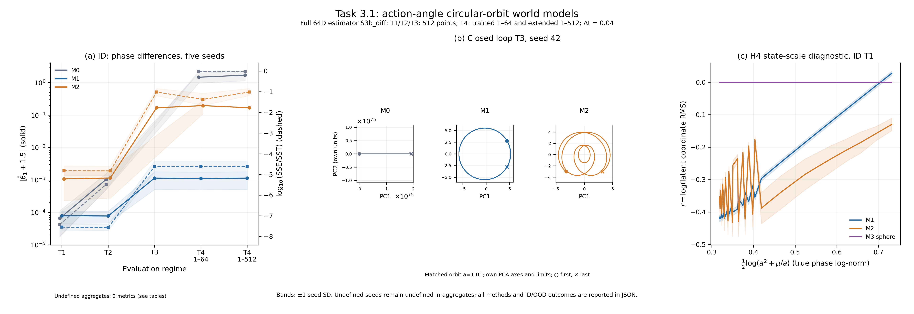

# Task 3.1: circular-orbit remediation and diagnostics

Execution status: **completed**. Completed training records: **15/15**. Scientific criteria: **12/16 passed, 4 failed, 0 pending**.

Execution completion and scientific acceptance are separate outcomes. A completed run can fail a prespecified hypothesis; numerical results are retained without tuning them to pass.



## Protocol and numerical settings

```json
{
  "smoke_test": false,
  "seeds": [
    42,
    43,
    44,
    45,
    46
  ],
  "training": {
    "steps": 2000,
    "batch_size": 256,
    "context_length": 16,
    "delta": 4,
    "horizon": 64,
    "ar_steps": 16,
    "device": "cuda",
    "learning_rate": 0.001,
    "minimum_learning_rate": 1e-05,
    "weight_decay": 0.0001,
    "gradient_clip": 1.0,
    "ema_start": 0.99,
    "ema_end": 0.999,
    "velocity_weight": 1.0,
    "variance_weight": 0.1,
    "state_std_floor": 0.5,
    "velocity_std_floor": 0.05,
    "variance_epsilon": 1e-06,
    "orthogonality_weight": 0.2,
    "sparsity_weight": 0.0,
    "sigreg_weight": 1.0,
    "log_every": 20,
    "checkpoint_every": 100,
    "smoke_test": false,
    "protocol": "task3_1",
    "temporal_lag": 16,
    "temporal_displacement_fraction": 0.8,
    "temporal_scale_weight": 0.2,
    "temporal_weight": 1.0,
    "relative_denominator_epsilon": 0.0001
  },
  "arch_type": "mlp",
  "mlp_variant": "odd_residual",
  "d": 64,
  "C": 4,
  "raw_test_samples": 2100,
  "primary_method": "S3b_diff",
  "frequency_methods": [
    "S2",
    "S3a_diff",
    "S3b_diff",
    "S3b_std"
  ],
  "spectral_input": "primary full d=64 latent, per-orbit unwhitened centered PCA",
  "factor_evaluation": "M2 per-orbit max temporal variance; additional diagnostic, never substitutes primary",
  "predictor": "M1/M2/M3 action-angle Koopman; Q=exp(S-S.T), M2 Q four16Dblocks, learned softplus rate_net",
  "M0_predictor": "frozen random unstructured MLP, H_max=512; no Kepler metadata",
  "training_dtype": "float32",
  "evaluation_dtype": "float64",
  "evaluation_precision": "promote learned float32 parameters after checkpoint; no further training or float64 initialization",
  "M3_normalization": "encoder/target pointwise feature-centered sphere radius sqrt(d); generated Koopman states retain norm without re-centering",
  "M3_objective": "relative direct+legacy AR+beta*SIGReg, beta=1; no M1/M2 temporal barrier",
  "M1_M2_objective": "relative direct+legacy AR+temporal1.0; M2 orthogonality.2",
  "phase_norm_probe": "response log latent RMS vs feature 0.5*log(a^2+1/a); constant response zero-score convention disclosed",
  "sparsity_weight": 0.0,
  "regimes": {
    "N_eval": 512,
    "L": 16,
    "delta": 4,
    "H_train": 64,
    "dt": 0.01,
    "macro_dt": 0.04,
    "origin_window_start_index": 0,
    "excludes_z0": true,
    "window_start_indices": {
      "T1": [
        4,
        8,
        12,
        16,
        20,
        24,
        28,
        32,
        36,
        40,
        44,
        48,
        52,
        56,
        60,
        64,
        68,
        72,
        76,
        80,
        84,
        88,
        92,
        96,
        100,
        104,
        108,
        112,
        116,
        120,
        124,
        128,
        132,
        136,
        140,
        144,
        148,
        152,
        156,
        160,
        164,
        168,
        172,
        176,
        180,
        184,
        188,
        192,
        196,
        200,
        204,
        208,
        212,
        216,
        220,
        224,
        228,
        232,
        236,
        240,
        244,
        248,
        252,
        256,
        260,
        264,
        268,
        272,
        276,
        280,
        284,
        288,
        292,
        296,
        300,
        304,
        308,
        312,
        316,
        320,
        324,
        328,
        332,
        336,
        340,
        344,
        348,
        352,
        356,
        360,
        364,
        368,
        372,
        376,
        380,
        384,
        388,
        392,
        396,
        400,
        404,
        408,
        412,
        416,
        420,
        424,
        428,
        432,
        436,
        440,
        444,
        448,
        452,
        456,
        460,
        464,
        468,
        472,
        476,
        480,
        484,
        488,
        492,
        496,
        500,
        504,
        508,
        512,
        516,
        520,
        524,
        528,
        532,
        536,
        540,
        544,
        548,
        552,
        556,
        560,
        564,
        568,
        572,
        576,
        580,
        584,
        588,
        592,
        596,
        600,
        604,
        608,
        612,
        616,
        620,
        624,
        628,
        632,
        636,
        640,
        644,
        648,
        652,
        656,
        660,
        664,
        668,
        672,
        676,
        680,
        684,
        688,
        692,
        696,
        700,
        704,
        708,
        712,
        716,
        720,
        724,
        728,
        732,
        736,
        740,
        744,
        748,
        752,
        756,
        760,
        764,
        768,
        772,
        776,
        780,
        784,
        788,
        792,
        796,
        800,
        804,
        808,
        812,
        816,
        820,
        824,
        828,
        832,
        836,
        840,
        844,
        848,
        852,
        856,
        860,
        864,
        868,
        872,
        876,
        880,
        884,
        888,
        892,
        896,
        900,
        904,
        908,
        912,
        916,
        920,
        924,
        928,
        932,
        936,
        940,
        944,
        948,
        952,
        956,
        960,
        964,
        968,
        972,
        976,
        980,
        984,
        988,
        992,
        996,
        1000,
        1004,
        1008,
        1012,
        1016,
        1020,
        1024,
        1028,
        1032,
        1036,
        1040,
        1044,
        1048,
        1052,
        1056,
        1060,
        1064,
        1068,
        1072,
        1076,
        1080,
        1084,
        1088,
        1092,
        1096,
        1100,
        1104,
        1108,
        1112,
        1116,
        1120,
        1124,
        1128,
        1132,
        1136,
        1140,
        1144,
        1148,
        1152,
        1156,
        1160,
        1164,
        1168,
        1172,
        1176,
        1180,
        1184,
        1188,
        1192,
        1196,
        1200,
        1204,
        1208,
        1212,
        1216,
        1220,
        1224,
        1228,
        1232,
        1236,
        1240,
        1244,
        1248,
        1252,
        1256,
        1260,
        1264,
        1268,
        1272,
        1276,
        1280,
        1284,
        1288,
        1292,
        1296,
        1300,
        1304,
        1308,
        1312,
        1316,
        1320,
        1324,
        1328,
        1332,
        1336,
        1340,
        1344,
        1348,
        1352,
        1356,
        1360,
        1364,
        1368,
        1372,
        1376,
        1380,
        1384,
        1388,
        1392,
        1396,
        1400,
        1404,
        1408,
        1412,
        1416,
        1420,
        1424,
        1428,
        1432,
        1436,
        1440,
        1444,
        1448,
        1452,
        1456,
        1460,
        1464,
        1468,
        1472,
        1476,
        1480,
        1484,
        1488,
        1492,
        1496,
        1500,
        1504,
        1508,
        1512,
        1516,
        1520,
        1524,
        1528,
        1532,
        1536,
        1540,
        1544,
        1548,
        1552,
        1556,
        1560,
        1564,
        1568,
        1572,
        1576,
        1580,
        1584,
        1588,
        1592,
        1596,
        1600,
        1604,
        1608,
        1612,
        1616,
        1620,
        1624,
        1628,
        1632,
        1636,
        1640,
        1644,
        1648,
        1652,
        1656,
        1660,
        1664,
        1668,
        1672,
        1676,
        1680,
        1684,
        1688,
        1692,
        1696,
        1700,
        1704,
        1708,
        1712,
        1716,
        1720,
        1724,
        1728,
        1732,
        1736,
        1740,
        1744,
        1748,
        1752,
        1756,
        1760,
        1764,
        1768,
        1772,
        1776,
        1780,
        1784,
        1788,
        1792,
        1796,
        1800,
        1804,
        1808,
        1812,
        1816,
        1820,
        1824,
        1828,
        1832,
        1836,
        1840,
        1844,
        1848,
        1852,
        1856,
        1860,
        1864,
        1868,
        1872,
        1876,
        1880,
        1884,
        1888,
        1892,
        1896,
        1900,
        1904,
        1908,
        1912,
        1916,
        1920,
        1924,
        1928,
        1932,
        1936,
        1940,
        1944,
        1948,
        1952,
        1956,
        1960,
        1964,
        1968,
        1972,
        1976,
        1980,
        1984,
        1988,
        1992,
        1996,
        2000,
        2004,
        2008,
        2012,
        2016,
        2020,
        2024,
        2028,
        2032,
        2036,
        2040,
        2044,
        2048
      ],
      "T2": [
        4,
        8,
        12,
        16,
        20,
        24,
        28,
        32,
        36,
        40,
        44,
        48,
        52,
        56,
        60,
        64,
        68,
        72,
        76,
        80,
        84,
        88,
        92,
        96,
        100,
        104,
        108,
        112,
        116,
        120,
        124,
        128,
        132,
        136,
        140,
        144,
        148,
        152,
        156,
        160,
        164,
        168,
        172,
        176,
        180,
        184,
        188,
        192,
        196,
        200,
        204,
        208,
        212,
        216,
        220,
        224,
        228,
        232,
        236,
        240,
        244,
        248,
        252,
        256,
        260,
        264,
        268,
        272,
        276,
        280,
        284,
        288,
        292,
        296,
        300,
        304,
        308,
        312,
        316,
        320,
        324,
        328,
        332,
        336,
        340,
        344,
        348,
        352,
        356,
        360,
        364,
        368,
        372,
        376,
        380,
        384,
        388,
        392,
        396,
        400,
        404,
        408,
        412,
        416,
        420,
        424,
        428,
        432,
        436,
        440,
        444,
        448,
        452,
        456,
        460,
        464,
        468,
        472,
        476,
        480,
        484,
        488,
        492,
        496,
        500,
        504,
        508,
        512,
        516,
        520,
        524,
        528,
        532,
        536,
        540,
        544,
        548,
        552,
        556,
        560,
        564,
        568,
        572,
        576,
        580,
        584,
        588,
        592,
        596,
        600,
        604,
        608,
        612,
        616,
        620,
        624,
        628,
        632,
        636,
        640,
        644,
        648,
        652,
        656,
        660,
        664,
        668,
        672,
        676,
        680,
        684,
        688,
        692,
        696,
        700,
        704,
        708,
        712,
        716,
        720,
        724,
        728,
        732,
        736,
        740,
        744,
        748,
        752,
        756,
        760,
        764,
        768,
        772,
        776,
        780,
        784,
        788,
        792,
        796,
        800,
        804,
        808,
        812,
        816,
        820,
        824,
        828,
        832,
        836,
        840,
        844,
        848,
        852,
        856,
        860,
        864,
        868,
        872,
        876,
        880,
        884,
        888,
        892,
        896,
        900,
        904,
        908,
        912,
        916,
        920,
        924,
        928,
        932,
        936,
        940,
        944,
        948,
        952,
        956,
        960,
        964,
        968,
        972,
        976,
        980,
        984,
        988,
        992,
        996,
        1000,
        1004,
        1008,
        1012,
        1016,
        1020,
        1024,
        1028,
        1032,
        1036,
        1040,
        1044,
        1048,
        1052,
        1056,
        1060,
        1064,
        1068,
        1072,
        1076,
        1080,
        1084,
        1088,
        1092,
        1096,
        1100,
        1104,
        1108,
        1112,
        1116,
        1120,
        1124,
        1128,
        1132,
        1136,
        1140,
        1144,
        1148,
        1152,
        1156,
        1160,
        1164,
        1168,
        1172,
        1176,
        1180,
        1184,
        1188,
        1192,
        1196,
        1200,
        1204,
        1208,
        1212,
        1216,
        1220,
        1224,
        1228,
        1232,
        1236,
        1240,
        1244,
        1248,
        1252,
        1256,
        1260,
        1264,
        1268,
        1272,
        1276,
        1280,
        1284,
        1288,
        1292,
        1296,
        1300,
        1304,
        1308,
        1312,
        1316,
        1320,
        1324,
        1328,
        1332,
        1336,
        1340,
        1344,
        1348,
        1352,
        1356,
        1360,
        1364,
        1368,
        1372,
        1376,
        1380,
        1384,
        1388,
        1392,
        1396,
        1400,
        1404,
        1408,
        1412,
        1416,
        1420,
        1424,
        1428,
        1432,
        1436,
        1440,
        1444,
        1448,
        1452,
        1456,
        1460,
        1464,
        1468,
        1472,
        1476,
        1480,
        1484,
        1488,
        1492,
        1496,
        1500,
        1504,
        1508,
        1512,
        1516,
        1520,
        1524,
        1528,
        1532,
        1536,
        1540,
        1544,
        1548,
        1552,
        1556,
        1560,
        1564,
        1568,
        1572,
        1576,
        1580,
        1584,
        1588,
        1592,
        1596,
        1600,
        1604,
        1608,
        1612,
        1616,
        1620,
        1624,
        1628,
        1632,
        1636,
        1640,
        1644,
        1648,
        1652,
        1656,
        1660,
        1664,
        1668,
        1672,
        1676,
        1680,
        1684,
        1688,
        1692,
        1696,
        1700,
        1704,
        1708,
        1712,
        1716,
        1720,
        1724,
        1728,
        1732,
        1736,
        1740,
        1744,
        1748,
        1752,
        1756,
        1760,
        1764,
        1768,
        1772,
        1776,
        1780,
        1784,
        1788,
        1792,
        1796,
        1800,
        1804,
        1808,
        1812,
        1816,
        1820,
        1824,
        1828,
        1832,
        1836,
        1840,
        1844,
        1848,
        1852,
        1856,
        1860,
        1864,
        1868,
        1872,
        1876,
        1880,
        1884,
        1888,
        1892,
        1896,
        1900,
        1904,
        1908,
        1912,
        1916,
        1920,
        1924,
        1928,
        1932,
        1936,
        1940,
        1944,
        1948,
        1952,
        1956,
        1960,
        1964,
        1968,
        1972,
        1976,
        1980,
        1984,
        1988,
        1992,
        1996,
        2000,
        2004,
        2008,
        2012,
        2016,
        2020,
        2024,
        2028,
        2032,
        2036,
        2040,
        2044,
        2048
      ],
      "T3": [
        4,
        8,
        12,
        16,
        20,
        24,
        28,
        32,
        36,
        40,
        44,
        48,
        52,
        56,
        60,
        64,
        68,
        72,
        76,
        80,
        84,
        88,
        92,
        96,
        100,
        104,
        108,
        112,
        116,
        120,
        124,
        128,
        132,
        136,
        140,
        144,
        148,
        152,
        156,
        160,
        164,
        168,
        172,
        176,
        180,
        184,
        188,
        192,
        196,
        200,
        204,
        208,
        212,
        216,
        220,
        224,
        228,
        232,
        236,
        240,
        244,
        248,
        252,
        256,
        260,
        264,
        268,
        272,
        276,
        280,
        284,
        288,
        292,
        296,
        300,
        304,
        308,
        312,
        316,
        320,
        324,
        328,
        332,
        336,
        340,
        344,
        348,
        352,
        356,
        360,
        364,
        368,
        372,
        376,
        380,
        384,
        388,
        392,
        396,
        400,
        404,
        408,
        412,
        416,
        420,
        424,
        428,
        432,
        436,
        440,
        444,
        448,
        452,
        456,
        460,
        464,
        468,
        472,
        476,
        480,
        484,
        488,
        492,
        496,
        500,
        504,
        508,
        512,
        516,
        520,
        524,
        528,
        532,
        536,
        540,
        544,
        548,
        552,
        556,
        560,
        564,
        568,
        572,
        576,
        580,
        584,
        588,
        592,
        596,
        600,
        604,
        608,
        612,
        616,
        620,
        624,
        628,
        632,
        636,
        640,
        644,
        648,
        652,
        656,
        660,
        664,
        668,
        672,
        676,
        680,
        684,
        688,
        692,
        696,
        700,
        704,
        708,
        712,
        716,
        720,
        724,
        728,
        732,
        736,
        740,
        744,
        748,
        752,
        756,
        760,
        764,
        768,
        772,
        776,
        780,
        784,
        788,
        792,
        796,
        800,
        804,
        808,
        812,
        816,
        820,
        824,
        828,
        832,
        836,
        840,
        844,
        848,
        852,
        856,
        860,
        864,
        868,
        872,
        876,
        880,
        884,
        888,
        892,
        896,
        900,
        904,
        908,
        912,
        916,
        920,
        924,
        928,
        932,
        936,
        940,
        944,
        948,
        952,
        956,
        960,
        964,
        968,
        972,
        976,
        980,
        984,
        988,
        992,
        996,
        1000,
        1004,
        1008,
        1012,
        1016,
        1020,
        1024,
        1028,
        1032,
        1036,
        1040,
        1044,
        1048,
        1052,
        1056,
        1060,
        1064,
        1068,
        1072,
        1076,
        1080,
        1084,
        1088,
        1092,
        1096,
        1100,
        1104,
        1108,
        1112,
        1116,
        1120,
        1124,
        1128,
        1132,
        1136,
        1140,
        1144,
        1148,
        1152,
        1156,
        1160,
        1164,
        1168,
        1172,
        1176,
        1180,
        1184,
        1188,
        1192,
        1196,
        1200,
        1204,
        1208,
        1212,
        1216,
        1220,
        1224,
        1228,
        1232,
        1236,
        1240,
        1244,
        1248,
        1252,
        1256,
        1260,
        1264,
        1268,
        1272,
        1276,
        1280,
        1284,
        1288,
        1292,
        1296,
        1300,
        1304,
        1308,
        1312,
        1316,
        1320,
        1324,
        1328,
        1332,
        1336,
        1340,
        1344,
        1348,
        1352,
        1356,
        1360,
        1364,
        1368,
        1372,
        1376,
        1380,
        1384,
        1388,
        1392,
        1396,
        1400,
        1404,
        1408,
        1412,
        1416,
        1420,
        1424,
        1428,
        1432,
        1436,
        1440,
        1444,
        1448,
        1452,
        1456,
        1460,
        1464,
        1468,
        1472,
        1476,
        1480,
        1484,
        1488,
        1492,
        1496,
        1500,
        1504,
        1508,
        1512,
        1516,
        1520,
        1524,
        1528,
        1532,
        1536,
        1540,
        1544,
        1548,
        1552,
        1556,
        1560,
        1564,
        1568,
        1572,
        1576,
        1580,
        1584,
        1588,
        1592,
        1596,
        1600,
        1604,
        1608,
        1612,
        1616,
        1620,
        1624,
        1628,
        1632,
        1636,
        1640,
        1644,
        1648,
        1652,
        1656,
        1660,
        1664,
        1668,
        1672,
        1676,
        1680,
        1684,
        1688,
        1692,
        1696,
        1700,
        1704,
        1708,
        1712,
        1716,
        1720,
        1724,
        1728,
        1732,
        1736,
        1740,
        1744,
        1748,
        1752,
        1756,
        1760,
        1764,
        1768,
        1772,
        1776,
        1780,
        1784,
        1788,
        1792,
        1796,
        1800,
        1804,
        1808,
        1812,
        1816,
        1820,
        1824,
        1828,
        1832,
        1836,
        1840,
        1844,
        1848,
        1852,
        1856,
        1860,
        1864,
        1868,
        1872,
        1876,
        1880,
        1884,
        1888,
        1892,
        1896,
        1900,
        1904,
        1908,
        1912,
        1916,
        1920,
        1924,
        1928,
        1932,
        1936,
        1940,
        1944,
        1948,
        1952,
        1956,
        1960,
        1964,
        1968,
        1972,
        1976,
        1980,
        1984,
        1988,
        1992,
        1996,
        2000,
        2004,
        2008,
        2012,
        2016,
        2020,
        2024,
        2028,
        2032,
        2036,
        2040,
        2044,
        2048
      ],
      "T4": [
        4,
        8,
        12,
        16,
        20,
        24,
        28,
        32,
        36,
        40,
        44,
        48,
        52,
        56,
        60,
        64,
        68,
        72,
        76,
        80,
        84,
        88,
        92,
        96,
        100,
        104,
        108,
        112,
        116,
        120,
        124,
        128,
        132,
        136,
        140,
        144,
        148,
        152,
        156,
        160,
        164,
        168,
        172,
        176,
        180,
        184,
        188,
        192,
        196,
        200,
        204,
        208,
        212,
        216,
        220,
        224,
        228,
        232,
        236,
        240,
        244,
        248,
        252,
        256
      ],
      "T4_512": [
        4,
        8,
        12,
        16,
        20,
        24,
        28,
        32,
        36,
        40,
        44,
        48,
        52,
        56,
        60,
        64,
        68,
        72,
        76,
        80,
        84,
        88,
        92,
        96,
        100,
        104,
        108,
        112,
        116,
        120,
        124,
        128,
        132,
        136,
        140,
        144,
        148,
        152,
        156,
        160,
        164,
        168,
        172,
        176,
        180,
        184,
        188,
        192,
        196,
        200,
        204,
        208,
        212,
        216,
        220,
        224,
        228,
        232,
        236,
        240,
        244,
        248,
        252,
        256,
        260,
        264,
        268,
        272,
        276,
        280,
        284,
        288,
        292,
        296,
        300,
        304,
        308,
        312,
        316,
        320,
        324,
        328,
        332,
        336,
        340,
        344,
        348,
        352,
        356,
        360,
        364,
        368,
        372,
        376,
        380,
        384,
        388,
        392,
        396,
        400,
        404,
        408,
        412,
        416,
        420,
        424,
        428,
        432,
        436,
        440,
        444,
        448,
        452,
        456,
        460,
        464,
        468,
        472,
        476,
        480,
        484,
        488,
        492,
        496,
        500,
        504,
        508,
        512,
        516,
        520,
        524,
        528,
        532,
        536,
        540,
        544,
        548,
        552,
        556,
        560,
        564,
        568,
        572,
        576,
        580,
        584,
        588,
        592,
        596,
        600,
        604,
        608,
        612,
        616,
        620,
        624,
        628,
        632,
        636,
        640,
        644,
        648,
        652,
        656,
        660,
        664,
        668,
        672,
        676,
        680,
        684,
        688,
        692,
        696,
        700,
        704,
        708,
        712,
        716,
        720,
        724,
        728,
        732,
        736,
        740,
        744,
        748,
        752,
        756,
        760,
        764,
        768,
        772,
        776,
        780,
        784,
        788,
        792,
        796,
        800,
        804,
        808,
        812,
        816,
        820,
        824,
        828,
        832,
        836,
        840,
        844,
        848,
        852,
        856,
        860,
        864,
        868,
        872,
        876,
        880,
        884,
        888,
        892,
        896,
        900,
        904,
        908,
        912,
        916,
        920,
        924,
        928,
        932,
        936,
        940,
        944,
        948,
        952,
        956,
        960,
        964,
        968,
        972,
        976,
        980,
        984,
        988,
        992,
        996,
        1000,
        1004,
        1008,
        1012,
        1016,
        1020,
        1024,
        1028,
        1032,
        1036,
        1040,
        1044,
        1048,
        1052,
        1056,
        1060,
        1064,
        1068,
        1072,
        1076,
        1080,
        1084,
        1088,
        1092,
        1096,
        1100,
        1104,
        1108,
        1112,
        1116,
        1120,
        1124,
        1128,
        1132,
        1136,
        1140,
        1144,
        1148,
        1152,
        1156,
        1160,
        1164,
        1168,
        1172,
        1176,
        1180,
        1184,
        1188,
        1192,
        1196,
        1200,
        1204,
        1208,
        1212,
        1216,
        1220,
        1224,
        1228,
        1232,
        1236,
        1240,
        1244,
        1248,
        1252,
        1256,
        1260,
        1264,
        1268,
        1272,
        1276,
        1280,
        1284,
        1288,
        1292,
        1296,
        1300,
        1304,
        1308,
        1312,
        1316,
        1320,
        1324,
        1328,
        1332,
        1336,
        1340,
        1344,
        1348,
        1352,
        1356,
        1360,
        1364,
        1368,
        1372,
        1376,
        1380,
        1384,
        1388,
        1392,
        1396,
        1400,
        1404,
        1408,
        1412,
        1416,
        1420,
        1424,
        1428,
        1432,
        1436,
        1440,
        1444,
        1448,
        1452,
        1456,
        1460,
        1464,
        1468,
        1472,
        1476,
        1480,
        1484,
        1488,
        1492,
        1496,
        1500,
        1504,
        1508,
        1512,
        1516,
        1520,
        1524,
        1528,
        1532,
        1536,
        1540,
        1544,
        1548,
        1552,
        1556,
        1560,
        1564,
        1568,
        1572,
        1576,
        1580,
        1584,
        1588,
        1592,
        1596,
        1600,
        1604,
        1608,
        1612,
        1616,
        1620,
        1624,
        1628,
        1632,
        1636,
        1640,
        1644,
        1648,
        1652,
        1656,
        1660,
        1664,
        1668,
        1672,
        1676,
        1680,
        1684,
        1688,
        1692,
        1696,
        1700,
        1704,
        1708,
        1712,
        1716,
        1720,
        1724,
        1728,
        1732,
        1736,
        1740,
        1744,
        1748,
        1752,
        1756,
        1760,
        1764,
        1768,
        1772,
        1776,
        1780,
        1784,
        1788,
        1792,
        1796,
        1800,
        1804,
        1808,
        1812,
        1816,
        1820,
        1824,
        1828,
        1832,
        1836,
        1840,
        1844,
        1848,
        1852,
        1856,
        1860,
        1864,
        1868,
        1872,
        1876,
        1880,
        1884,
        1888,
        1892,
        1896,
        1900,
        1904,
        1908,
        1912,
        1916,
        1920,
        1924,
        1928,
        1932,
        1936,
        1940,
        1944,
        1948,
        1952,
        1956,
        1960,
        1964,
        1968,
        1972,
        1976,
        1980,
        1984,
        1988,
        1992,
        1996,
        2000,
        2004,
        2008,
        2012,
        2016,
        2020,
        2024,
        2028,
        2032,
        2036,
        2040,
        2044,
        2048
      ]
    },
    "H_extended": 512,
    "extended_direct_regime": "T4_512",
    "sample_times": {
      "T1": [
        0.04,
        0.08,
        0.12,
        0.16,
        0.2,
        0.24,
        0.28,
        0.32,
        0.36,
        0.4,
        0.44,
        0.48,
        0.52,
        0.56,
        0.6,
        0.64,
        0.68,
        0.72,
        0.76,
        0.8,
        0.84,
        0.88,
        0.92,
        0.96,
        1.0,
        1.04,
        1.08,
        1.12,
        1.16,
        1.2,
        1.24,
        1.28,
        1.32,
        1.36,
        1.4000000000000001,
        1.44,
        1.48,
        1.52,
        1.56,
        1.6,
        1.6400000000000001,
        1.68,
        1.72,
        1.76,
        1.8,
        1.84,
        1.8800000000000001,
        1.92,
        1.96,
        2.0,
        2.04,
        2.08,
        2.12,
        2.16,
        2.2,
        2.24,
        2.2800000000000002,
        2.32,
        2.36,
        2.4,
        2.44,
        2.48,
        2.52,
        2.56,
        2.6,
        2.64,
        2.68,
        2.72,
        2.7600000000000002,
        2.8000000000000003,
        2.84,
        2.88,
        2.92,
        2.96,
        3.0,
        3.04,
        3.08,
        3.12,
        3.16,
        3.2,
        3.24,
        3.2800000000000002,
        3.3200000000000003,
        3.36,
        3.4,
        3.44,
        3.48,
        3.52,
        3.56,
        3.6,
        3.64,
        3.68,
        3.72,
        3.7600000000000002,
        3.8000000000000003,
        3.84,
        3.88,
        3.92,
        3.96,
        4.0,
        4.04,
        4.08,
        4.12,
        4.16,
        4.2,
        4.24,
        4.28,
        4.32,
        4.36,
        4.4,
        4.44,
        4.48,
        4.5200000000000005,
        4.5600000000000005,
        4.6000000000000005,
        4.64,
        4.68,
        4.72,
        4.76,
        4.8,
        4.84,
        4.88,
        4.92,
        4.96,
        5.0,
        5.04,
        5.08,
        5.12,
        5.16,
        5.2,
        5.24,
        5.28,
        5.32,
        5.36,
        5.4,
        5.44,
        5.48,
        5.5200000000000005,
        5.5600000000000005,
        5.6000000000000005,
        5.64,
        5.68,
        5.72,
        5.76,
        5.8,
        5.84,
        5.88,
        5.92,
        5.96,
        6.0,
        6.04,
        6.08,
        6.12,
        6.16,
        6.2,
        6.24,
        6.28,
        6.32,
        6.36,
        6.4,
        6.44,
        6.48,
        6.5200000000000005,
        6.5600000000000005,
        6.6000000000000005,
        6.640000000000001,
        6.68,
        6.72,
        6.76,
        6.8,
        6.84,
        6.88,
        6.92,
        6.96,
        7.0,
        7.04,
        7.08,
        7.12,
        7.16,
        7.2,
        7.24,
        7.28,
        7.32,
        7.36,
        7.4,
        7.44,
        7.48,
        7.5200000000000005,
        7.5600000000000005,
        7.6000000000000005,
        7.640000000000001,
        7.68,
        7.72,
        7.76,
        7.8,
        7.84,
        7.88,
        7.92,
        7.96,
        8.0,
        8.040000000000001,
        8.08,
        8.120000000000001,
        8.16,
        8.2,
        8.24,
        8.28,
        8.32,
        8.36,
        8.4,
        8.44,
        8.48,
        8.52,
        8.56,
        8.6,
        8.64,
        8.68,
        8.72,
        8.76,
        8.8,
        8.84,
        8.88,
        8.92,
        8.96,
        9.0,
        9.040000000000001,
        9.08,
        9.120000000000001,
        9.16,
        9.200000000000001,
        9.24,
        9.28,
        9.32,
        9.36,
        9.4,
        9.44,
        9.48,
        9.52,
        9.56,
        9.6,
        9.64,
        9.68,
        9.72,
        9.76,
        9.8,
        9.84,
        9.88,
        9.92,
        9.96,
        10.0,
        10.040000000000001,
        10.08,
        10.120000000000001,
        10.16,
        10.200000000000001,
        10.24,
        10.28,
        10.32,
        10.36,
        10.4,
        10.44,
        10.48,
        10.52,
        10.56,
        10.6,
        10.64,
        10.68,
        10.72,
        10.76,
        10.8,
        10.84,
        10.88,
        10.92,
        10.96,
        11.0,
        11.040000000000001,
        11.08,
        11.120000000000001,
        11.16,
        11.200000000000001,
        11.24,
        11.28,
        11.32,
        11.36,
        11.4,
        11.44,
        11.48,
        11.52,
        11.56,
        11.6,
        11.64,
        11.68,
        11.72,
        11.76,
        11.8,
        11.84,
        11.88,
        11.92,
        11.96,
        12.0,
        12.040000000000001,
        12.08,
        12.120000000000001,
        12.16,
        12.200000000000001,
        12.24,
        12.280000000000001,
        12.32,
        12.36,
        12.4,
        12.44,
        12.48,
        12.52,
        12.56,
        12.6,
        12.64,
        12.68,
        12.72,
        12.76,
        12.8,
        12.84,
        12.88,
        12.92,
        12.96,
        13.0,
        13.040000000000001,
        13.08,
        13.120000000000001,
        13.16,
        13.200000000000001,
        13.24,
        13.280000000000001,
        13.32,
        13.36,
        13.4,
        13.44,
        13.48,
        13.52,
        13.56,
        13.6,
        13.64,
        13.68,
        13.72,
        13.76,
        13.8,
        13.84,
        13.88,
        13.92,
        13.96,
        14.0,
        14.040000000000001,
        14.08,
        14.120000000000001,
        14.16,
        14.200000000000001,
        14.24,
        14.280000000000001,
        14.32,
        14.36,
        14.4,
        14.44,
        14.48,
        14.52,
        14.56,
        14.6,
        14.64,
        14.68,
        14.72,
        14.76,
        14.8,
        14.84,
        14.88,
        14.92,
        14.96,
        15.0,
        15.040000000000001,
        15.08,
        15.120000000000001,
        15.16,
        15.200000000000001,
        15.24,
        15.280000000000001,
        15.32,
        15.36,
        15.4,
        15.44,
        15.48,
        15.52,
        15.56,
        15.6,
        15.64,
        15.68,
        15.72,
        15.76,
        15.8,
        15.84,
        15.88,
        15.92,
        15.96,
        16.0,
        16.04,
        16.080000000000002,
        16.12,
        16.16,
        16.2,
        16.240000000000002,
        16.28,
        16.32,
        16.36,
        16.4,
        16.44,
        16.48,
        16.52,
        16.56,
        16.6,
        16.64,
        16.68,
        16.72,
        16.76,
        16.8,
        16.84,
        16.88,
        16.92,
        16.96,
        17.0,
        17.04,
        17.080000000000002,
        17.12,
        17.16,
        17.2,
        17.240000000000002,
        17.28,
        17.32,
        17.36,
        17.400000000000002,
        17.44,
        17.48,
        17.52,
        17.56,
        17.6,
        17.64,
        17.68,
        17.72,
        17.76,
        17.8,
        17.84,
        17.88,
        17.92,
        17.96,
        18.0,
        18.04,
        18.080000000000002,
        18.12,
        18.16,
        18.2,
        18.240000000000002,
        18.28,
        18.32,
        18.36,
        18.400000000000002,
        18.44,
        18.48,
        18.52,
        18.56,
        18.6,
        18.64,
        18.68,
        18.72,
        18.76,
        18.8,
        18.84,
        18.88,
        18.92,
        18.96,
        19.0,
        19.04,
        19.080000000000002,
        19.12,
        19.16,
        19.2,
        19.240000000000002,
        19.28,
        19.32,
        19.36,
        19.400000000000002,
        19.44,
        19.48,
        19.52,
        19.56,
        19.6,
        19.64,
        19.68,
        19.72,
        19.76,
        19.8,
        19.84,
        19.88,
        19.92,
        19.96,
        20.0,
        20.04,
        20.080000000000002,
        20.12,
        20.16,
        20.2,
        20.240000000000002,
        20.28,
        20.32,
        20.36,
        20.400000000000002,
        20.44,
        20.48
      ],
      "T2": [
        0.04,
        0.08,
        0.12,
        0.16,
        0.2,
        0.24,
        0.28,
        0.32,
        0.36,
        0.4,
        0.44,
        0.48,
        0.52,
        0.56,
        0.6,
        0.64,
        0.68,
        0.72,
        0.76,
        0.8,
        0.84,
        0.88,
        0.92,
        0.96,
        1.0,
        1.04,
        1.08,
        1.12,
        1.16,
        1.2,
        1.24,
        1.28,
        1.32,
        1.36,
        1.4000000000000001,
        1.44,
        1.48,
        1.52,
        1.56,
        1.6,
        1.6400000000000001,
        1.68,
        1.72,
        1.76,
        1.8,
        1.84,
        1.8800000000000001,
        1.92,
        1.96,
        2.0,
        2.04,
        2.08,
        2.12,
        2.16,
        2.2,
        2.24,
        2.2800000000000002,
        2.32,
        2.36,
        2.4,
        2.44,
        2.48,
        2.52,
        2.56,
        2.6,
        2.64,
        2.68,
        2.72,
        2.7600000000000002,
        2.8000000000000003,
        2.84,
        2.88,
        2.92,
        2.96,
        3.0,
        3.04,
        3.08,
        3.12,
        3.16,
        3.2,
        3.24,
        3.2800000000000002,
        3.3200000000000003,
        3.36,
        3.4,
        3.44,
        3.48,
        3.52,
        3.56,
        3.6,
        3.64,
        3.68,
        3.72,
        3.7600000000000002,
        3.8000000000000003,
        3.84,
        3.88,
        3.92,
        3.96,
        4.0,
        4.04,
        4.08,
        4.12,
        4.16,
        4.2,
        4.24,
        4.28,
        4.32,
        4.36,
        4.4,
        4.44,
        4.48,
        4.5200000000000005,
        4.5600000000000005,
        4.6000000000000005,
        4.64,
        4.68,
        4.72,
        4.76,
        4.8,
        4.84,
        4.88,
        4.92,
        4.96,
        5.0,
        5.04,
        5.08,
        5.12,
        5.16,
        5.2,
        5.24,
        5.28,
        5.32,
        5.36,
        5.4,
        5.44,
        5.48,
        5.5200000000000005,
        5.5600000000000005,
        5.6000000000000005,
        5.64,
        5.68,
        5.72,
        5.76,
        5.8,
        5.84,
        5.88,
        5.92,
        5.96,
        6.0,
        6.04,
        6.08,
        6.12,
        6.16,
        6.2,
        6.24,
        6.28,
        6.32,
        6.36,
        6.4,
        6.44,
        6.48,
        6.5200000000000005,
        6.5600000000000005,
        6.6000000000000005,
        6.640000000000001,
        6.68,
        6.72,
        6.76,
        6.8,
        6.84,
        6.88,
        6.92,
        6.96,
        7.0,
        7.04,
        7.08,
        7.12,
        7.16,
        7.2,
        7.24,
        7.28,
        7.32,
        7.36,
        7.4,
        7.44,
        7.48,
        7.5200000000000005,
        7.5600000000000005,
        7.6000000000000005,
        7.640000000000001,
        7.68,
        7.72,
        7.76,
        7.8,
        7.84,
        7.88,
        7.92,
        7.96,
        8.0,
        8.040000000000001,
        8.08,
        8.120000000000001,
        8.16,
        8.2,
        8.24,
        8.28,
        8.32,
        8.36,
        8.4,
        8.44,
        8.48,
        8.52,
        8.56,
        8.6,
        8.64,
        8.68,
        8.72,
        8.76,
        8.8,
        8.84,
        8.88,
        8.92,
        8.96,
        9.0,
        9.040000000000001,
        9.08,
        9.120000000000001,
        9.16,
        9.200000000000001,
        9.24,
        9.28,
        9.32,
        9.36,
        9.4,
        9.44,
        9.48,
        9.52,
        9.56,
        9.6,
        9.64,
        9.68,
        9.72,
        9.76,
        9.8,
        9.84,
        9.88,
        9.92,
        9.96,
        10.0,
        10.040000000000001,
        10.08,
        10.120000000000001,
        10.16,
        10.200000000000001,
        10.24,
        10.28,
        10.32,
        10.36,
        10.4,
        10.44,
        10.48,
        10.52,
        10.56,
        10.6,
        10.64,
        10.68,
        10.72,
        10.76,
        10.8,
        10.84,
        10.88,
        10.92,
        10.96,
        11.0,
        11.040000000000001,
        11.08,
        11.120000000000001,
        11.16,
        11.200000000000001,
        11.24,
        11.28,
        11.32,
        11.36,
        11.4,
        11.44,
        11.48,
        11.52,
        11.56,
        11.6,
        11.64,
        11.68,
        11.72,
        11.76,
        11.8,
        11.84,
        11.88,
        11.92,
        11.96,
        12.0,
        12.040000000000001,
        12.08,
        12.120000000000001,
        12.16,
        12.200000000000001,
        12.24,
        12.280000000000001,
        12.32,
        12.36,
        12.4,
        12.44,
        12.48,
        12.52,
        12.56,
        12.6,
        12.64,
        12.68,
        12.72,
        12.76,
        12.8,
        12.84,
        12.88,
        12.92,
        12.96,
        13.0,
        13.040000000000001,
        13.08,
        13.120000000000001,
        13.16,
        13.200000000000001,
        13.24,
        13.280000000000001,
        13.32,
        13.36,
        13.4,
        13.44,
        13.48,
        13.52,
        13.56,
        13.6,
        13.64,
        13.68,
        13.72,
        13.76,
        13.8,
        13.84,
        13.88,
        13.92,
        13.96,
        14.0,
        14.040000000000001,
        14.08,
        14.120000000000001,
        14.16,
        14.200000000000001,
        14.24,
        14.280000000000001,
        14.32,
        14.36,
        14.4,
        14.44,
        14.48,
        14.52,
        14.56,
        14.6,
        14.64,
        14.68,
        14.72,
        14.76,
        14.8,
        14.84,
        14.88,
        14.92,
        14.96,
        15.0,
        15.040000000000001,
        15.08,
        15.120000000000001,
        15.16,
        15.200000000000001,
        15.24,
        15.280000000000001,
        15.32,
        15.36,
        15.4,
        15.44,
        15.48,
        15.52,
        15.56,
        15.6,
        15.64,
        15.68,
        15.72,
        15.76,
        15.8,
        15.84,
        15.88,
        15.92,
        15.96,
        16.0,
        16.04,
        16.080000000000002,
        16.12,
        16.16,
        16.2,
        16.240000000000002,
        16.28,
        16.32,
        16.36,
        16.4,
        16.44,
        16.48,
        16.52,
        16.56,
        16.6,
        16.64,
        16.68,
        16.72,
        16.76,
        16.8,
        16.84,
        16.88,
        16.92,
        16.96,
        17.0,
        17.04,
        17.080000000000002,
        17.12,
        17.16,
        17.2,
        17.240000000000002,
        17.28,
        17.32,
        17.36,
        17.400000000000002,
        17.44,
        17.48,
        17.52,
        17.56,
        17.6,
        17.64,
        17.68,
        17.72,
        17.76,
        17.8,
        17.84,
        17.88,
        17.92,
        17.96,
        18.0,
        18.04,
        18.080000000000002,
        18.12,
        18.16,
        18.2,
        18.240000000000002,
        18.28,
        18.32,
        18.36,
        18.400000000000002,
        18.44,
        18.48,
        18.52,
        18.56,
        18.6,
        18.64,
        18.68,
        18.72,
        18.76,
        18.8,
        18.84,
        18.88,
        18.92,
        18.96,
        19.0,
        19.04,
        19.080000000000002,
        19.12,
        19.16,
        19.2,
        19.240000000000002,
        19.28,
        19.32,
        19.36,
        19.400000000000002,
        19.44,
        19.48,
        19.52,
        19.56,
        19.6,
        19.64,
        19.68,
        19.72,
        19.76,
        19.8,
        19.84,
        19.88,
        19.92,
        19.96,
        20.0,
        20.04,
        20.080000000000002,
        20.12,
        20.16,
        20.2,
        20.240000000000002,
        20.28,
        20.32,
        20.36,
        20.400000000000002,
        20.44,
        20.48
      ],
      "T3": [
        0.04,
        0.08,
        0.12,
        0.16,
        0.2,
        0.24,
        0.28,
        0.32,
        0.36,
        0.4,
        0.44,
        0.48,
        0.52,
        0.56,
        0.6,
        0.64,
        0.68,
        0.72,
        0.76,
        0.8,
        0.84,
        0.88,
        0.92,
        0.96,
        1.0,
        1.04,
        1.08,
        1.12,
        1.16,
        1.2,
        1.24,
        1.28,
        1.32,
        1.36,
        1.4000000000000001,
        1.44,
        1.48,
        1.52,
        1.56,
        1.6,
        1.6400000000000001,
        1.68,
        1.72,
        1.76,
        1.8,
        1.84,
        1.8800000000000001,
        1.92,
        1.96,
        2.0,
        2.04,
        2.08,
        2.12,
        2.16,
        2.2,
        2.24,
        2.2800000000000002,
        2.32,
        2.36,
        2.4,
        2.44,
        2.48,
        2.52,
        2.56,
        2.6,
        2.64,
        2.68,
        2.72,
        2.7600000000000002,
        2.8000000000000003,
        2.84,
        2.88,
        2.92,
        2.96,
        3.0,
        3.04,
        3.08,
        3.12,
        3.16,
        3.2,
        3.24,
        3.2800000000000002,
        3.3200000000000003,
        3.36,
        3.4,
        3.44,
        3.48,
        3.52,
        3.56,
        3.6,
        3.64,
        3.68,
        3.72,
        3.7600000000000002,
        3.8000000000000003,
        3.84,
        3.88,
        3.92,
        3.96,
        4.0,
        4.04,
        4.08,
        4.12,
        4.16,
        4.2,
        4.24,
        4.28,
        4.32,
        4.36,
        4.4,
        4.44,
        4.48,
        4.5200000000000005,
        4.5600000000000005,
        4.6000000000000005,
        4.64,
        4.68,
        4.72,
        4.76,
        4.8,
        4.84,
        4.88,
        4.92,
        4.96,
        5.0,
        5.04,
        5.08,
        5.12,
        5.16,
        5.2,
        5.24,
        5.28,
        5.32,
        5.36,
        5.4,
        5.44,
        5.48,
        5.5200000000000005,
        5.5600000000000005,
        5.6000000000000005,
        5.64,
        5.68,
        5.72,
        5.76,
        5.8,
        5.84,
        5.88,
        5.92,
        5.96,
        6.0,
        6.04,
        6.08,
        6.12,
        6.16,
        6.2,
        6.24,
        6.28,
        6.32,
        6.36,
        6.4,
        6.44,
        6.48,
        6.5200000000000005,
        6.5600000000000005,
        6.6000000000000005,
        6.640000000000001,
        6.68,
        6.72,
        6.76,
        6.8,
        6.84,
        6.88,
        6.92,
        6.96,
        7.0,
        7.04,
        7.08,
        7.12,
        7.16,
        7.2,
        7.24,
        7.28,
        7.32,
        7.36,
        7.4,
        7.44,
        7.48,
        7.5200000000000005,
        7.5600000000000005,
        7.6000000000000005,
        7.640000000000001,
        7.68,
        7.72,
        7.76,
        7.8,
        7.84,
        7.88,
        7.92,
        7.96,
        8.0,
        8.040000000000001,
        8.08,
        8.120000000000001,
        8.16,
        8.2,
        8.24,
        8.28,
        8.32,
        8.36,
        8.4,
        8.44,
        8.48,
        8.52,
        8.56,
        8.6,
        8.64,
        8.68,
        8.72,
        8.76,
        8.8,
        8.84,
        8.88,
        8.92,
        8.96,
        9.0,
        9.040000000000001,
        9.08,
        9.120000000000001,
        9.16,
        9.200000000000001,
        9.24,
        9.28,
        9.32,
        9.36,
        9.4,
        9.44,
        9.48,
        9.52,
        9.56,
        9.6,
        9.64,
        9.68,
        9.72,
        9.76,
        9.8,
        9.84,
        9.88,
        9.92,
        9.96,
        10.0,
        10.040000000000001,
        10.08,
        10.120000000000001,
        10.16,
        10.200000000000001,
        10.24,
        10.28,
        10.32,
        10.36,
        10.4,
        10.44,
        10.48,
        10.52,
        10.56,
        10.6,
        10.64,
        10.68,
        10.72,
        10.76,
        10.8,
        10.84,
        10.88,
        10.92,
        10.96,
        11.0,
        11.040000000000001,
        11.08,
        11.120000000000001,
        11.16,
        11.200000000000001,
        11.24,
        11.28,
        11.32,
        11.36,
        11.4,
        11.44,
        11.48,
        11.52,
        11.56,
        11.6,
        11.64,
        11.68,
        11.72,
        11.76,
        11.8,
        11.84,
        11.88,
        11.92,
        11.96,
        12.0,
        12.040000000000001,
        12.08,
        12.120000000000001,
        12.16,
        12.200000000000001,
        12.24,
        12.280000000000001,
        12.32,
        12.36,
        12.4,
        12.44,
        12.48,
        12.52,
        12.56,
        12.6,
        12.64,
        12.68,
        12.72,
        12.76,
        12.8,
        12.84,
        12.88,
        12.92,
        12.96,
        13.0,
        13.040000000000001,
        13.08,
        13.120000000000001,
        13.16,
        13.200000000000001,
        13.24,
        13.280000000000001,
        13.32,
        13.36,
        13.4,
        13.44,
        13.48,
        13.52,
        13.56,
        13.6,
        13.64,
        13.68,
        13.72,
        13.76,
        13.8,
        13.84,
        13.88,
        13.92,
        13.96,
        14.0,
        14.040000000000001,
        14.08,
        14.120000000000001,
        14.16,
        14.200000000000001,
        14.24,
        14.280000000000001,
        14.32,
        14.36,
        14.4,
        14.44,
        14.48,
        14.52,
        14.56,
        14.6,
        14.64,
        14.68,
        14.72,
        14.76,
        14.8,
        14.84,
        14.88,
        14.92,
        14.96,
        15.0,
        15.040000000000001,
        15.08,
        15.120000000000001,
        15.16,
        15.200000000000001,
        15.24,
        15.280000000000001,
        15.32,
        15.36,
        15.4,
        15.44,
        15.48,
        15.52,
        15.56,
        15.6,
        15.64,
        15.68,
        15.72,
        15.76,
        15.8,
        15.84,
        15.88,
        15.92,
        15.96,
        16.0,
        16.04,
        16.080000000000002,
        16.12,
        16.16,
        16.2,
        16.240000000000002,
        16.28,
        16.32,
        16.36,
        16.4,
        16.44,
        16.48,
        16.52,
        16.56,
        16.6,
        16.64,
        16.68,
        16.72,
        16.76,
        16.8,
        16.84,
        16.88,
        16.92,
        16.96,
        17.0,
        17.04,
        17.080000000000002,
        17.12,
        17.16,
        17.2,
        17.240000000000002,
        17.28,
        17.32,
        17.36,
        17.400000000000002,
        17.44,
        17.48,
        17.52,
        17.56,
        17.6,
        17.64,
        17.68,
        17.72,
        17.76,
        17.8,
        17.84,
        17.88,
        17.92,
        17.96,
        18.0,
        18.04,
        18.080000000000002,
        18.12,
        18.16,
        18.2,
        18.240000000000002,
        18.28,
        18.32,
        18.36,
        18.400000000000002,
        18.44,
        18.48,
        18.52,
        18.56,
        18.6,
        18.64,
        18.68,
        18.72,
        18.76,
        18.8,
        18.84,
        18.88,
        18.92,
        18.96,
        19.0,
        19.04,
        19.080000000000002,
        19.12,
        19.16,
        19.2,
        19.240000000000002,
        19.28,
        19.32,
        19.36,
        19.400000000000002,
        19.44,
        19.48,
        19.52,
        19.56,
        19.6,
        19.64,
        19.68,
        19.72,
        19.76,
        19.8,
        19.84,
        19.88,
        19.92,
        19.96,
        20.0,
        20.04,
        20.080000000000002,
        20.12,
        20.16,
        20.2,
        20.240000000000002,
        20.28,
        20.32,
        20.36,
        20.400000000000002,
        20.44,
        20.48
      ],
      "T4": [
        0.04,
        0.08,
        0.12,
        0.16,
        0.2,
        0.24,
        0.28,
        0.32,
        0.36,
        0.4,
        0.44,
        0.48,
        0.52,
        0.56,
        0.6,
        0.64,
        0.68,
        0.72,
        0.76,
        0.8,
        0.84,
        0.88,
        0.92,
        0.96,
        1.0,
        1.04,
        1.08,
        1.12,
        1.16,
        1.2,
        1.24,
        1.28,
        1.32,
        1.36,
        1.4000000000000001,
        1.44,
        1.48,
        1.52,
        1.56,
        1.6,
        1.6400000000000001,
        1.68,
        1.72,
        1.76,
        1.8,
        1.84,
        1.8800000000000001,
        1.92,
        1.96,
        2.0,
        2.04,
        2.08,
        2.12,
        2.16,
        2.2,
        2.24,
        2.2800000000000002,
        2.32,
        2.36,
        2.4,
        2.44,
        2.48,
        2.52,
        2.56
      ],
      "T4_512": [
        0.04,
        0.08,
        0.12,
        0.16,
        0.2,
        0.24,
        0.28,
        0.32,
        0.36,
        0.4,
        0.44,
        0.48,
        0.52,
        0.56,
        0.6,
        0.64,
        0.68,
        0.72,
        0.76,
        0.8,
        0.84,
        0.88,
        0.92,
        0.96,
        1.0,
        1.04,
        1.08,
        1.12,
        1.16,
        1.2,
        1.24,
        1.28,
        1.32,
        1.36,
        1.4000000000000001,
        1.44,
        1.48,
        1.52,
        1.56,
        1.6,
        1.6400000000000001,
        1.68,
        1.72,
        1.76,
        1.8,
        1.84,
        1.8800000000000001,
        1.92,
        1.96,
        2.0,
        2.04,
        2.08,
        2.12,
        2.16,
        2.2,
        2.24,
        2.2800000000000002,
        2.32,
        2.36,
        2.4,
        2.44,
        2.48,
        2.52,
        2.56,
        2.6,
        2.64,
        2.68,
        2.72,
        2.7600000000000002,
        2.8000000000000003,
        2.84,
        2.88,
        2.92,
        2.96,
        3.0,
        3.04,
        3.08,
        3.12,
        3.16,
        3.2,
        3.24,
        3.2800000000000002,
        3.3200000000000003,
        3.36,
        3.4,
        3.44,
        3.48,
        3.52,
        3.56,
        3.6,
        3.64,
        3.68,
        3.72,
        3.7600000000000002,
        3.8000000000000003,
        3.84,
        3.88,
        3.92,
        3.96,
        4.0,
        4.04,
        4.08,
        4.12,
        4.16,
        4.2,
        4.24,
        4.28,
        4.32,
        4.36,
        4.4,
        4.44,
        4.48,
        4.5200000000000005,
        4.5600000000000005,
        4.6000000000000005,
        4.64,
        4.68,
        4.72,
        4.76,
        4.8,
        4.84,
        4.88,
        4.92,
        4.96,
        5.0,
        5.04,
        5.08,
        5.12,
        5.16,
        5.2,
        5.24,
        5.28,
        5.32,
        5.36,
        5.4,
        5.44,
        5.48,
        5.5200000000000005,
        5.5600000000000005,
        5.6000000000000005,
        5.64,
        5.68,
        5.72,
        5.76,
        5.8,
        5.84,
        5.88,
        5.92,
        5.96,
        6.0,
        6.04,
        6.08,
        6.12,
        6.16,
        6.2,
        6.24,
        6.28,
        6.32,
        6.36,
        6.4,
        6.44,
        6.48,
        6.5200000000000005,
        6.5600000000000005,
        6.6000000000000005,
        6.640000000000001,
        6.68,
        6.72,
        6.76,
        6.8,
        6.84,
        6.88,
        6.92,
        6.96,
        7.0,
        7.04,
        7.08,
        7.12,
        7.16,
        7.2,
        7.24,
        7.28,
        7.32,
        7.36,
        7.4,
        7.44,
        7.48,
        7.5200000000000005,
        7.5600000000000005,
        7.6000000000000005,
        7.640000000000001,
        7.68,
        7.72,
        7.76,
        7.8,
        7.84,
        7.88,
        7.92,
        7.96,
        8.0,
        8.040000000000001,
        8.08,
        8.120000000000001,
        8.16,
        8.2,
        8.24,
        8.28,
        8.32,
        8.36,
        8.4,
        8.44,
        8.48,
        8.52,
        8.56,
        8.6,
        8.64,
        8.68,
        8.72,
        8.76,
        8.8,
        8.84,
        8.88,
        8.92,
        8.96,
        9.0,
        9.040000000000001,
        9.08,
        9.120000000000001,
        9.16,
        9.200000000000001,
        9.24,
        9.28,
        9.32,
        9.36,
        9.4,
        9.44,
        9.48,
        9.52,
        9.56,
        9.6,
        9.64,
        9.68,
        9.72,
        9.76,
        9.8,
        9.84,
        9.88,
        9.92,
        9.96,
        10.0,
        10.040000000000001,
        10.08,
        10.120000000000001,
        10.16,
        10.200000000000001,
        10.24,
        10.28,
        10.32,
        10.36,
        10.4,
        10.44,
        10.48,
        10.52,
        10.56,
        10.6,
        10.64,
        10.68,
        10.72,
        10.76,
        10.8,
        10.84,
        10.88,
        10.92,
        10.96,
        11.0,
        11.040000000000001,
        11.08,
        11.120000000000001,
        11.16,
        11.200000000000001,
        11.24,
        11.28,
        11.32,
        11.36,
        11.4,
        11.44,
        11.48,
        11.52,
        11.56,
        11.6,
        11.64,
        11.68,
        11.72,
        11.76,
        11.8,
        11.84,
        11.88,
        11.92,
        11.96,
        12.0,
        12.040000000000001,
        12.08,
        12.120000000000001,
        12.16,
        12.200000000000001,
        12.24,
        12.280000000000001,
        12.32,
        12.36,
        12.4,
        12.44,
        12.48,
        12.52,
        12.56,
        12.6,
        12.64,
        12.68,
        12.72,
        12.76,
        12.8,
        12.84,
        12.88,
        12.92,
        12.96,
        13.0,
        13.040000000000001,
        13.08,
        13.120000000000001,
        13.16,
        13.200000000000001,
        13.24,
        13.280000000000001,
        13.32,
        13.36,
        13.4,
        13.44,
        13.48,
        13.52,
        13.56,
        13.6,
        13.64,
        13.68,
        13.72,
        13.76,
        13.8,
        13.84,
        13.88,
        13.92,
        13.96,
        14.0,
        14.040000000000001,
        14.08,
        14.120000000000001,
        14.16,
        14.200000000000001,
        14.24,
        14.280000000000001,
        14.32,
        14.36,
        14.4,
        14.44,
        14.48,
        14.52,
        14.56,
        14.6,
        14.64,
        14.68,
        14.72,
        14.76,
        14.8,
        14.84,
        14.88,
        14.92,
        14.96,
        15.0,
        15.040000000000001,
        15.08,
        15.120000000000001,
        15.16,
        15.200000000000001,
        15.24,
        15.280000000000001,
        15.32,
        15.36,
        15.4,
        15.44,
        15.48,
        15.52,
        15.56,
        15.6,
        15.64,
        15.68,
        15.72,
        15.76,
        15.8,
        15.84,
        15.88,
        15.92,
        15.96,
        16.0,
        16.04,
        16.080000000000002,
        16.12,
        16.16,
        16.2,
        16.240000000000002,
        16.28,
        16.32,
        16.36,
        16.4,
        16.44,
        16.48,
        16.52,
        16.56,
        16.6,
        16.64,
        16.68,
        16.72,
        16.76,
        16.8,
        16.84,
        16.88,
        16.92,
        16.96,
        17.0,
        17.04,
        17.080000000000002,
        17.12,
        17.16,
        17.2,
        17.240000000000002,
        17.28,
        17.32,
        17.36,
        17.400000000000002,
        17.44,
        17.48,
        17.52,
        17.56,
        17.6,
        17.64,
        17.68,
        17.72,
        17.76,
        17.8,
        17.84,
        17.88,
        17.92,
        17.96,
        18.0,
        18.04,
        18.080000000000002,
        18.12,
        18.16,
        18.2,
        18.240000000000002,
        18.28,
        18.32,
        18.36,
        18.400000000000002,
        18.44,
        18.48,
        18.52,
        18.56,
        18.6,
        18.64,
        18.68,
        18.72,
        18.76,
        18.8,
        18.84,
        18.88,
        18.92,
        18.96,
        19.0,
        19.04,
        19.080000000000002,
        19.12,
        19.16,
        19.2,
        19.240000000000002,
        19.28,
        19.32,
        19.36,
        19.400000000000002,
        19.44,
        19.48,
        19.52,
        19.56,
        19.6,
        19.64,
        19.68,
        19.72,
        19.76,
        19.8,
        19.84,
        19.88,
        19.92,
        19.96,
        20.0,
        20.04,
        20.080000000000002,
        20.12,
        20.16,
        20.2,
        20.240000000000002,
        20.28,
        20.32,
        20.36,
        20.400000000000002,
        20.44,
        20.48
      ]
    },
    "required_raw_samples": 2064,
    "sample_span": {
      "T1": 20.44,
      "T2": 20.44,
      "T3": 20.44,
      "T4": 2.52,
      "T4_512": 20.44
    },
    "last_horizon_from_origin": {
      "T1": 20.48,
      "T2": 20.48,
      "T3": 20.48,
      "T4": 2.56,
      "T4_512": 20.48
    },
    "pca": "frequency evaluation chooses centered_pca (legacy default) or uncentered_svd explicitly"
  },
  "acceptance_split": "test_id_sub",
  "ood": "diagnostic; no OOD threshold specified"
}
```

T1 encodes true future windows. T2 predicts one step from each true predecessor. T3 repeatedly uses horizon 1 from one initial window. T4 predicts trained horizons 1–64 from that same initial window; T4_512 separately evaluates horizons 1–512. All sequences exclude z0 and align to future window starts. Each orbit/regime uses independent centered, unwhitened PCA for the primary frequency estimates. Frequency estimation always uses the full 64D latent vector; the M2 leading-factor result below is a separate diagnostic.

In the full protocol, δ=4 and simulator dt=0.01 give 512 points separated by 0.04. T1/T2/T3 and T4_512 span **20.44** between first and last samples and reach **20.48** from the initial window. Trained T4 spans **2.52** (last horizon **2.56**). The 2100 raw samples supply all required true windows without padding. ID orbits cover more than one period; long-period OOD orbits can still be partial arcs. FFT resolution and nonlinear projection geometry remain relevant.

An odd encoder maps opposite physical states to opposite latents. This gives zero full-cycle mean for antipodally symmetric circular trajectories, but does **not** give zero sample mean on an arbitrary finite arc. Differencing removes a constant origin shift; it does not remove anisotropic or nonlinear phase distortion.

Training uses float32; the same learned numeric parameters are promoted to float64 for all M0–M3 evaluations. The direct prediction loss is normalized per orbit by target latent energy, while the AR state/velocity loss retains its specified unscaled convention. The intra-orbit temporal displacement/scale term has weight 1.0 for M1/M2. The JSON records exact settings.

## Training execution

|   seed | model   | status    |   steps | device   |   seconds |
|--------|---------|-----------|---------|----------|-----------|
|     42 | M1      | completed |    2000 | cuda     |   46.3758 |
|     42 | M2      | completed |    2000 | cuda     |   51.7558 |
|     42 | M3      | completed |    2000 | cuda     |   51.5147 |
|     43 | M1      | completed |    2000 | cuda     |   53.594  |
|     43 | M2      | completed |    2000 | cuda     |   52.8141 |
|     43 | M3      | completed |    2000 | cuda     |   52.3402 |
|     44 | M1      | completed |    2000 | cuda     |   55.0477 |
|     44 | M2      | completed |    2000 | cuda     |   60.5215 |
|     44 | M3      | completed |    2000 | cuda     |   60.137  |
|     45 | M1      | completed |    2000 | cuda     |   62.5107 |
|     45 | M2      | completed |    2000 | cuda     |   67.5978 |
|     45 | M3      | completed |    2000 | cuda     |   67.4084 |
|     46 | M1      | completed |    2000 | cuda     |   69.586  |
|     46 | M2      | completed |    2000 | cuda     |   75.0166 |
|     46 | M3      | completed |    2000 | cuda     |   74.8593 |

## Frequency regressions

Entries are mean ± sample standard deviation over the recorded seeds. The seed count is explicit. An undefined seed makes the aggregate undefined; no `nanmean`, invalid-orbit filtering, or best-seed selection is used. SSE/SST is computed directly rather than by subtracting rounded R².

### test_id_sub

| model   | regime   | method   | seeds   | slope mean ± SD         | |slope+1.5|            | R²                    | SSE/SST                |   invalid orbits |
|---------|----------|----------|---------|-------------------------|------------------------|-----------------------|------------------------|------------------|
| M0      | T1       | S2       | 5/5     | -1.44765 ± 4.87e-05     | 0.0523496 ± 4.87e-05   | 0.99313 ± 8.74e-06    | 0.00686965 ± 8.74e-06  |                0 |
| M0      | T1       | S3a_diff | 5/5     | -1.5001 ± 0.000159      | 0.00015236 ± 9.53e-05  | 1 ± 3.46e-08          | 1.42397e-07 ± 3.46e-08 |                0 |
| M0      | T1       | S3b_diff | 5/5     | -1.49999 ± 8.65e-05     | 6.52497e-05 ± 4.74e-05 | 1 ± 5.73e-08          | 6.47938e-08 ± 5.73e-08 |                0 |
| M0      | T1       | S3b_std  | 5/5     | -1.50216 ± 9.16e-05     | 0.00215648 ± 9.16e-05  | 0.999899 ± 1.09e-06   | 0.000100973 ± 1.09e-06 |                0 |
| M0      | T2       | S2       | 5/5     | -1.4473 ± 0.000416      | 0.0526977 ± 0.000416   | 0.993178 ± 6.22e-05   | 0.00682152 ± 6.22e-05  |                0 |
| M0      | T2       | S3a_diff | 5/5     | -1.50193 ± 0.00323      | 0.00270027 ± 0.00245   | 0.999973 ± 8.16e-06   | 2.71132e-05 ± 8.16e-06 |                0 |
| M0      | T2       | S3b_diff | 5/5     | -1.50083 ± 0.000864     | 0.00103193 ± 0.000533  | 0.999996 ± 1.64e-06   | 3.62506e-06 ± 1.64e-06 |                0 |
| M0      | T2       | S3b_std  | 5/5     | -1.50245 ± 0.000351     | 0.002447 ± 0.000351    | 0.999892 ± 4.73e-06   | 0.000107789 ± 4.73e-06 |                0 |
| M0      | T3       | S2       | 5/5     | -1.55167e-05 ± 2.55e-05 | 1.49998 ± 2.55e-05     | 0.0793504 ± 0.111     | 0.92065 ± 0.111        |                0 |
| M0      | T3       | S3a_diff | 5/5     | undefined (5/5 seeds)   | undefined (5/5 seeds)  | undefined (5/5 seeds) | undefined (5/5 seeds)  |              123 |
| M0      | T3       | S3b_diff | 5/5     | undefined (5/5 seeds)   | undefined (5/5 seeds)  | undefined (5/5 seeds) | undefined (5/5 seeds)  |              150 |
| M0      | T3       | S3b_std  | 5/5     | -0.00104693 ± 0.00236   | 1.49895 ± 0.00236      | 0.0393242 ± 0.0373    | 0.960676 ± 0.0373      |                0 |
| M0      | T4       | S2       | 5/5     | 0.00506371 ± 0.472      | 1.50506 ± 0.472        | 0.109016 ± 0.123      | 0.890984 ± 0.123       |                0 |
| M0      | T4       | S3a_diff | 5/5     | undefined (5/5 seeds)   | undefined (5/5 seeds)  | undefined (5/5 seeds) | undefined (5/5 seeds)  |               81 |
| M0      | T4       | S3b_diff | 5/5     | -0.032101 ± 0.506       | 1.4679 ± 0.506         | 0.0303796 ± 0.0237    | 0.96962 ± 0.0237       |                0 |
| M0      | T4       | S3b_std  | 5/5     | -0.340998 ± 0.502       | 1.159 ± 0.502          | 0.0723043 ± 0.0538    | 0.927696 ± 0.0538      |                0 |
| M0      | T4_512   | S2       | 5/5     | -0.246716 ± 0.908       | 1.39492 ± 0.596        | 0.0461707 ± 0.0823    | 0.953829 ± 0.0823      |                0 |
| M0      | T4_512   | S3a_diff | 5/5     | undefined (5/5 seeds)   | undefined (5/5 seeds)  | undefined (5/5 seeds) | undefined (5/5 seeds)  |               90 |
| M0      | T4_512   | S3b_diff | 5/5     | 0.204476 ± 0.567        | 1.70448 ± 0.567        | 0.0526764 ± 0.037     | 0.947324 ± 0.037       |                0 |
| M0      | T4_512   | S3b_std  | 5/5     | 0.481346 ± 0.7          | 1.98135 ± 0.7          | 0.103394 ± 0.0945     | 0.896606 ± 0.0945      |                0 |
| M1      | T1       | S2       | 5/5     | -1.44767 ± 1.24e-05     | 0.0523251 ± 1.24e-05   | 0.993125 ± 2.24e-06   | 0.00687458 ± 2.24e-06  |                0 |
| M1      | T1       | S3a_diff | 5/5     | -1.49977 ± 0.00018      | 0.000230716 ± 0.00018  | 0.999999 ± 5.06e-07   | 8.65384e-07 ± 5.06e-07 |                0 |
| M1      | T1       | S3b_diff | 5/5     | -1.49996 ± 8.34e-05     | 7.82536e-05 ± 3.27e-05 | 1 ± 1.13e-08          | 2.98112e-08 ± 1.13e-08 |                0 |
| M1      | T1       | S3b_std  | 5/5     | -1.50209 ± 5.28e-05     | 0.00209042 ± 5.28e-05  | 0.9999 ± 1.04e-06     | 0.00010046 ± 1.04e-06  |                0 |
| M1      | T2       | S2       | 5/5     | -1.44767 ± 1.2e-05      | 0.0523253 ± 1.2e-05    | 0.993125 ± 2.19e-06   | 0.00687456 ± 2.19e-06  |                0 |
| M1      | T2       | S3a_diff | 5/5     | -1.49979 ± 0.00018      | 0.000210757 ± 0.00018  | 0.999999 ± 5.04e-07   | 8.28095e-07 ± 5.04e-07 |                0 |
| M1      | T2       | S3b_diff | 5/5     | -1.49996 ± 8.21e-05     | 7.71542e-05 ± 3.04e-05 | 1 ± 1.09e-08          | 2.838e-08 ± 1.09e-08   |                0 |
| M1      | T2       | S3b_std  | 5/5     | -1.50209 ± 5.25e-05     | 0.00209034 ± 5.25e-05  | 0.9999 ± 1.02e-06     | 0.000100461 ± 1.02e-06 |                0 |
| M1      | T3       | S2       | 5/5     | -1.448 ± 0.00084        | 0.052002 ± 0.00084     | 0.993055 ± 0.000123   | 0.00694497 ± 0.000123  |                0 |
| M1      | T3       | S3a_diff | 5/5     | -1.50032 ± 0.00137      | 0.00113568 ± 0.000634  | 0.999972 ± 1.52e-05   | 2.79374e-05 ± 1.52e-05 |                0 |
| M1      | T3       | S3b_diff | 5/5     | -1.50032 ± 0.00138      | 0.00114097 ± 0.000637  | 0.999972 ± 1.52e-05   | 2.79379e-05 ± 1.52e-05 |                0 |
| M1      | T3       | S3b_std  | 5/5     | -1.50246 ± 0.00141      | 0.00246147 ± 0.00141   | 0.999879 ± 3.65e-05   | 0.000121365 ± 3.65e-05 |                0 |
| M1      | T4       | S2       | 5/5     | -0.00105286 ± 6.64e-07  | 1.49895 ± 6.64e-07     | 0.906601 ± 0.000589   | 0.093399 ± 0.000589    |                0 |
| M1      | T4       | S3a_diff | 5/5     | -1.50029 ± 0.00136      | 0.00111783 ± 0.000623  | 0.999972 ± 1.51e-05   | 2.79375e-05 ± 1.51e-05 |                0 |
| M1      | T4       | S3b_diff | 5/5     | -1.50029 ± 0.00136      | 0.00111671 ± 0.000623  | 0.999972 ± 1.51e-05   | 2.79365e-05 ± 1.51e-05 |                0 |
| M1      | T4       | S3b_std  | 5/5     | -0.221644 ± 0.000296    | 1.27836 ± 0.000296     | 0.747716 ± 0.00105    | 0.252284 ± 0.00105     |                0 |
| M1      | T4_512   | S2       | 5/5     | -1.448 ± 0.00084        | 0.052002 ± 0.00084     | 0.993055 ± 0.000123   | 0.00694497 ± 0.000123  |                0 |
| M1      | T4_512   | S3a_diff | 5/5     | -1.50032 ± 0.00137      | 0.00113568 ± 0.000634  | 0.999972 ± 1.52e-05   | 2.79374e-05 ± 1.52e-05 |                0 |
| M1      | T4_512   | S3b_diff | 5/5     | -1.50032 ± 0.00138      | 0.00114097 ± 0.000637  | 0.999972 ± 1.52e-05   | 2.79379e-05 ± 1.52e-05 |                0 |
| M1      | T4_512   | S3b_std  | 5/5     | -1.50246 ± 0.00141      | 0.00246147 ± 0.00141   | 0.999879 ± 3.65e-05   | 0.000121365 ± 3.65e-05 |                0 |
| M2      | T1       | S2       | 5/5     | -1.44745 ± 0.00024      | 0.0525546 ± 0.00024    | 0.993161 ± 4.32e-05   | 0.0068386 ± 4.32e-05   |                0 |
| M2      | T1       | S3a_diff | 5/5     | -1.50662 ± 0.0597       | 0.0490149 ± 0.0249     | 0.994115 ± 0.00699    | 0.00588517 ± 0.00699   |                0 |
| M2      | T1       | S3b_diff | 5/5     | -1.49956 ± 0.00139      | 0.00107691 ± 0.000847  | 0.999983 ± 8.69e-06   | 1.68249e-05 ± 8.69e-06 |                0 |
| M2      | T1       | S3b_std  | 5/5     | -1.50193 ± 0.000969     | 0.0019255 ± 0.000969   | 0.999887 ± 1.58e-05   | 0.000112796 ± 1.58e-05 |                0 |
| M2      | T2       | S2       | 5/5     | -1.44744 ± 0.000246     | 0.0525565 ± 0.000246   | 0.993162 ± 4.44e-05   | 0.00683805 ± 4.44e-05  |                0 |
| M2      | T2       | S3a_diff | 5/5     | -1.50417 ± 0.0594       | 0.0488761 ± 0.0238     | 0.994616 ± 0.00618    | 0.00538359 ± 0.00618   |                0 |
| M2      | T2       | S3b_diff | 5/5     | -1.49951 ± 0.00145      | 0.00114712 ± 0.000874  | 0.999984 ± 8.28e-06   | 1.64879e-05 ± 8.28e-06 |                0 |
| M2      | T2       | S3b_std  | 5/5     | -1.50192 ± 0.000972     | 0.00192253 ± 0.000972  | 0.999887 ± 1.55e-05   | 0.000112564 ± 1.55e-05 |                0 |
| M2      | T3       | S2       | 5/5     | -1.46599 ± 0.0874       | 0.0804204 ± 0.0317     | 0.890088 ± 0.0551     | 0.109912 ± 0.0551      |                0 |
| M2      | T3       | S3a_diff | 5/5     | -1.70286 ± 0.198        | 0.202856 ± 0.198       | 0.895268 ± 0.0402     | 0.104732 ± 0.0402      |                0 |
| M2      | T3       | S3b_diff | 5/5     | -1.668 ± 0.191          | 0.167995 ± 0.191       | 0.896965 ± 0.0451     | 0.103035 ± 0.0451      |                0 |
| M2      | T3       | S3b_std  | 5/5     | -1.74397 ± 0.166        | 0.243968 ± 0.166       | 0.891782 ± 0.0472     | 0.108218 ± 0.0472      |                0 |
| M2      | T4       | S2       | 5/5     | -0.00106067 ± 6.15e-05  | 1.49894 ± 6.15e-05     | 0.892444 ± 0.027      | 0.107556 ± 0.027       |                0 |
| M2      | T4       | S3a_diff | 5/5     | -1.31767 ± 0.0871       | 0.182327 ± 0.0871      | 0.950487 ± 0.0296     | 0.0495131 ± 0.0296     |                0 |
| M2      | T4       | S3b_diff | 5/5     | -1.3042 ± 0.0869        | 0.195796 ± 0.0869      | 0.949587 ± 0.03       | 0.0504134 ± 0.03       |                0 |
| M2      | T4       | S3b_std  | 5/5     | -0.222739 ± 0.0138      | 1.27726 ± 0.0138       | 0.760636 ± 0.0267     | 0.239364 ± 0.0267      |                0 |
| M2      | T4_512   | S2       | 5/5     | -1.46599 ± 0.0874       | 0.0804204 ± 0.0317     | 0.890088 ± 0.0551     | 0.109912 ± 0.0551      |                0 |
| M2      | T4_512   | S3a_diff | 5/5     | -1.70286 ± 0.198        | 0.202856 ± 0.198       | 0.895268 ± 0.0402     | 0.104732 ± 0.0402      |                0 |
| M2      | T4_512   | S3b_diff | 5/5     | -1.668 ± 0.191          | 0.167995 ± 0.191       | 0.896965 ± 0.0451     | 0.103035 ± 0.0451      |                0 |
| M2      | T4_512   | S3b_std  | 5/5     | -1.74397 ± 0.166        | 0.243968 ± 0.166       | 0.891782 ± 0.0472     | 0.108218 ± 0.0472      |                0 |
| M3      | T1       | S2       | 5/5     | -1.09331 ± 0.105        | 0.40669 ± 0.105        | 0.454635 ± 0.0701     | 0.545365 ± 0.0701      |                0 |
| M3      | T1       | S3a_diff | 5/5     | undefined (4/5 seeds)   | undefined (4/5 seeds)  | undefined (4/5 seeds) | undefined (4/5 seeds)  |                4 |
| M3      | T1       | S3b_diff | 5/5     | -1.19637 ± 0.162        | 0.303631 ± 0.162       | 0.44468 ± 0.075       | 0.55532 ± 0.075        |                0 |
| M3      | T1       | S3b_std  | 5/5     | -1.55122 ± 0.554        | 0.483525 ± 0.134       | 0.458433 ± 0.112      | 0.541567 ± 0.112       |                0 |
| M3      | T2       | S2       | 5/5     | -1.14494 ± 0.0631       | 0.35506 ± 0.0631       | 0.448126 ± 0.04       | 0.551874 ± 0.04        |                0 |
| M3      | T2       | S3a_diff | 5/5     | undefined (3/5 seeds)   | undefined (3/5 seeds)  | undefined (3/5 seeds) | undefined (3/5 seeds)  |                4 |
| M3      | T2       | S3b_diff | 5/5     | -1.28822 ± 0.182        | 0.230648 ± 0.15        | 0.469994 ± 0.0761     | 0.530006 ± 0.0761      |                0 |
| M3      | T2       | S3b_std  | 5/5     | -1.48694 ± 0.488        | 0.391488 ± 0.216       | 0.492977 ± 0.141      | 0.507023 ± 0.141       |                0 |
| M3      | T3       | S2       | 5/5     | -1.09471 ± 0.198        | 0.405287 ± 0.198       | 0.412084 ± 0.142      | 0.587916 ± 0.142       |                0 |
| M3      | T3       | S3a_diff | 5/5     | undefined (1/5 seeds)   | undefined (1/5 seeds)  | undefined (1/5 seeds) | undefined (1/5 seeds)  |                1 |
| M3      | T3       | S3b_diff | 5/5     | -1.60079 ± 1.25         | 0.826744 ± 0.855       | 0.363971 ± 0.21       | 0.636029 ± 0.21        |                0 |
| M3      | T3       | S3b_std  | 5/5     | -1.19565 ± 0.186        | 0.304354 ± 0.186       | 0.407894 ± 0.152      | 0.592106 ± 0.152       |                0 |
| M3      | T4       | S2       | 5/5     | -0.172711 ± 0.0689      | 1.32729 ± 0.0689       | 0.139248 ± 0.073      | 0.860752 ± 0.073       |                0 |
| M3      | T4       | S3a_diff | 5/5     | undefined (1/5 seeds)   | undefined (1/5 seeds)  | undefined (1/5 seeds) | undefined (1/5 seeds)  |                2 |
| M3      | T4       | S3b_diff | 5/5     | -0.871468 ± 0.477       | 0.698374 ± 0.334       | 0.272973 ± 0.217      | 0.727027 ± 0.217       |                0 |
| M3      | T4       | S3b_std  | 5/5     | -0.442293 ± 0.0979      | 1.05771 ± 0.0979       | 0.221708 ± 0.0805     | 0.778292 ± 0.0805      |                0 |
| M3      | T4_512   | S2       | 5/5     | -1.09471 ± 0.198        | 0.405287 ± 0.198       | 0.412084 ± 0.142      | 0.587916 ± 0.142       |                0 |
| M3      | T4_512   | S3a_diff | 5/5     | undefined (1/5 seeds)   | undefined (1/5 seeds)  | undefined (1/5 seeds) | undefined (1/5 seeds)  |                1 |
| M3      | T4_512   | S3b_diff | 5/5     | -1.65074 ± 1.36         | 0.876698 ± 0.964       | 0.363391 ± 0.211      | 0.636609 ± 0.211       |                0 |
| M3      | T4_512   | S3b_std  | 5/5     | -1.19565 ± 0.186        | 0.304354 ± 0.186       | 0.407894 ± 0.152      | 0.592106 ± 0.152       |                0 |

### test_ood

| model   | regime   | method   | seeds   | slope mean ± SD         | |slope+1.5|            | R²                    | SSE/SST                |   invalid orbits |
|---------|----------|----------|---------|-------------------------|------------------------|-----------------------|------------------------|------------------|
| M0      | T1       | S2       | 5/5     | -0.812475 ± 3.46e-07    | 0.687525 ± 3.46e-07    | 0.992258 ± 7.89e-08   | 0.00774211 ± 7.89e-08  |                0 |
| M0      | T1       | S3a_diff | 5/5     | -1.49969 ± 0.00104      | 0.000830629 ± 0.000585 | 0.999977 ± 1.05e-05   | 2.34144e-05 ± 1.05e-05 |                0 |
| M0      | T1       | S3b_diff | 5/5     | -1.49933 ± 0.000655     | 0.000848862 ± 0.000294 | 0.999994 ± 2.11e-06   | 6.05224e-06 ± 2.11e-06 |                0 |
| M0      | T1       | S3b_std  | 5/5     | -1.03832 ± 1.71e-05     | 0.461677 ± 1.71e-05    | 0.99598 ± 1.87e-06    | 0.00401964 ± 1.87e-06  |                0 |
| M0      | T2       | S2       | 5/5     | -0.812458 ± 3.01e-06    | 0.687542 ± 3.01e-06    | 0.992258 ± 4.47e-07   | 0.00774198 ± 4.47e-07  |                0 |
| M0      | T2       | S3a_diff | 5/5     | -1.47374 ± 0.00797      | 0.0262576 ± 0.00797    | 0.999351 ± 0.000299   | 0.000649421 ± 0.000299 |                0 |
| M0      | T2       | S3b_diff | 5/5     | -1.457 ± 0.00472        | 0.0429953 ± 0.00472    | 0.999383 ± 0.000441   | 0.000617067 ± 0.000441 |                0 |
| M0      | T2       | S3b_std  | 5/5     | -1.03713 ± 0.000175     | 0.462873 ± 0.000175    | 0.995994 ± 2.57e-05   | 0.00400619 ± 2.57e-05  |                0 |
| M0      | T3       | S2       | 5/5     | 9.36101e-06 ± 8.89e-06  | 1.50001 ± 8.89e-06     | 0.509299 ± 0.435      | 0.490701 ± 0.435       |                0 |
| M0      | T3       | S3a_diff | 5/5     | undefined (5/5 seeds)   | undefined (5/5 seeds)  | undefined (5/5 seeds) | undefined (5/5 seeds)  |              216 |
| M0      | T3       | S3b_diff | 5/5     | undefined (5/5 seeds)   | undefined (5/5 seeds)  | undefined (5/5 seeds) | undefined (5/5 seeds)  |              250 |
| M0      | T3       | S3b_std  | 5/5     | -8.83449e-05 ± 0.000193 | 1.49991 ± 0.000193     | 0.102211 ± 0.167      | 0.897789 ± 0.167       |                0 |
| M0      | T4       | S2       | 5/5     | 0.0498445 ± 0.073       | 1.54984 ± 0.073        | 0.0468466 ± 0.0778    | 0.953153 ± 0.0778      |                0 |
| M0      | T4       | S3a_diff | 5/5     | undefined (5/5 seeds)   | undefined (5/5 seeds)  | undefined (5/5 seeds) | undefined (5/5 seeds)  |              130 |
| M0      | T4       | S3b_diff | 5/5     | 0.103802 ± 0.111        | 1.6038 ± 0.111         | 0.0482008 ± 0.0536    | 0.951799 ± 0.0536      |                0 |
| M0      | T4       | S3b_std  | 5/5     | 0.0595939 ± 0.121       | 1.55959 ± 0.121        | 0.033111 ± 0.0459     | 0.966889 ± 0.0459      |                0 |
| M0      | T4_512   | S2       | 5/5     | 0.110006 ± 0.146        | 1.61001 ± 0.146        | 0.0636368 ± 0.0705    | 0.936363 ± 0.0705      |                0 |
| M0      | T4_512   | S3a_diff | 5/5     | undefined (5/5 seeds)   | undefined (5/5 seeds)  | undefined (5/5 seeds) | undefined (5/5 seeds)  |              143 |
| M0      | T4_512   | S3b_diff | 5/5     | 0.0676629 ± 0.0668      | 1.56766 ± 0.0668       | 0.0244233 ± 0.0468    | 0.975577 ± 0.0468      |                0 |
| M0      | T4_512   | S3b_std  | 5/5     | 0.0655786 ± 0.0972      | 1.56558 ± 0.0972       | 0.0252168 ± 0.045     | 0.974783 ± 0.045       |                0 |
| M1      | T1       | S2       | 5/5     | -0.812475 ± 2.58e-07    | 0.687525 ± 2.58e-07    | 0.992258 ± 1.05e-07   | 0.00774201 ± 1.05e-07  |                0 |
| M1      | T1       | S3a_diff | 5/5     | -1.50029 ± 0.00107      | 0.000782371 ± 0.000689 | 0.999953 ± 8.14e-06   | 4.69112e-05 ± 8.14e-06 |                0 |
| M1      | T1       | S3b_diff | 5/5     | -1.49887 ± 0.000589     | 0.00113277 ± 0.000589  | 0.999992 ± 3.66e-06   | 7.83884e-06 ± 3.66e-06 |                0 |
| M1      | T1       | S3b_std  | 5/5     | -1.03831 ± 3.16e-06     | 0.46169 ± 3.16e-06     | 0.995983 ± 2.66e-06   | 0.00401736 ± 2.66e-06  |                0 |
| M1      | T2       | S2       | 5/5     | -0.812475 ± 2.58e-07    | 0.687525 ± 2.58e-07    | 0.992258 ± 1.13e-07   | 0.00774201 ± 1.13e-07  |                0 |
| M1      | T2       | S3a_diff | 5/5     | -1.50034 ± 0.00111      | 0.000797569 ± 0.000767 | 0.999954 ± 7.98e-06   | 4.62975e-05 ± 7.98e-06 |                0 |
| M1      | T2       | S3b_diff | 5/5     | -1.49887 ± 0.000591     | 0.00113291 ± 0.000591  | 0.999992 ± 3.63e-06   | 7.79308e-06 ± 3.63e-06 |                0 |
| M1      | T2       | S3b_std  | 5/5     | -1.03831 ± 3.6e-06      | 0.46169 ± 3.6e-06      | 0.995983 ± 2.66e-06   | 0.00401737 ± 2.66e-06  |                0 |
| M1      | T3       | S2       | 5/5     | -0.616017 ± 0.0196      | 0.883983 ± 0.0196      | 0.958355 ± 0.0123     | 0.0416454 ± 0.0123     |                0 |
| M1      | T3       | S3a_diff | 5/5     | -1.30773 ± 0.0214       | 0.192271 ± 0.0214      | 0.981306 ± 0.00392    | 0.0186938 ± 0.00392    |                0 |
| M1      | T3       | S3b_diff | 5/5     | -1.3077 ± 0.0214        | 0.1923 ± 0.0214        | 0.981292 ± 0.00392    | 0.0187084 ± 0.00392    |                0 |
| M1      | T3       | S3b_std  | 5/5     | -0.841897 ± 0.0197      | 0.658103 ± 0.0197      | 0.969754 ± 0.00754    | 0.0302457 ± 0.00754    |                0 |
| M1      | T4       | S2       | 5/5     | -0.000747868 ± 0.000312 | 1.49925 ± 0.000312     | 0.69469 ± 0.37        | 0.30531 ± 0.37         |                0 |
| M1      | T4       | S3a_diff | 5/5     | -1.30913 ± 0.0212       | 0.190868 ± 0.0212      | 0.981496 ± 0.00423    | 0.0185037 ± 0.00423    |                0 |
| M1      | T4       | S3b_diff | 5/5     | -1.30901 ± 0.0212       | 0.190992 ± 0.0212      | 0.981467 ± 0.00422    | 0.0185331 ± 0.00422    |                0 |
| M1      | T4       | S3b_std  | 5/5     | -0.155661 ± 0.0181      | 1.34434 ± 0.0181       | 0.775901 ± 0.0796     | 0.224099 ± 0.0796      |                0 |
| M1      | T4_512   | S2       | 5/5     | -0.616017 ± 0.0196      | 0.883983 ± 0.0196      | 0.958355 ± 0.0123     | 0.0416454 ± 0.0123     |                0 |
| M1      | T4_512   | S3a_diff | 5/5     | -1.30773 ± 0.0214       | 0.192271 ± 0.0214      | 0.981306 ± 0.00392    | 0.0186938 ± 0.00392    |                0 |
| M1      | T4_512   | S3b_diff | 5/5     | -1.3077 ± 0.0214        | 0.1923 ± 0.0214        | 0.981292 ± 0.00392    | 0.0187084 ± 0.00392    |                0 |
| M1      | T4_512   | S3b_std  | 5/5     | -0.841897 ± 0.0197      | 0.658103 ± 0.0197      | 0.969754 ± 0.00754    | 0.0302457 ± 0.00754    |                0 |
| M2      | T1       | S2       | 5/5     | -0.812404 ± 9.73e-06    | 0.687596 ± 9.73e-06    | 0.99226 ± 1.09e-06    | 0.00773986 ± 1.09e-06  |                0 |
| M2      | T1       | S3a_diff | 5/5     | -1.40803 ± 0.021        | 0.0919662 ± 0.021      | 0.995956 ± 0.0022     | 0.00404446 ± 0.0022    |                0 |
| M2      | T1       | S3b_diff | 5/5     | -1.36296 ± 0.0217       | 0.13704 ± 0.0217       | 0.998924 ± 0.000422   | 0.00107587 ± 0.000422  |                0 |
| M2      | T1       | S3b_std  | 5/5     | -1.0329 ± 0.000586      | 0.4671 ± 0.000586      | 0.99621 ± 2.47e-05    | 0.00378991 ± 2.47e-05  |                0 |
| M2      | T2       | S2       | 5/5     | -0.812404 ± 9.79e-06    | 0.687596 ± 9.79e-06    | 0.99226 ± 1.13e-06    | 0.00773988 ± 1.13e-06  |                0 |
| M2      | T2       | S3a_diff | 5/5     | -1.40838 ± 0.0238       | 0.0916207 ± 0.0238     | 0.995791 ± 0.00249    | 0.00420894 ± 0.00249   |                0 |
| M2      | T2       | S3b_diff | 5/5     | -1.36346 ± 0.0217       | 0.136543 ± 0.0217      | 0.998928 ± 0.000423   | 0.0010724 ± 0.000423   |                0 |
| M2      | T2       | S3b_std  | 5/5     | -1.03293 ± 0.000584     | 0.467069 ± 0.000584    | 0.996209 ± 2.5e-05    | 0.00379112 ± 2.5e-05   |                0 |
| M2      | T3       | S2       | 5/5     | -0.642301 ± 0.0239      | 0.857699 ± 0.0239      | 0.967895 ± 0.0127     | 0.0321047 ± 0.0127     |                0 |
| M2      | T3       | S3a_diff | 5/5     | undefined (1/5 seeds)   | undefined (1/5 seeds)  | undefined (1/5 seeds) | undefined (1/5 seeds)  |                2 |
| M2      | T3       | S3b_diff | 5/5     | -1.08651 ± 0.104        | 0.413491 ± 0.104       | 0.961839 ± 0.0155     | 0.0381611 ± 0.0155     |                0 |
| M2      | T3       | S3b_std  | 5/5     | -0.850734 ± 0.0296      | 0.649266 ± 0.0296      | 0.977299 ± 0.00807    | 0.0227012 ± 0.00807    |                0 |
| M2      | T4       | S2       | 5/5     | -0.00194113 ± 0.000843  | 1.49806 ± 0.000843     | 0.247128 ± 0.389      | 0.752872 ± 0.389       |                0 |
| M2      | T4       | S3a_diff | 5/5     | -0.928564 ± 0.185       | 0.571436 ± 0.185       | 0.936595 ± 0.0311     | 0.0634046 ± 0.0311     |                0 |
| M2      | T4       | S3b_diff | 5/5     | -0.927362 ± 0.185       | 0.572638 ± 0.185       | 0.93624 ± 0.033       | 0.0637599 ± 0.033      |                0 |
| M2      | T4       | S3b_std  | 5/5     | -0.175175 ± 0.0192      | 1.32482 ± 0.0192       | 0.829821 ± 0.072      | 0.170179 ± 0.072       |                0 |
| M2      | T4_512   | S2       | 5/5     | -0.642301 ± 0.0239      | 0.857699 ± 0.0239      | 0.967895 ± 0.0127     | 0.0321047 ± 0.0127     |                0 |
| M2      | T4_512   | S3a_diff | 5/5     | undefined (1/5 seeds)   | undefined (1/5 seeds)  | undefined (1/5 seeds) | undefined (1/5 seeds)  |                2 |
| M2      | T4_512   | S3b_diff | 5/5     | -1.08651 ± 0.104        | 0.413491 ± 0.104       | 0.961839 ± 0.0155     | 0.0381611 ± 0.0155     |                0 |
| M2      | T4_512   | S3b_std  | 5/5     | -0.850734 ± 0.0296      | 0.649266 ± 0.0296      | 0.977299 ± 0.00807    | 0.0227012 ± 0.00807    |                0 |
| M3      | T1       | S2       | 5/5     | -0.812123 ± 2.51e-05    | 0.687877 ± 2.51e-05    | 0.99226 ± 4.57e-06    | 0.00773968 ± 4.57e-06  |                0 |
| M3      | T1       | S3a_diff | 5/5     | undefined (1/5 seeds)   | undefined (1/5 seeds)  | undefined (1/5 seeds) | undefined (1/5 seeds)  |                1 |
| M3      | T1       | S3b_diff | 5/5     | -1.36051 ± 0.0782       | 0.139492 ± 0.0782      | 0.931963 ± 0.0356     | 0.0680366 ± 0.0356     |                0 |
| M3      | T1       | S3b_std  | 5/5     | -1.01211 ± 0.00234      | 0.487889 ± 0.00234     | 0.99594 ± 0.00048     | 0.00406015 ± 0.00048   |                0 |
| M3      | T2       | S2       | 5/5     | -0.812123 ± 2.46e-05    | 0.687877 ± 2.46e-05    | 0.99226 ± 4.63e-06    | 0.00773962 ± 4.63e-06  |                0 |
| M3      | T2       | S3a_diff | 5/5     | undefined (2/5 seeds)   | undefined (2/5 seeds)  | undefined (2/5 seeds) | undefined (2/5 seeds)  |                3 |
| M3      | T2       | S3b_diff | 5/5     | -1.36361 ± 0.0836       | 0.136394 ± 0.0836      | 0.932138 ± 0.0352     | 0.0678622 ± 0.0352     |                0 |
| M3      | T2       | S3b_std  | 5/5     | -1.01202 ± 0.00231      | 0.487984 ± 0.00231     | 0.995954 ± 0.00045    | 0.00404586 ± 0.00045   |                0 |
| M3      | T3       | S2       | 5/5     | -0.59272 ± 0.0367       | 0.90728 ± 0.0367       | 0.973081 ± 0.0064     | 0.0269187 ± 0.0064     |                0 |
| M3      | T3       | S3a_diff | 5/5     | undefined (2/5 seeds)   | undefined (2/5 seeds)  | undefined (2/5 seeds) | undefined (2/5 seeds)  |                4 |
| M3      | T3       | S3b_diff | 5/5     | -1.23657 ± 0.512        | 0.507121 ± 0.166       | 0.65035 ± 0.392       | 0.34965 ± 0.392        |                0 |
| M3      | T3       | S3b_std  | 5/5     | -0.788824 ± 0.0478      | 0.711176 ± 0.0478      | 0.975317 ± 0.00755    | 0.024683 ± 0.00755     |                0 |
| M3      | T4       | S2       | 5/5     | -0.0028051 ± 0.00515    | 1.49719 ± 0.00515      | 0.784912 ± 0.356      | 0.215088 ± 0.356       |                0 |
| M3      | T4       | S3a_diff | 5/5     | -0.759548 ± 0.121       | 0.740452 ± 0.121       | 0.869627 ± 0.0586     | 0.130373 ± 0.0586      |                0 |
| M3      | T4       | S3b_diff | 5/5     | -0.75425 ± 0.121        | 0.74575 ± 0.121        | 0.867082 ± 0.0596     | 0.132918 ± 0.0596      |                0 |
| M3      | T4       | S3b_std  | 5/5     | -0.129297 ± 0.0316      | 1.3707 ± 0.0316        | 0.863619 ± 0.0773     | 0.136381 ± 0.0773      |                0 |
| M3      | T4_512   | S2       | 5/5     | -0.59272 ± 0.0367       | 0.90728 ± 0.0367       | 0.973081 ± 0.0064     | 0.0269187 ± 0.0064     |                0 |
| M3      | T4_512   | S3a_diff | 5/5     | undefined (2/5 seeds)   | undefined (2/5 seeds)  | undefined (2/5 seeds) | undefined (2/5 seeds)  |                4 |
| M3      | T4_512   | S3b_diff | 5/5     | -1.28925 ± 0.6          | 0.535878 ± 0.238       | 0.637393 ± 0.41       | 0.362607 ± 0.41        |                0 |
| M3      | T4_512   | S3b_std  | 5/5     | -0.788824 ± 0.0478      | 0.711176 ± 0.0478      | 0.975317 ± 0.00755    | 0.024683 ± 0.00755     |                0 |

## M2 leading-factor diagnostic

The leading factor is selected per orbit and regime by temporal variance without radius/frequency labels. This is supplementary to the full 64D primary analysis and never replaces failed full-vector criteria. Each record retains `active_factor_indices` for all orbits.

### test_id_sub

| regime   | method   | seeds   | leading factor |slope+1.5|   | leading factor R²   |   invalid orbits |
|----------|----------|---------|------------------------------|---------------------|------------------|
| T1       | S2       | 5/5     | 0.0536087 ± 0.00166          | 0.993304 ± 0.00025  |                0 |
| T1       | S3a_diff | 5/5     | 0.223709 ± 0.169             | 0.95556 ± 0.0315    |                0 |
| T1       | S3b_diff | 5/5     | 0.182659 ± 0.216             | 0.888435 ± 0.115    |                0 |
| T1       | S3b_std  | 5/5     | 0.00448519 ± 0.00298         | 0.999746 ± 0.000103 |                0 |
| T2       | S2       | 5/5     | 0.0535904 ± 0.00165          | 0.993302 ± 0.000249 |                0 |
| T2       | S3a_diff | 5/5     | 0.223727 ± 0.171             | 0.956015 ± 0.0315   |                0 |
| T2       | S3b_diff | 5/5     | 0.166502 ± 0.187             | 0.886236 ± 0.119    |                0 |
| T2       | S3b_std  | 5/5     | 0.00455953 ± 0.00294         | 0.999752 ± 9.87e-05 |                0 |
| T3       | S2       | 5/5     | 0.10527 ± 0.0648             | 0.8515 ± 0.109      |                0 |
| T3       | S3a_diff | 5/5     | 0.120476 ± 0.137             | 0.846725 ± 0.0925   |                0 |
| T3       | S3b_diff | 5/5     | 0.117733 ± 0.127             | 0.846739 ± 0.0892   |                0 |
| T3       | S3b_std  | 5/5     | 0.119212 ± 0.115             | 0.84808 ± 0.0881    |                0 |
| T4       | S2       | 5/5     | 1.49881 ± 0.000403           | 0.751547 ± 0.245    |                0 |
| T4       | S3a_diff | 5/5     | 0.247873 ± 0.148             | 0.884407 ± 0.0586   |                0 |
| T4       | S3b_diff | 5/5     | 0.253181 ± 0.147             | 0.884494 ± 0.0582   |                0 |
| T4       | S3b_std  | 5/5     | 1.25917 ± 0.048              | 0.7044 ± 0.0648     |                0 |
| T4_512   | S2       | 5/5     | 0.10527 ± 0.0648             | 0.8515 ± 0.109      |                0 |
| T4_512   | S3a_diff | 5/5     | 0.120476 ± 0.137             | 0.846725 ± 0.0925   |                0 |
| T4_512   | S3b_diff | 5/5     | 0.117733 ± 0.127             | 0.846739 ± 0.0892   |                0 |
| T4_512   | S3b_std  | 5/5     | 0.119212 ± 0.115             | 0.84808 ± 0.0881    |                0 |

### test_ood

| regime   | method   | seeds   | leading factor |slope+1.5|   | leading factor R²     |   invalid orbits |
|----------|----------|---------|------------------------------|-----------------------|------------------|
| T1       | S2       | 5/5     | 0.687595 ± 1.42e-05          | 0.992261 ± 9.15e-07   |                0 |
| T1       | S3a_diff | 5/5     | undefined (1/5 seeds)        | undefined (1/5 seeds) |                1 |
| T1       | S3b_diff | 5/5     | 0.0463029 ± 0.0319           | 0.98033 ± 0.0185      |                0 |
| T1       | S3b_std  | 5/5     | 0.462773 ± 0.00189           | 0.995918 ± 0.00028    |                0 |
| T2       | S2       | 5/5     | 0.687594 ± 1.45e-05          | 0.992261 ± 8.85e-07   |                0 |
| T2       | S3a_diff | 5/5     | undefined (1/5 seeds)        | undefined (1/5 seeds) |                1 |
| T2       | S3b_diff | 5/5     | 0.0461662 ± 0.0316           | 0.980859 ± 0.0175     |                0 |
| T2       | S3b_std  | 5/5     | 0.462754 ± 0.00189           | 0.995917 ± 0.000285   |                0 |
| T3       | S2       | 5/5     | 0.834557 ± 0.0324            | 0.973602 ± 0.0142     |                0 |
| T3       | S3a_diff | 5/5     | undefined (1/5 seeds)        | undefined (1/5 seeds) |                1 |
| T3       | S3b_diff | 5/5     | 0.370368 ± 0.199             | 0.812884 ± 0.308      |                0 |
| T3       | S3b_std  | 5/5     | 0.632005 ± 0.0466            | 0.979422 ± 0.0106     |                0 |
| T4       | S2       | 5/5     | 1.49019 ± 0.0072             | 0.296277 ± 0.372      |                0 |
| T4       | S3a_diff | 5/5     | 0.547514 ± 0.183             | 0.920575 ± 0.0369     |                0 |
| T4       | S3b_diff | 5/5     | 0.548771 ± 0.183             | 0.919979 ± 0.0373     |                0 |
| T4       | S3b_std  | 5/5     | 1.30127 ± 0.0272             | 0.83772 ± 0.0932      |                0 |
| T4_512   | S2       | 5/5     | 0.834557 ± 0.0324            | 0.973602 ± 0.0142     |                0 |
| T4_512   | S3a_diff | 5/5     | undefined (1/5 seeds)        | undefined (1/5 seeds) |                1 |
| T4_512   | S3b_diff | 5/5     | 0.381752 ± 0.179             | 0.804413 ± 0.327      |                0 |
| T4_512   | S3b_std  | 5/5     | 0.632005 ± 0.0466            | 0.979422 ± 0.0106     |                0 |

## H4: phase-scale and axis probes

| split       | model   | regime   | seeds   | phase-norm R²       | axis-probe R²       | state-norm R²       |   constant-norm seeds |   failed seeds |
|-------------|---------|----------|---------|---------------------|---------------------|---------------------|-----------------------|----------------|
| test_id_sub | M0      | T1       | 5/5     | 0.999899 ± 5.3e-05  | 0.999999 ± 7.69e-07 | 0.646215 ± 0.00987  |                     0 |              0 |
| test_id_sub | M0      | T3       | 5/5     | 0.182888 ± 0.244    | 0.193193 ± 0.158    | 0.152942 ± 0.165    |                     0 |              0 |
| test_id_sub | M1      | T1       | 5/5     | 0.992257 ± 0.0014   | 1 ± 2.57e-07        | 0.729221 ± 0.00719  |                     0 |              0 |
| test_id_sub | M1      | T3       | 5/5     | 0.991941 ± 0.00112  | 0.999973 ± 1.51e-05 | 0.729432 ± 0.00634  |                     0 |              0 |
| test_id_sub | M2      | T1       | 5/5     | 0.435083 ± 0.134    | 0.999605 ± 0.000343 | 0.0239493 ± 0.0374  |                     0 |              0 |
| test_id_sub | M2      | T3       | 5/5     | 0.365241 ± 0.114    | 0.983792 ± 0.0101   | 0.0176909 ± 0.0222  |                     0 |              0 |
| test_id_sub | M3      | T1       | 5/5     | 0 ± 0               | 0.953101 ± 0.0102   | 0 ± 0               |                     5 |              0 |
| test_id_sub | M3      | T3       | 5/5     | 0 ± 0               | 0.873842 ± 0.0349   | 0 ± 0               |                     5 |              0 |
| test_ood    | M0      | T1       | 5/5     | 0.999997 ± 9.12e-07 | 0.999999 ± 9.01e-07 | 0.968339 ± 0.000164 |                     0 |              0 |
| test_ood    | M0      | T3       | 5/5     | 0.663377 ± 0.33     | 0.660201 ± 0.319    | 0.637096 ± 0.334    |                     0 |              0 |
| test_ood    | M1      | T1       | 5/5     | 0.999918 ± 2.26e-05 | 0.999994 ± 5.2e-06  | 0.971385 ± 0.000489 |                     0 |              0 |
| test_ood    | M1      | T3       | 5/5     | 0.999874 ± 2.73e-05 | 0.984826 ± 0.00635  | 0.971188 ± 0.000544 |                     0 |              0 |
| test_ood    | M2      | T1       | 5/5     | 0.997198 ± 0.000716 | 0.999682 ± 0.000203 | 0.953062 ± 0.00227  |                     0 |              0 |
| test_ood    | M2      | T3       | 5/5     | 0.99561 ± 0.00133   | 0.978549 ± 0.00698  | 0.952517 ± 0.00345  |                     0 |              0 |
| test_ood    | M3      | T1       | 5/5     | 0 ± 0               | 0.993291 ± 0.00214  | 0 ± 0               |                     5 |              0 |
| test_ood    | M3      | T3       | 5/5     | 0 ± 0               | 0.913212 ± 0.0405   | 0 ± 0               |                     5 |              0 |

`phase_norm_r2` regresses log latent coordinate RMS **as the response** on 0.5 log(a²+μ/a). A constant factor in the true physical RMS changes only the intercept. `axis_probe_r2` reconstructs log(a) from the pair [log state coordinate RMS, log RMS(diff(Z)/0.04)]. `state_norm_r2` is the legacy log(a)-on-state-norm score, included under both names.

A predictor with log-feature standard deviation ≤1e−6 is treated as numerically constant by default; the threshold, feature variation and dropped columns are retained in each JSON fit. A constant predictor against varying axes gives R²=0. Conventional R² is undefined for an exactly constant response; Task 3.1 explicitly assigns `phase_norm_r2=0` when latent norm response std≤1e−6. The JSON flags this zero-score convention and retains the conventional fit value.

### Preserved Task 3 metrics and physical control

| split       | model   | regime   | legacy cycle-radius R²   | legacy state-norm R²   | legacy energy R²    | physical norm→log(a) R²   | Spearman(s, log a)   |
|-------------|---------|----------|--------------------------|------------------------|---------------------|---------------------------|----------------------|
| test_id_sub | M0      | T1       | 0.638387 ± 0.0105        | 0.646215 ± 0.00987     | 0.663453 ± 0.00748  | 0.648686 ± 0              | 0.701179 ± 0.0135    |
| test_id_sub | M0      | T3       | 0.152941 ± 0.165         | 0.152942 ± 0.165       | 0.188873 ± 0.157    | 0.648686 ± 0              | 0.123826 ± 0.378     |
| test_id_sub | M1      | T1       | 0.726195 ± 0.0076        | 0.729221 ± 0.00719     | 0.731459 ± 0.00652  | 0.648686 ± 0              | 0.79257 ± 0.00973    |
| test_id_sub | M1      | T3       | 0.726466 ± 0.00671       | 0.729432 ± 0.00634     | 0.731567 ± 0.00585  | 0.648686 ± 0              | 0.791858 ± 0.00714   |
| test_id_sub | M2      | T1       | 0.0167725 ± 0.0249       | 0.0239493 ± 0.0374     | 0.623849 ± 0.0417   | 0.648686 ± 0              | 0.0341268 ± 0.117    |
| test_id_sub | M2      | T3       | 0.259411 ± 0.152         | 0.0176909 ± 0.0222     | 0.658132 ± 0.118    | 0.648686 ± 0              | -0.445695 ± 0.138    |
| test_id_sub | M3      | T1       | 0.576496 ± 0.0167        | 0 ± 0                  | 0.576496 ± 0.0167   | 0.648686 ± 0              | -0.792392 ± 0.0037   |
| test_id_sub | M3      | T3       | 0.437434 ± 0.155         | 0 ± 0                  | 0.437434 ± 0.155    | 0.648686 ± 0              | -0.721112 ± 0.124    |
| test_ood    | M0      | T1       | 0.686635 ± 0.00543       | 0.968339 ± 0.000164    | 0.972759 ± 0.000127 | 0.968595 ± 0              | 0.500715 ± 0.000172  |
| test_ood    | M0      | T3       | 0.63709 ± 0.334          | 0.637096 ± 0.334       | 0.662212 ± 0.318    | 0.968595 ± 0              | 0.64921 ± 0.223      |
| test_ood    | M1      | T1       | 0.778309 ± 0.0107        | 0.971385 ± 0.000489    | 0.974148 ± 0.000337 | 0.968595 ± 0              | 0.501945 ± 0.000702  |
| test_ood    | M1      | T3       | 0.748036 ± 0.0345        | 0.971188 ± 0.000544    | 0.973712 ± 0.000618 | 0.968595 ± 0              | 0.502982 ± 0.00296   |
| test_ood    | M2      | T1       | 0.0345811 ± 0.0296       | 0.953062 ± 0.00227     | 0.959952 ± 0.00253  | 0.968595 ± 0              | -0.219938 ± 0.112    |
| test_ood    | M2      | T3       | 0.261195 ± 0.354         | 0.952517 ± 0.00345     | 0.964204 ± 0.00661  | 0.968595 ± 0              | -0.480048 ± 0.245    |
| test_ood    | M3      | T1       | 0.897875 ± 0.0201        | 0 ± 0                  | 0.897875 ± 0.0201   | 0.968595 ± 0              | -0.906881 ± 0.0113   |
| test_ood    | M3      | T3       | 0.71278 ± 0.117          | 0 ± 0                  | 0.71278 ± 0.117     | 0.968595 ± 0              | -0.720797 ± 0.0376   |

The physical norm→log(a) R² is computed on each actual radius grid, rather than hardcoding a theoretical ceiling. It measures the nonmonotonic phase-norm confound in the previous one-feature probe. Legacy s/r average coordinate-summed squared norms over time; new r_rms/v_rms average over time and coordinates. Their dimensional constant offsets do not change linear-probe R².

Spearman(s, log a) supplies the direction and rank diagnostic: high linear R² alone does not establish increasing monotonicity. The energy target log|E|=log(μ/2)−log(a) is affine in log(a), so energy R² is a related scale probe rather than independent evidence of learned conservation.

Unit state norm does not imply a constant centered cycle radius on a finite arc. A normalized state can retain radius information in its direction and its temporal velocity. Zero M3 state/phase norm scores therefore establish only loss of the norm channel; they do not establish total loss of scale information, and a successful M3 axis probe would be reported without contradiction. Low R² of these linear norm probes also does not establish absence of nonlinear scale information elsewhere in the representation. The M3 normalization result is therefore measured, not assumed.

## Predictor invariants and temporal displacement

| split       | model   | seeds   | max |QᵀQ−I|            | max norm drift         | max log-action drift   | max AR/direct discrepancy   | median latent/input displacement ratio   |
|-------------|---------|---------|------------------------|------------------------|------------------------|-----------------------------|------------------------------------------|
| test_id_sub | M0      | 5/5     | undefined (5/5 seeds)  | 4.37844e+94 ± 6.34e+94 | undefined (5/5 seeds)  | 4.37844e+94 ± 6.34e+94      | 0.993401 ± 0.00376                       |
| test_id_sub | M1      | 5/5     | 8.90399e-15 ± 1.89e-15 | 3.12284e-13 ± 2.99e-13 | 1.4325e-11 ± 6.4e-12   | 8.19497e-12 ± 4.55e-12      | 0.967973 ± 0.00844                       |
| test_id_sub | M2      | 5/5     | 3.64153e-15 ± 9.5e-16  | 2.79421e-13 ± 1.19e-13 | 2.12481e-11 ± 1.36e-11 | 1.53367e-11 ± 6.62e-12      | 1.06738 ± 0.0265                         |
| test_id_sub | M3      | 5/5     | 2.82663e-14 ± 4.6e-15  | 2.25393e-12 ± 8.27e-13 | 6.13221e-11 ± 4.5e-11  | 1.73965e-10 ± 6.45e-11      | 3.31173 ± 0.0494                         |
| test_ood    | M0      | 5/5     | undefined (5/5 seeds)  | 7.3149e+94 ± 1.18e+95  | undefined (5/5 seeds)  | 7.3149e+94 ± 1.18e+95       | 0.997199 ± 0.00315                       |
| test_ood    | M1      | 5/5     | 8.90399e-15 ± 1.89e-15 | 4.4873e-13 ± 3.59e-13  | 6.78666e-11 ± 9.8e-11  | 1.83808e-11 ± 8.6e-12       | 0.960382 ± 0.00559                       |
| test_ood    | M2      | 5/5     | 3.64153e-15 ± 9.5e-16  | 3.15703e-13 ± 3.85e-14 | 1.61762e-11 ± 1.37e-11 | 2.94328e-11 ± 2.09e-11      | 1.09174 ± 0.0273                         |
| test_ood    | M3      | 5/5     | 2.82663e-14 ± 4.6e-15  | 3.0844e-12 ± 9.27e-13  | 1.41223e-10 ± 1.38e-10 | 2.6788e-10 ± 1.9e-10        | 1.02722 ± 0.00931                        |

Drift and AR/direct discrepancy are measured on the actual float64 generated trajectories. The orthogonal architecture supplies a mathematical conservation mechanism; finite precision deviations and learned-frequency accuracy are separate empirical quantities. Temporal displacement ratios compare latent and input coordinate RMS at the prescribed within-orbit lag.

## Prespecified scientific acceptance

There are 16 criteria. Each T4 model criterion jointly checks five seeds at trained horizons 1–64 and the same five seeds at extended horizons 1–512: **10 seed/horizon records**. T3 and T1 criteria have five seed records. The extra T4 window does not replace or average away the trained window. All thresholds are checked per seed.

| criterion                                                           | status   | seed/horizon records   | details                                                                                                                                                                                                                                                                                                                                                                                                                                                                                                                                                                                                                                                                                                                                                                                                                                                                                                                                                                                                                                                                                                                                                                                                                                                                                                                                                                                                                                                                                                                                                                                                                                                                                                                                                                                                                                                                                                |
|---------------------------------------------------------------------|----------|------------------------|--------------------------------------------------------------------------------------------------------------------------------------------------------------------------------------------------------------------------------------------------------------------------------------------------------------------------------------------------------------------------------------------------------------------------------------------------------------------------------------------------------------------------------------------------------------------------------------------------------------------------------------------------------------------------------------------------------------------------------------------------------------------------------------------------------------------------------------------------------------------------------------------------------------------------------------------------------------------------------------------------------------------------------------------------------------------------------------------------------------------------------------------------------------------------------------------------------------------------------------------------------------------------------------------------------------------------------------------------------------------------------------------------------------------------------------------------------------------------------------------------------------------------------------------------------------------------------------------------------------------------------------------------------------------------------------------------------------------------------------------------------------------------------------------------------------------------------------------------------------------------------------------------------|
| All 15 CUDA training runs completed 2000 steps, batch 256           | PASS     | see details            | {}                                                                                                                                                                                                                                                                                                                                                                                                                                                                                                                                                                                                                                                                                                                                                                                                                                                                                                                                                                                                                                                                                                                                                                                                                                                                                                                                                                                                                                                                                                                                                                                                                                                                                                                                                                                                                                                                                                     |
| ID T1 M0: slope error<.01 and R2>.9999 (S3b_diff, full64)           | PASS     | 5/5                    | [{"seed": 42, "regime": "T1", "slope_abs_error": 9.886381304946568e-06, "r2": 0.9999999948043674, "invalid": 0, "state_norm_r2": null, "phase_norm_r2": null, "axis_probe_r2": null}, {"seed": 43, "regime": "T1", "slope_abs_error": 0.00013266902460640217, "r2": 0.9999999293926082, "invalid": 0, "state_norm_r2": null, "phase_norm_r2": null, "axis_probe_r2": null}, {"seed": 44, "regime": "T1", "slope_abs_error": 6.488709736629517e-05, "r2": 0.9999999821399941, "invalid": 0, "state_norm_r2": null, "phase_norm_r2": null, "axis_probe_r2": null}, {"seed": 45, "regime": "T1", "slope_abs_error": 3.367651799934812e-05, "r2": 0.9999998512929621, "invalid": 0, "state_norm_r2": null, "phase_norm_r2": null, "axis_probe_r2": null}, {"seed": 46, "regime": "T1", "slope_abs_error": 8.512947103711532e-05, "r2": 0.9999999184012182, "invalid": 0, "state_norm_r2": null, "phase_norm_r2": null, "axis_probe_r2": null}]                                                                                                                                                                                                                                                                                                                                                                                                                                                                                                                                                                                                                                                                                                                                                                                                                                                                                                                                                             |
| ID T1 M1: slope error<.01 and R2>.9999 (S3b_diff, full64)           | PASS     | 5/5                    | [{"seed": 42, "regime": "T1", "slope_abs_error": 0.00010662714768350234, "r2": 0.9999999690867221, "invalid": 0, "state_norm_r2": null, "phase_norm_r2": null, "axis_probe_r2": null}, {"seed": 43, "regime": "T1", "slope_abs_error": 9.799762247175714e-05, "r2": 0.9999999793957078, "invalid": 0, "state_norm_r2": null, "phase_norm_r2": null, "axis_probe_r2": null}, {"seed": 44, "regime": "T1", "slope_abs_error": 7.852519641571298e-05, "r2": 0.9999999512400846, "invalid": 0, "state_norm_r2": null, "phase_norm_r2": null, "axis_probe_r2": null}, {"seed": 45, "regime": "T1", "slope_abs_error": 8.49546439172233e-05, "r2": 0.9999999779771916, "invalid": 0, "state_norm_r2": null, "phase_norm_r2": null, "axis_probe_r2": null}, {"seed": 46, "regime": "T1", "slope_abs_error": 2.316356998410818e-05, "r2": 0.9999999732444231, "invalid": 0, "state_norm_r2": null, "phase_norm_r2": null, "axis_probe_r2": null}]                                                                                                                                                                                                                                                                                                                                                                                                                                                                                                                                                                                                                                                                                                                                                                                                                                                                                                                                                              |
| ID T1 M2: slope error<.01 and R2>.9999 (S3b_diff, full64)           | PASS     | 5/5                    | [{"seed": 42, "regime": "T1", "slope_abs_error": 0.00046705509292599423, "r2": 0.9999918238812561, "invalid": 0, "state_norm_r2": null, "phase_norm_r2": null, "axis_probe_r2": null}, {"seed": 43, "regime": "T1", "slope_abs_error": 0.001043101573448002, "r2": 0.9999746193065286, "invalid": 0, "state_norm_r2": null, "phase_norm_r2": null, "axis_probe_r2": null}, {"seed": 44, "regime": "T1", "slope_abs_error": 0.0003054019977457578, "r2": 0.9999866403870731, "invalid": 0, "state_norm_r2": null, "phase_norm_r2": null, "axis_probe_r2": null}, {"seed": 45, "regime": "T1", "slope_abs_error": 0.0024541536234601313, "r2": 0.999989641929092, "invalid": 0, "state_norm_r2": null, "phase_norm_r2": null, "axis_probe_r2": null}, {"seed": 46, "regime": "T1", "slope_abs_error": 0.0011148296455503193, "r2": 0.9999731499172055, "invalid": 0, "state_norm_r2": null, "phase_norm_r2": null, "axis_probe_r2": null}]                                                                                                                                                                                                                                                                                                                                                                                                                                                                                                                                                                                                                                                                                                                                                                                                                                                                                                                                                               |
| ID T3 M0 fails law recovery (S3b_diff, 512, full64)                 | PASS     | 5/5                    | [{"seed": 42, "regime": "T3", "slope_abs_error": null, "r2": null, "invalid": 30, "state_norm_r2": null, "phase_norm_r2": null, "axis_probe_r2": null}, {"seed": 43, "regime": "T3", "slope_abs_error": null, "r2": null, "invalid": 30, "state_norm_r2": null, "phase_norm_r2": null, "axis_probe_r2": null}, {"seed": 44, "regime": "T3", "slope_abs_error": null, "r2": null, "invalid": 30, "state_norm_r2": null, "phase_norm_r2": null, "axis_probe_r2": null}, {"seed": 45, "regime": "T3", "slope_abs_error": null, "r2": null, "invalid": 30, "state_norm_r2": null, "phase_norm_r2": null, "axis_probe_r2": null}, {"seed": 46, "regime": "T3", "slope_abs_error": null, "r2": null, "invalid": 30, "state_norm_r2": null, "phase_norm_r2": null, "axis_probe_r2": null}]                                                                                                                                                                                                                                                                                                                                                                                                                                                                                                                                                                                                                                                                                                                                                                                                                                                                                                                                                                                                                                                                                                                    |
| ID T3 M1: slope error<.05 and R2>.99 (S3b_diff, 512, full64)        | PASS     | 5/5                    | [{"seed": 42, "regime": "T3", "slope_abs_error": 0.001477601268984552, "r2": 0.9999488286893382, "invalid": 0, "state_norm_r2": null, "phase_norm_r2": null, "axis_probe_r2": null}, {"seed": 43, "regime": "T3", "slope_abs_error": 0.0018540346893662907, "r2": 0.9999905350513333, "invalid": 0, "state_norm_r2": null, "phase_norm_r2": null, "axis_probe_r2": null}, {"seed": 44, "regime": "T3", "slope_abs_error": 0.00018918504309950457, "r2": 0.9999739187781989, "invalid": 0, "state_norm_r2": null, "phase_norm_r2": null, "axis_probe_r2": null}, {"seed": 45, "regime": "T3", "slope_abs_error": 0.0013023425580485082, "r2": 0.9999693677858017, "invalid": 0, "state_norm_r2": null, "phase_norm_r2": null, "axis_probe_r2": null}, {"seed": 46, "regime": "T3", "slope_abs_error": 0.0008816696180158345, "r2": 0.9999776602037402, "invalid": 0, "state_norm_r2": null, "phase_norm_r2": null, "axis_probe_r2": null}]                                                                                                                                                                                                                                                                                                                                                                                                                                                                                                                                                                                                                                                                                                                                                                                                                                                                                                                                                              |
| ID T3 M2: slope error<.05 and R2>.99 (S3b_diff, 512, full64)        | FAIL     | 5/5                    | [{"seed": 42, "regime": "T3", "slope_abs_error": 0.0548314308956257, "r2": 0.8246517397186347, "invalid": 0, "state_norm_r2": null, "phase_norm_r2": null, "axis_probe_r2": null}, {"seed": 43, "regime": "T3", "slope_abs_error": 0.021055810337619496, "r2": 0.9309568587548465, "invalid": 0, "state_norm_r2": null, "phase_norm_r2": null, "axis_probe_r2": null}, {"seed": 44, "regime": "T3", "slope_abs_error": 0.3962826661413954, "r2": 0.9162018438175836, "invalid": 0, "state_norm_r2": null, "phase_norm_r2": null, "axis_probe_r2": null}, {"seed": 45, "regime": "T3", "slope_abs_error": 0.35478573778517486, "r2": 0.9309105987757342, "invalid": 0, "state_norm_r2": null, "phase_norm_r2": null, "axis_probe_r2": null}, {"seed": 46, "regime": "T3", "slope_abs_error": 0.013019881434478853, "r2": 0.8821056475505069, "invalid": 0, "state_norm_r2": null, "phase_norm_r2": null, "axis_probe_r2": null}]                                                                                                                                                                                                                                                                                                                                                                                                                                                                                                                                                                                                                                                                                                                                                                                                                                                                                                                                                                        |
| ID T4 M0 fails law recovery (S3b_diff, 64 AND 512, full64)          | PASS     | 10/10                  | [{"seed": 42, "regime": "T4", "slope_abs_error": 1.4966146467628196, "r2": 1.3578002455716387e-06, "invalid": 0, "state_norm_r2": null, "phase_norm_r2": null, "axis_probe_r2": null}, {"seed": 42, "regime": "T4_512", "slope_abs_error": 2.3503103914235086, "r2": 0.1055976469907618, "invalid": 0, "state_norm_r2": null, "phase_norm_r2": null, "axis_probe_r2": null}, {"seed": 43, "regime": "T4", "slope_abs_error": 2.0040719837550274, "r2": 0.028687820797823282, "invalid": 0, "state_norm_r2": null, "phase_norm_r2": null, "axis_probe_r2": null}, {"seed": 43, "regime": "T4_512", "slope_abs_error": 0.9378515784815464, "r2": 0.06575949626120847, "invalid": 0, "state_norm_r2": null, "phase_norm_r2": null, "axis_probe_r2": null}, {"seed": 44, "regime": "T4", "slope_abs_error": 0.8236950968086473, "r2": 0.06656966441882695, "invalid": 0, "state_norm_r2": null, "phase_norm_r2": null, "axis_probe_r2": null}, {"seed": 44, "regime": "T4_512", "slope_abs_error": 1.3160969036511512, "r2": 0.007401300823813406, "invalid": 0, "state_norm_r2": null, "phase_norm_r2": null, "axis_probe_r2": null}, {"seed": 45, "regime": "T4", "slope_abs_error": 1.1095963548203887, "r2": 0.026527228204080933, "invalid": 0, "state_norm_r2": null, "phase_norm_r2": null, "axis_probe_r2": null}, {"seed": 45, "regime": "T4_512", "slope_abs_error": 1.981336846041929, "r2": 0.03154222852294131, "invalid": 0, "state_norm_r2": null, "phase_norm_r2": null, "axis_probe_r2": null}, {"seed": 46, "regime": "T4", "slope_abs_error": 1.9055168231749753, "r2": 0.03011201291112431, "invalid": 0, "state_norm_r2": null, "phase_norm_r2": null, "axis_probe_r2": null}, {"seed": 46, "regime": "T4_512", "slope_abs_error": 1.936786301790418, "r2": 0.0530813069031183, "invalid": 0, "state_norm_r2": null, "phase_norm_r2": null, "axis_probe_r2": null}]                   |
| ID T4 M1: slope error<.05 and R2>.99 (S3b_diff, 64 AND 512, full64) | PASS     | 10/10                  | [{"seed": 42, "regime": "T4", "slope_abs_error": 0.0014037366909194215, "r2": 0.9999490585256563, "invalid": 0, "state_norm_r2": null, "phase_norm_r2": null, "axis_probe_r2": null}, {"seed": 42, "regime": "T4_512", "slope_abs_error": 0.0014776012691202212, "r2": 0.999948828689338, "invalid": 0, "state_norm_r2": null, "phase_norm_r2": null, "axis_probe_r2": null}, {"seed": 43, "regime": "T4", "slope_abs_error": 0.0018598314347926248, "r2": 0.9999905287634997, "invalid": 0, "state_norm_r2": null, "phase_norm_r2": null, "axis_probe_r2": null}, {"seed": 43, "regime": "T4_512", "slope_abs_error": 0.0018540346897930604, "r2": 0.9999905350513335, "invalid": 0, "state_norm_r2": null, "phase_norm_r2": null, "axis_probe_r2": null}, {"seed": 44, "regime": "T4", "slope_abs_error": 0.00021394112727968206, "r2": 0.9999738277912623, "invalid": 0, "state_norm_r2": null, "phase_norm_r2": null, "axis_probe_r2": null}, {"seed": 44, "regime": "T4_512", "slope_abs_error": 0.0001891850430801867, "r2": 0.9999739187781987, "invalid": 0, "state_norm_r2": null, "phase_norm_r2": null, "axis_probe_r2": null}, {"seed": 45, "regime": "T4", "slope_abs_error": 0.0012683125867953837, "r2": 0.9999692397592037, "invalid": 0, "state_norm_r2": null, "phase_norm_r2": null, "axis_probe_r2": null}, {"seed": 45, "regime": "T4_512", "slope_abs_error": 0.0013023425578950754, "r2": 0.9999693677858017, "invalid": 0, "state_norm_r2": null, "phase_norm_r2": null, "axis_probe_r2": null}, {"seed": 46, "regime": "T4", "slope_abs_error": 0.0008377068842506663, "r2": 0.9999776628393403, "invalid": 0, "state_norm_r2": null, "phase_norm_r2": null, "axis_probe_r2": null}, {"seed": 46, "regime": "T4_512", "slope_abs_error": 0.0008816696180298234, "r2": 0.9999776602037402, "invalid": 0, "state_norm_r2": null, "phase_norm_r2": null, "axis_probe_r2": null}] |
| ID T4 M2: slope error<.05 and R2>.99 (S3b_diff, 64 AND 512, full64) | FAIL     | 10/10                  | [{"seed": 42, "regime": "T4", "slope_abs_error": 0.29686171841053177, "r2": 0.9209317483667965, "invalid": 0, "state_norm_r2": null, "phase_norm_r2": null, "axis_probe_r2": null}, {"seed": 42, "regime": "T4_512", "slope_abs_error": 0.05483143089556708, "r2": 0.8246517397186908, "invalid": 0, "state_norm_r2": null, "phase_norm_r2": null, "axis_probe_r2": null}, {"seed": 43, "regime": "T4", "slope_abs_error": 0.1759588563640906, "r2": 0.9801227137650953, "invalid": 0, "state_norm_r2": null, "phase_norm_r2": null, "axis_probe_r2": null}, {"seed": 43, "regime": "T4_512", "slope_abs_error": 0.021055810337288206, "r2": 0.9309568587548457, "invalid": 0, "state_norm_r2": null, "phase_norm_r2": null, "axis_probe_r2": null}, {"seed": 44, "regime": "T4", "slope_abs_error": 0.21131795062363268, "r2": 0.9167639693581898, "invalid": 0, "state_norm_r2": null, "phase_norm_r2": null, "axis_probe_r2": null}, {"seed": 44, "regime": "T4_512", "slope_abs_error": 0.3962826661413652, "r2": 0.9162018438175569, "invalid": 0, "state_norm_r2": null, "phase_norm_r2": null, "axis_probe_r2": null}, {"seed": 45, "regime": "T4", "slope_abs_error": 0.06178524753773407, "r2": 0.9769604821167546, "invalid": 0, "state_norm_r2": null, "phase_norm_r2": null, "axis_probe_r2": null}, {"seed": 45, "regime": "T4_512", "slope_abs_error": 0.35478573778534894, "r2": 0.9309105987758081, "invalid": 0, "state_norm_r2": null, "phase_norm_r2": null, "axis_probe_r2": null}, {"seed": 46, "regime": "T4", "slope_abs_error": 0.2330558375952101, "r2": 0.9531540128499464, "invalid": 0, "state_norm_r2": null, "phase_norm_r2": null, "axis_probe_r2": null}, {"seed": 46, "regime": "T4_512", "slope_abs_error": 0.013019881434145342, "r2": 0.8821056475505453, "invalid": 0, "state_norm_r2": null, "phase_norm_r2": null, "axis_probe_r2": null}]                      |
| H4 ID T1 M1: phase R2>.90 AND axis-probe R2>.95                     | PASS     | 5/5                    | [{"seed": 42, "regime": "T1", "slope_abs_error": null, "r2": null, "invalid": null, "state_norm_r2": 0.7266366484003448, "phase_norm_r2": 0.9928301528993567, "axis_probe_r2": 0.9999992666999741}, {"seed": 43, "regime": "T1", "slope_abs_error": null, "r2": null, "invalid": null, "state_norm_r2": 0.7372033525157417, "phase_norm_r2": 0.9906570042582679, "axis_probe_r2": 0.9999998947901739}, {"seed": 44, "regime": "T1", "slope_abs_error": null, "r2": null, "invalid": null, "state_norm_r2": 0.7312379482928584, "phase_norm_r2": 0.9919455272085859, "axis_probe_r2": 0.9999996193516946}, {"seed": 45, "regime": "T1", "slope_abs_error": null, "r2": null, "invalid": null, "state_norm_r2": 0.7327626590543173, "phase_norm_r2": 0.9915174880485489, "axis_probe_r2": 0.9999994824316512}, {"seed": 46, "regime": "T1", "slope_abs_error": null, "r2": null, "invalid": null, "state_norm_r2": 0.7182641599277697, "phase_norm_r2": 0.9943361254041745, "axis_probe_r2": 0.9999993005707202}]                                                                                                                                                                                                                                                                                                                                                                                                                                                                                                                                                                                                                                                                                                                                                                                                                                                                                        |
| H4 ID T1 M2: phase R2>.90 AND axis-probe R2>.95                     | FAIL     | 5/5                    | [{"seed": 42, "regime": "T1", "slope_abs_error": null, "r2": null, "invalid": null, "state_norm_r2": 0.08963831398826416, "phase_norm_r2": 0.6371340503442331, "axis_probe_r2": 0.999869435906335}, {"seed": 43, "regime": "T1", "slope_abs_error": null, "r2": null, "invalid": null, "state_norm_r2": 0.009067318039268968, "phase_norm_r2": 0.4374910313726861, "axis_probe_r2": 0.9997572538850316}, {"seed": 44, "regime": "T1", "slope_abs_error": null, "r2": null, "invalid": null, "state_norm_r2": 0.0021801628621681557, "phase_norm_r2": 0.2983264215185141, "axis_probe_r2": 0.9998426318330369}, {"seed": 45, "regime": "T1", "slope_abs_error": null, "r2": null, "invalid": null, "state_norm_r2": 7.325931946855491e-06, "phase_norm_r2": 0.33046714799416566, "axis_probe_r2": 0.9995087654236469}, {"seed": 46, "regime": "T1", "slope_abs_error": null, "r2": null, "invalid": null, "state_norm_r2": 0.018853417742983325, "phase_norm_r2": 0.4719944910508026, "axis_probe_r2": 0.9990461218699604}]                                                                                                                                                                                                                                                                                                                                                                                                                                                                                                                                                                                                                                                                                                                                                                                                                                                                             |
| H4 ID T1 M3: state and phase R2<.05                                 | PASS     | 5/5                    | [{"seed": 42, "regime": "T1", "slope_abs_error": null, "r2": null, "invalid": null, "state_norm_r2": 0.0, "phase_norm_r2": 0.0, "axis_probe_r2": 0.9623415937603635}, {"seed": 43, "regime": "T1", "slope_abs_error": null, "r2": null, "invalid": null, "state_norm_r2": 0.0, "phase_norm_r2": 0.0, "axis_probe_r2": 0.9497751712267993}, {"seed": 44, "regime": "T1", "slope_abs_error": null, "r2": null, "invalid": null, "state_norm_r2": 0.0, "phase_norm_r2": 0.0, "axis_probe_r2": 0.9379574098107741}, {"seed": 45, "regime": "T1", "slope_abs_error": null, "r2": null, "invalid": null, "state_norm_r2": 0.0, "phase_norm_r2": 0.0, "axis_probe_r2": 0.9528538520999004}, {"seed": 46, "regime": "T1", "slope_abs_error": null, "r2": null, "invalid": null, "state_norm_r2": 0.0, "phase_norm_r2": 0.0, "axis_probe_r2": 0.9625767248732229}]                                                                                                                                                                                                                                                                                                                                                                                                                                                                                                                                                                                                                                                                                                                                                                                                                                                                                                                                                                                                                                              |
| H4 ID T3 M1: phase R2>.90 AND axis-probe R2>.95                     | PASS     | 5/5                    | [{"seed": 42, "regime": "T3", "slope_abs_error": null, "r2": null, "invalid": null, "state_norm_r2": 0.7280863709876328, "phase_norm_r2": 0.9925247516115241, "axis_probe_r2": 0.9999513219220583}, {"seed": 43, "regime": "T3", "slope_abs_error": null, "r2": null, "invalid": null, "state_norm_r2": 0.7384278996007356, "phase_norm_r2": 0.9902192450842286, "axis_probe_r2": 0.9999933312399677}, {"seed": 44, "regime": "T3", "slope_abs_error": null, "r2": null, "invalid": null, "state_norm_r2": 0.729059067038373, "phase_norm_r2": 0.9920727185642905, "axis_probe_r2": 0.999973968177416}, {"seed": 45, "regime": "T3", "slope_abs_error": null, "r2": null, "invalid": null, "state_norm_r2": 0.7308648906433763, "phase_norm_r2": 0.9916784120541919, "axis_probe_r2": 0.9999699012691209}, {"seed": 46, "regime": "T3", "slope_abs_error": null, "r2": null, "invalid": null, "state_norm_r2": 0.7207226526766133, "phase_norm_r2": 0.9932106538635755, "axis_probe_r2": 0.9999776790708801}]                                                                                                                                                                                                                                                                                                                                                                                                                                                                                                                                                                                                                                                                                                                                                                                                                                                                                          |
| H4 ID T3 M2: phase R2>.90 AND axis-probe R2>.95                     | FAIL     | 5/5                    | [{"seed": 42, "regime": "T3", "slope_abs_error": null, "r2": null, "invalid": null, "state_norm_r2": 0.05358714244149021, "phase_norm_r2": 0.49764257275136825, "axis_probe_r2": 0.9818773646848831}, {"seed": 43, "regime": "T3", "slope_abs_error": null, "r2": null, "invalid": null, "state_norm_r2": 0.0024104680575982584, "phase_norm_r2": 0.2973420658566647, "axis_probe_r2": 0.9945925589501984}, {"seed": 44, "regime": "T3", "slope_abs_error": null, "r2": null, "invalid": null, "state_norm_r2": 0.002574493288396318, "phase_norm_r2": 0.2825196751213418, "axis_probe_r2": 0.967695283788637}, {"seed": 45, "regime": "T3", "slope_abs_error": null, "r2": null, "invalid": null, "state_norm_r2": 0.004605057076978114, "phase_norm_r2": 0.26754982862934773, "axis_probe_r2": 0.9887466910948889}, {"seed": 46, "regime": "T3", "slope_abs_error": null, "r2": null, "invalid": null, "state_norm_r2": 0.02527727471466057, "phase_norm_r2": 0.48115148179797973, "axis_probe_r2": 0.9860456652453888}]                                                                                                                                                                                                                                                                                                                                                                                                                                                                                                                                                                                                                                                                                                                                                                                                                                                                             |
| H4 ID T3 M3: state and phase R2<.05                                 | PASS     | 5/5                    | [{"seed": 42, "regime": "T3", "slope_abs_error": null, "r2": null, "invalid": null, "state_norm_r2": 0.0, "phase_norm_r2": 0.0, "axis_probe_r2": 0.8498786476025916}, {"seed": 43, "regime": "T3", "slope_abs_error": null, "r2": null, "invalid": null, "state_norm_r2": 0.0, "phase_norm_r2": 0.0, "axis_probe_r2": 0.8798517199771608}, {"seed": 44, "regime": "T3", "slope_abs_error": null, "r2": null, "invalid": null, "state_norm_r2": 0.0, "phase_norm_r2": 0.0, "axis_probe_r2": 0.8296541895672329}, {"seed": 45, "regime": "T3", "slope_abs_error": null, "r2": null, "invalid": null, "state_norm_r2": 0.0, "phase_norm_r2": 0.0, "axis_probe_r2": 0.8911507521253899}, {"seed": 46, "regime": "T3", "slope_abs_error": null, "r2": null, "invalid": null, "state_norm_r2": 0.0, "phase_norm_r2": 0.0, "axis_probe_r2": 0.9186726151854805}]                                                                                                                                                                                                                                                                                                                                                                                                                                                                                                                                                                                                                                                                                                                                                                                                                                                                                                                                                                                                                                              |

## Environment

```json
{
  "cuda_available": true,
  "torch": "2.1.1+cu118",
  "cuda_runtime": "11.8",
  "python": "3.10.13",
  "platform": "Linux-5.15.0-186-generic-x86_64-with-glibc2.35",
  "gpus": [
    {
      "index": 0,
      "name": "NVIDIA A100-SXM4-80GB MIG 3g.40gb",
      "total_memory_bytes": 42144366592,
      "capability": [
        8,
        0
      ]
    }
  ],
  "checked_at_utc": "2026-10-15T09:38:44.501498+00:00",
  "numpy": "1.26.4",
  "scipy": "1.14.1",
  "scikit-learn": "1.7.2",
  "matplotlib": "3.10.1",
  "tabulate": "0.9.0",
  "threadpoolctl": "3.6.0"
}
```

## Artifacts

- [Full stdout](exp2_circular_stdout.txt)
- [All per-orbit and per-seed results](exp2_circular_results.json)
- [300 dpi publication figure](figures/exp2_circular_regimes.png)
