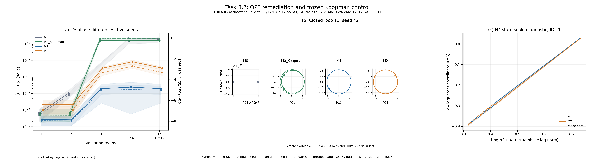

# Task 3.2: OPF remediation and scientific controls

Execution status: **completed**. Completed training records: **15/15**. Scientific criteria: **17/18 passed, 1 failed, 0 pending**.

Execution completion and scientific acceptance are separate outcomes. A completed run can fail a prespecified hypothesis; numerical results are retained without tuning them to pass.



## Protocol and numerical settings

```json
{
  "smoke_test": false,
  "seeds": [
    42,
    43,
    44,
    45,
    46
  ],
  "training": {
    "steps": 2000,
    "batch_size": 256,
    "context_length": 16,
    "delta": 4,
    "horizon": 64,
    "ar_steps": 16,
    "device": "cuda",
    "learning_rate": 0.001,
    "minimum_learning_rate": 1e-05,
    "weight_decay": 0.0001,
    "gradient_clip": 1.0,
    "ema_start": 0.99,
    "ema_end": 0.999,
    "velocity_weight": 1.0,
    "variance_weight": 0.1,
    "state_std_floor": 0.5,
    "velocity_std_floor": 0.05,
    "variance_epsilon": 1e-06,
    "orthogonality_weight": 0.2,
    "sparsity_weight": 0.0,
    "sigreg_weight": 1.0,
    "log_every": 20,
    "checkpoint_every": 100,
    "smoke_test": false,
    "protocol": "task3_2",
    "temporal_lag": 16,
    "temporal_displacement_fraction": 0.8,
    "temporal_scale_weight": 0.2,
    "temporal_weight": 1.0,
    "relative_denominator_epsilon": 0.0001,
    "log_scale_epsilon": 1e-06,
    "log_scale_weight": 0.5,
    "factor_scale_weight": 0.25,
    "coherence_weight": 0.1
  },
  "arch_type": "mlp",
  "mlp_variant": "odd_residual",
  "models": [
    "M0",
    "M0_Koopman",
    "M1",
    "M2",
    "M3"
  ],
  "splits": [
    "test_id_sub",
    "test_ood",
    "test_ood_inner",
    "test_ood_outer"
  ],
  "d": 64,
  "C": 4,
  "raw_test_samples": 2100,
  "primary_method": "S3b_diff",
  "frequency_methods": [
    "S2",
    "S3a_diff",
    "S3b_diff",
    "S3b_std"
  ],
  "spectral_input": "primary full d=64 latent, per-orbit unwhitened centered PCA",
  "factor_evaluation": "M2 per-orbit max temporal variance; additional diagnostic, never substitutes primary",
  "predictor": "M1/M2/M3 action-angle Koopman; Q=exp(S-S.T), M2 Q four16Dblocks, learned softplus rate_net",
  "M0_predictor": "frozen random unstructured MLP, H_max=512; no Kepler metadata",
  "training_dtype": "float32",
  "evaluation_dtype": "float64",
  "evaluation_precision": "promote learned float32 parameters after checkpoint; no further training or float64 initialization",
  "M3_normalization": "encoder/target pointwise feature-centered sphere radius sqrt(d); generated Koopman states retain norm without re-centering",
  "M3_objective": "relative direct+legacy AR+beta*SIGReg, beta=1; no M1/M2 temporal barrier",
  "M1_M2_objective": "relative direct+relative AR state/increment+log temporal1.0+coherence.1; M2 scale-invariant mean OPF.2+factor log-scale.25",
  "OPF": "per-state RMS sqrt(mean(z²)+1e-6); population batch standardization; mean of 3072 ordered off-block correlation squares",
  "frequency_coherence": "population variance of log(omega+1e-8) across all32 planes; weight0.1; M1/M2 only",
  "M0_Koopman": "frozen encoder/predictor identically initialized to M1 at same seed; no optimizer",
  "oos_probes": "fit all200 train circular orbits separately for T1/T3, freeze coefficients and constant-column selection; score all test orbits without refit",
  "acceptance_accounting": "16 inherited criteria plus2 M0_Koopman controls; formal section3 failure threshold .3/R2 .8, not narrative >1.0",
  "phase_norm_probe": "response log latent RMS vs feature 0.5*log(a^2+1/a); constant response zero-score convention disclosed",
  "sparsity_weight": 0.0,
  "regimes": {
    "N_eval": 512,
    "L": 16,
    "delta": 4,
    "H_train": 64,
    "dt": 0.01,
    "macro_dt": 0.04,
    "origin_window_start_index": 0,
    "excludes_z0": true,
    "window_start_indices": {
      "T1": [
        4,
        8,
        12,
        16,
        20,
        24,
        28,
        32,
        36,
        40,
        44,
        48,
        52,
        56,
        60,
        64,
        68,
        72,
        76,
        80,
        84,
        88,
        92,
        96,
        100,
        104,
        108,
        112,
        116,
        120,
        124,
        128,
        132,
        136,
        140,
        144,
        148,
        152,
        156,
        160,
        164,
        168,
        172,
        176,
        180,
        184,
        188,
        192,
        196,
        200,
        204,
        208,
        212,
        216,
        220,
        224,
        228,
        232,
        236,
        240,
        244,
        248,
        252,
        256,
        260,
        264,
        268,
        272,
        276,
        280,
        284,
        288,
        292,
        296,
        300,
        304,
        308,
        312,
        316,
        320,
        324,
        328,
        332,
        336,
        340,
        344,
        348,
        352,
        356,
        360,
        364,
        368,
        372,
        376,
        380,
        384,
        388,
        392,
        396,
        400,
        404,
        408,
        412,
        416,
        420,
        424,
        428,
        432,
        436,
        440,
        444,
        448,
        452,
        456,
        460,
        464,
        468,
        472,
        476,
        480,
        484,
        488,
        492,
        496,
        500,
        504,
        508,
        512,
        516,
        520,
        524,
        528,
        532,
        536,
        540,
        544,
        548,
        552,
        556,
        560,
        564,
        568,
        572,
        576,
        580,
        584,
        588,
        592,
        596,
        600,
        604,
        608,
        612,
        616,
        620,
        624,
        628,
        632,
        636,
        640,
        644,
        648,
        652,
        656,
        660,
        664,
        668,
        672,
        676,
        680,
        684,
        688,
        692,
        696,
        700,
        704,
        708,
        712,
        716,
        720,
        724,
        728,
        732,
        736,
        740,
        744,
        748,
        752,
        756,
        760,
        764,
        768,
        772,
        776,
        780,
        784,
        788,
        792,
        796,
        800,
        804,
        808,
        812,
        816,
        820,
        824,
        828,
        832,
        836,
        840,
        844,
        848,
        852,
        856,
        860,
        864,
        868,
        872,
        876,
        880,
        884,
        888,
        892,
        896,
        900,
        904,
        908,
        912,
        916,
        920,
        924,
        928,
        932,
        936,
        940,
        944,
        948,
        952,
        956,
        960,
        964,
        968,
        972,
        976,
        980,
        984,
        988,
        992,
        996,
        1000,
        1004,
        1008,
        1012,
        1016,
        1020,
        1024,
        1028,
        1032,
        1036,
        1040,
        1044,
        1048,
        1052,
        1056,
        1060,
        1064,
        1068,
        1072,
        1076,
        1080,
        1084,
        1088,
        1092,
        1096,
        1100,
        1104,
        1108,
        1112,
        1116,
        1120,
        1124,
        1128,
        1132,
        1136,
        1140,
        1144,
        1148,
        1152,
        1156,
        1160,
        1164,
        1168,
        1172,
        1176,
        1180,
        1184,
        1188,
        1192,
        1196,
        1200,
        1204,
        1208,
        1212,
        1216,
        1220,
        1224,
        1228,
        1232,
        1236,
        1240,
        1244,
        1248,
        1252,
        1256,
        1260,
        1264,
        1268,
        1272,
        1276,
        1280,
        1284,
        1288,
        1292,
        1296,
        1300,
        1304,
        1308,
        1312,
        1316,
        1320,
        1324,
        1328,
        1332,
        1336,
        1340,
        1344,
        1348,
        1352,
        1356,
        1360,
        1364,
        1368,
        1372,
        1376,
        1380,
        1384,
        1388,
        1392,
        1396,
        1400,
        1404,
        1408,
        1412,
        1416,
        1420,
        1424,
        1428,
        1432,
        1436,
        1440,
        1444,
        1448,
        1452,
        1456,
        1460,
        1464,
        1468,
        1472,
        1476,
        1480,
        1484,
        1488,
        1492,
        1496,
        1500,
        1504,
        1508,
        1512,
        1516,
        1520,
        1524,
        1528,
        1532,
        1536,
        1540,
        1544,
        1548,
        1552,
        1556,
        1560,
        1564,
        1568,
        1572,
        1576,
        1580,
        1584,
        1588,
        1592,
        1596,
        1600,
        1604,
        1608,
        1612,
        1616,
        1620,
        1624,
        1628,
        1632,
        1636,
        1640,
        1644,
        1648,
        1652,
        1656,
        1660,
        1664,
        1668,
        1672,
        1676,
        1680,
        1684,
        1688,
        1692,
        1696,
        1700,
        1704,
        1708,
        1712,
        1716,
        1720,
        1724,
        1728,
        1732,
        1736,
        1740,
        1744,
        1748,
        1752,
        1756,
        1760,
        1764,
        1768,
        1772,
        1776,
        1780,
        1784,
        1788,
        1792,
        1796,
        1800,
        1804,
        1808,
        1812,
        1816,
        1820,
        1824,
        1828,
        1832,
        1836,
        1840,
        1844,
        1848,
        1852,
        1856,
        1860,
        1864,
        1868,
        1872,
        1876,
        1880,
        1884,
        1888,
        1892,
        1896,
        1900,
        1904,
        1908,
        1912,
        1916,
        1920,
        1924,
        1928,
        1932,
        1936,
        1940,
        1944,
        1948,
        1952,
        1956,
        1960,
        1964,
        1968,
        1972,
        1976,
        1980,
        1984,
        1988,
        1992,
        1996,
        2000,
        2004,
        2008,
        2012,
        2016,
        2020,
        2024,
        2028,
        2032,
        2036,
        2040,
        2044,
        2048
      ],
      "T2": [
        4,
        8,
        12,
        16,
        20,
        24,
        28,
        32,
        36,
        40,
        44,
        48,
        52,
        56,
        60,
        64,
        68,
        72,
        76,
        80,
        84,
        88,
        92,
        96,
        100,
        104,
        108,
        112,
        116,
        120,
        124,
        128,
        132,
        136,
        140,
        144,
        148,
        152,
        156,
        160,
        164,
        168,
        172,
        176,
        180,
        184,
        188,
        192,
        196,
        200,
        204,
        208,
        212,
        216,
        220,
        224,
        228,
        232,
        236,
        240,
        244,
        248,
        252,
        256,
        260,
        264,
        268,
        272,
        276,
        280,
        284,
        288,
        292,
        296,
        300,
        304,
        308,
        312,
        316,
        320,
        324,
        328,
        332,
        336,
        340,
        344,
        348,
        352,
        356,
        360,
        364,
        368,
        372,
        376,
        380,
        384,
        388,
        392,
        396,
        400,
        404,
        408,
        412,
        416,
        420,
        424,
        428,
        432,
        436,
        440,
        444,
        448,
        452,
        456,
        460,
        464,
        468,
        472,
        476,
        480,
        484,
        488,
        492,
        496,
        500,
        504,
        508,
        512,
        516,
        520,
        524,
        528,
        532,
        536,
        540,
        544,
        548,
        552,
        556,
        560,
        564,
        568,
        572,
        576,
        580,
        584,
        588,
        592,
        596,
        600,
        604,
        608,
        612,
        616,
        620,
        624,
        628,
        632,
        636,
        640,
        644,
        648,
        652,
        656,
        660,
        664,
        668,
        672,
        676,
        680,
        684,
        688,
        692,
        696,
        700,
        704,
        708,
        712,
        716,
        720,
        724,
        728,
        732,
        736,
        740,
        744,
        748,
        752,
        756,
        760,
        764,
        768,
        772,
        776,
        780,
        784,
        788,
        792,
        796,
        800,
        804,
        808,
        812,
        816,
        820,
        824,
        828,
        832,
        836,
        840,
        844,
        848,
        852,
        856,
        860,
        864,
        868,
        872,
        876,
        880,
        884,
        888,
        892,
        896,
        900,
        904,
        908,
        912,
        916,
        920,
        924,
        928,
        932,
        936,
        940,
        944,
        948,
        952,
        956,
        960,
        964,
        968,
        972,
        976,
        980,
        984,
        988,
        992,
        996,
        1000,
        1004,
        1008,
        1012,
        1016,
        1020,
        1024,
        1028,
        1032,
        1036,
        1040,
        1044,
        1048,
        1052,
        1056,
        1060,
        1064,
        1068,
        1072,
        1076,
        1080,
        1084,
        1088,
        1092,
        1096,
        1100,
        1104,
        1108,
        1112,
        1116,
        1120,
        1124,
        1128,
        1132,
        1136,
        1140,
        1144,
        1148,
        1152,
        1156,
        1160,
        1164,
        1168,
        1172,
        1176,
        1180,
        1184,
        1188,
        1192,
        1196,
        1200,
        1204,
        1208,
        1212,
        1216,
        1220,
        1224,
        1228,
        1232,
        1236,
        1240,
        1244,
        1248,
        1252,
        1256,
        1260,
        1264,
        1268,
        1272,
        1276,
        1280,
        1284,
        1288,
        1292,
        1296,
        1300,
        1304,
        1308,
        1312,
        1316,
        1320,
        1324,
        1328,
        1332,
        1336,
        1340,
        1344,
        1348,
        1352,
        1356,
        1360,
        1364,
        1368,
        1372,
        1376,
        1380,
        1384,
        1388,
        1392,
        1396,
        1400,
        1404,
        1408,
        1412,
        1416,
        1420,
        1424,
        1428,
        1432,
        1436,
        1440,
        1444,
        1448,
        1452,
        1456,
        1460,
        1464,
        1468,
        1472,
        1476,
        1480,
        1484,
        1488,
        1492,
        1496,
        1500,
        1504,
        1508,
        1512,
        1516,
        1520,
        1524,
        1528,
        1532,
        1536,
        1540,
        1544,
        1548,
        1552,
        1556,
        1560,
        1564,
        1568,
        1572,
        1576,
        1580,
        1584,
        1588,
        1592,
        1596,
        1600,
        1604,
        1608,
        1612,
        1616,
        1620,
        1624,
        1628,
        1632,
        1636,
        1640,
        1644,
        1648,
        1652,
        1656,
        1660,
        1664,
        1668,
        1672,
        1676,
        1680,
        1684,
        1688,
        1692,
        1696,
        1700,
        1704,
        1708,
        1712,
        1716,
        1720,
        1724,
        1728,
        1732,
        1736,
        1740,
        1744,
        1748,
        1752,
        1756,
        1760,
        1764,
        1768,
        1772,
        1776,
        1780,
        1784,
        1788,
        1792,
        1796,
        1800,
        1804,
        1808,
        1812,
        1816,
        1820,
        1824,
        1828,
        1832,
        1836,
        1840,
        1844,
        1848,
        1852,
        1856,
        1860,
        1864,
        1868,
        1872,
        1876,
        1880,
        1884,
        1888,
        1892,
        1896,
        1900,
        1904,
        1908,
        1912,
        1916,
        1920,
        1924,
        1928,
        1932,
        1936,
        1940,
        1944,
        1948,
        1952,
        1956,
        1960,
        1964,
        1968,
        1972,
        1976,
        1980,
        1984,
        1988,
        1992,
        1996,
        2000,
        2004,
        2008,
        2012,
        2016,
        2020,
        2024,
        2028,
        2032,
        2036,
        2040,
        2044,
        2048
      ],
      "T3": [
        4,
        8,
        12,
        16,
        20,
        24,
        28,
        32,
        36,
        40,
        44,
        48,
        52,
        56,
        60,
        64,
        68,
        72,
        76,
        80,
        84,
        88,
        92,
        96,
        100,
        104,
        108,
        112,
        116,
        120,
        124,
        128,
        132,
        136,
        140,
        144,
        148,
        152,
        156,
        160,
        164,
        168,
        172,
        176,
        180,
        184,
        188,
        192,
        196,
        200,
        204,
        208,
        212,
        216,
        220,
        224,
        228,
        232,
        236,
        240,
        244,
        248,
        252,
        256,
        260,
        264,
        268,
        272,
        276,
        280,
        284,
        288,
        292,
        296,
        300,
        304,
        308,
        312,
        316,
        320,
        324,
        328,
        332,
        336,
        340,
        344,
        348,
        352,
        356,
        360,
        364,
        368,
        372,
        376,
        380,
        384,
        388,
        392,
        396,
        400,
        404,
        408,
        412,
        416,
        420,
        424,
        428,
        432,
        436,
        440,
        444,
        448,
        452,
        456,
        460,
        464,
        468,
        472,
        476,
        480,
        484,
        488,
        492,
        496,
        500,
        504,
        508,
        512,
        516,
        520,
        524,
        528,
        532,
        536,
        540,
        544,
        548,
        552,
        556,
        560,
        564,
        568,
        572,
        576,
        580,
        584,
        588,
        592,
        596,
        600,
        604,
        608,
        612,
        616,
        620,
        624,
        628,
        632,
        636,
        640,
        644,
        648,
        652,
        656,
        660,
        664,
        668,
        672,
        676,
        680,
        684,
        688,
        692,
        696,
        700,
        704,
        708,
        712,
        716,
        720,
        724,
        728,
        732,
        736,
        740,
        744,
        748,
        752,
        756,
        760,
        764,
        768,
        772,
        776,
        780,
        784,
        788,
        792,
        796,
        800,
        804,
        808,
        812,
        816,
        820,
        824,
        828,
        832,
        836,
        840,
        844,
        848,
        852,
        856,
        860,
        864,
        868,
        872,
        876,
        880,
        884,
        888,
        892,
        896,
        900,
        904,
        908,
        912,
        916,
        920,
        924,
        928,
        932,
        936,
        940,
        944,
        948,
        952,
        956,
        960,
        964,
        968,
        972,
        976,
        980,
        984,
        988,
        992,
        996,
        1000,
        1004,
        1008,
        1012,
        1016,
        1020,
        1024,
        1028,
        1032,
        1036,
        1040,
        1044,
        1048,
        1052,
        1056,
        1060,
        1064,
        1068,
        1072,
        1076,
        1080,
        1084,
        1088,
        1092,
        1096,
        1100,
        1104,
        1108,
        1112,
        1116,
        1120,
        1124,
        1128,
        1132,
        1136,
        1140,
        1144,
        1148,
        1152,
        1156,
        1160,
        1164,
        1168,
        1172,
        1176,
        1180,
        1184,
        1188,
        1192,
        1196,
        1200,
        1204,
        1208,
        1212,
        1216,
        1220,
        1224,
        1228,
        1232,
        1236,
        1240,
        1244,
        1248,
        1252,
        1256,
        1260,
        1264,
        1268,
        1272,
        1276,
        1280,
        1284,
        1288,
        1292,
        1296,
        1300,
        1304,
        1308,
        1312,
        1316,
        1320,
        1324,
        1328,
        1332,
        1336,
        1340,
        1344,
        1348,
        1352,
        1356,
        1360,
        1364,
        1368,
        1372,
        1376,
        1380,
        1384,
        1388,
        1392,
        1396,
        1400,
        1404,
        1408,
        1412,
        1416,
        1420,
        1424,
        1428,
        1432,
        1436,
        1440,
        1444,
        1448,
        1452,
        1456,
        1460,
        1464,
        1468,
        1472,
        1476,
        1480,
        1484,
        1488,
        1492,
        1496,
        1500,
        1504,
        1508,
        1512,
        1516,
        1520,
        1524,
        1528,
        1532,
        1536,
        1540,
        1544,
        1548,
        1552,
        1556,
        1560,
        1564,
        1568,
        1572,
        1576,
        1580,
        1584,
        1588,
        1592,
        1596,
        1600,
        1604,
        1608,
        1612,
        1616,
        1620,
        1624,
        1628,
        1632,
        1636,
        1640,
        1644,
        1648,
        1652,
        1656,
        1660,
        1664,
        1668,
        1672,
        1676,
        1680,
        1684,
        1688,
        1692,
        1696,
        1700,
        1704,
        1708,
        1712,
        1716,
        1720,
        1724,
        1728,
        1732,
        1736,
        1740,
        1744,
        1748,
        1752,
        1756,
        1760,
        1764,
        1768,
        1772,
        1776,
        1780,
        1784,
        1788,
        1792,
        1796,
        1800,
        1804,
        1808,
        1812,
        1816,
        1820,
        1824,
        1828,
        1832,
        1836,
        1840,
        1844,
        1848,
        1852,
        1856,
        1860,
        1864,
        1868,
        1872,
        1876,
        1880,
        1884,
        1888,
        1892,
        1896,
        1900,
        1904,
        1908,
        1912,
        1916,
        1920,
        1924,
        1928,
        1932,
        1936,
        1940,
        1944,
        1948,
        1952,
        1956,
        1960,
        1964,
        1968,
        1972,
        1976,
        1980,
        1984,
        1988,
        1992,
        1996,
        2000,
        2004,
        2008,
        2012,
        2016,
        2020,
        2024,
        2028,
        2032,
        2036,
        2040,
        2044,
        2048
      ],
      "T4": [
        4,
        8,
        12,
        16,
        20,
        24,
        28,
        32,
        36,
        40,
        44,
        48,
        52,
        56,
        60,
        64,
        68,
        72,
        76,
        80,
        84,
        88,
        92,
        96,
        100,
        104,
        108,
        112,
        116,
        120,
        124,
        128,
        132,
        136,
        140,
        144,
        148,
        152,
        156,
        160,
        164,
        168,
        172,
        176,
        180,
        184,
        188,
        192,
        196,
        200,
        204,
        208,
        212,
        216,
        220,
        224,
        228,
        232,
        236,
        240,
        244,
        248,
        252,
        256
      ],
      "T4_512": [
        4,
        8,
        12,
        16,
        20,
        24,
        28,
        32,
        36,
        40,
        44,
        48,
        52,
        56,
        60,
        64,
        68,
        72,
        76,
        80,
        84,
        88,
        92,
        96,
        100,
        104,
        108,
        112,
        116,
        120,
        124,
        128,
        132,
        136,
        140,
        144,
        148,
        152,
        156,
        160,
        164,
        168,
        172,
        176,
        180,
        184,
        188,
        192,
        196,
        200,
        204,
        208,
        212,
        216,
        220,
        224,
        228,
        232,
        236,
        240,
        244,
        248,
        252,
        256,
        260,
        264,
        268,
        272,
        276,
        280,
        284,
        288,
        292,
        296,
        300,
        304,
        308,
        312,
        316,
        320,
        324,
        328,
        332,
        336,
        340,
        344,
        348,
        352,
        356,
        360,
        364,
        368,
        372,
        376,
        380,
        384,
        388,
        392,
        396,
        400,
        404,
        408,
        412,
        416,
        420,
        424,
        428,
        432,
        436,
        440,
        444,
        448,
        452,
        456,
        460,
        464,
        468,
        472,
        476,
        480,
        484,
        488,
        492,
        496,
        500,
        504,
        508,
        512,
        516,
        520,
        524,
        528,
        532,
        536,
        540,
        544,
        548,
        552,
        556,
        560,
        564,
        568,
        572,
        576,
        580,
        584,
        588,
        592,
        596,
        600,
        604,
        608,
        612,
        616,
        620,
        624,
        628,
        632,
        636,
        640,
        644,
        648,
        652,
        656,
        660,
        664,
        668,
        672,
        676,
        680,
        684,
        688,
        692,
        696,
        700,
        704,
        708,
        712,
        716,
        720,
        724,
        728,
        732,
        736,
        740,
        744,
        748,
        752,
        756,
        760,
        764,
        768,
        772,
        776,
        780,
        784,
        788,
        792,
        796,
        800,
        804,
        808,
        812,
        816,
        820,
        824,
        828,
        832,
        836,
        840,
        844,
        848,
        852,
        856,
        860,
        864,
        868,
        872,
        876,
        880,
        884,
        888,
        892,
        896,
        900,
        904,
        908,
        912,
        916,
        920,
        924,
        928,
        932,
        936,
        940,
        944,
        948,
        952,
        956,
        960,
        964,
        968,
        972,
        976,
        980,
        984,
        988,
        992,
        996,
        1000,
        1004,
        1008,
        1012,
        1016,
        1020,
        1024,
        1028,
        1032,
        1036,
        1040,
        1044,
        1048,
        1052,
        1056,
        1060,
        1064,
        1068,
        1072,
        1076,
        1080,
        1084,
        1088,
        1092,
        1096,
        1100,
        1104,
        1108,
        1112,
        1116,
        1120,
        1124,
        1128,
        1132,
        1136,
        1140,
        1144,
        1148,
        1152,
        1156,
        1160,
        1164,
        1168,
        1172,
        1176,
        1180,
        1184,
        1188,
        1192,
        1196,
        1200,
        1204,
        1208,
        1212,
        1216,
        1220,
        1224,
        1228,
        1232,
        1236,
        1240,
        1244,
        1248,
        1252,
        1256,
        1260,
        1264,
        1268,
        1272,
        1276,
        1280,
        1284,
        1288,
        1292,
        1296,
        1300,
        1304,
        1308,
        1312,
        1316,
        1320,
        1324,
        1328,
        1332,
        1336,
        1340,
        1344,
        1348,
        1352,
        1356,
        1360,
        1364,
        1368,
        1372,
        1376,
        1380,
        1384,
        1388,
        1392,
        1396,
        1400,
        1404,
        1408,
        1412,
        1416,
        1420,
        1424,
        1428,
        1432,
        1436,
        1440,
        1444,
        1448,
        1452,
        1456,
        1460,
        1464,
        1468,
        1472,
        1476,
        1480,
        1484,
        1488,
        1492,
        1496,
        1500,
        1504,
        1508,
        1512,
        1516,
        1520,
        1524,
        1528,
        1532,
        1536,
        1540,
        1544,
        1548,
        1552,
        1556,
        1560,
        1564,
        1568,
        1572,
        1576,
        1580,
        1584,
        1588,
        1592,
        1596,
        1600,
        1604,
        1608,
        1612,
        1616,
        1620,
        1624,
        1628,
        1632,
        1636,
        1640,
        1644,
        1648,
        1652,
        1656,
        1660,
        1664,
        1668,
        1672,
        1676,
        1680,
        1684,
        1688,
        1692,
        1696,
        1700,
        1704,
        1708,
        1712,
        1716,
        1720,
        1724,
        1728,
        1732,
        1736,
        1740,
        1744,
        1748,
        1752,
        1756,
        1760,
        1764,
        1768,
        1772,
        1776,
        1780,
        1784,
        1788,
        1792,
        1796,
        1800,
        1804,
        1808,
        1812,
        1816,
        1820,
        1824,
        1828,
        1832,
        1836,
        1840,
        1844,
        1848,
        1852,
        1856,
        1860,
        1864,
        1868,
        1872,
        1876,
        1880,
        1884,
        1888,
        1892,
        1896,
        1900,
        1904,
        1908,
        1912,
        1916,
        1920,
        1924,
        1928,
        1932,
        1936,
        1940,
        1944,
        1948,
        1952,
        1956,
        1960,
        1964,
        1968,
        1972,
        1976,
        1980,
        1984,
        1988,
        1992,
        1996,
        2000,
        2004,
        2008,
        2012,
        2016,
        2020,
        2024,
        2028,
        2032,
        2036,
        2040,
        2044,
        2048
      ]
    },
    "H_extended": 512,
    "extended_direct_regime": "T4_512",
    "sample_times": {
      "T1": [
        0.04,
        0.08,
        0.12,
        0.16,
        0.2,
        0.24,
        0.28,
        0.32,
        0.36,
        0.4,
        0.44,
        0.48,
        0.52,
        0.56,
        0.6,
        0.64,
        0.68,
        0.72,
        0.76,
        0.8,
        0.84,
        0.88,
        0.92,
        0.96,
        1.0,
        1.04,
        1.08,
        1.12,
        1.16,
        1.2,
        1.24,
        1.28,
        1.32,
        1.36,
        1.4000000000000001,
        1.44,
        1.48,
        1.52,
        1.56,
        1.6,
        1.6400000000000001,
        1.68,
        1.72,
        1.76,
        1.8,
        1.84,
        1.8800000000000001,
        1.92,
        1.96,
        2.0,
        2.04,
        2.08,
        2.12,
        2.16,
        2.2,
        2.24,
        2.2800000000000002,
        2.32,
        2.36,
        2.4,
        2.44,
        2.48,
        2.52,
        2.56,
        2.6,
        2.64,
        2.68,
        2.72,
        2.7600000000000002,
        2.8000000000000003,
        2.84,
        2.88,
        2.92,
        2.96,
        3.0,
        3.04,
        3.08,
        3.12,
        3.16,
        3.2,
        3.24,
        3.2800000000000002,
        3.3200000000000003,
        3.36,
        3.4,
        3.44,
        3.48,
        3.52,
        3.56,
        3.6,
        3.64,
        3.68,
        3.72,
        3.7600000000000002,
        3.8000000000000003,
        3.84,
        3.88,
        3.92,
        3.96,
        4.0,
        4.04,
        4.08,
        4.12,
        4.16,
        4.2,
        4.24,
        4.28,
        4.32,
        4.36,
        4.4,
        4.44,
        4.48,
        4.5200000000000005,
        4.5600000000000005,
        4.6000000000000005,
        4.64,
        4.68,
        4.72,
        4.76,
        4.8,
        4.84,
        4.88,
        4.92,
        4.96,
        5.0,
        5.04,
        5.08,
        5.12,
        5.16,
        5.2,
        5.24,
        5.28,
        5.32,
        5.36,
        5.4,
        5.44,
        5.48,
        5.5200000000000005,
        5.5600000000000005,
        5.6000000000000005,
        5.64,
        5.68,
        5.72,
        5.76,
        5.8,
        5.84,
        5.88,
        5.92,
        5.96,
        6.0,
        6.04,
        6.08,
        6.12,
        6.16,
        6.2,
        6.24,
        6.28,
        6.32,
        6.36,
        6.4,
        6.44,
        6.48,
        6.5200000000000005,
        6.5600000000000005,
        6.6000000000000005,
        6.640000000000001,
        6.68,
        6.72,
        6.76,
        6.8,
        6.84,
        6.88,
        6.92,
        6.96,
        7.0,
        7.04,
        7.08,
        7.12,
        7.16,
        7.2,
        7.24,
        7.28,
        7.32,
        7.36,
        7.4,
        7.44,
        7.48,
        7.5200000000000005,
        7.5600000000000005,
        7.6000000000000005,
        7.640000000000001,
        7.68,
        7.72,
        7.76,
        7.8,
        7.84,
        7.88,
        7.92,
        7.96,
        8.0,
        8.040000000000001,
        8.08,
        8.120000000000001,
        8.16,
        8.2,
        8.24,
        8.28,
        8.32,
        8.36,
        8.4,
        8.44,
        8.48,
        8.52,
        8.56,
        8.6,
        8.64,
        8.68,
        8.72,
        8.76,
        8.8,
        8.84,
        8.88,
        8.92,
        8.96,
        9.0,
        9.040000000000001,
        9.08,
        9.120000000000001,
        9.16,
        9.200000000000001,
        9.24,
        9.28,
        9.32,
        9.36,
        9.4,
        9.44,
        9.48,
        9.52,
        9.56,
        9.6,
        9.64,
        9.68,
        9.72,
        9.76,
        9.8,
        9.84,
        9.88,
        9.92,
        9.96,
        10.0,
        10.040000000000001,
        10.08,
        10.120000000000001,
        10.16,
        10.200000000000001,
        10.24,
        10.28,
        10.32,
        10.36,
        10.4,
        10.44,
        10.48,
        10.52,
        10.56,
        10.6,
        10.64,
        10.68,
        10.72,
        10.76,
        10.8,
        10.84,
        10.88,
        10.92,
        10.96,
        11.0,
        11.040000000000001,
        11.08,
        11.120000000000001,
        11.16,
        11.200000000000001,
        11.24,
        11.28,
        11.32,
        11.36,
        11.4,
        11.44,
        11.48,
        11.52,
        11.56,
        11.6,
        11.64,
        11.68,
        11.72,
        11.76,
        11.8,
        11.84,
        11.88,
        11.92,
        11.96,
        12.0,
        12.040000000000001,
        12.08,
        12.120000000000001,
        12.16,
        12.200000000000001,
        12.24,
        12.280000000000001,
        12.32,
        12.36,
        12.4,
        12.44,
        12.48,
        12.52,
        12.56,
        12.6,
        12.64,
        12.68,
        12.72,
        12.76,
        12.8,
        12.84,
        12.88,
        12.92,
        12.96,
        13.0,
        13.040000000000001,
        13.08,
        13.120000000000001,
        13.16,
        13.200000000000001,
        13.24,
        13.280000000000001,
        13.32,
        13.36,
        13.4,
        13.44,
        13.48,
        13.52,
        13.56,
        13.6,
        13.64,
        13.68,
        13.72,
        13.76,
        13.8,
        13.84,
        13.88,
        13.92,
        13.96,
        14.0,
        14.040000000000001,
        14.08,
        14.120000000000001,
        14.16,
        14.200000000000001,
        14.24,
        14.280000000000001,
        14.32,
        14.36,
        14.4,
        14.44,
        14.48,
        14.52,
        14.56,
        14.6,
        14.64,
        14.68,
        14.72,
        14.76,
        14.8,
        14.84,
        14.88,
        14.92,
        14.96,
        15.0,
        15.040000000000001,
        15.08,
        15.120000000000001,
        15.16,
        15.200000000000001,
        15.24,
        15.280000000000001,
        15.32,
        15.36,
        15.4,
        15.44,
        15.48,
        15.52,
        15.56,
        15.6,
        15.64,
        15.68,
        15.72,
        15.76,
        15.8,
        15.84,
        15.88,
        15.92,
        15.96,
        16.0,
        16.04,
        16.080000000000002,
        16.12,
        16.16,
        16.2,
        16.240000000000002,
        16.28,
        16.32,
        16.36,
        16.4,
        16.44,
        16.48,
        16.52,
        16.56,
        16.6,
        16.64,
        16.68,
        16.72,
        16.76,
        16.8,
        16.84,
        16.88,
        16.92,
        16.96,
        17.0,
        17.04,
        17.080000000000002,
        17.12,
        17.16,
        17.2,
        17.240000000000002,
        17.28,
        17.32,
        17.36,
        17.400000000000002,
        17.44,
        17.48,
        17.52,
        17.56,
        17.6,
        17.64,
        17.68,
        17.72,
        17.76,
        17.8,
        17.84,
        17.88,
        17.92,
        17.96,
        18.0,
        18.04,
        18.080000000000002,
        18.12,
        18.16,
        18.2,
        18.240000000000002,
        18.28,
        18.32,
        18.36,
        18.400000000000002,
        18.44,
        18.48,
        18.52,
        18.56,
        18.6,
        18.64,
        18.68,
        18.72,
        18.76,
        18.8,
        18.84,
        18.88,
        18.92,
        18.96,
        19.0,
        19.04,
        19.080000000000002,
        19.12,
        19.16,
        19.2,
        19.240000000000002,
        19.28,
        19.32,
        19.36,
        19.400000000000002,
        19.44,
        19.48,
        19.52,
        19.56,
        19.6,
        19.64,
        19.68,
        19.72,
        19.76,
        19.8,
        19.84,
        19.88,
        19.92,
        19.96,
        20.0,
        20.04,
        20.080000000000002,
        20.12,
        20.16,
        20.2,
        20.240000000000002,
        20.28,
        20.32,
        20.36,
        20.400000000000002,
        20.44,
        20.48
      ],
      "T2": [
        0.04,
        0.08,
        0.12,
        0.16,
        0.2,
        0.24,
        0.28,
        0.32,
        0.36,
        0.4,
        0.44,
        0.48,
        0.52,
        0.56,
        0.6,
        0.64,
        0.68,
        0.72,
        0.76,
        0.8,
        0.84,
        0.88,
        0.92,
        0.96,
        1.0,
        1.04,
        1.08,
        1.12,
        1.16,
        1.2,
        1.24,
        1.28,
        1.32,
        1.36,
        1.4000000000000001,
        1.44,
        1.48,
        1.52,
        1.56,
        1.6,
        1.6400000000000001,
        1.68,
        1.72,
        1.76,
        1.8,
        1.84,
        1.8800000000000001,
        1.92,
        1.96,
        2.0,
        2.04,
        2.08,
        2.12,
        2.16,
        2.2,
        2.24,
        2.2800000000000002,
        2.32,
        2.36,
        2.4,
        2.44,
        2.48,
        2.52,
        2.56,
        2.6,
        2.64,
        2.68,
        2.72,
        2.7600000000000002,
        2.8000000000000003,
        2.84,
        2.88,
        2.92,
        2.96,
        3.0,
        3.04,
        3.08,
        3.12,
        3.16,
        3.2,
        3.24,
        3.2800000000000002,
        3.3200000000000003,
        3.36,
        3.4,
        3.44,
        3.48,
        3.52,
        3.56,
        3.6,
        3.64,
        3.68,
        3.72,
        3.7600000000000002,
        3.8000000000000003,
        3.84,
        3.88,
        3.92,
        3.96,
        4.0,
        4.04,
        4.08,
        4.12,
        4.16,
        4.2,
        4.24,
        4.28,
        4.32,
        4.36,
        4.4,
        4.44,
        4.48,
        4.5200000000000005,
        4.5600000000000005,
        4.6000000000000005,
        4.64,
        4.68,
        4.72,
        4.76,
        4.8,
        4.84,
        4.88,
        4.92,
        4.96,
        5.0,
        5.04,
        5.08,
        5.12,
        5.16,
        5.2,
        5.24,
        5.28,
        5.32,
        5.36,
        5.4,
        5.44,
        5.48,
        5.5200000000000005,
        5.5600000000000005,
        5.6000000000000005,
        5.64,
        5.68,
        5.72,
        5.76,
        5.8,
        5.84,
        5.88,
        5.92,
        5.96,
        6.0,
        6.04,
        6.08,
        6.12,
        6.16,
        6.2,
        6.24,
        6.28,
        6.32,
        6.36,
        6.4,
        6.44,
        6.48,
        6.5200000000000005,
        6.5600000000000005,
        6.6000000000000005,
        6.640000000000001,
        6.68,
        6.72,
        6.76,
        6.8,
        6.84,
        6.88,
        6.92,
        6.96,
        7.0,
        7.04,
        7.08,
        7.12,
        7.16,
        7.2,
        7.24,
        7.28,
        7.32,
        7.36,
        7.4,
        7.44,
        7.48,
        7.5200000000000005,
        7.5600000000000005,
        7.6000000000000005,
        7.640000000000001,
        7.68,
        7.72,
        7.76,
        7.8,
        7.84,
        7.88,
        7.92,
        7.96,
        8.0,
        8.040000000000001,
        8.08,
        8.120000000000001,
        8.16,
        8.2,
        8.24,
        8.28,
        8.32,
        8.36,
        8.4,
        8.44,
        8.48,
        8.52,
        8.56,
        8.6,
        8.64,
        8.68,
        8.72,
        8.76,
        8.8,
        8.84,
        8.88,
        8.92,
        8.96,
        9.0,
        9.040000000000001,
        9.08,
        9.120000000000001,
        9.16,
        9.200000000000001,
        9.24,
        9.28,
        9.32,
        9.36,
        9.4,
        9.44,
        9.48,
        9.52,
        9.56,
        9.6,
        9.64,
        9.68,
        9.72,
        9.76,
        9.8,
        9.84,
        9.88,
        9.92,
        9.96,
        10.0,
        10.040000000000001,
        10.08,
        10.120000000000001,
        10.16,
        10.200000000000001,
        10.24,
        10.28,
        10.32,
        10.36,
        10.4,
        10.44,
        10.48,
        10.52,
        10.56,
        10.6,
        10.64,
        10.68,
        10.72,
        10.76,
        10.8,
        10.84,
        10.88,
        10.92,
        10.96,
        11.0,
        11.040000000000001,
        11.08,
        11.120000000000001,
        11.16,
        11.200000000000001,
        11.24,
        11.28,
        11.32,
        11.36,
        11.4,
        11.44,
        11.48,
        11.52,
        11.56,
        11.6,
        11.64,
        11.68,
        11.72,
        11.76,
        11.8,
        11.84,
        11.88,
        11.92,
        11.96,
        12.0,
        12.040000000000001,
        12.08,
        12.120000000000001,
        12.16,
        12.200000000000001,
        12.24,
        12.280000000000001,
        12.32,
        12.36,
        12.4,
        12.44,
        12.48,
        12.52,
        12.56,
        12.6,
        12.64,
        12.68,
        12.72,
        12.76,
        12.8,
        12.84,
        12.88,
        12.92,
        12.96,
        13.0,
        13.040000000000001,
        13.08,
        13.120000000000001,
        13.16,
        13.200000000000001,
        13.24,
        13.280000000000001,
        13.32,
        13.36,
        13.4,
        13.44,
        13.48,
        13.52,
        13.56,
        13.6,
        13.64,
        13.68,
        13.72,
        13.76,
        13.8,
        13.84,
        13.88,
        13.92,
        13.96,
        14.0,
        14.040000000000001,
        14.08,
        14.120000000000001,
        14.16,
        14.200000000000001,
        14.24,
        14.280000000000001,
        14.32,
        14.36,
        14.4,
        14.44,
        14.48,
        14.52,
        14.56,
        14.6,
        14.64,
        14.68,
        14.72,
        14.76,
        14.8,
        14.84,
        14.88,
        14.92,
        14.96,
        15.0,
        15.040000000000001,
        15.08,
        15.120000000000001,
        15.16,
        15.200000000000001,
        15.24,
        15.280000000000001,
        15.32,
        15.36,
        15.4,
        15.44,
        15.48,
        15.52,
        15.56,
        15.6,
        15.64,
        15.68,
        15.72,
        15.76,
        15.8,
        15.84,
        15.88,
        15.92,
        15.96,
        16.0,
        16.04,
        16.080000000000002,
        16.12,
        16.16,
        16.2,
        16.240000000000002,
        16.28,
        16.32,
        16.36,
        16.4,
        16.44,
        16.48,
        16.52,
        16.56,
        16.6,
        16.64,
        16.68,
        16.72,
        16.76,
        16.8,
        16.84,
        16.88,
        16.92,
        16.96,
        17.0,
        17.04,
        17.080000000000002,
        17.12,
        17.16,
        17.2,
        17.240000000000002,
        17.28,
        17.32,
        17.36,
        17.400000000000002,
        17.44,
        17.48,
        17.52,
        17.56,
        17.6,
        17.64,
        17.68,
        17.72,
        17.76,
        17.8,
        17.84,
        17.88,
        17.92,
        17.96,
        18.0,
        18.04,
        18.080000000000002,
        18.12,
        18.16,
        18.2,
        18.240000000000002,
        18.28,
        18.32,
        18.36,
        18.400000000000002,
        18.44,
        18.48,
        18.52,
        18.56,
        18.6,
        18.64,
        18.68,
        18.72,
        18.76,
        18.8,
        18.84,
        18.88,
        18.92,
        18.96,
        19.0,
        19.04,
        19.080000000000002,
        19.12,
        19.16,
        19.2,
        19.240000000000002,
        19.28,
        19.32,
        19.36,
        19.400000000000002,
        19.44,
        19.48,
        19.52,
        19.56,
        19.6,
        19.64,
        19.68,
        19.72,
        19.76,
        19.8,
        19.84,
        19.88,
        19.92,
        19.96,
        20.0,
        20.04,
        20.080000000000002,
        20.12,
        20.16,
        20.2,
        20.240000000000002,
        20.28,
        20.32,
        20.36,
        20.400000000000002,
        20.44,
        20.48
      ],
      "T3": [
        0.04,
        0.08,
        0.12,
        0.16,
        0.2,
        0.24,
        0.28,
        0.32,
        0.36,
        0.4,
        0.44,
        0.48,
        0.52,
        0.56,
        0.6,
        0.64,
        0.68,
        0.72,
        0.76,
        0.8,
        0.84,
        0.88,
        0.92,
        0.96,
        1.0,
        1.04,
        1.08,
        1.12,
        1.16,
        1.2,
        1.24,
        1.28,
        1.32,
        1.36,
        1.4000000000000001,
        1.44,
        1.48,
        1.52,
        1.56,
        1.6,
        1.6400000000000001,
        1.68,
        1.72,
        1.76,
        1.8,
        1.84,
        1.8800000000000001,
        1.92,
        1.96,
        2.0,
        2.04,
        2.08,
        2.12,
        2.16,
        2.2,
        2.24,
        2.2800000000000002,
        2.32,
        2.36,
        2.4,
        2.44,
        2.48,
        2.52,
        2.56,
        2.6,
        2.64,
        2.68,
        2.72,
        2.7600000000000002,
        2.8000000000000003,
        2.84,
        2.88,
        2.92,
        2.96,
        3.0,
        3.04,
        3.08,
        3.12,
        3.16,
        3.2,
        3.24,
        3.2800000000000002,
        3.3200000000000003,
        3.36,
        3.4,
        3.44,
        3.48,
        3.52,
        3.56,
        3.6,
        3.64,
        3.68,
        3.72,
        3.7600000000000002,
        3.8000000000000003,
        3.84,
        3.88,
        3.92,
        3.96,
        4.0,
        4.04,
        4.08,
        4.12,
        4.16,
        4.2,
        4.24,
        4.28,
        4.32,
        4.36,
        4.4,
        4.44,
        4.48,
        4.5200000000000005,
        4.5600000000000005,
        4.6000000000000005,
        4.64,
        4.68,
        4.72,
        4.76,
        4.8,
        4.84,
        4.88,
        4.92,
        4.96,
        5.0,
        5.04,
        5.08,
        5.12,
        5.16,
        5.2,
        5.24,
        5.28,
        5.32,
        5.36,
        5.4,
        5.44,
        5.48,
        5.5200000000000005,
        5.5600000000000005,
        5.6000000000000005,
        5.64,
        5.68,
        5.72,
        5.76,
        5.8,
        5.84,
        5.88,
        5.92,
        5.96,
        6.0,
        6.04,
        6.08,
        6.12,
        6.16,
        6.2,
        6.24,
        6.28,
        6.32,
        6.36,
        6.4,
        6.44,
        6.48,
        6.5200000000000005,
        6.5600000000000005,
        6.6000000000000005,
        6.640000000000001,
        6.68,
        6.72,
        6.76,
        6.8,
        6.84,
        6.88,
        6.92,
        6.96,
        7.0,
        7.04,
        7.08,
        7.12,
        7.16,
        7.2,
        7.24,
        7.28,
        7.32,
        7.36,
        7.4,
        7.44,
        7.48,
        7.5200000000000005,
        7.5600000000000005,
        7.6000000000000005,
        7.640000000000001,
        7.68,
        7.72,
        7.76,
        7.8,
        7.84,
        7.88,
        7.92,
        7.96,
        8.0,
        8.040000000000001,
        8.08,
        8.120000000000001,
        8.16,
        8.2,
        8.24,
        8.28,
        8.32,
        8.36,
        8.4,
        8.44,
        8.48,
        8.52,
        8.56,
        8.6,
        8.64,
        8.68,
        8.72,
        8.76,
        8.8,
        8.84,
        8.88,
        8.92,
        8.96,
        9.0,
        9.040000000000001,
        9.08,
        9.120000000000001,
        9.16,
        9.200000000000001,
        9.24,
        9.28,
        9.32,
        9.36,
        9.4,
        9.44,
        9.48,
        9.52,
        9.56,
        9.6,
        9.64,
        9.68,
        9.72,
        9.76,
        9.8,
        9.84,
        9.88,
        9.92,
        9.96,
        10.0,
        10.040000000000001,
        10.08,
        10.120000000000001,
        10.16,
        10.200000000000001,
        10.24,
        10.28,
        10.32,
        10.36,
        10.4,
        10.44,
        10.48,
        10.52,
        10.56,
        10.6,
        10.64,
        10.68,
        10.72,
        10.76,
        10.8,
        10.84,
        10.88,
        10.92,
        10.96,
        11.0,
        11.040000000000001,
        11.08,
        11.120000000000001,
        11.16,
        11.200000000000001,
        11.24,
        11.28,
        11.32,
        11.36,
        11.4,
        11.44,
        11.48,
        11.52,
        11.56,
        11.6,
        11.64,
        11.68,
        11.72,
        11.76,
        11.8,
        11.84,
        11.88,
        11.92,
        11.96,
        12.0,
        12.040000000000001,
        12.08,
        12.120000000000001,
        12.16,
        12.200000000000001,
        12.24,
        12.280000000000001,
        12.32,
        12.36,
        12.4,
        12.44,
        12.48,
        12.52,
        12.56,
        12.6,
        12.64,
        12.68,
        12.72,
        12.76,
        12.8,
        12.84,
        12.88,
        12.92,
        12.96,
        13.0,
        13.040000000000001,
        13.08,
        13.120000000000001,
        13.16,
        13.200000000000001,
        13.24,
        13.280000000000001,
        13.32,
        13.36,
        13.4,
        13.44,
        13.48,
        13.52,
        13.56,
        13.6,
        13.64,
        13.68,
        13.72,
        13.76,
        13.8,
        13.84,
        13.88,
        13.92,
        13.96,
        14.0,
        14.040000000000001,
        14.08,
        14.120000000000001,
        14.16,
        14.200000000000001,
        14.24,
        14.280000000000001,
        14.32,
        14.36,
        14.4,
        14.44,
        14.48,
        14.52,
        14.56,
        14.6,
        14.64,
        14.68,
        14.72,
        14.76,
        14.8,
        14.84,
        14.88,
        14.92,
        14.96,
        15.0,
        15.040000000000001,
        15.08,
        15.120000000000001,
        15.16,
        15.200000000000001,
        15.24,
        15.280000000000001,
        15.32,
        15.36,
        15.4,
        15.44,
        15.48,
        15.52,
        15.56,
        15.6,
        15.64,
        15.68,
        15.72,
        15.76,
        15.8,
        15.84,
        15.88,
        15.92,
        15.96,
        16.0,
        16.04,
        16.080000000000002,
        16.12,
        16.16,
        16.2,
        16.240000000000002,
        16.28,
        16.32,
        16.36,
        16.4,
        16.44,
        16.48,
        16.52,
        16.56,
        16.6,
        16.64,
        16.68,
        16.72,
        16.76,
        16.8,
        16.84,
        16.88,
        16.92,
        16.96,
        17.0,
        17.04,
        17.080000000000002,
        17.12,
        17.16,
        17.2,
        17.240000000000002,
        17.28,
        17.32,
        17.36,
        17.400000000000002,
        17.44,
        17.48,
        17.52,
        17.56,
        17.6,
        17.64,
        17.68,
        17.72,
        17.76,
        17.8,
        17.84,
        17.88,
        17.92,
        17.96,
        18.0,
        18.04,
        18.080000000000002,
        18.12,
        18.16,
        18.2,
        18.240000000000002,
        18.28,
        18.32,
        18.36,
        18.400000000000002,
        18.44,
        18.48,
        18.52,
        18.56,
        18.6,
        18.64,
        18.68,
        18.72,
        18.76,
        18.8,
        18.84,
        18.88,
        18.92,
        18.96,
        19.0,
        19.04,
        19.080000000000002,
        19.12,
        19.16,
        19.2,
        19.240000000000002,
        19.28,
        19.32,
        19.36,
        19.400000000000002,
        19.44,
        19.48,
        19.52,
        19.56,
        19.6,
        19.64,
        19.68,
        19.72,
        19.76,
        19.8,
        19.84,
        19.88,
        19.92,
        19.96,
        20.0,
        20.04,
        20.080000000000002,
        20.12,
        20.16,
        20.2,
        20.240000000000002,
        20.28,
        20.32,
        20.36,
        20.400000000000002,
        20.44,
        20.48
      ],
      "T4": [
        0.04,
        0.08,
        0.12,
        0.16,
        0.2,
        0.24,
        0.28,
        0.32,
        0.36,
        0.4,
        0.44,
        0.48,
        0.52,
        0.56,
        0.6,
        0.64,
        0.68,
        0.72,
        0.76,
        0.8,
        0.84,
        0.88,
        0.92,
        0.96,
        1.0,
        1.04,
        1.08,
        1.12,
        1.16,
        1.2,
        1.24,
        1.28,
        1.32,
        1.36,
        1.4000000000000001,
        1.44,
        1.48,
        1.52,
        1.56,
        1.6,
        1.6400000000000001,
        1.68,
        1.72,
        1.76,
        1.8,
        1.84,
        1.8800000000000001,
        1.92,
        1.96,
        2.0,
        2.04,
        2.08,
        2.12,
        2.16,
        2.2,
        2.24,
        2.2800000000000002,
        2.32,
        2.36,
        2.4,
        2.44,
        2.48,
        2.52,
        2.56
      ],
      "T4_512": [
        0.04,
        0.08,
        0.12,
        0.16,
        0.2,
        0.24,
        0.28,
        0.32,
        0.36,
        0.4,
        0.44,
        0.48,
        0.52,
        0.56,
        0.6,
        0.64,
        0.68,
        0.72,
        0.76,
        0.8,
        0.84,
        0.88,
        0.92,
        0.96,
        1.0,
        1.04,
        1.08,
        1.12,
        1.16,
        1.2,
        1.24,
        1.28,
        1.32,
        1.36,
        1.4000000000000001,
        1.44,
        1.48,
        1.52,
        1.56,
        1.6,
        1.6400000000000001,
        1.68,
        1.72,
        1.76,
        1.8,
        1.84,
        1.8800000000000001,
        1.92,
        1.96,
        2.0,
        2.04,
        2.08,
        2.12,
        2.16,
        2.2,
        2.24,
        2.2800000000000002,
        2.32,
        2.36,
        2.4,
        2.44,
        2.48,
        2.52,
        2.56,
        2.6,
        2.64,
        2.68,
        2.72,
        2.7600000000000002,
        2.8000000000000003,
        2.84,
        2.88,
        2.92,
        2.96,
        3.0,
        3.04,
        3.08,
        3.12,
        3.16,
        3.2,
        3.24,
        3.2800000000000002,
        3.3200000000000003,
        3.36,
        3.4,
        3.44,
        3.48,
        3.52,
        3.56,
        3.6,
        3.64,
        3.68,
        3.72,
        3.7600000000000002,
        3.8000000000000003,
        3.84,
        3.88,
        3.92,
        3.96,
        4.0,
        4.04,
        4.08,
        4.12,
        4.16,
        4.2,
        4.24,
        4.28,
        4.32,
        4.36,
        4.4,
        4.44,
        4.48,
        4.5200000000000005,
        4.5600000000000005,
        4.6000000000000005,
        4.64,
        4.68,
        4.72,
        4.76,
        4.8,
        4.84,
        4.88,
        4.92,
        4.96,
        5.0,
        5.04,
        5.08,
        5.12,
        5.16,
        5.2,
        5.24,
        5.28,
        5.32,
        5.36,
        5.4,
        5.44,
        5.48,
        5.5200000000000005,
        5.5600000000000005,
        5.6000000000000005,
        5.64,
        5.68,
        5.72,
        5.76,
        5.8,
        5.84,
        5.88,
        5.92,
        5.96,
        6.0,
        6.04,
        6.08,
        6.12,
        6.16,
        6.2,
        6.24,
        6.28,
        6.32,
        6.36,
        6.4,
        6.44,
        6.48,
        6.5200000000000005,
        6.5600000000000005,
        6.6000000000000005,
        6.640000000000001,
        6.68,
        6.72,
        6.76,
        6.8,
        6.84,
        6.88,
        6.92,
        6.96,
        7.0,
        7.04,
        7.08,
        7.12,
        7.16,
        7.2,
        7.24,
        7.28,
        7.32,
        7.36,
        7.4,
        7.44,
        7.48,
        7.5200000000000005,
        7.5600000000000005,
        7.6000000000000005,
        7.640000000000001,
        7.68,
        7.72,
        7.76,
        7.8,
        7.84,
        7.88,
        7.92,
        7.96,
        8.0,
        8.040000000000001,
        8.08,
        8.120000000000001,
        8.16,
        8.2,
        8.24,
        8.28,
        8.32,
        8.36,
        8.4,
        8.44,
        8.48,
        8.52,
        8.56,
        8.6,
        8.64,
        8.68,
        8.72,
        8.76,
        8.8,
        8.84,
        8.88,
        8.92,
        8.96,
        9.0,
        9.040000000000001,
        9.08,
        9.120000000000001,
        9.16,
        9.200000000000001,
        9.24,
        9.28,
        9.32,
        9.36,
        9.4,
        9.44,
        9.48,
        9.52,
        9.56,
        9.6,
        9.64,
        9.68,
        9.72,
        9.76,
        9.8,
        9.84,
        9.88,
        9.92,
        9.96,
        10.0,
        10.040000000000001,
        10.08,
        10.120000000000001,
        10.16,
        10.200000000000001,
        10.24,
        10.28,
        10.32,
        10.36,
        10.4,
        10.44,
        10.48,
        10.52,
        10.56,
        10.6,
        10.64,
        10.68,
        10.72,
        10.76,
        10.8,
        10.84,
        10.88,
        10.92,
        10.96,
        11.0,
        11.040000000000001,
        11.08,
        11.120000000000001,
        11.16,
        11.200000000000001,
        11.24,
        11.28,
        11.32,
        11.36,
        11.4,
        11.44,
        11.48,
        11.52,
        11.56,
        11.6,
        11.64,
        11.68,
        11.72,
        11.76,
        11.8,
        11.84,
        11.88,
        11.92,
        11.96,
        12.0,
        12.040000000000001,
        12.08,
        12.120000000000001,
        12.16,
        12.200000000000001,
        12.24,
        12.280000000000001,
        12.32,
        12.36,
        12.4,
        12.44,
        12.48,
        12.52,
        12.56,
        12.6,
        12.64,
        12.68,
        12.72,
        12.76,
        12.8,
        12.84,
        12.88,
        12.92,
        12.96,
        13.0,
        13.040000000000001,
        13.08,
        13.120000000000001,
        13.16,
        13.200000000000001,
        13.24,
        13.280000000000001,
        13.32,
        13.36,
        13.4,
        13.44,
        13.48,
        13.52,
        13.56,
        13.6,
        13.64,
        13.68,
        13.72,
        13.76,
        13.8,
        13.84,
        13.88,
        13.92,
        13.96,
        14.0,
        14.040000000000001,
        14.08,
        14.120000000000001,
        14.16,
        14.200000000000001,
        14.24,
        14.280000000000001,
        14.32,
        14.36,
        14.4,
        14.44,
        14.48,
        14.52,
        14.56,
        14.6,
        14.64,
        14.68,
        14.72,
        14.76,
        14.8,
        14.84,
        14.88,
        14.92,
        14.96,
        15.0,
        15.040000000000001,
        15.08,
        15.120000000000001,
        15.16,
        15.200000000000001,
        15.24,
        15.280000000000001,
        15.32,
        15.36,
        15.4,
        15.44,
        15.48,
        15.52,
        15.56,
        15.6,
        15.64,
        15.68,
        15.72,
        15.76,
        15.8,
        15.84,
        15.88,
        15.92,
        15.96,
        16.0,
        16.04,
        16.080000000000002,
        16.12,
        16.16,
        16.2,
        16.240000000000002,
        16.28,
        16.32,
        16.36,
        16.4,
        16.44,
        16.48,
        16.52,
        16.56,
        16.6,
        16.64,
        16.68,
        16.72,
        16.76,
        16.8,
        16.84,
        16.88,
        16.92,
        16.96,
        17.0,
        17.04,
        17.080000000000002,
        17.12,
        17.16,
        17.2,
        17.240000000000002,
        17.28,
        17.32,
        17.36,
        17.400000000000002,
        17.44,
        17.48,
        17.52,
        17.56,
        17.6,
        17.64,
        17.68,
        17.72,
        17.76,
        17.8,
        17.84,
        17.88,
        17.92,
        17.96,
        18.0,
        18.04,
        18.080000000000002,
        18.12,
        18.16,
        18.2,
        18.240000000000002,
        18.28,
        18.32,
        18.36,
        18.400000000000002,
        18.44,
        18.48,
        18.52,
        18.56,
        18.6,
        18.64,
        18.68,
        18.72,
        18.76,
        18.8,
        18.84,
        18.88,
        18.92,
        18.96,
        19.0,
        19.04,
        19.080000000000002,
        19.12,
        19.16,
        19.2,
        19.240000000000002,
        19.28,
        19.32,
        19.36,
        19.400000000000002,
        19.44,
        19.48,
        19.52,
        19.56,
        19.6,
        19.64,
        19.68,
        19.72,
        19.76,
        19.8,
        19.84,
        19.88,
        19.92,
        19.96,
        20.0,
        20.04,
        20.080000000000002,
        20.12,
        20.16,
        20.2,
        20.240000000000002,
        20.28,
        20.32,
        20.36,
        20.400000000000002,
        20.44,
        20.48
      ]
    },
    "required_raw_samples": 2064,
    "sample_span": {
      "T1": 20.44,
      "T2": 20.44,
      "T3": 20.44,
      "T4": 2.52,
      "T4_512": 20.44
    },
    "last_horizon_from_origin": {
      "T1": 20.48,
      "T2": 20.48,
      "T3": 20.48,
      "T4": 2.56,
      "T4_512": 20.48
    },
    "pca": "frequency evaluation chooses centered_pca (legacy default) or uncentered_svd explicitly"
  },
  "acceptance_split": "test_id_sub",
  "ood": "diagnostic; no OOD threshold specified"
}
```

T1 encodes true future windows. T2 predicts one step from each true predecessor. T3 repeatedly uses horizon 1 from one initial window. T4 predicts trained horizons 1–64 from that same initial window; T4_512 separately evaluates horizons 1–512. All sequences exclude z0 and align to future window starts. Each orbit/regime uses independent centered, unwhitened PCA for the primary frequency estimates. Frequency estimation always uses the full 64D latent vector; the M2 leading-factor result below is a separate diagnostic.

In the full protocol, δ=4 and simulator dt=0.01 give 512 points separated by 0.04. T1/T2/T3 and T4_512 span **20.44** between first and last samples and reach **20.48** from the initial window. Trained T4 spans **2.52** (last horizon **2.56**). The 2100 raw samples supply all required true windows without padding. ID orbits cover more than one period; long-period OOD orbits can still be partial arcs. FFT resolution and nonlinear projection geometry remain relevant.

An odd encoder maps opposite physical states to opposite latents. This gives zero full-cycle mean for antipodally symmetric circular trajectories, but does **not** give zero sample mean on an arbitrary finite arc. Differencing removes a constant origin shift; it does not remove anisotropic or nonlinear phase distortion.

Training uses float32; the same learned numeric parameters are promoted to float64 for all all model evaluations. The direct prediction loss is normalized per orbit by target latent energy, and Task 3.2 also normalizes AR state and increment losses per orbit for M1/M2. M3 retains its Task 3.1 objective. The intra-orbit temporal displacement/scale term has weight 1.0 for M1/M2. The JSON records exact settings.

## Training execution

|   seed | model   | status    |   steps | device   |   seconds |
|--------|---------|-----------|---------|----------|-----------|
|     42 | M1      | completed |    2000 | cuda     |   52.7558 |
|     42 | M2      | completed |    2000 | cuda     |   59.4533 |
|     42 | M3      | completed |    2000 | cuda     |   61.6278 |
|     43 | M1      | completed |    2000 | cuda     |   73.1902 |
|     43 | M2      | completed |    2000 | cuda     |   87.7622 |
|     43 | M3      | completed |    2000 | cuda     |   88.1184 |
|     44 | M1      | completed |    2000 | cuda     |   96.7953 |
|     44 | M2      | completed |    2000 | cuda     |  105.444  |
|     44 | M3      | completed |    2000 | cuda     |  106.46   |
|     45 | M1      | completed |    2000 | cuda     |  121.345  |
|     45 | M2      | completed |    2000 | cuda     |  130.702  |
|     45 | M3      | completed |    2000 | cuda     |  131.334  |
|     46 | M1      | completed |    2000 | cuda     |  144.284  |
|     46 | M2      | completed |    2000 | cuda     |  153.432  |
|     46 | M3      | completed |    2000 | cuda     |  153.602  |

## Frequency regressions

Entries are mean ± sample standard deviation over the recorded seeds. The seed count is explicit. An undefined seed makes the aggregate undefined; no `nanmean`, invalid-orbit filtering, or best-seed selection is used. SSE/SST is computed directly rather than by subtracting rounded R².

### test_id_sub

| model      | regime   | method   | seeds   | slope mean ± SD         | abs(slope+1.5)            | R²                    | SSE/SST                |   invalid orbits |
|------------|----------|----------|---------|-------------------------|------------------------|-----------------------|------------------------|------------------|
| M0         | T1       | S2       | 5/5     | -1.44765 ± 4.87e-05     | 0.0523496 ± 4.87e-05   | 0.99313 ± 8.74e-06    | 0.00686965 ± 8.74e-06  |                0 |
| M0         | T1       | S3a_diff | 5/5     | -1.5001 ± 0.000159      | 0.00015236 ± 9.53e-05  | 1 ± 3.46e-08          | 1.42397e-07 ± 3.46e-08 |                0 |
| M0         | T1       | S3b_diff | 5/5     | -1.49999 ± 8.65e-05     | 6.52497e-05 ± 4.74e-05 | 1 ± 5.73e-08          | 6.47938e-08 ± 5.73e-08 |                0 |
| M0         | T1       | S3b_std  | 5/5     | -1.50216 ± 9.16e-05     | 0.00215648 ± 9.16e-05  | 0.999899 ± 1.09e-06   | 0.000100973 ± 1.09e-06 |                0 |
| M0         | T2       | S2       | 5/5     | -1.4473 ± 0.000416      | 0.0526977 ± 0.000416   | 0.993178 ± 6.22e-05   | 0.00682152 ± 6.22e-05  |                0 |
| M0         | T2       | S3a_diff | 5/5     | -1.50193 ± 0.00323      | 0.00270027 ± 0.00245   | 0.999973 ± 8.16e-06   | 2.71132e-05 ± 8.16e-06 |                0 |
| M0         | T2       | S3b_diff | 5/5     | -1.50083 ± 0.000864     | 0.00103193 ± 0.000533  | 0.999996 ± 1.64e-06   | 3.62506e-06 ± 1.64e-06 |                0 |
| M0         | T2       | S3b_std  | 5/5     | -1.50245 ± 0.000351     | 0.002447 ± 0.000351    | 0.999892 ± 4.73e-06   | 0.000107789 ± 4.73e-06 |                0 |
| M0         | T3       | S2       | 5/5     | -1.55167e-05 ± 2.55e-05 | 1.49998 ± 2.55e-05     | 0.0793504 ± 0.111     | 0.92065 ± 0.111        |                0 |
| M0         | T3       | S3a_diff | 5/5     | undefined (5/5 seeds)   | undefined (5/5 seeds)  | undefined (5/5 seeds) | undefined (5/5 seeds)  |              123 |
| M0         | T3       | S3b_diff | 5/5     | undefined (5/5 seeds)   | undefined (5/5 seeds)  | undefined (5/5 seeds) | undefined (5/5 seeds)  |              150 |
| M0         | T3       | S3b_std  | 5/5     | -0.00104693 ± 0.00236   | 1.49895 ± 0.00236      | 0.0393242 ± 0.0373    | 0.960676 ± 0.0373      |                0 |
| M0         | T4       | S2       | 5/5     | 0.00506371 ± 0.472      | 1.50506 ± 0.472        | 0.109016 ± 0.123      | 0.890984 ± 0.123       |                0 |
| M0         | T4       | S3a_diff | 5/5     | undefined (5/5 seeds)   | undefined (5/5 seeds)  | undefined (5/5 seeds) | undefined (5/5 seeds)  |               81 |
| M0         | T4       | S3b_diff | 5/5     | -0.032101 ± 0.506       | 1.4679 ± 0.506         | 0.0303796 ± 0.0237    | 0.96962 ± 0.0237       |                0 |
| M0         | T4       | S3b_std  | 5/5     | -0.340998 ± 0.502       | 1.159 ± 0.502          | 0.0723043 ± 0.0538    | 0.927696 ± 0.0538      |                0 |
| M0         | T4_512   | S2       | 5/5     | -0.246716 ± 0.908       | 1.39492 ± 0.596        | 0.0461707 ± 0.0823    | 0.953829 ± 0.0823      |                0 |
| M0         | T4_512   | S3a_diff | 5/5     | undefined (5/5 seeds)   | undefined (5/5 seeds)  | undefined (5/5 seeds) | undefined (5/5 seeds)  |               90 |
| M0         | T4_512   | S3b_diff | 5/5     | 0.204476 ± 0.567        | 1.70448 ± 0.567        | 0.0526764 ± 0.037     | 0.947324 ± 0.037       |                0 |
| M0         | T4_512   | S3b_std  | 5/5     | 0.481346 ± 0.7          | 1.98135 ± 0.7          | 0.103394 ± 0.0945     | 0.896606 ± 0.0945      |                0 |
| M0_Koopman | T1       | S2       | 5/5     | -1.44765 ± 4.87e-05     | 0.0523496 ± 4.87e-05   | 0.99313 ± 8.74e-06    | 0.00686965 ± 8.74e-06  |                0 |
| M0_Koopman | T1       | S3a_diff | 5/5     | -1.5001 ± 0.000159      | 0.00015236 ± 9.53e-05  | 1 ± 3.46e-08          | 1.42397e-07 ± 3.46e-08 |                0 |
| M0_Koopman | T1       | S3b_diff | 5/5     | -1.49999 ± 8.65e-05     | 6.52497e-05 ± 4.74e-05 | 1 ± 5.73e-08          | 6.47938e-08 ± 5.73e-08 |                0 |
| M0_Koopman | T1       | S3b_std  | 5/5     | -1.50216 ± 9.16e-05     | 0.00215648 ± 9.16e-05  | 0.999899 ± 1.09e-06   | 0.000100973 ± 1.09e-06 |                0 |
| M0_Koopman | T2       | S2       | 5/5     | -1.44765 ± 4.79e-05     | 0.0523494 ± 4.79e-05   | 0.99313 ± 8.63e-06    | 0.00686963 ± 8.63e-06  |                0 |
| M0_Koopman | T2       | S3a_diff | 5/5     | -1.5001 ± 0.000172      | 0.000163669 ± 9.03e-05 | 1 ± 3.45e-08          | 1.57901e-07 ± 3.45e-08 |                0 |
| M0_Koopman | T2       | S3b_diff | 5/5     | -1.49999 ± 8.7e-05      | 6.64958e-05 ± 4.64e-05 | 1 ± 5.66e-08          | 6.4427e-08 ± 5.66e-08  |                0 |
| M0_Koopman | T2       | S3b_std  | 5/5     | -1.50216 ± 9.11e-05     | 0.00215923 ± 9.11e-05  | 0.999899 ± 1.12e-06   | 0.00010094 ± 1.12e-06  |                0 |
| M0_Koopman | T3       | S2       | 5/5     | 0.00610086 ± 0.0146     | 1.5061 ± 0.0146        | 0.139615 ± 0.161      | 0.860385 ± 0.161       |                0 |
| M0_Koopman | T3       | S3a_diff | 5/5     | 0.0043471 ± 0.0137      | 1.50435 ± 0.0137       | 0.120983 ± 0.141      | 0.879017 ± 0.141       |                0 |
| M0_Koopman | T3       | S3b_diff | 5/5     | 0.00434417 ± 0.0135     | 1.50434 ± 0.0135       | 0.121901 ± 0.143      | 0.878099 ± 0.143       |                0 |
| M0_Koopman | T3       | S3b_std  | 5/5     | 0.0057125 ± 0.0147      | 1.50571 ± 0.0147       | 0.135264 ± 0.155      | 0.864736 ± 0.155       |                0 |
| M0_Koopman | T4       | S2       | 5/5     | 2.41312e-06 ± 4.52e-06  | 1.5 ± 4.52e-06         | 0.0883572 ± 0.169     | 0.911643 ± 0.169       |                0 |
| M0_Koopman | T4       | S3a_diff | 5/5     | 0.00244575 ± 0.0118     | 1.50245 ± 0.0118       | 0.0919707 ± 0.131     | 0.908029 ± 0.131       |                0 |
| M0_Koopman | T4       | S3b_diff | 5/5     | 0.00231129 ± 0.0118     | 1.50231 ± 0.0118       | 0.0903061 ± 0.129     | 0.909694 ± 0.129       |                0 |
| M0_Koopman | T4       | S3b_std  | 5/5     | 8.94763e-05 ± 0.000482  | 1.50009 ± 0.000482     | 0.0882035 ± 0.128     | 0.911797 ± 0.128       |                0 |
| M0_Koopman | T4_512   | S2       | 5/5     | 0.00610086 ± 0.0146     | 1.5061 ± 0.0146        | 0.139615 ± 0.161      | 0.860385 ± 0.161       |                0 |
| M0_Koopman | T4_512   | S3a_diff | 5/5     | 0.0043471 ± 0.0137      | 1.50435 ± 0.0137       | 0.120983 ± 0.141      | 0.879017 ± 0.141       |                0 |
| M0_Koopman | T4_512   | S3b_diff | 5/5     | 0.00434417 ± 0.0135     | 1.50434 ± 0.0135       | 0.121901 ± 0.143      | 0.878099 ± 0.143       |                0 |
| M0_Koopman | T4_512   | S3b_std  | 5/5     | 0.0057125 ± 0.0147      | 1.50571 ± 0.0147       | 0.135264 ± 0.155      | 0.864736 ± 0.155       |                0 |
| M1         | T1       | S2       | 5/5     | -1.44766 ± 1.21e-06     | 0.0523401 ± 1.21e-06   | 0.993128 ± 2.26e-07   | 0.00687192 ± 2.26e-07  |                0 |
| M1         | T1       | S3a_diff | 5/5     | -1.49981 ± 0.000177     | 0.000193042 ± 0.000168 | 1 ± 5.73e-07          | 4.78766e-07 ± 5.73e-07 |                0 |
| M1         | T1       | S3b_diff | 5/5     | -1.49999 ± 3.29e-05     | 2.67812e-05 ± 1.57e-05 | 1 ± 3.39e-08          | 2.20292e-08 ± 3.39e-08 |                0 |
| M1         | T1       | S3b_std  | 5/5     | -1.50215 ± 3.17e-05     | 0.00215115 ± 3.17e-05  | 0.999899 ± 6.32e-07   | 0.000100865 ± 6.32e-07 |                0 |
| M1         | T2       | S2       | 5/5     | -1.44766 ± 1.1e-06      | 0.0523401 ± 1.1e-06    | 0.993128 ± 2.02e-07   | 0.00687193 ± 2.02e-07  |                0 |
| M1         | T2       | S3a_diff | 5/5     | -1.49981 ± 0.000171     | 0.000189092 ± 0.000171 | 1 ± 5.62e-07          | 4.71264e-07 ± 5.62e-07 |                0 |
| M1         | T2       | S3b_diff | 5/5     | -1.49999 ± 3.13e-05     | 2.58773e-05 ± 1.45e-05 | 1 ± 3.29e-08          | 2.14069e-08 ± 3.29e-08 |                0 |
| M1         | T2       | S3b_std  | 5/5     | -1.50215 ± 3.11e-05     | 0.00215106 ± 3.11e-05  | 0.999899 ± 6.21e-07   | 0.000100863 ± 6.21e-07 |                0 |
| M1         | T3       | S2       | 5/5     | -1.44746 ± 0.000898     | 0.0525422 ± 0.000898   | 0.993099 ± 0.000145   | 0.00690102 ± 0.000145  |                0 |
| M1         | T3       | S3a_diff | 5/5     | -1.49899 ± 0.00262      | 0.00200841 ± 0.00176   | 0.999986 ± 1.43e-05   | 1.43598e-05 ± 1.43e-05 |                0 |
| M1         | T3       | S3b_diff | 5/5     | -1.4991 ± 0.00256       | 0.00194658 ± 0.00168   | 0.999986 ± 1.43e-05   | 1.42847e-05 ± 1.43e-05 |                0 |
| M1         | T3       | S3b_std  | 5/5     | -1.5016 ± 0.00251       | 0.00251683 ± 0.00127   | 0.999895 ± 6.98e-06   | 0.000104936 ± 6.98e-06 |                0 |
| M1         | T4       | S2       | 5/5     | -0.00105222 ± 8.12e-07  | 1.49895 ± 8.12e-07     | 0.906799 ± 0.000348   | 0.0932013 ± 0.000348   |                0 |
| M1         | T4       | S3a_diff | 5/5     | -1.49838 ± 0.00304      | 0.0023867 ± 0.00232    | 0.999984 ± 1.4e-05    | 1.57879e-05 ± 1.4e-05  |                0 |
| M1         | T4       | S3b_diff | 5/5     | -1.49836 ± 0.00305      | 0.00240058 ± 0.00234   | 0.999984 ± 1.4e-05    | 1.58207e-05 ± 1.4e-05  |                0 |
| M1         | T4       | S3b_std  | 5/5     | -0.221427 ± 0.00026     | 1.27857 ± 0.00026      | 0.748172 ± 0.000533   | 0.251828 ± 0.000533    |                0 |
| M1         | T4_512   | S2       | 5/5     | -1.44746 ± 0.000898     | 0.0525422 ± 0.000898   | 0.993099 ± 0.000145   | 0.00690102 ± 0.000145  |                0 |
| M1         | T4_512   | S3a_diff | 5/5     | -1.49899 ± 0.00262      | 0.00200841 ± 0.00176   | 0.999986 ± 1.43e-05   | 1.43598e-05 ± 1.43e-05 |                0 |
| M1         | T4_512   | S3b_diff | 5/5     | -1.4991 ± 0.00256       | 0.00194658 ± 0.00168   | 0.999986 ± 1.43e-05   | 1.42847e-05 ± 1.43e-05 |                0 |
| M1         | T4_512   | S3b_std  | 5/5     | -1.5016 ± 0.00251       | 0.00251683 ± 0.00127   | 0.999895 ± 6.98e-06   | 0.000104936 ± 6.98e-06 |                0 |
| M2         | T1       | S2       | 5/5     | -1.44766 ± 3.39e-05     | 0.0523407 ± 3.39e-05   | 0.993128 ± 5.92e-06   | 0.00687196 ± 5.92e-06  |                0 |
| M2         | T1       | S3a_diff | 5/5     | -1.49705 ± 0.0022       | 0.00295409 ± 0.0022    | 0.999991 ± 9.46e-06   | 9.26149e-06 ± 9.46e-06 |                0 |
| M2         | T1       | S3b_diff | 5/5     | -1.49988 ± 0.000265     | 0.000212358 ± 0.000178 | 1 ± 1.23e-07          | 1.59499e-07 ± 1.23e-07 |                0 |
| M2         | T1       | S3b_std  | 5/5     | -1.50209 ± 0.000142     | 0.00208703 ± 0.000142  | 0.999898 ± 1.91e-06   | 0.000102043 ± 1.91e-06 |                0 |
| M2         | T2       | S2       | 5/5     | -1.44766 ± 3.32e-05     | 0.0523408 ± 3.32e-05   | 0.993128 ± 5.8e-06    | 0.00687195 ± 5.8e-06   |                0 |
| M2         | T2       | S3a_diff | 5/5     | -1.49709 ± 0.00213      | 0.00290997 ± 0.00213   | 0.999991 ± 8.93e-06   | 8.96848e-06 ± 8.93e-06 |                0 |
| M2         | T2       | S3b_diff | 5/5     | -1.49988 ± 0.000262     | 0.000211713 ± 0.000176 | 1 ± 1.16e-07          | 1.55846e-07 ± 1.16e-07 |                0 |
| M2         | T2       | S3b_std  | 5/5     | -1.50209 ± 0.000139     | 0.00208752 ± 0.000139  | 0.999898 ± 1.85e-06   | 0.000102014 ± 1.85e-06 |                0 |
| M2         | T3       | S2       | 5/5     | -1.43891 ± 0.00167      | 0.061093 ± 0.00167     | 0.993948 ± 0.000299   | 0.00605225 ± 0.000299  |                0 |
| M2         | T3       | S3a_diff | 5/5     | -1.46386 ± 0.00645      | 0.0361432 ± 0.00645    | 0.999351 ± 0.000531   | 0.000648708 ± 0.000531 |                0 |
| M2         | T3       | S3b_diff | 5/5     | -1.4661 ± 0.00606       | 0.0338959 ± 0.00606    | 0.999409 ± 0.000494   | 0.000591388 ± 0.000494 |                0 |
| M2         | T3       | S3b_std  | 5/5     | -1.48013 ± 0.00502      | 0.0198722 ± 0.00502    | 0.999482 ± 0.000381   | 0.000518442 ± 0.000381 |                0 |
| M2         | T4       | S2       | 5/5     | -0.00103388 ± 5.78e-06  | 1.49897 ± 5.78e-06     | 0.901269 ± 0.00269    | 0.0987313 ± 0.00269    |                0 |
| M2         | T4       | S3a_diff | 5/5     | -1.42052 ± 0.0221       | 0.0794773 ± 0.0221     | 0.997907 ± 0.000979   | 0.0020929 ± 0.000979   |                0 |
| M2         | T4       | S3b_diff | 5/5     | -1.41901 ± 0.0228       | 0.0809907 ± 0.0228     | 0.997832 ± 0.00106    | 0.0021685 ± 0.00106    |                0 |
| M2         | T4       | S3b_std  | 5/5     | -0.219589 ± 0.000847    | 1.28041 ± 0.000847     | 0.744481 ± 0.00414    | 0.255519 ± 0.00414     |                0 |
| M2         | T4_512   | S2       | 5/5     | -1.43891 ± 0.00167      | 0.061093 ± 0.00167     | 0.993948 ± 0.000299   | 0.00605225 ± 0.000299  |                0 |
| M2         | T4_512   | S3a_diff | 5/5     | -1.46386 ± 0.00645      | 0.0361432 ± 0.00645    | 0.999351 ± 0.000531   | 0.000648708 ± 0.000531 |                0 |
| M2         | T4_512   | S3b_diff | 5/5     | -1.4661 ± 0.00606       | 0.0338959 ± 0.00606    | 0.999409 ± 0.000494   | 0.000591388 ± 0.000494 |                0 |
| M2         | T4_512   | S3b_std  | 5/5     | -1.48013 ± 0.00502      | 0.0198722 ± 0.00502    | 0.999482 ± 0.000381   | 0.000518442 ± 0.000381 |                0 |
| M3         | T1       | S2       | 5/5     | -1.09331 ± 0.105        | 0.40669 ± 0.105        | 0.454635 ± 0.0701     | 0.545365 ± 0.0701      |                0 |
| M3         | T1       | S3a_diff | 5/5     | undefined (4/5 seeds)   | undefined (4/5 seeds)  | undefined (4/5 seeds) | undefined (4/5 seeds)  |                4 |
| M3         | T1       | S3b_diff | 5/5     | -1.19637 ± 0.162        | 0.303631 ± 0.162       | 0.44468 ± 0.075       | 0.55532 ± 0.075        |                0 |
| M3         | T1       | S3b_std  | 5/5     | -1.55122 ± 0.554        | 0.483525 ± 0.134       | 0.458433 ± 0.112      | 0.541567 ± 0.112       |                0 |
| M3         | T2       | S2       | 5/5     | -1.14494 ± 0.0631       | 0.35506 ± 0.0631       | 0.448126 ± 0.04       | 0.551874 ± 0.04        |                0 |
| M3         | T2       | S3a_diff | 5/5     | undefined (3/5 seeds)   | undefined (3/5 seeds)  | undefined (3/5 seeds) | undefined (3/5 seeds)  |                4 |
| M3         | T2       | S3b_diff | 5/5     | -1.28822 ± 0.182        | 0.230648 ± 0.15        | 0.469994 ± 0.0761     | 0.530006 ± 0.0761      |                0 |
| M3         | T2       | S3b_std  | 5/5     | -1.48694 ± 0.488        | 0.391488 ± 0.216       | 0.492977 ± 0.141      | 0.507023 ± 0.141       |                0 |
| M3         | T3       | S2       | 5/5     | -1.09471 ± 0.198        | 0.405287 ± 0.198       | 0.412084 ± 0.142      | 0.587916 ± 0.142       |                0 |
| M3         | T3       | S3a_diff | 5/5     | undefined (1/5 seeds)   | undefined (1/5 seeds)  | undefined (1/5 seeds) | undefined (1/5 seeds)  |                1 |
| M3         | T3       | S3b_diff | 5/5     | -1.60079 ± 1.25         | 0.826744 ± 0.855       | 0.363971 ± 0.21       | 0.636029 ± 0.21        |                0 |
| M3         | T3       | S3b_std  | 5/5     | -1.19565 ± 0.186        | 0.304354 ± 0.186       | 0.407894 ± 0.152      | 0.592106 ± 0.152       |                0 |
| M3         | T4       | S2       | 5/5     | -0.172711 ± 0.0689      | 1.32729 ± 0.0689       | 0.139248 ± 0.073      | 0.860752 ± 0.073       |                0 |
| M3         | T4       | S3a_diff | 5/5     | undefined (1/5 seeds)   | undefined (1/5 seeds)  | undefined (1/5 seeds) | undefined (1/5 seeds)  |                2 |
| M3         | T4       | S3b_diff | 5/5     | -0.871468 ± 0.477       | 0.698374 ± 0.334       | 0.272973 ± 0.217      | 0.727027 ± 0.217       |                0 |
| M3         | T4       | S3b_std  | 5/5     | -0.442293 ± 0.0979      | 1.05771 ± 0.0979       | 0.221708 ± 0.0805     | 0.778292 ± 0.0805      |                0 |
| M3         | T4_512   | S2       | 5/5     | -1.09471 ± 0.198        | 0.405287 ± 0.198       | 0.412084 ± 0.142      | 0.587916 ± 0.142       |                0 |
| M3         | T4_512   | S3a_diff | 5/5     | undefined (1/5 seeds)   | undefined (1/5 seeds)  | undefined (1/5 seeds) | undefined (1/5 seeds)  |                1 |
| M3         | T4_512   | S3b_diff | 5/5     | -1.65074 ± 1.36         | 0.876698 ± 0.964       | 0.363391 ± 0.211      | 0.636609 ± 0.211       |                0 |
| M3         | T4_512   | S3b_std  | 5/5     | -1.19565 ± 0.186        | 0.304354 ± 0.186       | 0.407894 ± 0.152      | 0.592106 ± 0.152       |                0 |

### test_ood

| model      | regime   | method   | seeds   | slope mean ± SD         | abs(slope+1.5)            | R²                    | SSE/SST                |   invalid orbits |
|------------|----------|----------|---------|-------------------------|------------------------|-----------------------|------------------------|------------------|
| M0         | T1       | S2       | 5/5     | -0.812475 ± 3.46e-07    | 0.687525 ± 3.46e-07    | 0.992258 ± 7.89e-08   | 0.00774211 ± 7.89e-08  |                0 |
| M0         | T1       | S3a_diff | 5/5     | -1.49969 ± 0.00104      | 0.000830629 ± 0.000585 | 0.999977 ± 1.05e-05   | 2.34144e-05 ± 1.05e-05 |                0 |
| M0         | T1       | S3b_diff | 5/5     | -1.49933 ± 0.000655     | 0.000848862 ± 0.000294 | 0.999994 ± 2.11e-06   | 6.05224e-06 ± 2.11e-06 |                0 |
| M0         | T1       | S3b_std  | 5/5     | -1.03832 ± 1.71e-05     | 0.461677 ± 1.71e-05    | 0.99598 ± 1.87e-06    | 0.00401964 ± 1.87e-06  |                0 |
| M0         | T2       | S2       | 5/5     | -0.812458 ± 3.01e-06    | 0.687542 ± 3.01e-06    | 0.992258 ± 4.47e-07   | 0.00774198 ± 4.47e-07  |                0 |
| M0         | T2       | S3a_diff | 5/5     | -1.47374 ± 0.00797      | 0.0262576 ± 0.00797    | 0.999351 ± 0.000299   | 0.000649421 ± 0.000299 |                0 |
| M0         | T2       | S3b_diff | 5/5     | -1.457 ± 0.00472        | 0.0429953 ± 0.00472    | 0.999383 ± 0.000441   | 0.000617067 ± 0.000441 |                0 |
| M0         | T2       | S3b_std  | 5/5     | -1.03713 ± 0.000175     | 0.462873 ± 0.000175    | 0.995994 ± 2.57e-05   | 0.00400619 ± 2.57e-05  |                0 |
| M0         | T3       | S2       | 5/5     | 9.36101e-06 ± 8.89e-06  | 1.50001 ± 8.89e-06     | 0.509299 ± 0.435      | 0.490701 ± 0.435       |                0 |
| M0         | T3       | S3a_diff | 5/5     | undefined (5/5 seeds)   | undefined (5/5 seeds)  | undefined (5/5 seeds) | undefined (5/5 seeds)  |              216 |
| M0         | T3       | S3b_diff | 5/5     | undefined (5/5 seeds)   | undefined (5/5 seeds)  | undefined (5/5 seeds) | undefined (5/5 seeds)  |              250 |
| M0         | T3       | S3b_std  | 5/5     | -8.83449e-05 ± 0.000193 | 1.49991 ± 0.000193     | 0.102211 ± 0.167      | 0.897789 ± 0.167       |                0 |
| M0         | T4       | S2       | 5/5     | 0.0498445 ± 0.073       | 1.54984 ± 0.073        | 0.0468466 ± 0.0778    | 0.953153 ± 0.0778      |                0 |
| M0         | T4       | S3a_diff | 5/5     | undefined (5/5 seeds)   | undefined (5/5 seeds)  | undefined (5/5 seeds) | undefined (5/5 seeds)  |              130 |
| M0         | T4       | S3b_diff | 5/5     | 0.103802 ± 0.111        | 1.6038 ± 0.111         | 0.0482008 ± 0.0536    | 0.951799 ± 0.0536      |                0 |
| M0         | T4       | S3b_std  | 5/5     | 0.0595939 ± 0.121       | 1.55959 ± 0.121        | 0.033111 ± 0.0459     | 0.966889 ± 0.0459      |                0 |
| M0         | T4_512   | S2       | 5/5     | 0.110006 ± 0.146        | 1.61001 ± 0.146        | 0.0636368 ± 0.0705    | 0.936363 ± 0.0705      |                0 |
| M0         | T4_512   | S3a_diff | 5/5     | undefined (5/5 seeds)   | undefined (5/5 seeds)  | undefined (5/5 seeds) | undefined (5/5 seeds)  |              143 |
| M0         | T4_512   | S3b_diff | 5/5     | 0.0676629 ± 0.0668      | 1.56766 ± 0.0668       | 0.0244233 ± 0.0468    | 0.975577 ± 0.0468      |                0 |
| M0         | T4_512   | S3b_std  | 5/5     | 0.0655786 ± 0.0972      | 1.56558 ± 0.0972       | 0.0252168 ± 0.045     | 0.974783 ± 0.045       |                0 |
| M0_Koopman | T1       | S2       | 5/5     | -0.812475 ± 3.46e-07    | 0.687525 ± 3.46e-07    | 0.992258 ± 7.89e-08   | 0.00774211 ± 7.89e-08  |                0 |
| M0_Koopman | T1       | S3a_diff | 5/5     | -1.49969 ± 0.00104      | 0.000830629 ± 0.000585 | 0.999977 ± 1.05e-05   | 2.34144e-05 ± 1.05e-05 |                0 |
| M0_Koopman | T1       | S3b_diff | 5/5     | -1.49933 ± 0.000655     | 0.000848862 ± 0.000294 | 0.999994 ± 2.11e-06   | 6.05224e-06 ± 2.11e-06 |                0 |
| M0_Koopman | T1       | S3b_std  | 5/5     | -1.03832 ± 1.71e-05     | 0.461677 ± 1.71e-05    | 0.99598 ± 1.87e-06    | 0.00401964 ± 1.87e-06  |                0 |
| M0_Koopman | T2       | S2       | 5/5     | -0.812475 ± 3.12e-07    | 0.687525 ± 3.12e-07    | 0.992258 ± 9.14e-08   | 0.00774211 ± 9.14e-08  |                0 |
| M0_Koopman | T2       | S3a_diff | 5/5     | -1.49963 ± 0.00104      | 0.000867781 ± 0.000551 | 0.999976 ± 9.56e-06   | 2.39828e-05 ± 9.56e-06 |                0 |
| M0_Koopman | T2       | S3b_diff | 5/5     | -1.49931 ± 0.00066      | 0.000862671 ± 0.000309 | 0.999994 ± 2.04e-06   | 5.99502e-06 ± 2.04e-06 |                0 |
| M0_Koopman | T2       | S3b_std  | 5/5     | -1.03832 ± 1.68e-05     | 0.461676 ± 1.68e-05    | 0.99598 ± 1.99e-06    | 0.00401968 ± 1.99e-06  |                0 |
| M0_Koopman | T3       | S2       | 5/5     | 0.00457009 ± 0.0138     | 1.50457 ± 0.0138       | 0.356902 ± 0.259      | 0.643098 ± 0.259       |                0 |
| M0_Koopman | T3       | S3a_diff | 5/5     | 0.0110922 ± 0.0134      | 1.51109 ± 0.0134       | 0.33633 ± 0.305       | 0.66367 ± 0.305        |                0 |
| M0_Koopman | T3       | S3b_diff | 5/5     | 0.0105653 ± 0.0133      | 1.51057 ± 0.0133       | 0.341808 ± 0.3        | 0.658192 ± 0.3         |                0 |
| M0_Koopman | T3       | S3b_std  | 5/5     | 0.00731995 ± 0.0147     | 1.50732 ± 0.0147       | 0.337812 ± 0.255      | 0.662188 ± 0.255       |                0 |
| M0_Koopman | T4       | S2       | 5/5     | 1.26355e-05 ± 6.34e-06  | 1.50001 ± 6.34e-06     | 0.780257 ± 0.18       | 0.219743 ± 0.18        |                0 |
| M0_Koopman | T4       | S3a_diff | 5/5     | 0.0217189 ± 0.0144      | 1.52172 ± 0.0144       | 0.643443 ± 0.351      | 0.356557 ± 0.351       |                0 |
| M0_Koopman | T4       | S3b_diff | 5/5     | 0.0224555 ± 0.0146      | 1.52246 ± 0.0146       | 0.649701 ± 0.343      | 0.350299 ± 0.343       |                0 |
| M0_Koopman | T4       | S3b_std  | 5/5     | 0.00104162 ± 0.000692   | 1.50104 ± 0.000692     | 0.645756 ± 0.327      | 0.354244 ± 0.327       |                0 |
| M0_Koopman | T4_512   | S2       | 5/5     | 0.00457009 ± 0.0138     | 1.50457 ± 0.0138       | 0.356902 ± 0.259      | 0.643098 ± 0.259       |                0 |
| M0_Koopman | T4_512   | S3a_diff | 5/5     | 0.0110922 ± 0.0134      | 1.51109 ± 0.0134       | 0.33633 ± 0.305       | 0.66367 ± 0.305        |                0 |
| M0_Koopman | T4_512   | S3b_diff | 5/5     | 0.0105653 ± 0.0133      | 1.51057 ± 0.0133       | 0.341808 ± 0.3        | 0.658192 ± 0.3         |                0 |
| M0_Koopman | T4_512   | S3b_std  | 5/5     | 0.00731995 ± 0.0147     | 1.50732 ± 0.0147       | 0.337812 ± 0.255      | 0.662188 ± 0.255       |                0 |
| M1         | T1       | S2       | 5/5     | -0.812471 ± 1.68e-06    | 0.687529 ± 1.68e-06    | 0.992258 ± 1.68e-07   | 0.00774185 ± 1.68e-07  |                0 |
| M1         | T1       | S3a_diff | 5/5     | -1.49372 ± 0.00311      | 0.00628076 ± 0.00311   | 0.999944 ± 2.58e-05   | 5.56066e-05 ± 2.58e-05 |                0 |
| M1         | T1       | S3b_diff | 5/5     | -1.49075 ± 0.00434      | 0.00924754 ± 0.00434   | 0.999985 ± 1.31e-05   | 1.52886e-05 ± 1.31e-05 |                0 |
| M1         | T1       | S3b_std  | 5/5     | -1.03808 ± 0.000117     | 0.46192 ± 0.000117     | 0.995994 ± 7.94e-06   | 0.00400563 ± 7.94e-06  |                0 |
| M1         | T2       | S2       | 5/5     | -0.812471 ± 1.67e-06    | 0.687529 ± 1.67e-06    | 0.992258 ± 1.69e-07   | 0.00774185 ± 1.69e-07  |                0 |
| M1         | T2       | S3a_diff | 5/5     | -1.49389 ± 0.00297      | 0.00610734 ± 0.00297   | 0.999944 ± 2.6e-05    | 5.58576e-05 ± 2.6e-05  |                0 |
| M1         | T2       | S3b_diff | 5/5     | -1.49075 ± 0.00434      | 0.00924772 ± 0.00434   | 0.999985 ± 1.31e-05   | 1.53268e-05 ± 1.31e-05 |                0 |
| M1         | T2       | S3b_std  | 5/5     | -1.03808 ± 0.000117     | 0.46192 ± 0.000117     | 0.995994 ± 7.96e-06   | 0.0040056 ± 7.96e-06   |                0 |
| M1         | T3       | S2       | 5/5     | -0.600906 ± 0.0315      | 0.899094 ± 0.0315      | 0.948176 ± 0.0108     | 0.0518244 ± 0.0108     |                0 |
| M1         | T3       | S3a_diff | 5/5     | -1.2824 ± 0.0322        | 0.2176 ± 0.0322        | 0.978079 ± 0.00312    | 0.0219215 ± 0.00312    |                0 |
| M1         | T3       | S3b_diff | 5/5     | -1.28234 ± 0.0322       | 0.217661 ± 0.0322      | 0.978075 ± 0.00312    | 0.0219249 ± 0.00312    |                0 |
| M1         | T3       | S3b_std  | 5/5     | -0.826656 ± 0.0316      | 0.673344 ± 0.0316      | 0.963597 ± 0.00625    | 0.0364029 ± 0.00625    |                0 |
| M1         | T4       | S2       | 5/5     | -0.00124124 ± 0.00136   | 1.49876 ± 0.00136      | 0.537164 ± 0.417      | 0.462836 ± 0.417       |                0 |
| M1         | T4       | S3a_diff | 5/5     | -1.2827 ± 0.0321        | 0.217298 ± 0.0321      | 0.978162 ± 0.00316    | 0.0218384 ± 0.00316    |                0 |
| M1         | T4       | S3b_diff | 5/5     | -1.28261 ± 0.0321       | 0.217391 ± 0.0321      | 0.978138 ± 0.00316    | 0.0218615 ± 0.00316    |                0 |
| M1         | T4       | S3b_std  | 5/5     | -0.143751 ± 0.0268      | 1.35625 ± 0.0268       | 0.712534 ± 0.0574     | 0.287466 ± 0.0574      |                0 |
| M1         | T4_512   | S2       | 5/5     | -0.600906 ± 0.0315      | 0.899094 ± 0.0315      | 0.948176 ± 0.0108     | 0.0518244 ± 0.0108     |                0 |
| M1         | T4_512   | S3a_diff | 5/5     | -1.2824 ± 0.0322        | 0.2176 ± 0.0322        | 0.978079 ± 0.00312    | 0.0219215 ± 0.00312    |                0 |
| M1         | T4_512   | S3b_diff | 5/5     | -1.28234 ± 0.0322       | 0.217661 ± 0.0322      | 0.978075 ± 0.00312    | 0.0219249 ± 0.00312    |                0 |
| M1         | T4_512   | S3b_std  | 5/5     | -0.826656 ± 0.0316      | 0.673344 ± 0.0316      | 0.963597 ± 0.00625    | 0.0364029 ± 0.00625    |                0 |
| M2         | T1       | S2       | 5/5     | -0.812448 ± 1.14e-05    | 0.687552 ± 1.14e-05    | 0.992259 ± 9.92e-07   | 0.00774097 ± 9.92e-07  |                0 |
| M2         | T1       | S3a_diff | 5/5     | -1.45542 ± 0.0135       | 0.0445756 ± 0.0135     | 0.999623 ± 0.000283   | 0.000377477 ± 0.000283 |                0 |
| M2         | T1       | S3b_diff | 5/5     | -1.43979 ± 0.0164       | 0.0602053 ± 0.0164     | 0.999598 ± 0.000296   | 0.000402241 ± 0.000296 |                0 |
| M2         | T1       | S3b_std  | 5/5     | -1.03634 ± 0.000757     | 0.463662 ± 0.000757    | 0.996073 ± 5.5e-05    | 0.00392657 ± 5.5e-05   |                0 |
| M2         | T2       | S2       | 5/5     | -0.812448 ± 1.14e-05    | 0.687552 ± 1.14e-05    | 0.992259 ± 9.95e-07   | 0.00774097 ± 9.95e-07  |                0 |
| M2         | T2       | S3a_diff | 5/5     | -1.45555 ± 0.0135       | 0.044449 ± 0.0135      | 0.999622 ± 0.000285   | 0.00037824 ± 0.000285  |                0 |
| M2         | T2       | S3b_diff | 5/5     | -1.43979 ± 0.0164       | 0.0602139 ± 0.0164     | 0.999598 ± 0.000296   | 0.000402298 ± 0.000296 |                0 |
| M2         | T2       | S3b_std  | 5/5     | -1.03634 ± 0.000757     | 0.463663 ± 0.000757    | 0.996074 ± 5.51e-05   | 0.00392645 ± 5.51e-05  |                0 |
| M2         | T3       | S2       | 5/5     | -0.503702 ± 0.0489      | 0.996298 ± 0.0489      | 0.936726 ± 0.022      | 0.0632744 ± 0.022      |                0 |
| M2         | T3       | S3a_diff | 5/5     | -1.16763 ± 0.0544       | 0.332369 ± 0.0544      | 0.976032 ± 0.00546    | 0.0239682 ± 0.00546    |                0 |
| M2         | T3       | S3b_diff | 5/5     | -1.1669 ± 0.0544        | 0.333101 ± 0.0544      | 0.975962 ± 0.00547    | 0.0240377 ± 0.00547    |                0 |
| M2         | T3       | S3b_std  | 5/5     | -0.729112 ± 0.049       | 0.770888 ± 0.049       | 0.959269 ± 0.0115     | 0.0407315 ± 0.0115     |                0 |
| M2         | T4       | S2       | 5/5     | -0.00038314 ± 7.04e-05  | 1.49962 ± 7.04e-05     | 0.856858 ± 0.038      | 0.143142 ± 0.038       |                0 |
| M2         | T4       | S3a_diff | 5/5     | -1.16476 ± 0.0548       | 0.335239 ± 0.0548      | 0.975729 ± 0.00563    | 0.0242708 ± 0.00563    |                0 |
| M2         | T4       | S3b_diff | 5/5     | -1.16463 ± 0.0548       | 0.335373 ± 0.0548      | 0.975729 ± 0.0056     | 0.0242712 ± 0.0056     |                0 |
| M2         | T4       | S3b_std  | 5/5     | -0.0754172 ± 0.0239     | 1.42458 ± 0.0239       | 0.70256 ± 0.0617      | 0.29744 ± 0.0617       |                0 |
| M2         | T4_512   | S2       | 5/5     | -0.503702 ± 0.0489      | 0.996298 ± 0.0489      | 0.936726 ± 0.022      | 0.0632744 ± 0.022      |                0 |
| M2         | T4_512   | S3a_diff | 5/5     | -1.16763 ± 0.0544       | 0.332369 ± 0.0544      | 0.976032 ± 0.00546    | 0.0239682 ± 0.00546    |                0 |
| M2         | T4_512   | S3b_diff | 5/5     | -1.1669 ± 0.0544        | 0.333101 ± 0.0544      | 0.975962 ± 0.00547    | 0.0240377 ± 0.00547    |                0 |
| M2         | T4_512   | S3b_std  | 5/5     | -0.729112 ± 0.049       | 0.770888 ± 0.049       | 0.959269 ± 0.0115     | 0.0407315 ± 0.0115     |                0 |
| M3         | T1       | S2       | 5/5     | -0.812123 ± 2.51e-05    | 0.687877 ± 2.51e-05    | 0.99226 ± 4.57e-06    | 0.00773968 ± 4.57e-06  |                0 |
| M3         | T1       | S3a_diff | 5/5     | undefined (1/5 seeds)   | undefined (1/5 seeds)  | undefined (1/5 seeds) | undefined (1/5 seeds)  |                1 |
| M3         | T1       | S3b_diff | 5/5     | -1.36051 ± 0.0782       | 0.139492 ± 0.0782      | 0.931963 ± 0.0356     | 0.0680366 ± 0.0356     |                0 |
| M3         | T1       | S3b_std  | 5/5     | -1.01211 ± 0.00234      | 0.487889 ± 0.00234     | 0.99594 ± 0.00048     | 0.00406015 ± 0.00048   |                0 |
| M3         | T2       | S2       | 5/5     | -0.812123 ± 2.46e-05    | 0.687877 ± 2.46e-05    | 0.99226 ± 4.63e-06    | 0.00773962 ± 4.63e-06  |                0 |
| M3         | T2       | S3a_diff | 5/5     | undefined (2/5 seeds)   | undefined (2/5 seeds)  | undefined (2/5 seeds) | undefined (2/5 seeds)  |                3 |
| M3         | T2       | S3b_diff | 5/5     | -1.36361 ± 0.0836       | 0.136394 ± 0.0836      | 0.932138 ± 0.0352     | 0.0678622 ± 0.0352     |                0 |
| M3         | T2       | S3b_std  | 5/5     | -1.01202 ± 0.00231      | 0.487984 ± 0.00231     | 0.995954 ± 0.00045    | 0.00404586 ± 0.00045   |                0 |
| M3         | T3       | S2       | 5/5     | -0.59272 ± 0.0367       | 0.90728 ± 0.0367       | 0.973081 ± 0.0064     | 0.0269187 ± 0.0064     |                0 |
| M3         | T3       | S3a_diff | 5/5     | undefined (2/5 seeds)   | undefined (2/5 seeds)  | undefined (2/5 seeds) | undefined (2/5 seeds)  |                4 |
| M3         | T3       | S3b_diff | 5/5     | -1.23657 ± 0.512        | 0.507121 ± 0.166       | 0.65035 ± 0.392       | 0.34965 ± 0.392        |                0 |
| M3         | T3       | S3b_std  | 5/5     | -0.788824 ± 0.0478      | 0.711176 ± 0.0478      | 0.975317 ± 0.00755    | 0.024683 ± 0.00755     |                0 |
| M3         | T4       | S2       | 5/5     | -0.0028051 ± 0.00515    | 1.49719 ± 0.00515      | 0.784912 ± 0.356      | 0.215088 ± 0.356       |                0 |
| M3         | T4       | S3a_diff | 5/5     | -0.759548 ± 0.121       | 0.740452 ± 0.121       | 0.869627 ± 0.0586     | 0.130373 ± 0.0586      |                0 |
| M3         | T4       | S3b_diff | 5/5     | -0.75425 ± 0.121        | 0.74575 ± 0.121        | 0.867082 ± 0.0596     | 0.132918 ± 0.0596      |                0 |
| M3         | T4       | S3b_std  | 5/5     | -0.129297 ± 0.0316      | 1.3707 ± 0.0316        | 0.863619 ± 0.0773     | 0.136381 ± 0.0773      |                0 |
| M3         | T4_512   | S2       | 5/5     | -0.59272 ± 0.0367       | 0.90728 ± 0.0367       | 0.973081 ± 0.0064     | 0.0269187 ± 0.0064     |                0 |
| M3         | T4_512   | S3a_diff | 5/5     | undefined (2/5 seeds)   | undefined (2/5 seeds)  | undefined (2/5 seeds) | undefined (2/5 seeds)  |                4 |
| M3         | T4_512   | S3b_diff | 5/5     | -1.28925 ± 0.6          | 0.535878 ± 0.238       | 0.637393 ± 0.41       | 0.362607 ± 0.41        |                0 |
| M3         | T4_512   | S3b_std  | 5/5     | -0.788824 ± 0.0478      | 0.711176 ± 0.0478      | 0.975317 ± 0.00755    | 0.024683 ± 0.00755     |                0 |

### test_ood_inner

| model      | regime   | method   | seeds   | slope mean ± SD         | abs(slope+1.5)            | R²                    | SSE/SST                |   invalid orbits |
|------------|----------|----------|---------|-------------------------|------------------------|-----------------------|------------------------|------------------|
| M0         | T1       | S2       | 5/5     | -1.50078 ± 2.13e-08     | 0.000776682 ± 2.13e-08 | 0.999994 ± 2.74e-11   | 5.58601e-06 ± 2.74e-11 |                0 |
| M0         | T1       | S3a_diff | 5/5     | -1.49997 ± 9.68e-05     | 5.78185e-05 ± 7.74e-05 | 1 ± 9.49e-09          | 1.37205e-08 ± 9.49e-09 |                0 |
| M0         | T1       | S3b_diff | 5/5     | -1.5 ± 6.97e-06         | 5.48443e-06 ± 4.1e-06  | 1 ± 1.7e-10           | 2.52705e-10 ± 1.7e-10  |                0 |
| M0         | T1       | S3b_std  | 5/5     | -1.49999 ± 7.62e-06     | 9.66914e-06 ± 7.62e-06 | 1 ± 3.02e-10          | 2.35315e-09 ± 3.02e-10 |                0 |
| M0         | T2       | S2       | 5/5     | -1.50078 ± 1.15e-07     | 0.000776734 ± 1.15e-07 | 0.999994 ± 2.27e-10   | 5.58586e-06 ± 2.27e-10 |                0 |
| M0         | T2       | S3a_diff | 5/5     | -1.49835 ± 0.00214      | 0.00173094 ± 0.00206   | 0.999997 ± 1.63e-06   | 3.1976e-06 ± 1.63e-06  |                0 |
| M0         | T2       | S3b_diff | 5/5     | -1.49999 ± 2.92e-05     | 2.43652e-05 ± 1.65e-05 | 1 ± 9.82e-09          | 1.2305e-08 ± 9.82e-09  |                0 |
| M0         | T2       | S3b_std  | 5/5     | -1.49999 ± 2.42e-05     | 2.15411e-05 ± 1.02e-05 | 1 ± 2.57e-09          | 6.59387e-09 ± 2.57e-09 |                0 |
| M0         | T3       | S2       | 5/5     | 1.12296e-05 ± 5.59e-05  | 1.50001 ± 5.59e-05     | 0.0591013 ± 0.082     | 0.940899 ± 0.082       |                0 |
| M0         | T3       | S3a_diff | 5/5     | undefined (5/5 seeds)   | undefined (5/5 seeds)  | undefined (5/5 seeds) | undefined (5/5 seeds)  |              109 |
| M0         | T3       | S3b_diff | 5/5     | undefined (5/5 seeds)   | undefined (5/5 seeds)  | undefined (5/5 seeds) | undefined (5/5 seeds)  |              125 |
| M0         | T3       | S3b_std  | 5/5     | 0.00535234 ± 0.0119     | 1.50535 ± 0.0119       | 0.0587656 ± 0.0732    | 0.941234 ± 0.0732      |                0 |
| M0         | T4       | S2       | 5/5     | -0.201081 ± 0.862       | 1.29971 ± 0.861        | 0.0616784 ± 0.103     | 0.938322 ± 0.103       |                0 |
| M0         | T4       | S3a_diff | 5/5     | undefined (5/5 seeds)   | undefined (5/5 seeds)  | undefined (5/5 seeds) | undefined (5/5 seeds)  |               69 |
| M0         | T4       | S3b_diff | 5/5     | -0.813793 ± 1.23        | 1.13268 ± 0.698        | 0.0799719 ± 0.153     | 0.920028 ± 0.153       |                0 |
| M0         | T4       | S3b_std  | 5/5     | 0.939125 ± 1.24         | 2.43913 ± 1.24         | 0.0428965 ± 0.0436    | 0.957104 ± 0.0436      |                0 |
| M0         | T4_512   | S2       | 5/5     | -0.575181 ± 0.743       | 0.974779 ± 0.658       | 0.0214862 ± 0.0302    | 0.978514 ± 0.0302      |                0 |
| M0         | T4_512   | S3a_diff | 5/5     | undefined (5/5 seeds)   | undefined (5/5 seeds)  | undefined (5/5 seeds) | undefined (5/5 seeds)  |               68 |
| M0         | T4_512   | S3b_diff | 5/5     | 1.21882 ± 1.1           | 2.71882 ± 1.1          | 0.0715664 ± 0.0553    | 0.928434 ± 0.0553      |                0 |
| M0         | T4_512   | S3b_std  | 5/5     | -0.0489339 ± 1.07       | 1.45107 ± 1.07         | 0.0353255 ± 0.019     | 0.964675 ± 0.019       |                0 |
| M0_Koopman | T1       | S2       | 5/5     | -1.50078 ± 2.13e-08     | 0.000776682 ± 2.13e-08 | 0.999994 ± 2.74e-11   | 5.58601e-06 ± 2.74e-11 |                0 |
| M0_Koopman | T1       | S3a_diff | 5/5     | -1.49997 ± 9.68e-05     | 5.78185e-05 ± 7.74e-05 | 1 ± 9.49e-09          | 1.37205e-08 ± 9.49e-09 |                0 |
| M0_Koopman | T1       | S3b_diff | 5/5     | -1.5 ± 6.97e-06         | 5.48443e-06 ± 4.1e-06  | 1 ± 1.7e-10           | 2.52705e-10 ± 1.7e-10  |                0 |
| M0_Koopman | T1       | S3b_std  | 5/5     | -1.49999 ± 7.62e-06     | 9.66914e-06 ± 7.62e-06 | 1 ± 3.02e-10          | 2.35315e-09 ± 3.02e-10 |                0 |
| M0_Koopman | T2       | S2       | 5/5     | -1.50078 ± 7.45e-08     | 0.000776707 ± 7.45e-08 | 0.999994 ± 1e-10      | 5.58596e-06 ± 1e-10    |                0 |
| M0_Koopman | T2       | S3a_diff | 5/5     | -1.49996 ± 0.000124     | 6.92942e-05 ± 0.000105 | 1 ± 7.72e-09          | 1.20836e-08 ± 7.72e-09 |                0 |
| M0_Koopman | T2       | S3b_diff | 5/5     | -1.5 ± 6.3e-06          | 5.04493e-06 ± 3.3e-06  | 1 ± 2.53e-10          | 2.88236e-10 ± 2.53e-10 |                0 |
| M0_Koopman | T2       | S3b_std  | 5/5     | -1.49999 ± 6.65e-06     | 1.01529e-05 ± 6.65e-06 | 1 ± 3.5e-10           | 2.3906e-09 ± 3.5e-10   |                0 |
| M0_Koopman | T3       | S2       | 5/5     | -0.00154354 ± 0.0168    | 1.49846 ± 0.0168       | 0.0311437 ± 0.033     | 0.968856 ± 0.033       |                0 |
| M0_Koopman | T3       | S3a_diff | 5/5     | -0.00125778 ± 0.0167    | 1.49874 ± 0.0167       | 0.031145 ± 0.017      | 0.968855 ± 0.017       |                0 |
| M0_Koopman | T3       | S3b_diff | 5/5     | -0.00111426 ± 0.0162    | 1.49889 ± 0.0162       | 0.0308604 ± 0.0171    | 0.96914 ± 0.0171       |                0 |
| M0_Koopman | T3       | S3b_std  | 5/5     | -0.00179481 ± 0.0165    | 1.49821 ± 0.0165       | 0.029369 ± 0.0273     | 0.970631 ± 0.0273      |                0 |
| M0_Koopman | T4       | S2       | 5/5     | -2.71088e-06 ± 6.57e-06 | 1.5 ± 6.57e-06         | 0.0376677 ± 0.0604    | 0.962332 ± 0.0604      |                0 |
| M0_Koopman | T4       | S3a_diff | 5/5     | 0.000545867 ± 0.0165    | 1.50055 ± 0.0165       | 0.0346465 ± 0.034     | 0.965353 ± 0.034       |                0 |
| M0_Koopman | T4       | S3b_diff | 5/5     | 0.000632429 ± 0.0168    | 1.50063 ± 0.0168       | 0.035496 ± 0.036      | 0.964504 ± 0.036       |                0 |
| M0_Koopman | T4       | S3b_std  | 5/5     | 1.98655e-05 ± 0.000686  | 1.50002 ± 0.000686     | 0.0349446 ± 0.0374    | 0.965055 ± 0.0374      |                0 |
| M0_Koopman | T4_512   | S2       | 5/5     | -0.00154354 ± 0.0168    | 1.49846 ± 0.0168       | 0.0311437 ± 0.033     | 0.968856 ± 0.033       |                0 |
| M0_Koopman | T4_512   | S3a_diff | 5/5     | -0.00125778 ± 0.0167    | 1.49874 ± 0.0167       | 0.031145 ± 0.017      | 0.968855 ± 0.017       |                0 |
| M0_Koopman | T4_512   | S3b_diff | 5/5     | -0.00111426 ± 0.0162    | 1.49889 ± 0.0162       | 0.0308604 ± 0.0171    | 0.96914 ± 0.0171       |                0 |
| M0_Koopman | T4_512   | S3b_std  | 5/5     | -0.00179481 ± 0.0165    | 1.49821 ± 0.0165       | 0.029369 ± 0.0273     | 0.970631 ± 0.0273      |                0 |
| M1         | T1       | S2       | 5/5     | -1.50078 ± 3.12e-09     | 0.000776678 ± 3.12e-09 | 0.999994 ± 8.71e-12   | 5.58604e-06 ± 8.71e-12 |                0 |
| M1         | T1       | S3a_diff | 5/5     | -1.49996 ± 7.04e-05     | 5.95447e-05 ± 4.84e-05 | 1 ± 1.82e-08          | 2.76187e-08 ± 1.82e-08 |                0 |
| M1         | T1       | S3b_diff | 5/5     | -1.5 ± 9.87e-07         | 7.67042e-07 ± 5.8e-07  | 1 ± 1.73e-11          | 2.71625e-11 ± 1.73e-11 |                0 |
| M1         | T1       | S3b_std  | 5/5     | -1.49999 ± 1.14e-06     | 1.04552e-05 ± 1.14e-06 | 1 ± 4.04e-11          | 1.98161e-09 ± 4.04e-11 |                0 |
| M1         | T2       | S2       | 5/5     | -1.50078 ± 7.28e-07     | 0.000776497 ± 7.28e-07 | 0.999994 ± 7.59e-10   | 5.5865e-06 ± 7.59e-10  |                0 |
| M1         | T2       | S3a_diff | 5/5     | -1.50027 ± 0.00108      | 0.000816024 ± 0.000657 | 0.999997 ± 4.8e-06    | 2.79505e-06 ± 4.8e-06  |                0 |
| M1         | T2       | S3b_diff | 5/5     | -1.5 ± 1.51e-06         | 1.21674e-06 ± 8.26e-07 | 1 ± 2.61e-10          | 2.10123e-10 ± 2.61e-10 |                0 |
| M1         | T2       | S3b_std  | 5/5     | -1.49999 ± 1.18e-06     | 1.02301e-05 ± 1.18e-06 | 1 ± 2.48e-10          | 2.12074e-09 ± 2.48e-10 |                0 |
| M1         | T3       | S2       | 5/5     | 0.967885 ± 0.147        | 2.46788 ± 0.147        | 0.847166 ± 0.116      | 0.152834 ± 0.116       |                0 |
| M1         | T3       | S3a_diff | 5/5     | 0.96727 ± 0.147         | 2.46727 ± 0.147        | 0.847778 ± 0.116      | 0.152222 ± 0.116       |                0 |
| M1         | T3       | S3b_diff | 5/5     | 0.96733 ± 0.147         | 2.46733 ± 0.147        | 0.847725 ± 0.116      | 0.152275 ± 0.116       |                0 |
| M1         | T3       | S3b_std  | 5/5     | 0.968946 ± 0.148        | 2.46895 ± 0.148        | 0.848346 ± 0.116      | 0.151654 ± 0.116       |                0 |
| M1         | T4       | S2       | 5/5     | 0.010842 ± 0.0147       | 1.51084 ± 0.0147       | 0.574058 ± 0.457      | 0.425942 ± 0.457       |                0 |
| M1         | T4       | S3a_diff | 5/5     | 0.962213 ± 0.149        | 2.46221 ± 0.149        | 0.845409 ± 0.117      | 0.154591 ± 0.117       |                0 |
| M1         | T4       | S3b_diff | 5/5     | 0.963326 ± 0.149        | 2.46333 ± 0.149        | 0.845521 ± 0.117      | 0.154479 ± 0.117       |                0 |
| M1         | T4       | S3b_std  | 5/5     | 0.858719 ± 0.0394       | 2.35872 ± 0.0394       | 0.850422 ± 0.113      | 0.149578 ± 0.113       |                0 |
| M1         | T4_512   | S2       | 5/5     | 0.967885 ± 0.147        | 2.46788 ± 0.147        | 0.847166 ± 0.116      | 0.152834 ± 0.116       |                0 |
| M1         | T4_512   | S3a_diff | 5/5     | 0.96727 ± 0.147         | 2.46727 ± 0.147        | 0.847778 ± 0.116      | 0.152222 ± 0.116       |                0 |
| M1         | T4_512   | S3b_diff | 5/5     | 0.96733 ± 0.147         | 2.46733 ± 0.147        | 0.847725 ± 0.116      | 0.152275 ± 0.116       |                0 |
| M1         | T4_512   | S3b_std  | 5/5     | 0.968946 ± 0.148        | 2.46895 ± 0.148        | 0.848346 ± 0.116      | 0.151654 ± 0.116       |                0 |
| M2         | T1       | S2       | 5/5     | -1.50078 ± 1.31e-08     | 0.000776678 ± 1.31e-08 | 0.999994 ± 2.93e-11   | 5.58603e-06 ± 2.93e-11 |                0 |
| M2         | T1       | S3a_diff | 5/5     | -1.50032 ± 0.000582     | 0.000463555 ± 0.000443 | 1 ± 2.02e-07          | 2.01058e-07 ± 2.02e-07 |                0 |
| M2         | T1       | S3b_diff | 5/5     | -1.5 ± 7.93e-06         | 6.11832e-06 ± 4.12e-06 | 1 ± 4.01e-10          | 3.81831e-10 ± 4.01e-10 |                0 |
| M2         | T1       | S3b_std  | 5/5     | -1.49999 ± 4.99e-06     | 1.04936e-05 ± 4.99e-06 | 1 ± 1.37e-10          | 2.12454e-09 ± 1.37e-10 |                0 |
| M2         | T2       | S2       | 5/5     | -1.50078 ± 3.13e-07     | 0.000776875 ± 3.13e-07 | 0.999994 ± 8.16e-10   | 5.58622e-06 ± 8.16e-10 |                0 |
| M2         | T2       | S3a_diff | 5/5     | -1.50094 ± 0.00123      | 0.000995064 ± 0.00117  | 0.999999 ± 9.77e-07   | 1.07195e-06 ± 9.77e-07 |                0 |
| M2         | T2       | S3b_diff | 5/5     | -1.5 ± 8.89e-06         | 6.87257e-06 ± 4.66e-06 | 1 ± 4.15e-10          | 4.51713e-10 ± 4.15e-10 |                0 |
| M2         | T2       | S3b_std  | 5/5     | -1.49999 ± 3.54e-06     | 1.00118e-05 ± 3.54e-06 | 1 ± 1.26e-10          | 2.11905e-09 ± 1.26e-10 |                0 |
| M2         | T3       | S2       | 5/5     | 0.938899 ± 0.215        | 2.4389 ± 0.215         | 0.854641 ± 0.0771     | 0.145359 ± 0.0771      |                0 |
| M2         | T3       | S3a_diff | 5/5     | 0.935798 ± 0.213        | 2.4358 ± 0.213         | 0.853552 ± 0.0786     | 0.146448 ± 0.0786      |                0 |
| M2         | T3       | S3b_diff | 5/5     | 0.936706 ± 0.213        | 2.43671 ± 0.213        | 0.853743 ± 0.0782     | 0.146257 ± 0.0782      |                0 |
| M2         | T3       | S3b_std  | 5/5     | 0.940267 ± 0.214        | 2.44027 ± 0.214        | 0.854283 ± 0.0778     | 0.145717 ± 0.0778      |                0 |
| M2         | T4       | S2       | 5/5     | 0.0013457 ± 0.000141    | 1.50135 ± 0.000141     | 0.861467 ± 0.0603     | 0.138533 ± 0.0603      |                0 |
| M2         | T4       | S3a_diff | 5/5     | 0.940225 ± 0.218        | 2.44023 ± 0.218        | 0.854484 ± 0.0759     | 0.145516 ± 0.0759      |                0 |
| M2         | T4       | S3b_diff | 5/5     | 0.940459 ± 0.216        | 2.44046 ± 0.216        | 0.855229 ± 0.0753     | 0.144771 ± 0.0753      |                0 |
| M2         | T4       | S3b_std  | 5/5     | 0.457051 ± 0.0763       | 1.95705 ± 0.0763       | 0.851068 ± 0.0456     | 0.148932 ± 0.0456      |                0 |
| M2         | T4_512   | S2       | 5/5     | 0.938899 ± 0.215        | 2.4389 ± 0.215         | 0.854641 ± 0.0771     | 0.145359 ± 0.0771      |                0 |
| M2         | T4_512   | S3a_diff | 5/5     | 0.935798 ± 0.213        | 2.4358 ± 0.213         | 0.853552 ± 0.0786     | 0.146448 ± 0.0786      |                0 |
| M2         | T4_512   | S3b_diff | 5/5     | 0.936706 ± 0.213        | 2.43671 ± 0.213        | 0.853743 ± 0.0782     | 0.146257 ± 0.0782      |                0 |
| M2         | T4_512   | S3b_std  | 5/5     | 0.940267 ± 0.214        | 2.44027 ± 0.214        | 0.854283 ± 0.0778     | 0.145717 ± 0.0778      |                0 |
| M3         | T1       | S2       | 5/5     | -1.50078 ± 1.15e-06     | 0.000776044 ± 1.15e-06 | 0.999994 ± 2.27e-09   | 5.58447e-06 ± 2.27e-09 |                0 |
| M3         | T1       | S3a_diff | 5/5     | -1.36972 ± 0.174        | 0.166399 ± 0.13        | 0.998014 ± 0.00287    | 0.00198573 ± 0.00287   |                0 |
| M3         | T1       | S3b_diff | 5/5     | -1.49999 ± 5e-05        | 3.16177e-05 ± 3.58e-05 | 1 ± 2.14e-08          | 2.49529e-08 ± 2.14e-08 |                0 |
| M3         | T1       | S3b_std  | 5/5     | -1.49997 ± 3.2e-05      | 2.59413e-05 ± 3.2e-05  | 1 ± 6.64e-09          | 9.50148e-09 ± 6.64e-09 |                0 |
| M3         | T2       | S2       | 5/5     | -1.50077 ± 3.21e-06     | 0.000773413 ± 3.21e-06 | 0.999994 ± 2.15e-08   | 5.57555e-06 ± 2.15e-08 |                0 |
| M3         | T2       | S3a_diff | 5/5     | -1.37164 ± 0.153        | 0.149733 ± 0.126       | 0.997467 ± 0.00435    | 0.00253269 ± 0.00435   |                0 |
| M3         | T2       | S3b_diff | 5/5     | -1.49999 ± 4.69e-05     | 3.62843e-05 ± 2.65e-05 | 1 ± 1.9e-08           | 2.16502e-08 ± 1.9e-08  |                0 |
| M3         | T2       | S3b_std  | 5/5     | -1.49998 ± 2.59e-05     | 2.21644e-05 ± 2.59e-05 | 1 ± 6.55e-09          | 1.01263e-08 ± 6.55e-09 |                0 |
| M3         | T3       | S2       | 5/5     | 0.145111 ± 0.294        | 1.64511 ± 0.294        | 0.167651 ± 0.169      | 0.832349 ± 0.169       |                0 |
| M3         | T3       | S3a_diff | 5/5     | 0.135823 ± 0.259        | 1.63582 ± 0.259        | 0.177858 ± 0.196      | 0.822142 ± 0.196       |                0 |
| M3         | T3       | S3b_diff | 5/5     | 0.121775 ± 0.276        | 1.62178 ± 0.276        | 0.177423 ± 0.179      | 0.822577 ± 0.179       |                0 |
| M3         | T3       | S3b_std  | 5/5     | 0.140098 ± 0.295        | 1.6401 ± 0.295         | 0.177446 ± 0.18       | 0.822554 ± 0.18        |                0 |
| M3         | T4       | S2       | 5/5     | -0.00935445 ± 0.0218    | 1.49065 ± 0.0218       | 0.176764 ± 0.154      | 0.823236 ± 0.154       |                0 |
| M3         | T4       | S3a_diff | 5/5     | 0.131495 ± 0.172        | 1.6315 ± 0.172         | 0.218368 ± 0.202      | 0.781632 ± 0.202       |                0 |
| M3         | T4       | S3b_diff | 5/5     | 0.124153 ± 0.173        | 1.62415 ± 0.173        | 0.201088 ± 0.185      | 0.798912 ± 0.185       |                0 |
| M3         | T4       | S3b_std  | 5/5     | 0.112166 ± 0.188        | 1.61217 ± 0.188        | 0.223619 ± 0.212      | 0.776381 ± 0.212       |                0 |
| M3         | T4_512   | S2       | 5/5     | 0.145111 ± 0.294        | 1.64511 ± 0.294        | 0.167651 ± 0.169      | 0.832349 ± 0.169       |                0 |
| M3         | T4_512   | S3a_diff | 5/5     | 0.135823 ± 0.259        | 1.63582 ± 0.259        | 0.177858 ± 0.196      | 0.822142 ± 0.196       |                0 |
| M3         | T4_512   | S3b_diff | 5/5     | 0.121775 ± 0.276        | 1.62178 ± 0.276        | 0.177423 ± 0.179      | 0.822577 ± 0.179       |                0 |
| M3         | T4_512   | S3b_std  | 5/5     | 0.140098 ± 0.295        | 1.6401 ± 0.295         | 0.177446 ± 0.18       | 0.822554 ± 0.18        |                0 |

### test_ood_outer

| model      | regime   | method   | seeds   | slope mean ± SD         | abs(slope+1.5)           | R²                    | SSE/SST               |   invalid orbits |
|------------|----------|----------|---------|-------------------------|-----------------------|-----------------------|-----------------------|------------------|
| M0         | T1       | S2       | 5/5     | -0.000354874 ± 1.13e-05 | 1.49965 ± 1.13e-05    | 0.974454 ± 0.0016     | 0.0255465 ± 0.0016    |                0 |
| M0         | T1       | S3a_diff | 5/5     | -1.5034 ± 0.0267        | 0.0213686 ± 0.0126    | 0.992101 ± 0.0033     | 0.00789949 ± 0.0033   |                0 |
| M0         | T1       | S3b_diff | 5/5     | -1.48948 ± 0.0116       | 0.0116565 ± 0.0101    | 0.997928 ± 0.00079    | 0.00207165 ± 0.00079  |                0 |
| M0         | T1       | S3b_std  | 5/5     | -0.0286706 ± 0.000357   | 1.47133 ± 0.000357    | 0.97482 ± 0.00391     | 0.0251803 ± 0.00391   |                0 |
| M0         | T2       | S2       | 5/5     | -0.000439286 ± 5.86e-05 | 1.49956 ± 5.86e-05    | 0.814062 ± 0.0233     | 0.185938 ± 0.0233     |                0 |
| M0         | T2       | S3a_diff | 5/5     | -1.52819 ± 0.219        | 0.145447 ± 0.15       | 0.838658 ± 0.0413     | 0.161342 ± 0.0413     |                0 |
| M0         | T2       | S3b_diff | 5/5     | -1.30373 ± 0.165        | 0.196272 ± 0.165      | 0.812129 ± 0.109      | 0.187871 ± 0.109      |                0 |
| M0         | T2       | S3b_std  | 5/5     | -0.0333309 ± 0.00487    | 1.46667 ± 0.00487     | 0.77329 ± 0.12        | 0.22671 ± 0.12        |                0 |
| M0         | T3       | S2       | 5/5     | 9.51268e-05 ± 0.000101  | 1.5001 ± 0.000101     | 0.128396 ± 0.105      | 0.871604 ± 0.105      |                0 |
| M0         | T3       | S3a_diff | 5/5     | undefined (5/5 seeds)   | undefined (5/5 seeds) | undefined (5/5 seeds) | undefined (5/5 seeds) |              107 |
| M0         | T3       | S3b_diff | 5/5     | undefined (5/5 seeds)   | undefined (5/5 seeds) | undefined (5/5 seeds) | undefined (5/5 seeds) |              125 |
| M0         | T3       | S3b_std  | 5/5     | 0.00657959 ± 0.0147     | 1.50658 ± 0.0147      | 0.018149 ± 0.0174     | 0.981851 ± 0.0174     |                0 |
| M0         | T4       | S2       | 5/5     | 0.828947 ± 0.657        | 2.32895 ± 0.657       | 0.030066 ± 0.0284     | 0.969934 ± 0.0284     |                0 |
| M0         | T4       | S3a_diff | 5/5     | undefined (5/5 seeds)   | undefined (5/5 seeds) | undefined (5/5 seeds) | undefined (5/5 seeds) |               61 |
| M0         | T4       | S3b_diff | 5/5     | -1.03243 ± 2.22         | 1.6691 ± 1.31         | 0.0683414 ± 0.0572    | 0.931659 ± 0.0572     |                0 |
| M0         | T4       | S3b_std  | 5/5     | -0.775515 ± 1.42        | 1.42563 ± 0.358       | 0.013287 ± 0.0252     | 0.986713 ± 0.0252     |                0 |
| M0         | T4_512   | S2       | 5/5     | 0.717974 ± 1.3          | 2.21797 ± 1.3         | 0.0364643 ± 0.0255    | 0.963536 ± 0.0255     |                0 |
| M0         | T4_512   | S3a_diff | 5/5     | undefined (5/5 seeds)   | undefined (5/5 seeds) | undefined (5/5 seeds) | undefined (5/5 seeds) |               75 |
| M0         | T4_512   | S3b_diff | 5/5     | 1.29187 ± 1.74          | 2.79187 ± 1.74        | 0.0429323 ± 0.0506    | 0.957068 ± 0.0506     |                0 |
| M0         | T4_512   | S3b_std  | 5/5     | 0.231188 ± 0.842        | 1.73119 ± 0.842       | 0.0047812 ± 0.00736   | 0.995219 ± 0.00736    |                0 |
| M0_Koopman | T1       | S2       | 5/5     | -0.000354874 ± 1.13e-05 | 1.49965 ± 1.13e-05    | 0.974454 ± 0.0016     | 0.0255465 ± 0.0016    |                0 |
| M0_Koopman | T1       | S3a_diff | 5/5     | -1.5034 ± 0.0267        | 0.0213686 ± 0.0126    | 0.992101 ± 0.0033     | 0.00789949 ± 0.0033   |                0 |
| M0_Koopman | T1       | S3b_diff | 5/5     | -1.48948 ± 0.0116       | 0.0116565 ± 0.0101    | 0.997928 ± 0.00079    | 0.00207165 ± 0.00079  |                0 |
| M0_Koopman | T1       | S3b_std  | 5/5     | -0.0286706 ± 0.000357   | 1.47133 ± 0.000357    | 0.97482 ± 0.00391     | 0.0251803 ± 0.00391   |                0 |
| M0_Koopman | T2       | S2       | 5/5     | -0.000354703 ± 1.31e-05 | 1.49965 ± 1.31e-05    | 0.972617 ± 0.00242    | 0.0273827 ± 0.00242   |                0 |
| M0_Koopman | T2       | S3a_diff | 5/5     | -1.50148 ± 0.0253       | 0.0193315 ± 0.0132    | 0.991839 ± 0.00307    | 0.00816057 ± 0.00307  |                0 |
| M0_Koopman | T2       | S3b_diff | 5/5     | -1.48904 ± 0.0115       | 0.0119905 ± 0.0101    | 0.997951 ± 0.000771   | 0.00204932 ± 0.000771 |                0 |
| M0_Koopman | T2       | S3b_std  | 5/5     | -0.0286635 ± 0.00038    | 1.47134 ± 0.00038     | 0.974569 ± 0.0038     | 0.0254315 ± 0.0038    |                0 |
| M0_Koopman | T3       | S2       | 5/5     | -0.0291718 ± 0.0852     | 1.47083 ± 0.0852      | 0.0988591 ± 0.0788    | 0.901141 ± 0.0788     |                0 |
| M0_Koopman | T3       | S3a_diff | 5/5     | -0.0054536 ± 0.0775     | 1.49455 ± 0.0775      | 0.0635896 ± 0.0728    | 0.93641 ± 0.0728      |                0 |
| M0_Koopman | T3       | S3b_diff | 5/5     | -0.0049423 ± 0.0783     | 1.49506 ± 0.0783      | 0.0687314 ± 0.0772    | 0.931269 ± 0.0772     |                0 |
| M0_Koopman | T3       | S3b_std  | 5/5     | -0.0187613 ± 0.0866     | 1.48124 ± 0.0866      | 0.0790894 ± 0.0669    | 0.920911 ± 0.0669     |                0 |
| M0_Koopman | T4       | S2       | 5/5     | 4.76313e-05 ± 3.01e-05  | 1.50005 ± 3.01e-05    | 0.259406 ± 0.169      | 0.740594 ± 0.169      |                0 |
| M0_Koopman | T4       | S3a_diff | 5/5     | 0.0811955 ± 0.0624      | 1.5812 ± 0.0624       | 0.199417 ± 0.15       | 0.800583 ± 0.15       |                0 |
| M0_Koopman | T4       | S3b_diff | 5/5     | 0.0857693 ± 0.0634      | 1.58577 ± 0.0634      | 0.205134 ± 0.153      | 0.794866 ± 0.153      |                0 |
| M0_Koopman | T4       | S3b_std  | 5/5     | 0.00446889 ± 0.00336    | 1.50447 ± 0.00336     | 0.211364 ± 0.156      | 0.788636 ± 0.156      |                0 |
| M0_Koopman | T4_512   | S2       | 5/5     | -0.0291718 ± 0.0852     | 1.47083 ± 0.0852      | 0.0988591 ± 0.0788    | 0.901141 ± 0.0788     |                0 |
| M0_Koopman | T4_512   | S3a_diff | 5/5     | -0.0054536 ± 0.0775     | 1.49455 ± 0.0775      | 0.0635896 ± 0.0728    | 0.93641 ± 0.0728      |                0 |
| M0_Koopman | T4_512   | S3b_diff | 5/5     | -0.0049423 ± 0.0783     | 1.49506 ± 0.0783      | 0.0687314 ± 0.0772    | 0.931269 ± 0.0772     |                0 |
| M0_Koopman | T4_512   | S3b_std  | 5/5     | -0.0187613 ± 0.0866     | 1.48124 ± 0.0866      | 0.0790894 ± 0.0669    | 0.920911 ± 0.0669     |                0 |
| M1         | T1       | S2       | 5/5     | -0.000406918 ± 2.98e-05 | 1.49959 ± 2.98e-05    | 0.940565 ± 0.0231     | 0.059435 ± 0.0231     |                0 |
| M1         | T1       | S3a_diff | 5/5     | -1.50333 ± 0.0436       | 0.0368804 ± 0.0146    | 0.981673 ± 0.00863    | 0.0183273 ± 0.00863   |                0 |
| M1         | T1       | S3b_diff | 5/5     | -1.49144 ± 0.0269       | 0.0236219 ± 0.0109    | 0.995039 ± 0.00414    | 0.00496087 ± 0.00414  |                0 |
| M1         | T1       | S3b_std  | 5/5     | -0.0317511 ± 0.00168    | 1.46825 ± 0.00168     | 0.961702 ± 0.0116     | 0.0382983 ± 0.0116    |                0 |
| M1         | T2       | S2       | 5/5     | -0.000407128 ± 2.99e-05 | 1.49959 ± 2.99e-05    | 0.94046 ± 0.0231      | 0.0595399 ± 0.0231    |                0 |
| M1         | T2       | S3a_diff | 5/5     | -1.50324 ± 0.0436       | 0.036893 ± 0.0146     | 0.981598 ± 0.0087     | 0.0184025 ± 0.0087    |                0 |
| M1         | T2       | S3b_diff | 5/5     | -1.49152 ± 0.0268       | 0.0235337 ± 0.0109    | 0.995026 ± 0.00415    | 0.00497439 ± 0.00415  |                0 |
| M1         | T2       | S3b_std  | 5/5     | -0.0317563 ± 0.00169    | 1.46824 ± 0.00169     | 0.961662 ± 0.0117     | 0.0383384 ± 0.0117    |                0 |
| M1         | T3       | S2       | 5/5     | -0.000354014 ± 6.59e-06 | 1.49965 ± 6.59e-06    | 0.978214 ± 0.00695    | 0.0217857 ± 0.00695   |                0 |
| M1         | T3       | S3a_diff | 5/5     | -1.4434 ± 0.0483        | 0.0566039 ± 0.0483    | 0.993219 ± 0.00635    | 0.00678057 ± 0.00635  |                0 |
| M1         | T3       | S3b_diff | 5/5     | -1.44381 ± 0.0482       | 0.0561918 ± 0.0482    | 0.99314 ± 0.00646     | 0.00686045 ± 0.00646  |                0 |
| M1         | T3       | S3b_std  | 5/5     | -0.0287337 ± 0.00054    | 1.47127 ± 0.00054     | 0.97211 ± 0.00729     | 0.0278901 ± 0.00729   |                0 |
| M1         | T4       | S2       | 5/5     | -9.15931e-06 ± 3.64e-07 | 1.49999 ± 3.64e-07    | 0.974514 ± 0.0151     | 0.0254859 ± 0.0151    |                0 |
| M1         | T4       | S3a_diff | 5/5     | -1.44487 ± 0.0479       | 0.0551269 ± 0.0479    | 0.99291 ± 0.00678     | 0.00708953 ± 0.00678  |                0 |
| M1         | T4       | S3b_diff | 5/5     | -1.44488 ± 0.0479       | 0.055121 ± 0.0479     | 0.992909 ± 0.00678    | 0.00709076 ± 0.00678  |                0 |
| M1         | T4       | S3b_std  | 5/5     | -0.000411132 ± 9.12e-06 | 1.49959 ± 9.12e-06    | 0.962669 ± 0.00771    | 0.0373315 ± 0.00771   |                0 |
| M1         | T4_512   | S2       | 5/5     | -0.000354014 ± 6.59e-06 | 1.49965 ± 6.59e-06    | 0.978214 ± 0.00695    | 0.0217857 ± 0.00695   |                0 |
| M1         | T4_512   | S3a_diff | 5/5     | -1.4434 ± 0.0483        | 0.0566039 ± 0.0483    | 0.993219 ± 0.00635    | 0.00678057 ± 0.00635  |                0 |
| M1         | T4_512   | S3b_diff | 5/5     | -1.44381 ± 0.0482       | 0.0561918 ± 0.0482    | 0.99314 ± 0.00646     | 0.00686045 ± 0.00646  |                0 |
| M1         | T4_512   | S3b_std  | 5/5     | -0.0287337 ± 0.00054    | 1.47127 ± 0.00054     | 0.97211 ± 0.00729     | 0.0278901 ± 0.00729   |                0 |
| M2         | T1       | S2       | 5/5     | -0.000629916 ± 0.000188 | 1.49937 ± 0.000188    | 0.639168 ± 0.106      | 0.360832 ± 0.106      |                0 |
| M2         | T1       | S3a_diff | 5/5     | -1.48933 ± 0.0995       | 0.086568 ± 0.0261     | 0.900486 ± 0.0581     | 0.0995142 ± 0.0581    |                0 |
| M2         | T1       | S3b_diff | 5/5     | -1.51998 ± 0.0904       | 0.0700115 ± 0.0504    | 0.903198 ± 0.0518     | 0.0968017 ± 0.0518    |                0 |
| M2         | T1       | S3b_std  | 5/5     | -0.0502211 ± 0.0122     | 1.44978 ± 0.0122      | 0.802068 ± 0.0581     | 0.197932 ± 0.0581     |                0 |
| M2         | T2       | S2       | 5/5     | -0.000630247 ± 0.000188 | 1.49937 ± 0.000188    | 0.639093 ± 0.106      | 0.360907 ± 0.106      |                0 |
| M2         | T2       | S3a_diff | 5/5     | -1.48903 ± 0.1          | 0.0869777 ± 0.0264    | 0.900349 ± 0.0582     | 0.0996513 ± 0.0582    |                0 |
| M2         | T2       | S3b_diff | 5/5     | -1.52028 ± 0.091        | 0.070563 ± 0.0507     | 0.903268 ± 0.0515     | 0.0967324 ± 0.0515    |                0 |
| M2         | T2       | S3b_std  | 5/5     | -0.0502462 ± 0.0122     | 1.44975 ± 0.0122      | 0.801988 ± 0.0585     | 0.198012 ± 0.0585     |                0 |
| M2         | T3       | S2       | 5/5     | -0.00045604 ± 3.84e-05  | 1.49954 ± 3.84e-05    | 0.930178 ± 0.0244     | 0.0698216 ± 0.0244    |                0 |
| M2         | T3       | S3a_diff | 5/5     | -1.64142 ± 0.106        | 0.141422 ± 0.106      | 0.958648 ± 0.0131     | 0.0413525 ± 0.0131    |                0 |
| M2         | T3       | S3b_diff | 5/5     | -1.65078 ± 0.11         | 0.150782 ± 0.11       | 0.956619 ± 0.0132     | 0.0433808 ± 0.0132    |                0 |
| M2         | T3       | S3b_std  | 5/5     | -0.0377195 ± 0.00328    | 1.46228 ± 0.00328     | 0.922846 ± 0.0263     | 0.0771535 ± 0.0263    |                0 |
| M2         | T4       | S2       | 5/5     | -1.21899e-05 ± 1.27e-06 | 1.49999 ± 1.27e-06    | 0.930966 ± 0.0335     | 0.0690343 ± 0.0335    |                0 |
| M2         | T4       | S3a_diff | 5/5     | -1.67643 ± 0.122        | 0.176434 ± 0.122      | 0.950549 ± 0.0138     | 0.0494511 ± 0.0138    |                0 |
| M2         | T4       | S3b_diff | 5/5     | -1.67658 ± 0.122        | 0.176577 ± 0.122      | 0.950515 ± 0.0138     | 0.0494853 ± 0.0138    |                0 |
| M2         | T4       | S3b_std  | 5/5     | -0.000565575 ± 5.74e-05 | 1.49943 ± 5.74e-05    | 0.904117 ± 0.0321     | 0.0958831 ± 0.0321    |                0 |
| M2         | T4_512   | S2       | 5/5     | -0.00045604 ± 3.84e-05  | 1.49954 ± 3.84e-05    | 0.930178 ± 0.0244     | 0.0698216 ± 0.0244    |                0 |
| M2         | T4_512   | S3a_diff | 5/5     | -1.64142 ± 0.106        | 0.141422 ± 0.106      | 0.958648 ± 0.0131     | 0.0413525 ± 0.0131    |                0 |
| M2         | T4_512   | S3b_diff | 5/5     | -1.65078 ± 0.11         | 0.150782 ± 0.11       | 0.956619 ± 0.0132     | 0.0433808 ± 0.0132    |                0 |
| M2         | T4_512   | S3b_std  | 5/5     | -0.0377195 ± 0.00328    | 1.46228 ± 0.00328     | 0.922846 ± 0.0263     | 0.0771535 ± 0.0263    |                0 |
| M3         | T1       | S2       | 5/5     | -0.00207981 ± 0.000742  | 1.49792 ± 0.000742    | 0.487759 ± 0.112      | 0.512241 ± 0.112      |                0 |
| M3         | T1       | S3a_diff | 5/5     | undefined (1/5 seeds)   | undefined (1/5 seeds) | undefined (1/5 seeds) | undefined (1/5 seeds) |                1 |
| M3         | T1       | S3b_diff | 5/5     | 1.97139 ± 1.58          | 3.47139 ± 1.58        | 0.156886 ± 0.19       | 0.843114 ± 0.19       |                0 |
| M3         | T1       | S3b_std  | 5/5     | -0.10411 ± 0.073        | 1.39589 ± 0.073       | 0.252243 ± 0.215      | 0.747757 ± 0.215      |                0 |
| M3         | T2       | S2       | 5/5     | -0.00208329 ± 0.000751  | 1.49792 ± 0.000751    | 0.487909 ± 0.116      | 0.512091 ± 0.116      |                0 |
| M3         | T2       | S3a_diff | 5/5     | undefined (2/5 seeds)   | undefined (2/5 seeds) | undefined (2/5 seeds) | undefined (2/5 seeds) |                3 |
| M3         | T2       | S3b_diff | 5/5     | 2.13083 ± 1.62          | 3.63083 ± 1.62        | 0.167178 ± 0.192      | 0.832822 ± 0.192      |                0 |
| M3         | T2       | S3b_std  | 5/5     | -0.10532 ± 0.0694       | 1.39468 ± 0.0694      | 0.253074 ± 0.215      | 0.746926 ± 0.215      |                0 |
| M3         | T3       | S2       | 5/5     | -0.0423779 ± 0.0942     | 1.45762 ± 0.0942      | 0.017536 ± 0.0167     | 0.982464 ± 0.0167     |                0 |
| M3         | T3       | S3a_diff | 5/5     | undefined (2/5 seeds)   | undefined (2/5 seeds) | undefined (2/5 seeds) | undefined (2/5 seeds) |                4 |
| M3         | T3       | S3b_diff | 5/5     | 1.4492 ± 10.1           | 6.23745 ± 8.07        | 0.0436032 ± 0.025     | 0.956397 ± 0.025      |                0 |
| M3         | T3       | S3b_std  | 5/5     | -0.113206 ± 0.284       | 1.38679 ± 0.284       | 0.0233438 ± 0.0297    | 0.976656 ± 0.0297     |                0 |
| M3         | T4       | S2       | 5/5     | 0.000171357 ± 0.000209  | 1.50017 ± 0.000209    | 0.0388186 ± 0.0384    | 0.961181 ± 0.0384     |                0 |
| M3         | T4       | S3a_diff | 5/5     | 0.595931 ± 0.557        | 2.09593 ± 0.557       | 0.0257095 ± 0.022     | 0.974291 ± 0.022      |                0 |
| M3         | T4       | S3b_diff | 5/5     | 0.603503 ± 0.565        | 2.1035 ± 0.565        | 0.026185 ± 0.0222     | 0.973815 ± 0.0222     |                0 |
| M3         | T4       | S3b_std  | 5/5     | 0.0191624 ± 0.0284      | 1.51916 ± 0.0284      | 0.0392139 ± 0.0444    | 0.960786 ± 0.0444     |                0 |
| M3         | T4_512   | S2       | 5/5     | -0.0423779 ± 0.0942     | 1.45762 ± 0.0942      | 0.017536 ± 0.0167     | 0.982464 ± 0.0167     |                0 |
| M3         | T4_512   | S3a_diff | 5/5     | undefined (2/5 seeds)   | undefined (2/5 seeds) | undefined (2/5 seeds) | undefined (2/5 seeds) |                4 |
| M3         | T4_512   | S3b_diff | 5/5     | 2.07251 ± 12.7          | 7.59108 ± 10.2        | 0.0453541 ± 0.0262    | 0.954646 ± 0.0262     |                0 |
| M3         | T4_512   | S3b_std  | 5/5     | -0.113206 ± 0.284       | 1.38679 ± 0.284       | 0.0233438 ± 0.0297    | 0.976656 ± 0.0297     |                0 |

## Absolute ID frequency (S3b_diff)

| model      | regime   | intercept               | median q              | min q                 | max q                 | max absolute q error   |
|------------|----------|-------------------------|-----------------------|-----------------------|-----------------------|------------------------|
| M0         | T1       | -1.24274e-06 ± 2.55e-05 | 1 ± 5.41e-06          | 0.999609 ± 0.000224   | 1.00033 ± 0.000199    | 0.000427516 ± 0.000214 |
| M0         | T2       | -0.000210801 ± 0.000282 | 0.999988 ± 7.27e-05   | 0.995867 ± 0.00141    | 1.0025 ± 0.000914     | 0.00418584 ± 0.0013    |
| M0         | T3       | undefined (5/5 seeds)   | undefined (5/5 seeds) | undefined (5/5 seeds) | undefined (5/5 seeds) | undefined (5/5 seeds)  |
| M0         | T4       | 1.43891 ± 0.205         | 5.28497 ± 1.21        | 0.236384 ± 0.238      | 29.2248 ± 9.52        | 28.2248 ± 9.52         |
| M0         | T4_512   | 0.692159 ± 0.109        | 2.12045 ± 0.263       | 0.160837 ± 0.0929     | 17.9071 ± 5.42        | 16.9071 ± 5.42         |
| M0_Koopman | T1       | -1.24274e-06 ± 2.55e-05 | 1 ± 5.41e-06          | 0.999609 ± 0.000224   | 1.00033 ± 0.000199    | 0.000427516 ± 0.000214 |
| M0_Koopman | T2       | -9.3618e-07 ± 2.69e-05  | 0.999999 ± 5.17e-06   | 0.999611 ± 0.000218   | 1.00033 ± 0.000201    | 0.000423647 ± 0.000206 |
| M0_Koopman | T3       | -0.369727 ± 0.00289     | 0.681208 ± 0.00786    | 0.247615 ± 0.00306    | 1.89141 ± 0.0353      | 0.891409 ± 0.0353      |
| M0_Koopman | T4       | -0.362883 ± 0.00431     | 0.687443 ± 0.00848    | 0.249473 ± 0.0042     | 1.90137 ± 0.039       | 0.901375 ± 0.039       |
| M0_Koopman | T4_512   | -0.369727 ± 0.00289     | 0.681208 ± 0.00786    | 0.247615 ± 0.00306    | 1.89141 ± 0.0353      | 0.891409 ± 0.0353      |
| M1         | T1       | 1.01976e-06 ± 1.05e-05  | 0.999999 ± 2.11e-06   | 0.999797 ± 0.000184   | 1.00022 ± 0.000172    | 0.000244934 ± 0.00016  |
| M1         | T2       | 1.08194e-06 ± 9.89e-06  | 0.999999 ± 1.57e-06   | 0.999799 ± 0.000181   | 1.00022 ± 0.000169    | 0.000242816 ± 0.000157 |
| M1         | T3       | -0.000131934 ± 0.000946 | 0.999738 ± 0.000483   | 0.995389 ± 0.00274    | 1.00592 ± 0.00326     | 0.00636809 ± 0.00273   |
| M1         | T4       | 9.89045e-05 ± 0.00107   | 0.999755 ± 0.000504   | 0.995468 ± 0.00275    | 1.00709 ± 0.00388     | 0.0074957 ± 0.00332    |
| M1         | T4_512   | -0.000131934 ± 0.000946 | 0.999738 ± 0.000483   | 0.995389 ± 0.00274    | 1.00592 ± 0.00326     | 0.00636809 ± 0.00273   |
| M2         | T1       | 3.27821e-05 ± 7.75e-05  | 0.999998 ± 2.57e-06   | 0.999563 ± 0.000223   | 1.00076 ± 0.000506    | 0.000898383 ± 0.000383 |
| M2         | T2       | 3.28793e-05 ± 7.7e-05   | 0.999999 ± 2.02e-06   | 0.99957 ± 0.000219    | 1.00075 ± 0.000488    | 0.00088171 ± 0.000363  |
| M2         | T3       | 0.0118336 ± 0.00264     | 1.00335 ± 0.00175     | 0.991632 ± 0.00483    | 1.06994 ± 0.0174      | 0.0699402 ± 0.0174     |
| M2         | T4       | 0.0281048 ± 0.00894     | 1.00517 ± 0.00317     | 0.992931 ± 0.00333    | 1.16264 ± 0.0414      | 0.162643 ± 0.0414      |
| M2         | T4_512   | 0.0118336 ± 0.00264     | 1.00335 ± 0.00175     | 0.991632 ± 0.00483    | 1.06994 ± 0.0174      | 0.0699402 ± 0.0174     |
| M3         | T1       | 0.465953 ± 0.184        | 1.40366 ± 0.891       | 0.904121 ± 0.0272     | 4.60457 ± 0.887       | 3.60457 ± 0.887        |
| M3         | T2       | 0.508947 ± 0.168        | 1.60503 ± 0.888       | 0.904654 ± 0.026      | 4.60393 ± 0.888       | 3.60393 ± 0.888        |
| M3         | T3       | 0.909249 ± 0.451        | 3.49716 ± 0.505       | 0.652585 ± 0.39       | 5.76175 ± 0.488       | 4.76175 ± 0.488        |
| M3         | T4       | 0.874276 ± 0.493        | 3.62563 ± 0.262       | 0.638395 ± 0.501      | 5.21664 ± 0.385       | 4.21664 ± 0.385        |
| M3         | T4_512   | 0.892114 ± 0.488        | 3.49716 ± 0.505       | 0.652585 ± 0.39       | 5.76175 ± 0.488       | 4.76175 ± 0.488        |

q=omega_hat/a^(-1.5), mu=1. Each table cell is a mean ± seed SD; q_min/q_max are per-seed orbit extrema before aggregation. Raw per-orbit q remains in JSON. One invalid orbit leaves that seed's aggregate q undefined.

## Out-of-sample H4 (train to test)

| test split     | model      | regime   | seeds   | OOS phase R²        | OOS axis R²         |   invalid seeds |
|----------------|------------|----------|---------|---------------------|---------------------|-----------------|
| test_id_sub    | M0         | T1       | 5/5     | 0.99981 ± 8.84e-05  | 0.999999 ± 8.19e-07 |               0 |
| test_id_sub    | M0         | T3       | 5/5     | 0.0209047 ± 0.266   | -0.615839 ± 0.663   |               0 |
| test_id_sub    | M0_Koopman | T1       | 5/5     | 0.99981 ± 8.84e-05  | 0.999999 ± 8.19e-07 |               0 |
| test_id_sub    | M0_Koopman | T3       | 5/5     | 0.995268 ± 0.00403  | 0.563028 ± 0.0474   |               0 |
| test_id_sub    | M1         | T1       | 5/5     | 0.998772 ± 0.000404 | 0.999996 ± 3.43e-06 |               0 |
| test_id_sub    | M1         | T3       | 5/5     | 0.998742 ± 0.000355 | 0.999982 ± 1.48e-05 |               0 |
| test_id_sub    | M2         | T1       | 5/5     | 0.999 ± 0.00118     | 0.999178 ± 0.00036  |               0 |
| test_id_sub    | M2         | T3       | 5/5     | 0.998681 ± 0.00106  | 0.999378 ± 0.000283 |               0 |
| test_id_sub    | M3         | T1       | 5/5     | 0 ± 0               | 0.903452 ± 0.0276   |               0 |
| test_id_sub    | M3         | T3       | 5/5     | 0 ± 0               | 0.780751 ± 0.0317   |               0 |
| test_ood       | M0         | T1       | 5/5     | 0.999971 ± 1.3e-05  | 0.999999 ± 9.96e-07 |               0 |
| test_ood       | M0         | T3       | 5/5     | 0.617628 ± 0.333    | 0.432948 ± 0.249    |               0 |
| test_ood       | M0_Koopman | T1       | 5/5     | 0.999971 ± 1.3e-05  | 0.999999 ± 9.96e-07 |               0 |
| test_ood       | M0_Koopman | T3       | 5/5     | 0.999884 ± 6.95e-05 | 0.57397 ± 0.0146    |               0 |
| test_ood       | M1         | T1       | 5/5     | 0.999634 ± 0.000156 | 0.999981 ± 1.22e-05 |               0 |
| test_ood       | M1         | T3       | 5/5     | 0.999603 ± 0.000165 | 0.946125 ± 0.0125   |               0 |
| test_ood       | M2         | T1       | 5/5     | 0.999478 ± 0.000515 | 0.99856 ± 0.000862  |               0 |
| test_ood       | M2         | T3       | 5/5     | 0.999325 ± 0.000586 | 0.901218 ± 0.028    |               0 |
| test_ood       | M3         | T1       | 5/5     | 0 ± 0               | 0.801749 ± 0.00894  |               0 |
| test_ood       | M3         | T3       | 5/5     | 0 ± 0               | 0.722268 ± 0.0418   |               0 |
| test_ood_inner | M0         | T1       | 5/5     | 0.997857 ± 0.00174  | 0.999963 ± 1.43e-05 |               0 |
| test_ood_inner | M0         | T3       | 5/5     | -0.353255 ± 0.684   | -62.4869 ± 16.4     |               0 |
| test_ood_inner | M0_Koopman | T1       | 5/5     | 0.997857 ± 0.00174  | 0.999963 ± 1.43e-05 |               0 |
| test_ood_inner | M0_Koopman | T3       | 5/5     | 0.985932 ± 0.00949  | -55.9943 ± 1.81     |               0 |
| test_ood_inner | M1         | T1       | 5/5     | 0.960422 ± 0.03     | 0.999882 ± 0.000143 |               0 |
| test_ood_inner | M1         | T3       | 5/5     | 0.956774 ± 0.0332   | -6.76364 ± 1.81     |               0 |
| test_ood_inner | M2         | T1       | 5/5     | 0.96268 ± 0.0482    | 0.932545 ± 0.0361   |               0 |
| test_ood_inner | M2         | T3       | 5/5     | 0.947017 ± 0.0501   | -13.1531 ± 4.07     |               0 |
| test_ood_inner | M3         | T1       | 5/5     | 0 ± 0               | -13.6178 ± 1.67     |               0 |
| test_ood_inner | M3         | T3       | 5/5     | 0 ± 0               | -31.9442 ± 2.72     |               0 |
| test_ood_outer | M0         | T1       | 5/5     | 0.998975 ± 0.00083  | 0.999685 ± 0.000332 |               0 |
| test_ood_outer | M0         | T3       | 5/5     | -0.148037 ± 0.23    | -43.9816 ± 58.1     |               0 |
| test_ood_outer | M0_Koopman | T1       | 5/5     | 0.998975 ± 0.00083  | 0.999685 ± 0.000332 |               0 |
| test_ood_outer | M0_Koopman | T3       | 5/5     | 0.998724 ± 0.00104  | -9.91837 ± 5.78     |               0 |
| test_ood_outer | M1         | T1       | 5/5     | 0.990622 ± 0.00413  | 0.993659 ± 0.00415  |               0 |
| test_ood_outer | M1         | T3       | 5/5     | 0.989928 ± 0.0044   | 0.988122 ± 0.0141   |               0 |
| test_ood_outer | M2         | T1       | 5/5     | 0.982443 ± 0.00983  | 0.654984 ± 0.218    |               0 |
| test_ood_outer | M2         | T3       | 5/5     | 0.979222 ± 0.0126   | 0.776809 ± 0.275    |               0 |
| test_ood_outer | M3         | T1       | 5/5     | 0 ± 0               | -33.3754 ± 2.17     |               0 |
| test_ood_outer | M3         | T3       | 5/5     | 0 ± 0               | -16.4799 ± 9.52     |               0 |

Coefficients and constant-column selection are fitted on all 200 training radii, separately for T1 and T3, and applied unchanged to each test split. Negative test R² is retained. OOS phase R² uses the disclosed zero-score convention for a numerically constant response. The probe labels use physical metadata; these labels never enter JEPA training or the predictor.

## Dependence of T3 and T4_512

For the action-angle predictor, rates depend only on plane radii preserved by each rotation. Consequently P_1 composed k times equals P_k in exact arithmetic. The two sequences are computed separately, but their frequency regressions are not independent evidence. Their agreement tests numerical implementation; arbitrary wrong rates have the same property. The frozen M0_Koopman control separates this structural property from learned physical accuracy.

## M2 leading-factor diagnostic

The leading factor is selected per orbit and regime by temporal variance without radius/frequency labels. This is supplementary to the full 64D primary analysis and never replaces failed full-vector criteria. Each record retains `active_factor_indices` for all orbits.

### test_id_sub

| regime   | method   | seeds   | leading factor abs(slope+1.5)   | leading factor R²   |   invalid orbits |
|----------|----------|---------|------------------------------|---------------------|------------------|
| T1       | S2       | 5/5     | 0.052337 ± 4.76e-05          | 0.993127 ± 9.78e-06 |                0 |
| T1       | S3a_diff | 5/5     | 0.016841 ± 0.0174            | 0.999781 ± 0.000334 |                0 |
| T1       | S3b_diff | 5/5     | 0.00050375 ± 0.000562        | 0.999994 ± 6.25e-06 |                0 |
| T1       | S3b_std  | 5/5     | 0.00214286 ± 0.000486        | 0.999894 ± 4.84e-06 |                0 |
| T2       | S2       | 5/5     | 0.0523367 ± 4.61e-05         | 0.993127 ± 9.47e-06 |                0 |
| T2       | S3a_diff | 5/5     | 0.0165962 ± 0.0172           | 0.999785 ± 0.000328 |                0 |
| T2       | S3b_diff | 5/5     | 0.000494166 ± 0.000561       | 0.999994 ± 6.12e-06 |                0 |
| T2       | S3b_std  | 5/5     | 0.00214225 ± 0.000481        | 0.999894 ± 4.83e-06 |                0 |
| T3       | S2       | 5/5     | 0.0604045 ± 0.0174           | 0.992547 ± 0.00124  |                0 |
| T3       | S3a_diff | 5/5     | 0.0324657 ± 0.0232           | 0.997845 ± 0.00173  |                0 |
| T3       | S3b_diff | 5/5     | 0.031671 ± 0.0228            | 0.997881 ± 0.00175  |                0 |
| T3       | S3b_std  | 5/5     | 0.0276284 ± 0.0234           | 0.997797 ± 0.00195  |                0 |
| T4       | S2       | 5/5     | 1.49897 ± 8.9e-06            | 0.897126 ± 0.00435  |                0 |
| T4       | S3a_diff | 5/5     | 0.118719 ± 0.0329            | 0.994333 ± 0.00348  |                0 |
| T4       | S3b_diff | 5/5     | 0.120049 ± 0.0335            | 0.994163 ± 0.0037   |                0 |
| T4       | S3b_std  | 5/5     | 1.28083 ± 0.000774           | 0.740608 ± 0.00499  |                0 |
| T4_512   | S2       | 5/5     | 0.0604045 ± 0.0174           | 0.992547 ± 0.00124  |                0 |
| T4_512   | S3a_diff | 5/5     | 0.0324657 ± 0.0232           | 0.997845 ± 0.00173  |                0 |
| T4_512   | S3b_diff | 5/5     | 0.031671 ± 0.0228            | 0.997881 ± 0.00175  |                0 |
| T4_512   | S3b_std  | 5/5     | 0.0276284 ± 0.0234           | 0.997797 ± 0.00195  |                0 |

### test_ood

| regime   | method   | seeds   | leading factor abs(slope+1.5)   | leading factor R²   |   invalid orbits |
|----------|----------|---------|------------------------------|---------------------|------------------|
| T1       | S2       | 5/5     | 0.687556 ± 1.43e-05          | 0.99226 ± 1.5e-06   |                0 |
| T1       | S3a_diff | 5/5     | 0.0694334 ± 0.018            | 0.998261 ± 0.00119  |                0 |
| T1       | S3b_diff | 5/5     | 0.0648968 ± 0.0199           | 0.998631 ± 0.00144  |                0 |
| T1       | S3b_std  | 5/5     | 0.463835 ± 0.00105           | 0.99609 ± 7.08e-05  |                0 |
| T2       | S2       | 5/5     | 0.687556 ± 1.43e-05          | 0.99226 ± 1.51e-06  |                0 |
| T2       | S3a_diff | 5/5     | 0.0694764 ± 0.0183           | 0.998265 ± 0.00119  |                0 |
| T2       | S3b_diff | 5/5     | 0.0649203 ± 0.0199           | 0.998629 ± 0.00144  |                0 |
| T2       | S3b_std  | 5/5     | 0.463837 ± 0.00105           | 0.996091 ± 7.09e-05 |                0 |
| T3       | S2       | 5/5     | 0.997249 ± 0.0488            | 0.934967 ± 0.023    |                0 |
| T3       | S3a_diff | 5/5     | 0.340962 ± 0.0484            | 0.975074 ± 0.00597  |                0 |
| T3       | S3b_diff | 5/5     | 0.341461 ± 0.0483            | 0.975026 ± 0.00598  |                0 |
| T3       | S3b_std  | 5/5     | 0.77205 ± 0.0487             | 0.958301 ± 0.0121   |                0 |
| T4       | S2       | 5/5     | 1.49962 ± 7.07e-05           | 0.855891 ± 0.0397   |                0 |
| T4       | S3a_diff | 5/5     | 0.34229 ± 0.0478             | 0.975146 ± 0.00594  |                0 |
| T4       | S3b_diff | 5/5     | 0.342412 ± 0.0478            | 0.975137 ± 0.00593  |                0 |
| T4       | S3b_std  | 5/5     | 1.42447 ± 0.0242             | 0.701361 ± 0.066    |                0 |
| T4_512   | S2       | 5/5     | 0.997249 ± 0.0488            | 0.934967 ± 0.023    |                0 |
| T4_512   | S3a_diff | 5/5     | 0.340962 ± 0.0484            | 0.975074 ± 0.00597  |                0 |
| T4_512   | S3b_diff | 5/5     | 0.341461 ± 0.0483            | 0.975026 ± 0.00598  |                0 |
| T4_512   | S3b_std  | 5/5     | 0.77205 ± 0.0487             | 0.958301 ± 0.0121   |                0 |

### test_ood_inner

| regime   | method   | seeds   | leading factor abs(slope+1.5)   | leading factor R²   |   invalid orbits |
|----------|----------|---------|------------------------------|---------------------|------------------|
| T1       | S2       | 5/5     | 0.000776685 ± 3.73e-08       | 0.999994 ± 4.47e-11 |                0 |
| T1       | S3a_diff | 5/5     | 0.00349032 ± 0.00506         | 0.999995 ± 5.47e-06 |                0 |
| T1       | S3b_diff | 5/5     | 1.66826e-05 ± 1.37e-05       | 1 ± 3.16e-09        |                0 |
| T1       | S3b_std  | 5/5     | 2.10117e-05 ± 9.64e-06       | 1 ± 1.07e-09        |                0 |
| T2       | S2       | 5/5     | 0.000776894 ± 3.42e-07       | 0.999994 ± 8.99e-10 |                0 |
| T2       | S3a_diff | 5/5     | 0.00282214 ± 0.00214         | 0.999987 ± 1.37e-05 |                0 |
| T2       | S3b_diff | 5/5     | 2.08903e-05 ± 9.49e-06       | 1 ± 2.22e-09        |                0 |
| T2       | S3b_std  | 5/5     | 2.09111e-05 ± 1.21e-05       | 1 ± 1.3e-09         |                0 |
| T3       | S2       | 5/5     | 2.45434 ± 0.226              | 0.848721 ± 0.0663   |                0 |
| T3       | S3a_diff | 5/5     | 2.45224 ± 0.225              | 0.847651 ± 0.0687   |                0 |
| T3       | S3b_diff | 5/5     | 2.45271 ± 0.225              | 0.848084 ± 0.0679   |                0 |
| T3       | S3b_std  | 5/5     | 2.45628 ± 0.226              | 0.848483 ± 0.0676   |                0 |
| T4       | S2       | 5/5     | 1.50135 ± 0.000151           | 0.86057 ± 0.0386    |                0 |
| T4       | S3a_diff | 5/5     | 2.44446 ± 0.223              | 0.852953 ± 0.0558   |                0 |
| T4       | S3b_diff | 5/5     | 2.44496 ± 0.222              | 0.853559 ± 0.0555   |                0 |
| T4       | S3b_std  | 5/5     | 1.95813 ± 0.0748             | 0.849865 ± 0.0241   |                0 |
| T4_512   | S2       | 5/5     | 2.45434 ± 0.226              | 0.848721 ± 0.0663   |                0 |
| T4_512   | S3a_diff | 5/5     | 2.45224 ± 0.225              | 0.847651 ± 0.0687   |                0 |
| T4_512   | S3b_diff | 5/5     | 2.45271 ± 0.225              | 0.848084 ± 0.0679   |                0 |
| T4_512   | S3b_std  | 5/5     | 2.45628 ± 0.226              | 0.848483 ± 0.0676   |                0 |

### test_ood_outer

| regime   | method   | seeds   | leading factor abs(slope+1.5)   | leading factor R²   |   invalid orbits |
|----------|----------|---------|------------------------------|---------------------|------------------|
| T1       | S2       | 5/5     | 1.49928 ± 0.000273           | 0.499576 ± 0.127    |                0 |
| T1       | S3a_diff | 5/5     | 0.161445 ± 0.124             | 0.707721 ± 0.0913   |                0 |
| T1       | S3b_diff | 5/5     | 0.161288 ± 0.0619            | 0.766657 ± 0.135    |                0 |
| T1       | S3b_std  | 5/5     | 1.4451 ± 0.0173              | 0.627861 ± 0.129    |                0 |
| T2       | S2       | 5/5     | 1.49928 ± 0.000273           | 0.499107 ± 0.127    |                0 |
| T2       | S3a_diff | 5/5     | 0.162005 ± 0.123             | 0.708141 ± 0.0912   |                0 |
| T2       | S3b_diff | 5/5     | 0.161879 ± 0.0624            | 0.766776 ± 0.135    |                0 |
| T2       | S3b_std  | 5/5     | 1.44506 ± 0.0173             | 0.627675 ± 0.129    |                0 |
| T3       | S2       | 5/5     | 1.49953 ± 2.99e-05           | 0.878762 ± 0.0508   |                0 |
| T3       | S3a_diff | 5/5     | 0.160802 ± 0.114             | 0.91313 ± 0.0407    |                0 |
| T3       | S3b_diff | 5/5     | 0.167323 ± 0.117             | 0.911544 ± 0.041    |                0 |
| T3       | S3b_std  | 5/5     | 1.46027 ± 0.00255            | 0.867046 ± 0.0543   |                0 |
| T4       | S2       | 5/5     | 1.49999 ± 1.34e-06           | 0.852532 ± 0.0827   |                0 |
| T4       | S3a_diff | 5/5     | 0.17848 ± 0.111              | 0.902936 ± 0.0447   |                0 |
| T4       | S3b_diff | 5/5     | 0.178574 ± 0.111             | 0.902906 ± 0.0447   |                0 |
| T4       | S3b_std  | 5/5     | 1.4994 ± 3.92e-05            | 0.843206 ± 0.0653   |                0 |
| T4_512   | S2       | 5/5     | 1.49953 ± 2.99e-05           | 0.878762 ± 0.0508   |                0 |
| T4_512   | S3a_diff | 5/5     | 0.160802 ± 0.114             | 0.91313 ± 0.0407    |                0 |
| T4_512   | S3b_diff | 5/5     | 0.167323 ± 0.117             | 0.911544 ± 0.041    |                0 |
| T4_512   | S3b_std  | 5/5     | 1.46027 ± 0.00255            | 0.867046 ± 0.0543   |                0 |

## H4: phase-scale and axis probes

| split          | model      | regime   | seeds   | phase-norm R²       | axis-probe R²       | state-norm R²       |   constant-norm seeds |   failed seeds |
|----------------|------------|----------|---------|---------------------|---------------------|---------------------|-----------------------|----------------|
| test_id_sub    | M0         | T1       | 5/5     | 0.999899 ± 5.3e-05  | 0.999999 ± 7.69e-07 | 0.646215 ± 0.00987  |                     0 |              0 |
| test_id_sub    | M0         | T3       | 5/5     | 0.182888 ± 0.244    | 0.193193 ± 0.158    | 0.152942 ± 0.165    |                     0 |              0 |
| test_id_sub    | M0_Koopman | T1       | 5/5     | 0.999899 ± 5.3e-05  | 0.999999 ± 7.69e-07 | 0.646215 ± 0.00987  |                     0 |              0 |
| test_id_sub    | M0_Koopman | T3       | 5/5     | 0.995606 ± 0.0039   | 0.669576 ± 0.0313   | 0.640225 ± 0.00565  |                     0 |              0 |
| test_id_sub    | M1         | T1       | 5/5     | 0.999362 ± 0.000354 | 1 ± 5.8e-08         | 0.671584 ± 0.00682  |                     0 |              0 |
| test_id_sub    | M1         | T3       | 5/5     | 0.999289 ± 0.000332 | 0.999987 ± 1.45e-05 | 0.672111 ± 0.0063   |                     0 |              0 |
| test_id_sub    | M2         | T1       | 5/5     | 0.999115 ± 0.00109  | 0.999987 ± 7.74e-06 | 0.626267 ± 0.0194   |                     0 |              0 |
| test_id_sub    | M2         | T3       | 5/5     | 0.99883 ± 0.000989  | 0.999595 ± 0.00025  | 0.6277 ± 0.0192     |                     0 |              0 |
| test_id_sub    | M3         | T1       | 5/5     | 0 ± 0               | 0.953101 ± 0.0102   | 0 ± 0               |                     5 |              0 |
| test_id_sub    | M3         | T3       | 5/5     | 0 ± 0               | 0.873842 ± 0.0349   | 0 ± 0               |                     5 |              0 |
| test_ood       | M0         | T1       | 5/5     | 0.999997 ± 9.12e-07 | 0.999999 ± 9.01e-07 | 0.968339 ± 0.000164 |                     0 |              0 |
| test_ood       | M0         | T3       | 5/5     | 0.663377 ± 0.33     | 0.660201 ± 0.319    | 0.637096 ± 0.334    |                     0 |              0 |
| test_ood       | M0_Koopman | T1       | 5/5     | 0.999997 ± 9.12e-07 | 0.999999 ± 9.01e-07 | 0.968339 ± 0.000164 |                     0 |              0 |
| test_ood       | M0_Koopman | T3       | 5/5     | 0.999921 ± 4.51e-05 | 0.968851 ± 0.000705 | 0.968333 ± 0.000144 |                     0 |              0 |
| test_ood       | M1         | T1       | 5/5     | 0.99998 ± 1.44e-05  | 0.999993 ± 5.99e-06 | 0.969917 ± 0.000735 |                     0 |              0 |
| test_ood       | M1         | T3       | 5/5     | 0.99997 ± 2e-05     | 0.979492 ± 0.00428  | 0.969933 ± 0.000713 |                     0 |              0 |
| test_ood       | M2         | T1       | 5/5     | 0.999963 ± 2.11e-05 | 0.999916 ± 8.13e-05 | 0.969218 ± 0.00193  |                     0 |              0 |
| test_ood       | M2         | T3       | 5/5     | 0.999884 ± 8.98e-05 | 0.979112 ± 0.00672  | 0.969031 ± 0.00184  |                     0 |              0 |
| test_ood       | M3         | T1       | 5/5     | 0 ± 0               | 0.993291 ± 0.00214  | 0 ± 0               |                     5 |              0 |
| test_ood       | M3         | T3       | 5/5     | 0 ± 0               | 0.913212 ± 0.0405   | 0 ± 0               |                     5 |              0 |
| test_ood_inner | M0         | T1       | 5/5     | 0.999999 ± 1.01e-06 | 1 ± 1.07e-07        | 0.999119 ± 5.37e-05 |                     0 |              0 |
| test_ood_inner | M0         | T3       | 5/5     | 0.0949702 ± 0.0694  | 0.167636 ± 0.0894   | 0.0952201 ± 0.0723  |                     0 |              0 |
| test_ood_inner | M0_Koopman | T1       | 5/5     | 0.999999 ± 1.01e-06 | 1 ± 1.07e-07        | 0.999119 ± 5.37e-05 |                     0 |              0 |
| test_ood_inner | M0_Koopman | T3       | 5/5     | 0.98943 ± 0.00658   | 0.992341 ± 0.00538  | 0.989817 ± 0.00548  |                     0 |              0 |
| test_ood_inner | M1         | T1       | 5/5     | 0.999982 ± 2.54e-05 | 1 ± 2.62e-08        | 0.999296 ± 0.000128 |                     0 |              0 |
| test_ood_inner | M1         | T3       | 5/5     | 0.998632 ± 0.00108  | 0.998523 ± 0.000986 | 0.997943 ± 0.00102  |                     0 |              0 |
| test_ood_inner | M2         | T1       | 5/5     | 0.999716 ± 0.000259 | 0.999999 ± 6.02e-07 | 0.99975 ± 0.000148  |                     0 |              0 |
| test_ood_inner | M2         | T3       | 5/5     | 0.987699 ± 0.0142   | 0.98911 ± 0.0151    | 0.987763 ± 0.0154   |                     0 |              0 |
| test_ood_inner | M3         | T1       | 5/5     | 0 ± 0               | 0.971698 ± 0.00918  | 0 ± 0               |                     5 |              0 |
| test_ood_inner | M3         | T3       | 5/5     | 0 ± 0               | 0.372686 ± 0.26     | 0 ± 0               |                     5 |              0 |
| test_ood_outer | M0         | T1       | 5/5     | 0.999835 ± 9.53e-05 | 0.999891 ± 4.75e-05 | 0.999836 ± 9.61e-05 |                     0 |              0 |
| test_ood_outer | M0         | T3       | 5/5     | 0.140565 ± 0.0968   | 0.262021 ± 0.119    | 0.140582 ± 0.0968   |                     0 |              0 |
| test_ood_outer | M0_Koopman | T1       | 5/5     | 0.999835 ± 9.53e-05 | 0.999891 ± 4.75e-05 | 0.999836 ± 9.61e-05 |                     0 |              0 |
| test_ood_outer | M0_Koopman | T3       | 5/5     | 0.999636 ± 0.000111 | 0.999778 ± 9.89e-05 | 0.999634 ± 0.000117 |                     0 |              0 |
| test_ood_outer | M1         | T1       | 5/5     | 0.999945 ± 5.14e-05 | 0.999972 ± 2.88e-05 | 0.999943 ± 4.94e-05 |                     0 |              0 |
| test_ood_outer | M1         | T3       | 5/5     | 0.999892 ± 5.99e-05 | 0.999902 ± 5.97e-05 | 0.999892 ± 5.91e-05 |                     0 |              0 |
| test_ood_outer | M2         | T1       | 5/5     | 0.999564 ± 0.000519 | 0.999795 ± 0.000242 | 0.999559 ± 0.000513 |                     0 |              0 |
| test_ood_outer | M2         | T3       | 5/5     | 0.999305 ± 0.000647 | 0.999404 ± 0.000545 | 0.999304 ± 0.000639 |                     0 |              0 |
| test_ood_outer | M3         | T1       | 5/5     | 0 ± 0               | 0.893968 ± 0.0951   | 0 ± 0               |                     5 |              0 |
| test_ood_outer | M3         | T3       | 5/5     | 0 ± 0               | 0.0223986 ± 0.0281  | 0 ± 0               |                     5 |              0 |

`phase_norm_r2` regresses log latent coordinate RMS **as the response** on 0.5 log(a²+μ/a). A constant factor in the true physical RMS changes only the intercept. `axis_probe_r2` reconstructs log(a) from the pair [log state coordinate RMS, log RMS(diff(Z)/0.04)]. `state_norm_r2` is the legacy log(a)-on-state-norm score, included under both names.

A predictor with log-feature standard deviation ≤1e−6 is treated as numerically constant by default; the threshold, feature variation and dropped columns are retained in each JSON fit. A constant predictor against varying axes gives R²=0. Conventional R² is undefined for an exactly constant response; Task 3.1 explicitly assigns `phase_norm_r2=0` when latent norm response std≤1e−6. The JSON flags this zero-score convention and retains the conventional fit value.

### Preserved Task 3 metrics and physical control

| split          | model      | regime   | legacy cycle-radius R²   | legacy state-norm R²   | legacy energy R²    | physical norm→log(a) R²   | Spearman(s, log a)   |
|----------------|------------|----------|--------------------------|------------------------|---------------------|---------------------------|----------------------|
| test_id_sub    | M0         | T1       | 0.638387 ± 0.0105        | 0.646215 ± 0.00987     | 0.663453 ± 0.00748  | 0.648686 ± 0              | 0.701179 ± 0.0135    |
| test_id_sub    | M0         | T3       | 0.152941 ± 0.165         | 0.152942 ± 0.165       | 0.188873 ± 0.157    | 0.648686 ± 0              | 0.123826 ± 0.378     |
| test_id_sub    | M0_Koopman | T1       | 0.638387 ± 0.0105        | 0.646215 ± 0.00987     | 0.663453 ± 0.00748  | 0.648686 ± 0              | 0.701179 ± 0.0135    |
| test_id_sub    | M0_Koopman | T3       | 0.640198 ± 0.00609       | 0.640225 ± 0.00565     | 0.647434 ± 0.00601  | 0.648686 ± 0              | 0.709544 ± 0.0122    |
| test_id_sub    | M1         | T1       | 0.665229 ± 0.00718       | 0.671584 ± 0.00682     | 0.682592 ± 0.00531  | 0.648686 ± 0              | 0.725295 ± 0.0125    |
| test_id_sub    | M1         | T3       | 0.665735 ± 0.00647       | 0.672111 ± 0.0063      | 0.683541 ± 0.00502  | 0.648686 ± 0              | 0.727786 ± 0.0118    |
| test_id_sub    | M2         | T1       | 0.617531 ± 0.0204        | 0.626267 ± 0.0194      | 0.650831 ± 0.0126   | 0.648686 ± 0              | 0.683026 ± 0.0161    |
| test_id_sub    | M2         | T3       | 0.618632 ± 0.0197        | 0.6277 ± 0.0192        | 0.706767 ± 0.0215   | 0.648686 ± 0              | 0.681335 ± 0.014     |
| test_id_sub    | M3         | T1       | 0.576496 ± 0.0167        | 0 ± 0                  | 0.576496 ± 0.0167   | 0.648686 ± 0              | -0.792392 ± 0.0037   |
| test_id_sub    | M3         | T3       | 0.437434 ± 0.155         | 0 ± 0                  | 0.437434 ± 0.155    | 0.648686 ± 0              | -0.721112 ± 0.124    |
| test_ood       | M0         | T1       | 0.686635 ± 0.00543       | 0.968339 ± 0.000164    | 0.972759 ± 0.000127 | 0.968595 ± 0              | 0.500715 ± 0.000172  |
| test_ood       | M0         | T3       | 0.63709 ± 0.334          | 0.637096 ± 0.334       | 0.662212 ± 0.318    | 0.968595 ± 0              | 0.64921 ± 0.223      |
| test_ood       | M0_Koopman | T1       | 0.686635 ± 0.00543       | 0.968339 ± 0.000164    | 0.972759 ± 0.000127 | 0.968595 ± 0              | 0.500715 ± 0.000172  |
| test_ood       | M0_Koopman | T3       | 0.968347 ± 0.00015       | 0.968333 ± 0.000144    | 0.968854 ± 0.00103  | 0.968595 ± 0              | 0.750992 ± 0.000519  |
| test_ood       | M1         | T1       | 0.690863 ± 0.0197        | 0.969917 ± 0.000735    | 0.973232 ± 0.00053  | 0.968595 ± 0              | 0.501983 ± 0.00102   |
| test_ood       | M1         | T3       | 0.716779 ± 0.0154        | 0.969933 ± 0.000713    | 0.97401 ± 0.00048   | 0.968595 ± 0              | 0.504192 ± 0.00263   |
| test_ood       | M2         | T1       | 0.691882 ± 0.0434        | 0.969218 ± 0.00193     | 0.971861 ± 0.00159  | 0.968595 ± 0              | 0.502137 ± 0.00821   |
| test_ood       | M2         | T3       | 0.673811 ± 0.0807        | 0.969031 ± 0.00184     | 0.971343 ± 0.0016   | 0.968595 ± 0              | 0.494723 ± 0.0292    |
| test_ood       | M3         | T1       | 0.897875 ± 0.0201        | 0 ± 0                  | 0.897875 ± 0.0201   | 0.968595 ± 0              | -0.906881 ± 0.0113   |
| test_ood       | M3         | T3       | 0.71278 ± 0.117          | 0 ± 0                  | 0.71278 ± 0.117     | 0.968595 ± 0              | -0.720797 ± 0.0376   |
| test_ood_inner | M0         | T1       | 0.999121 ± 5.36e-05      | 0.999119 ± 5.37e-05    | 0.999121 ± 5.36e-05 | 0.999114 ± 0              | -1 ± 0               |
| test_ood_inner | M0         | T3       | 0.0952216 ± 0.0723       | 0.0952201 ± 0.0723     | 0.138433 ± 0.0603   | 0.999114 ± 0              | -0.280923 ± 0.159    |
| test_ood_inner | M0_Koopman | T1       | 0.999121 ± 5.36e-05      | 0.999119 ± 5.37e-05    | 0.999121 ± 5.36e-05 | 0.999114 ± 0              | -1 ± 0               |
| test_ood_inner | M0_Koopman | T3       | 0.989828 ± 0.00521       | 0.989817 ± 0.00548     | 0.991896 ± 0.00465  | 0.999114 ± 0              | -0.994462 ± 0.00416  |
| test_ood_inner | M1         | T1       | 0.999298 ± 0.000128      | 0.999296 ± 0.000128    | 0.999298 ± 0.000128 | 0.999114 ± 0              | -1 ± 0               |
| test_ood_inner | M1         | T3       | 0.997981 ± 0.001         | 0.997943 ± 0.00102     | 0.998212 ± 0.000887 | 0.999114 ± 0              | -0.999846 ± 0.000344 |
| test_ood_inner | M2         | T1       | 0.99975 ± 0.000147       | 0.99975 ± 0.000148     | 0.99975 ± 0.000147  | 0.999114 ± 0              | -1 ± 0               |
| test_ood_inner | M2         | T3       | 0.987831 ± 0.0152        | 0.987763 ± 0.0154      | 0.988731 ± 0.0141   | 0.999114 ± 0              | -0.994 ± 0.00793     |
| test_ood_inner | M3         | T1       | 0.210547 ± 0.00474       | 0 ± 0                  | 0.210547 ± 0.00474  | 0.999114 ± 0              | -0.332154 ± 0.00572  |
| test_ood_inner | M3         | T3       | 0.042053 ± 0.0355        | 0 ± 0                  | 0.042053 ± 0.0355   | 0.999114 ± 0              | 0.194923 ± 0.168     |
| test_ood_outer | M0         | T1       | 0.996274 ± 0.00284       | 0.999836 ± 9.61e-05    | 0.999882 ± 7.35e-05 | 0.999999 ± 1.24e-16       | -0.999077 ± 0.00138  |
| test_ood_outer | M0         | T3       | 0.140567 ± 0.0968        | 0.140582 ± 0.0968      | 0.244527 ± 0.136    | 0.999999 ± 1.24e-16       | 0.329692 ± 0.117     |
| test_ood_outer | M0_Koopman | T1       | 0.996274 ± 0.00284       | 0.999836 ± 9.61e-05    | 0.999882 ± 7.35e-05 | 0.999999 ± 1.24e-16       | -0.999077 ± 0.00138  |
| test_ood_outer | M0_Koopman | T3       | 0.999655 ± 0.000153      | 0.999634 ± 0.000117    | 0.999723 ± 0.000156 | 0.999999 ± 1.24e-16       | 1 ± 0                |
| test_ood_outer | M1         | T1       | 0.97959 ± 0.0133         | 0.999943 ± 4.94e-05    | 0.999969 ± 2.51e-05 | 0.999999 ± 1.24e-16       | -0.988923 ± 0.00819  |
| test_ood_outer | M1         | T3       | 0.946846 ± 0.0417        | 0.999892 ± 5.91e-05    | 0.999902 ± 5.8e-05  | 0.999999 ± 1.24e-16       | -0.971385 ± 0.0213   |
| test_ood_outer | M2         | T1       | 0.904667 ± 0.0766        | 0.999559 ± 0.000513    | 0.999818 ± 0.000153 | 0.999999 ± 1.24e-16       | -0.951692 ± 0.0391   |
| test_ood_outer | M2         | T3       | 0.894729 ± 0.07          | 0.999304 ± 0.000639    | 0.999379 ± 0.000573 | 0.999999 ± 1.24e-16       | -0.941077 ± 0.0388   |
| test_ood_outer | M3         | T1       | 0.852647 ± 0.157         | 0 ± 0                  | 0.852647 ± 0.157    | 0.999999 ± 1.24e-16       | -0.922 ± 0.0849      |
| test_ood_outer | M3         | T3       | 0.0258374 ± 0.0377       | 0 ± 0                  | 0.0258374 ± 0.0377  | 0.999999 ± 1.24e-16       | 0.0413846 ± 0.184    |

The physical norm→log(a) R² is computed on each actual radius grid, rather than hardcoding a theoretical ceiling. It measures the nonmonotonic phase-norm confound in the previous one-feature probe. Legacy s/r average coordinate-summed squared norms over time; new r_rms/v_rms average over time and coordinates. Their dimensional constant offsets do not change linear-probe R².

Spearman(s, log a) supplies the direction and rank diagnostic: high linear R² alone does not establish increasing monotonicity. The energy target log|E|=log(μ/2)−log(a) is affine in log(a), so energy R² is a related scale probe rather than independent evidence of learned conservation.

Unit state norm does not imply a constant centered cycle radius on a finite arc. A normalized state can retain radius information in its direction and its temporal velocity. Zero M3 state/phase norm scores therefore establish only loss of the norm channel; they do not establish total loss of scale information, and a successful M3 axis probe would be reported without contradiction. Low R² of these linear norm probes also does not establish absence of nonlinear scale information elsewhere in the representation. The M3 normalization result is therefore measured, not assumed.

## Predictor invariants and temporal displacement

| split          | model      | seeds   | max abs(QᵀQ−I)            | max norm drift         | max log-action drift   | max AR/direct discrepancy   | median latent/input displacement ratio   |
|----------------|------------|---------|------------------------|------------------------|------------------------|-----------------------------|------------------------------------------|
| test_id_sub    | M0         | 5/5     | undefined (5/5 seeds)  | 4.37844e+94 ± 6.34e+94 | undefined (5/5 seeds)  | 4.37844e+94 ± 6.34e+94      | 0.993401 ± 0.00376                       |
| test_id_sub    | M0_Koopman | 5/5     | 0 ± 0                  | 8.77076e-15 ± 1.29e-15 | 3.06422e-14 ± 7.59e-16 | 2.48499e-14 ± 1.3e-15       | 0.993401 ± 0.00376                       |
| test_id_sub    | M1         | 5/5     | 8.28226e-15 ± 1.54e-15 | 3.49409e-13 ± 1.57e-13 | 4.70251e-12 ± 1.19e-12 | 4.91674e-12 ± 2.39e-12      | 0.988462 ± 0.00306                       |
| test_id_sub    | M2         | 5/5     | 2.9754e-15 ± 8.1e-16   | 1.64668e-13 ± 9.62e-14 | 3.11835e-12 ± 4.85e-13 | 6.87629e-12 ± 3.56e-12      | 0.993242 ± 0.0022                        |
| test_id_sub    | M3         | 5/5     | 2.82663e-14 ± 4.6e-15  | 2.25393e-12 ± 8.27e-13 | 6.13221e-11 ± 4.5e-11  | 1.73965e-10 ± 6.45e-11      | 3.31173 ± 0.0494                         |
| test_ood       | M0         | 5/5     | undefined (5/5 seeds)  | 7.3149e+94 ± 1.18e+95  | undefined (5/5 seeds)  | 7.3149e+94 ± 1.18e+95       | 0.997199 ± 0.00315                       |
| test_ood       | M0_Koopman | 5/5     | 0 ± 0                  | 1.01252e-14 ± 1.05e-15 | 3.10335e-14 ± 6.19e-16 | 2.89628e-14 ± 1.43e-15      | 0.997199 ± 0.00315                       |
| test_ood       | M1         | 5/5     | 8.28226e-15 ± 1.54e-15 | 4.99822e-13 ± 1.16e-13 | 2.52604e-11 ± 8.26e-12 | 4.78151e-11 ± 1.22e-11      | 0.975216 ± 0.00332                       |
| test_ood       | M2         | 5/5     | 2.9754e-15 ± 8.1e-16   | 1.98686e-13 ± 8.8e-14  | 5.95307e-12 ± 3.67e-12 | 6.36515e-12 ± 1.79e-12      | 0.996309 ± 0.0102                        |
| test_ood       | M3         | 5/5     | 2.82663e-14 ± 4.6e-15  | 3.0844e-12 ± 9.27e-13  | 1.41223e-10 ± 1.38e-10 | 2.6788e-10 ± 1.9e-10        | 1.02722 ± 0.00931                        |
| test_ood_inner | M0         | 5/5     | undefined (5/5 seeds)  | 4.05924e+94 ± 6.22e+94 | undefined (5/5 seeds)  | 4.05924e+94 ± 6.22e+94      | 0.996075 ± 0.00377                       |
| test_ood_inner | M0_Koopman | 5/5     | 0 ± 0                  | 9.72555e-15 ± 8.8e-16  | 3.07004e-14 ± 7.24e-16 | 2.62792e-14 ± 1.91e-15      | 0.996075 ± 0.00377                       |
| test_ood_inner | M1         | 5/5     | 8.28226e-15 ± 1.54e-15 | 4.08029e-13 ± 1.92e-13 | 2.39088e-11 ± 7.67e-12 | 4.78151e-11 ± 1.22e-11      | 0.973513 ± 0.00471                       |
| test_ood_inner | M2         | 5/5     | 2.9754e-15 ± 8.1e-16   | 1.25189e-13 ± 8.86e-14 | 2.80789e-12 ± 8.52e-13 | 6.36515e-12 ± 1.79e-12      | 0.99194 ± 0.0127                         |
| test_ood_inner | M3         | 5/5     | 2.82663e-14 ± 4.6e-15  | 2.0308e-12 ± 1.16e-12  | 1.11875e-10 ± 1.53e-10 | 2.6788e-10 ± 1.9e-10        | 1.13353 ± 0.00107                        |
| test_ood_outer | M0         | 5/5     | undefined (5/5 seeds)  | 7.3149e+94 ± 1.18e+95  | undefined (5/5 seeds)  | 7.3149e+94 ± 1.18e+95       | 0.997696 ± 0.00269                       |
| test_ood_outer | M0_Koopman | 5/5     | 0 ± 0                  | 8.59313e-15 ± 2.19e-15 | 3.04201e-14 ± 8.88e-16 | 2.89628e-14 ± 1.43e-15      | 0.997696 ± 0.00269                       |
| test_ood_outer | M1         | 5/5     | 8.28226e-15 ± 1.54e-15 | 4.3725e-13 ± 1.58e-13  | 1.29031e-11 ± 1.03e-11 | 1.6525e-12 ± 3.08e-13       | 0.975694 ± 0.00372                       |
| test_ood_outer | M2         | 5/5     | 2.9754e-15 ± 8.1e-16   | 1.92713e-13 ± 8.43e-14 | 5.33008e-12 ± 4.26e-12 | 1.10577e-12 ± 9.37e-13      | 1.0253 ± 0.0199                          |
| test_ood_outer | M3         | 5/5     | 2.82663e-14 ± 4.6e-15  | 2.80844e-12 ± 9.28e-13 | 8.1401e-11 ± 3.89e-11  | 4.33196e-11 ± 2e-11         | 0.693401 ± 0.0413                        |

Drift and AR/direct discrepancy are measured on the actual float64 generated trajectories. The orthogonal architecture supplies a mathematical conservation mechanism; finite precision deviations and learned-frequency accuracy are separate empirical quantities. Temporal displacement ratios compare latent and input coordinate RMS at the prescribed within-orbit lag.

## Prespecified scientific acceptance

There are 16 inherited criteria plus two M0_Koopman controls in Task 3.2. Each T4 model criterion jointly checks five seeds at trained horizons 1–64 and the same five seeds at extended horizons 1–512: **10 seed/horizon records**. T3 and T1 criteria have five seed records. The extra T4 window does not replace or average away the trained window. All thresholds are checked per seed.

| criterion                                                           | status   | seed/horizon records   | details                                                                                                                                                                                                                                                                                                                                                                                                                                                                                                                                                                                                                                                                                                                                                                                                                                                                                                                                                                                                                                                                                                                                                                                                                                                                                                                                                                                                                                                                                                                                                                                                                                                                                                                                                                                                                                                                                                 |
|---------------------------------------------------------------------|----------|------------------------|---------------------------------------------------------------------------------------------------------------------------------------------------------------------------------------------------------------------------------------------------------------------------------------------------------------------------------------------------------------------------------------------------------------------------------------------------------------------------------------------------------------------------------------------------------------------------------------------------------------------------------------------------------------------------------------------------------------------------------------------------------------------------------------------------------------------------------------------------------------------------------------------------------------------------------------------------------------------------------------------------------------------------------------------------------------------------------------------------------------------------------------------------------------------------------------------------------------------------------------------------------------------------------------------------------------------------------------------------------------------------------------------------------------------------------------------------------------------------------------------------------------------------------------------------------------------------------------------------------------------------------------------------------------------------------------------------------------------------------------------------------------------------------------------------------------------------------------------------------------------------------------------------------|
| All 15 CUDA training runs completed 2000 steps, batch 256           | PASS     | see details            | {}                                                                                                                                                                                                                                                                                                                                                                                                                                                                                                                                                                                                                                                                                                                                                                                                                                                                                                                                                                                                                                                                                                                                                                                                                                                                                                                                                                                                                                                                                                                                                                                                                                                                                                                                                                                                                                                                                                      |
| ID T1 M0: slope error<.01 and R2>.9999 (S3b_diff, full64)           | PASS     | 5/5                    | [{"seed": 42, "regime": "T1", "slope_abs_error": 9.886381304946568e-06, "r2": 0.9999999948043674, "invalid": 0, "state_norm_r2": null, "phase_norm_r2": null, "axis_probe_r2": null}, {"seed": 43, "regime": "T1", "slope_abs_error": 0.00013266902460640217, "r2": 0.9999999293926082, "invalid": 0, "state_norm_r2": null, "phase_norm_r2": null, "axis_probe_r2": null}, {"seed": 44, "regime": "T1", "slope_abs_error": 6.488709736629517e-05, "r2": 0.9999999821399941, "invalid": 0, "state_norm_r2": null, "phase_norm_r2": null, "axis_probe_r2": null}, {"seed": 45, "regime": "T1", "slope_abs_error": 3.367651799934812e-05, "r2": 0.9999998512929621, "invalid": 0, "state_norm_r2": null, "phase_norm_r2": null, "axis_probe_r2": null}, {"seed": 46, "regime": "T1", "slope_abs_error": 8.512947103711532e-05, "r2": 0.9999999184012182, "invalid": 0, "state_norm_r2": null, "phase_norm_r2": null, "axis_probe_r2": null}]                                                                                                                                                                                                                                                                                                                                                                                                                                                                                                                                                                                                                                                                                                                                                                                                                                                                                                                                                              |
| ID T1 M1: slope error<.01 and R2>.9999 (S3b_diff, full64)           | PASS     | 5/5                    | [{"seed": 42, "regime": "T1", "slope_abs_error": 3.2472809528449886e-05, "r2": 0.9999999929357491, "invalid": 0, "state_norm_r2": null, "phase_norm_r2": null, "axis_probe_r2": null}, {"seed": 43, "regime": "T1", "slope_abs_error": 2.7968948641099445e-05, "r2": 0.9999999935301364, "invalid": 0, "state_norm_r2": null, "phase_norm_r2": null, "axis_probe_r2": null}, {"seed": 44, "regime": "T1", "slope_abs_error": 1.271250187273587e-05, "r2": 0.9999999925966803, "invalid": 0, "state_norm_r2": null, "phase_norm_r2": null, "axis_probe_r2": null}, {"seed": 45, "regime": "T1", "slope_abs_error": 4.949739501936001e-05, "r2": 0.9999999935371069, "invalid": 0, "state_norm_r2": null, "phase_norm_r2": null, "axis_probe_r2": null}, {"seed": 46, "regime": "T1", "slope_abs_error": 1.125446449479206e-05, "r2": 0.9999999172544213, "invalid": 0, "state_norm_r2": null, "phase_norm_r2": null, "axis_probe_r2": null}]                                                                                                                                                                                                                                                                                                                                                                                                                                                                                                                                                                                                                                                                                                                                                                                                                                                                                                                                                             |
| ID T1 M2: slope error<.01 and R2>.9999 (S3b_diff, full64)           | PASS     | 5/5                    | [{"seed": 42, "regime": "T1", "slope_abs_error": 9.123746203409944e-05, "r2": 0.9999999304939545, "invalid": 0, "state_norm_r2": null, "phase_norm_r2": null, "axis_probe_r2": null}, {"seed": 43, "regime": "T1", "slope_abs_error": 0.0004767541706514056, "r2": 0.9999996508427652, "invalid": 0, "state_norm_r2": null, "phase_norm_r2": null, "axis_probe_r2": null}, {"seed": 44, "regime": "T1", "slope_abs_error": 4.613670480324572e-05, "r2": 0.9999999520136207, "invalid": 0, "state_norm_r2": null, "phase_norm_r2": null, "axis_probe_r2": null}, {"seed": 45, "regime": "T1", "slope_abs_error": 0.00030968490485427935, "r2": 0.9999997917687846, "invalid": 0, "state_norm_r2": null, "phase_norm_r2": null, "axis_probe_r2": null}, {"seed": 46, "regime": "T1", "slope_abs_error": 0.00013797610500132507, "r2": 0.999999877384827, "invalid": 0, "state_norm_r2": null, "phase_norm_r2": null, "axis_probe_r2": null}]                                                                                                                                                                                                                                                                                                                                                                                                                                                                                                                                                                                                                                                                                                                                                                                                                                                                                                                                                              |
| ID T3 M0 fails law recovery (S3b_diff, 512, full64)                 | PASS     | 5/5                    | [{"seed": 42, "regime": "T3", "slope_abs_error": null, "r2": null, "invalid": 30, "state_norm_r2": null, "phase_norm_r2": null, "axis_probe_r2": null}, {"seed": 43, "regime": "T3", "slope_abs_error": null, "r2": null, "invalid": 30, "state_norm_r2": null, "phase_norm_r2": null, "axis_probe_r2": null}, {"seed": 44, "regime": "T3", "slope_abs_error": null, "r2": null, "invalid": 30, "state_norm_r2": null, "phase_norm_r2": null, "axis_probe_r2": null}, {"seed": 45, "regime": "T3", "slope_abs_error": null, "r2": null, "invalid": 30, "state_norm_r2": null, "phase_norm_r2": null, "axis_probe_r2": null}, {"seed": 46, "regime": "T3", "slope_abs_error": null, "r2": null, "invalid": 30, "state_norm_r2": null, "phase_norm_r2": null, "axis_probe_r2": null}]                                                                                                                                                                                                                                                                                                                                                                                                                                                                                                                                                                                                                                                                                                                                                                                                                                                                                                                                                                                                                                                                                                                     |
| ID T3 M1: slope error<.05 and R2>.99 (S3b_diff, 512, full64)        | PASS     | 5/5                    | [{"seed": 42, "regime": "T3", "slope_abs_error": 0.0012713657047715987, "r2": 0.9999945941901777, "invalid": 0, "state_norm_r2": null, "phase_norm_r2": null, "axis_probe_r2": null}, {"seed": 43, "regime": "T3", "slope_abs_error": 3.242585077112281e-05, "r2": 0.9999964437530016, "invalid": 0, "state_norm_r2": null, "phase_norm_r2": null, "axis_probe_r2": null}, {"seed": 44, "regime": "T3", "slope_abs_error": 0.0026004336571423536, "r2": 0.9999930457252152, "invalid": 0, "state_norm_r2": null, "phase_norm_r2": null, "axis_probe_r2": null}, {"seed": 45, "regime": "T3", "slope_abs_error": 0.0044839723141694154, "r2": 0.9999825256769613, "invalid": 0, "state_norm_r2": null, "phase_norm_r2": null, "axis_probe_r2": null}, {"seed": 46, "regime": "T3", "slope_abs_error": 0.0013447208321333282, "r2": 0.9999619669420122, "invalid": 0, "state_norm_r2": null, "phase_norm_r2": null, "axis_probe_r2": null}]                                                                                                                                                                                                                                                                                                                                                                                                                                                                                                                                                                                                                                                                                                                                                                                                                                                                                                                                                               |
| ID T3 M2: slope error<.05 and R2>.99 (S3b_diff, 512, full64)        | PASS     | 5/5                    | [{"seed": 42, "regime": "T3", "slope_abs_error": 0.024823377918857137, "r2": 0.9996620447385101, "invalid": 0, "state_norm_r2": null, "phase_norm_r2": null, "axis_probe_r2": null}, {"seed": 43, "regime": "T3", "slope_abs_error": 0.03515988879739984, "r2": 0.998535392164843, "invalid": 0, "state_norm_r2": null, "phase_norm_r2": null, "axis_probe_r2": null}, {"seed": 44, "regime": "T3", "slope_abs_error": 0.0311795395659209, "r2": 0.9997137987086656, "invalid": 0, "state_norm_r2": null, "phase_norm_r2": null, "axis_probe_r2": null}, {"seed": 45, "regime": "T3", "slope_abs_error": 0.03910569648802209, "r2": 0.9995080629152696, "invalid": 0, "state_norm_r2": null, "phase_norm_r2": null, "axis_probe_r2": null}, {"seed": 46, "regime": "T3", "slope_abs_error": 0.03921086317877309, "r2": 0.9996237621081216, "invalid": 0, "state_norm_r2": null, "phase_norm_r2": null, "axis_probe_r2": null}]                                                                                                                                                                                                                                                                                                                                                                                                                                                                                                                                                                                                                                                                                                                                                                                                                                                                                                                                                                          |
| ID T4 M0 fails law recovery (S3b_diff, 64 AND 512, full64)          | PASS     | 10/10                  | [{"seed": 42, "regime": "T4", "slope_abs_error": 1.4966146467628196, "r2": 1.3578002455716387e-06, "invalid": 0, "state_norm_r2": null, "phase_norm_r2": null, "axis_probe_r2": null}, {"seed": 42, "regime": "T4_512", "slope_abs_error": 2.3503103914235086, "r2": 0.1055976469907618, "invalid": 0, "state_norm_r2": null, "phase_norm_r2": null, "axis_probe_r2": null}, {"seed": 43, "regime": "T4", "slope_abs_error": 2.0040719837550274, "r2": 0.028687820797823282, "invalid": 0, "state_norm_r2": null, "phase_norm_r2": null, "axis_probe_r2": null}, {"seed": 43, "regime": "T4_512", "slope_abs_error": 0.9378515784815464, "r2": 0.06575949626120847, "invalid": 0, "state_norm_r2": null, "phase_norm_r2": null, "axis_probe_r2": null}, {"seed": 44, "regime": "T4", "slope_abs_error": 0.8236950968086473, "r2": 0.06656966441882695, "invalid": 0, "state_norm_r2": null, "phase_norm_r2": null, "axis_probe_r2": null}, {"seed": 44, "regime": "T4_512", "slope_abs_error": 1.3160969036511512, "r2": 0.007401300823813406, "invalid": 0, "state_norm_r2": null, "phase_norm_r2": null, "axis_probe_r2": null}, {"seed": 45, "regime": "T4", "slope_abs_error": 1.1095963548203887, "r2": 0.026527228204080933, "invalid": 0, "state_norm_r2": null, "phase_norm_r2": null, "axis_probe_r2": null}, {"seed": 45, "regime": "T4_512", "slope_abs_error": 1.981336846041929, "r2": 0.03154222852294131, "invalid": 0, "state_norm_r2": null, "phase_norm_r2": null, "axis_probe_r2": null}, {"seed": 46, "regime": "T4", "slope_abs_error": 1.9055168231749753, "r2": 0.03011201291112431, "invalid": 0, "state_norm_r2": null, "phase_norm_r2": null, "axis_probe_r2": null}, {"seed": 46, "regime": "T4_512", "slope_abs_error": 1.936786301790418, "r2": 0.0530813069031183, "invalid": 0, "state_norm_r2": null, "phase_norm_r2": null, "axis_probe_r2": null}]                    |
| ID T4 M1: slope error<.05 and R2>.99 (S3b_diff, 64 AND 512, full64) | PASS     | 10/10                  | [{"seed": 42, "regime": "T4", "slope_abs_error": 0.0005791589566623845, "r2": 0.9999940664887131, "invalid": 0, "state_norm_r2": null, "phase_norm_r2": null, "axis_probe_r2": null}, {"seed": 42, "regime": "T4_512", "slope_abs_error": 0.0012713657047216387, "r2": 0.9999945941901774, "invalid": 0, "state_norm_r2": null, "phase_norm_r2": null, "axis_probe_r2": null}, {"seed": 43, "regime": "T4", "slope_abs_error": 0.00024426112301245695, "r2": 0.9999963394550664, "invalid": 0, "state_norm_r2": null, "phase_norm_r2": null, "axis_probe_r2": null}, {"seed": 43, "regime": "T4_512", "slope_abs_error": 3.2425850707618054e-05, "r2": 0.9999964437530015, "invalid": 0, "state_norm_r2": null, "phase_norm_r2": null, "axis_probe_r2": null}, {"seed": 44, "regime": "T4", "slope_abs_error": 0.004790293806683499, "r2": 0.9999887627451768, "invalid": 0, "state_norm_r2": null, "phase_norm_r2": null, "axis_probe_r2": null}, {"seed": 44, "regime": "T4_512", "slope_abs_error": 0.0026004336572416076, "r2": 0.9999930457252151, "invalid": 0, "state_norm_r2": null, "phase_norm_r2": null, "axis_probe_r2": null}, {"seed": 45, "regime": "T4", "slope_abs_error": 0.0050699696569507235, "r2": 0.9999797803417476, "invalid": 0, "state_norm_r2": null, "phase_norm_r2": null, "axis_probe_r2": null}, {"seed": 45, "regime": "T4_512", "slope_abs_error": 0.0044839723142739984, "r2": 0.9999825256769612, "invalid": 0, "state_norm_r2": null, "phase_norm_r2": null, "axis_probe_r2": null}, {"seed": 46, "regime": "T4", "slope_abs_error": 0.0013191962271659197, "r2": 0.9999619474533062, "invalid": 0, "state_norm_r2": null, "phase_norm_r2": null, "axis_probe_r2": null}, {"seed": 46, "regime": "T4_512", "slope_abs_error": 0.0013447208322907578, "r2": 0.9999619669420121, "invalid": 0, "state_norm_r2": null, "phase_norm_r2": null, "axis_probe_r2": null}] |
| ID T4 M2: slope error<.05 and R2>.99 (S3b_diff, 64 AND 512, full64) | FAIL     | 10/10                  | [{"seed": 42, "regime": "T4", "slope_abs_error": 0.05526549377468415, "r2": 0.9990480062176881, "invalid": 0, "state_norm_r2": null, "phase_norm_r2": null, "axis_probe_r2": null}, {"seed": 42, "regime": "T4_512", "slope_abs_error": 0.024823377919004797, "r2": 0.9996620447385098, "invalid": 0, "state_norm_r2": null, "phase_norm_r2": null, "axis_probe_r2": null}, {"seed": 43, "regime": "T4", "slope_abs_error": 0.06795177650829531, "r2": 0.9977503721686777, "invalid": 0, "state_norm_r2": null, "phase_norm_r2": null, "axis_probe_r2": null}, {"seed": 43, "regime": "T4_512", "slope_abs_error": 0.03515988879745913, "r2": 0.9985353921648428, "invalid": 0, "state_norm_r2": null, "phase_norm_r2": null, "axis_probe_r2": null}, {"seed": 44, "regime": "T4", "slope_abs_error": 0.0762123297693229, "r2": 0.9976566609846995, "invalid": 0, "state_norm_r2": null, "phase_norm_r2": null, "axis_probe_r2": null}, {"seed": 44, "regime": "T4_512", "slope_abs_error": 0.0311795395659078, "r2": 0.9997137987086653, "invalid": 0, "state_norm_r2": null, "phase_norm_r2": null, "axis_probe_r2": null}, {"seed": 45, "regime": "T4", "slope_abs_error": 0.09101170143405657, "r2": 0.9984700834681016, "invalid": 0, "state_norm_r2": null, "phase_norm_r2": null, "axis_probe_r2": null}, {"seed": 45, "regime": "T4_512", "slope_abs_error": 0.03910569648798479, "r2": 0.9995080629152691, "invalid": 0, "state_norm_r2": null, "phase_norm_r2": null, "axis_probe_r2": null}, {"seed": 46, "regime": "T4", "slope_abs_error": 0.11451229366136184, "r2": 0.9962324017312368, "invalid": 0, "state_norm_r2": null, "phase_norm_r2": null, "axis_probe_r2": null}, {"seed": 46, "regime": "T4_512", "slope_abs_error": 0.039210863178810174, "r2": 0.9996237621081214, "invalid": 0, "state_norm_r2": null, "phase_norm_r2": null, "axis_probe_r2": null}]                      |
| H4 ID T1 M1: phase R2>.90 AND axis-probe R2>.95                     | PASS     | 5/5                    | [{"seed": 42, "regime": "T1", "slope_abs_error": null, "r2": null, "invalid": null, "state_norm_r2": 0.6809810141055446, "phase_norm_r2": 0.9988276836412245, "axis_probe_r2": 0.9999998263300173}, {"seed": 43, "regime": "T1", "slope_abs_error": null, "r2": null, "invalid": null, "state_norm_r2": 0.6737628807937588, "phase_norm_r2": 0.9992757320361249, "axis_probe_r2": 0.9999998913254978}, {"seed": 44, "regime": "T1", "slope_abs_error": null, "r2": null, "invalid": null, "state_norm_r2": 0.6624051885238371, "phase_norm_r2": 0.9997832879362201, "axis_probe_r2": 0.9999997371912179}, {"seed": 45, "regime": "T1", "slope_abs_error": null, "r2": null, "invalid": null, "state_norm_r2": 0.6686544599671929, "phase_norm_r2": 0.999533735040356, "axis_probe_r2": 0.9999998202682441}, {"seed": 46, "regime": "T1", "slope_abs_error": null, "r2": null, "invalid": null, "state_norm_r2": 0.6721164200727674, "phase_norm_r2": 0.9993871236283087, "axis_probe_r2": 0.9999997759551718}]                                                                                                                                                                                                                                                                                                                                                                                                                                                                                                                                                                                                                                                                                                                                                                                                                                                                                          |
| H4 ID T1 M2: phase R2>.90 AND axis-probe R2>.95                     | PASS     | 5/5                    | [{"seed": 42, "regime": "T1", "slope_abs_error": null, "r2": null, "invalid": null, "state_norm_r2": 0.6402643763244036, "phase_norm_r2": 0.9999114246565496, "axis_probe_r2": 0.9999959370566888}, {"seed": 43, "regime": "T1", "slope_abs_error": null, "r2": null, "invalid": null, "state_norm_r2": 0.6398243890608315, "phase_norm_r2": 0.9998995251342297, "axis_probe_r2": 0.9999863143067292}, {"seed": 44, "regime": "T1", "slope_abs_error": null, "r2": null, "invalid": null, "state_norm_r2": 0.6046119141803992, "phase_norm_r2": 0.9978712755248634, "axis_probe_r2": 0.9999912473710746}, {"seed": 45, "regime": "T1", "slope_abs_error": null, "r2": null, "invalid": null, "state_norm_r2": 0.605359324846536, "phase_norm_r2": 0.997968630050789, "axis_probe_r2": 0.9999861722927093}, {"seed": 46, "regime": "T1", "slope_abs_error": null, "r2": null, "invalid": null, "state_norm_r2": 0.6412753453174809, "phase_norm_r2": 0.9999240625653897, "axis_probe_r2": 0.9999751532525195}]                                                                                                                                                                                                                                                                                                                                                                                                                                                                                                                                                                                                                                                                                                                                                                                                                                                                                           |
| H4 ID T1 M3: state and phase R2<.05                                 | PASS     | 5/5                    | [{"seed": 42, "regime": "T1", "slope_abs_error": null, "r2": null, "invalid": null, "state_norm_r2": 0.0, "phase_norm_r2": 0.0, "axis_probe_r2": 0.9623415937603635}, {"seed": 43, "regime": "T1", "slope_abs_error": null, "r2": null, "invalid": null, "state_norm_r2": 0.0, "phase_norm_r2": 0.0, "axis_probe_r2": 0.9497751712267993}, {"seed": 44, "regime": "T1", "slope_abs_error": null, "r2": null, "invalid": null, "state_norm_r2": 0.0, "phase_norm_r2": 0.0, "axis_probe_r2": 0.9379574098107741}, {"seed": 45, "regime": "T1", "slope_abs_error": null, "r2": null, "invalid": null, "state_norm_r2": 0.0, "phase_norm_r2": 0.0, "axis_probe_r2": 0.9528538520999004}, {"seed": 46, "regime": "T1", "slope_abs_error": null, "r2": null, "invalid": null, "state_norm_r2": 0.0, "phase_norm_r2": 0.0, "axis_probe_r2": 0.9625767248732229}]                                                                                                                                                                                                                                                                                                                                                                                                                                                                                                                                                                                                                                                                                                                                                                                                                                                                                                                                                                                                                                               |
| H4 ID T3 M1: phase R2>.90 AND axis-probe R2>.95                     | PASS     | 5/5                    | [{"seed": 42, "regime": "T3", "slope_abs_error": null, "r2": null, "invalid": null, "state_norm_r2": 0.6810930971025924, "phase_norm_r2": 0.9987951560455328, "axis_probe_r2": 0.9999947745204225}, {"seed": 43, "regime": "T3", "slope_abs_error": null, "r2": null, "invalid": null, "state_norm_r2": 0.6738330928994527, "phase_norm_r2": 0.999230407853879, "axis_probe_r2": 0.9999966163711936}, {"seed": 44, "regime": "T3", "slope_abs_error": null, "r2": null, "invalid": null, "state_norm_r2": 0.6642207217777379, "phase_norm_r2": 0.9996681483147289, "axis_probe_r2": 0.9999944694155524}, {"seed": 45, "regime": "T3", "slope_abs_error": null, "r2": null, "invalid": null, "state_norm_r2": 0.6686181457777077, "phase_norm_r2": 0.9995098035306839, "axis_probe_r2": 0.9999887935669081}, {"seed": 46, "regime": "T3", "slope_abs_error": null, "r2": null, "invalid": null, "state_norm_r2": 0.6727896024312293, "phase_norm_r2": 0.9992438749070586, "axis_probe_r2": 0.9999619236526649}]                                                                                                                                                                                                                                                                                                                                                                                                                                                                                                                                                                                                                                                                                                                                                                                                                                                                                          |
| H4 ID T3 M2: phase R2>.90 AND axis-probe R2>.95                     | PASS     | 5/5                    | [{"seed": 42, "regime": "T3", "slope_abs_error": null, "r2": null, "invalid": null, "state_norm_r2": 0.6407212114414986, "phase_norm_r2": 0.9998152971496457, "axis_probe_r2": 0.9997577661100949}, {"seed": 43, "regime": "T3", "slope_abs_error": null, "r2": null, "invalid": null, "state_norm_r2": 0.6384855361134589, "phase_norm_r2": 0.9993782886557488, "axis_probe_r2": 0.9991616453199771}, {"seed": 44, "regime": "T3", "slope_abs_error": null, "r2": null, "invalid": null, "state_norm_r2": 0.6088682002789754, "phase_norm_r2": 0.9979654095601808, "axis_probe_r2": 0.9996179825534439}, {"seed": 45, "regime": "T3", "slope_abs_error": null, "r2": null, "invalid": null, "state_norm_r2": 0.60499915699246, "phase_norm_r2": 0.9975802470725116, "axis_probe_r2": 0.9997719994545224}, {"seed": 46, "regime": "T3", "slope_abs_error": null, "r2": null, "invalid": null, "state_norm_r2": 0.645423620436293, "phase_norm_r2": 0.999408887595475, "axis_probe_r2": 0.999664448805645}]                                                                                                                                                                                                                                                                                                                                                                                                                                                                                                                                                                                                                                                                                                                                                                                                                                                                                              |
| H4 ID T3 M3: state and phase R2<.05                                 | PASS     | 5/5                    | [{"seed": 42, "regime": "T3", "slope_abs_error": null, "r2": null, "invalid": null, "state_norm_r2": 0.0, "phase_norm_r2": 0.0, "axis_probe_r2": 0.8498786476025916}, {"seed": 43, "regime": "T3", "slope_abs_error": null, "r2": null, "invalid": null, "state_norm_r2": 0.0, "phase_norm_r2": 0.0, "axis_probe_r2": 0.8798517199771608}, {"seed": 44, "regime": "T3", "slope_abs_error": null, "r2": null, "invalid": null, "state_norm_r2": 0.0, "phase_norm_r2": 0.0, "axis_probe_r2": 0.8296541895672329}, {"seed": 45, "regime": "T3", "slope_abs_error": null, "r2": null, "invalid": null, "state_norm_r2": 0.0, "phase_norm_r2": 0.0, "axis_probe_r2": 0.8911507521253899}, {"seed": 46, "regime": "T3", "slope_abs_error": null, "r2": null, "invalid": null, "state_norm_r2": 0.0, "phase_norm_r2": 0.0, "axis_probe_r2": 0.9186726151854805}]                                                                                                                                                                                                                                                                                                                                                                                                                                                                                                                                                                                                                                                                                                                                                                                                                                                                                                                                                                                                                                               |
| Control ID T3 M0_Koopman fails law recovery (S3b_diff, full64)      | PASS     | 5/5                    | [{"seed": 42, "regime": "T3", "slope_abs_error": 1.524754868037967, "r2": 0.370555693096557, "invalid": 0, "state_norm_r2": null, "phase_norm_r2": null, "axis_probe_r2": null}, {"seed": 43, "regime": "T3", "slope_abs_error": 1.4980935676997735, "r2": 0.017242943208816808, "invalid": 0, "state_norm_r2": null, "phase_norm_r2": null, "axis_probe_r2": null}, {"seed": 44, "regime": "T3", "slope_abs_error": 1.494383601122719, "r2": 0.05617103301860649, "invalid": 0, "state_norm_r2": null, "phase_norm_r2": null, "axis_probe_r2": null}, {"seed": 45, "regime": "T3", "slope_abs_error": 1.5112183712901583, "r2": 0.10984049150806507, "invalid": 0, "state_norm_r2": null, "phase_norm_r2": null, "axis_probe_r2": null}, {"seed": 46, "regime": "T3", "slope_abs_error": 1.4932704474750804, "r2": 0.055695320302182605, "invalid": 0, "state_norm_r2": null, "phase_norm_r2": null, "axis_probe_r2": null}]                                                                                                                                                                                                                                                                                                                                                                                                                                                                                                                                                                                                                                                                                                                                                                                                                                                                                                                                                                           |
| Control ID T4 M0_Koopman fails law recovery (S3b_diff, full64)      | PASS     | 10/10                  | [{"seed": 42, "regime": "T4", "slope_abs_error": 1.522300058194449, "r2": 0.31967789239493827, "invalid": 0, "state_norm_r2": null, "phase_norm_r2": null, "axis_probe_r2": null}, {"seed": 42, "regime": "T4_512", "slope_abs_error": 1.524754868037967, "r2": 0.37055569309655534, "invalid": 0, "state_norm_r2": null, "phase_norm_r2": null, "axis_probe_r2": null}, {"seed": 43, "regime": "T4", "slope_abs_error": 1.4967244952924912, "r2": 0.04498899952419699, "invalid": 0, "state_norm_r2": null, "phase_norm_r2": null, "axis_probe_r2": null}, {"seed": 43, "regime": "T4_512", "slope_abs_error": 1.4980935676997735, "r2": 0.01724294320881592, "invalid": 0, "state_norm_r2": null, "phase_norm_r2": null, "axis_probe_r2": null}, {"seed": 44, "regime": "T4", "slope_abs_error": 1.4938577133429658, "r2": 0.04843165573376629, "invalid": 0, "state_norm_r2": null, "phase_norm_r2": null, "axis_probe_r2": null}, {"seed": 44, "regime": "T4_512", "slope_abs_error": 1.4943836011227192, "r2": 0.05617103301860593, "invalid": 0, "state_norm_r2": null, "phase_norm_r2": null, "axis_probe_r2": null}, {"seed": 45, "regime": "T4", "slope_abs_error": 1.5034907174481562, "r2": 0.013233297927725984, "invalid": 0, "state_norm_r2": null, "phase_norm_r2": null, "axis_probe_r2": null}, {"seed": 45, "regime": "T4_512", "slope_abs_error": 1.5112183712901581, "r2": 0.10984049150805919, "invalid": 0, "state_norm_r2": null, "phase_norm_r2": null, "axis_probe_r2": null}, {"seed": 46, "regime": "T4", "slope_abs_error": 1.4951834720100672, "r2": 0.02519850940153523, "invalid": 0, "state_norm_r2": null, "phase_norm_r2": null, "axis_probe_r2": null}, {"seed": 46, "regime": "T4_512", "slope_abs_error": 1.4932704474750804, "r2": 0.05569532030218527, "invalid": 0, "state_norm_r2": null, "phase_norm_r2": null, "axis_probe_r2": null}]                       |

## Environment

```json
{
  "cuda_available": true,
  "torch": "2.1.1+cu118",
  "cuda_runtime": "11.8",
  "python": "3.10.13",
  "platform": "Linux-5.15.0-186-generic-x86_64-with-glibc2.35",
  "gpus": [
    {
      "index": 0,
      "name": "NVIDIA A100-SXM4-80GB MIG 3g.40gb",
      "total_memory_bytes": 42144366592,
      "capability": [
        8,
        0
      ]
    }
  ],
  "checked_at_utc": "2026-10-15T13:34:07.485169+00:00",
  "numpy": "1.26.4",
  "scipy": "1.14.1",
  "scikit-learn": "1.7.2",
  "matplotlib": "3.10.1",
  "tabulate": "0.9.0",
  "threadpoolctl": "3.6.0"
}
```

## Artifacts

- [Full stdout](exp2_circular_stdout.txt)
- [All per-orbit and per-seed results](exp2_circular_results.json)
- [300 dpi publication figure](figures/exp2_circular_regimes.png)
