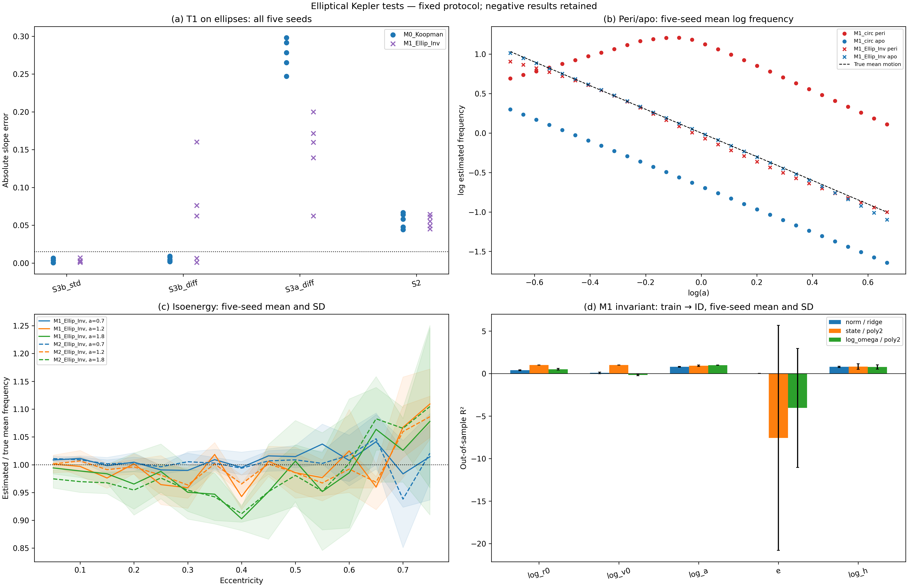

# Task 4 — эллиптические орбиты и инварианты

Полный эксперимент завершён: 20 GPU-обучений × 2000 шагов, batch 256, пять сидов 42–46. Научная приёмка: **11/12 PASS**; exit 1. Завершение вычислений не означает подтверждение всех гипотез ТЗ.

Единственный FAIL — ожидание R²(log a из нормы M1Inv)<0.75 на каждом сиде. Фактически: 42: 0.826267, 43: 0.750345, 44: 0.721759, 45: 0.853108, 46: 0.782125. Четыре из пяти значений выше порога. Следовательно, норма сохраняет заметную информацию о полуоси; заявленное жёсткое разделение «норма — только локальная кинематика, частоты — энергия» данными не подтверждается. При этом энергетическая проба от log-частот даёт R² от 0.968688 до 0.992753 и проходит свой критерий.

Перенос на экстремальные e пока ненадёжен: в OOD_ecc среднее R² закона T3 составляет ≈0.920 для M1Inv и ≈0.726 для M2Inv, худшая относительная ошибка частоты — ≈79% и практически 100%. Это не входит в заданную приёмку закона на ID, но существенно ограничивает положительный научный вывод. В одном OOD случае M2 q≈2.46e−14 формально остаётся положительным, поэтому invalid=0 не означает корректный период.

Для проверки начните с этого разбора, затем откройте [четырёхпанельный график](figures/exp3_elliptic_kepler.png) и [полные таблицы](exp3_elliptic_report.md). [JSON](exp3_elliptic_results.json) содержит каждую орбиту, прогнозы проб, параметры нормализации и коэффициенты; [протокол](protocol_task4.md) фиксирует решения до прогона. Чекпойнты находятся в checkpoints/.

## Приёмка

| criterion                                                     | passed   | details                              |
|---------------------------------------------------------------|----------|--------------------------------------|
| All20 CUDA trainings:2000steps B256                           | True     |                                      |
| H3 M0_Koopman: one phase method passes all5 seeds             | True     | {'S3b_std': True, 'S3b_diff': True}  |
| H3 M0_Koopman: DMD degradation                                | True     |                                      |
| H3 M1_Ellip_Inv: one phase method passes all5 seeds           | True     | {'S3b_std': True, 'S3b_diff': False} |
| H3 M1_Ellip_Inv: DMD degradation                              | True     |                                      |
| Zero-shot M1_circ mean phase gap>.35                          | True     |                                      |
| M1_Ellip_Inv phase gap<.12 all5 and at least3x mean reduction | True     |                                      |
| M0_Koopman T3 fails recovery                                  | True     |                                      |
| M1_Ellip_Inv T3 mean/worst law thresholds                     | True     |                                      |
| M2_Ellip_Inv T3 mean/worst law thresholds                     | True     |                                      |
| M1Inv norm OOS loga R2<.75                                    | False    |                                      |
| M1Inv omega OOS energy R2>.94                                 | True     |                                      |

Все пять сидов включены в агрегаты. Невалидные частоты не удаляются. Пороговые значения после получения результатов не менялись.

## Блок 1 и фазовая инвариантность

| model           |   mean_gap |   max_gap |   min_gap |
|-----------------|------------|-----------|-----------|
| M0_Koopman      |  0.0171626 | 0.0210689 | 0.0119279 |
| M1_circ         |  1.47763   | 1.55403   | 1.37625   |
| M2_circ         |  1.24875   | 1.38756   | 1.095     |
| M3_circ         |  0.96074   | 1.26036   | 0.445508  |
| M1_Ellip_Short  |  0.531307  | 0.654582  | 0.422561  |
| M1_Ellip_Inv    |  0.0558712 | 0.0698113 | 0.0395055 |
| M2_Ellip_Inv    |  0.0420051 | 0.0644175 | 0.0255403 |
| M3_Ellip_SIGReg |  1.18397   | 5.40165   | 0.0503036 |

Среднее расхождение M1circ / M1Inv: 1.47763 / 0.0558712; отношение средних — 26.4471. Это тест одной и той же физической орбиты с двумя стартами, поэтому истинная частота совпадает. Различающиеся предсказания показывают нарушение фазовой инвариантности.

Такое нарушение опровергает обобщение круговой модели на эти эллипсы, но само по себе не доказывает единственную конкретную эвристику нормы. Возможны смешивание кинематики и интегралов, недостаточный охват обучающих данных и ошибки представления/оценки частоты. Отдельно полезно сопоставить OOS-пробы и абсолютную калибровку ниже.

## Блок 2: H3 на истинной закодированной траектории T1

| model        | method   |   mean_abs_error |   worst_abs_error |   mean_R2 |   min_R2 |   invalid |
|--------------|----------|------------------|-------------------|-----------|----------|-----------|
| M0_Koopman   | S3b_std  |       0.00288539 |        0.00647367 |  0.999683 | 0.999593 |         0 |
| M0_Koopman   | S3b_diff |       0.00509968 |        0.00903274 |  0.999431 | 0.99933  |         0 |
| M0_Koopman   | S3a_diff |       0.276021   |        0.298154   |  0.817719 | 0.809283 |         0 |
| M0_Koopman   | S2       |       0.0561039  |        0.0667395  |  0.992849 | 0.991465 |         0 |
| M1_Ellip_Inv | S3b_std  |       0.00304798 |        0.0069876  |  0.999721 | 0.999659 |         0 |
| M1_Ellip_Inv | S3b_diff |       0.0610984  |        0.160285   |  0.981062 | 0.954105 |         0 |
| M1_Ellip_Inv | S3a_diff |       0.146513   |        0.199844   |  0.841833 | 0.819411 |         0 |
| M1_Ellip_Inv | S2       |       0.0550016  |        0.064456   |  0.992794 | 0.991565 |         0 |

H3 по критериям ТЗ подтверждена: у M0K оба фазовых метода проходят на всех пяти сидах, у M1Inv — S3b_std. S3b_diff у M1Inv не проходит все строгие пороги H3; этот результат не скрывается и не заменяется выбором метода отдельно по сидам. DMD деградирует в обоих случаях.

Утверждение о топологическом обороте фазы на полный период слабее требования почти идеальной регрессии частоты на конечном окне. PCA, вычитание центра, гармоники и неполные периоды могут влиять на оценку. Поэтому отрицательный H3 означает провал именно заявленного протокола и порогов; он не доказывает бесполезность фазовых оценивателей вообще. Метод std/diff не выбирался отдельно по сидам.

Дополнительная калибровка H3 использует те же 512 временных точек: identity отображает физическое окно 16×4 в 64 координаты; oracle строит идеальную окружность по истинной средней аномалии. Oracle является только контрольным сигналом для оценивателя и никогда не участвует в обучении или пробах. Эта диагностика не входит в исходную приёмку.

| reference                  | method   |   worst_abs_error |   min_R2 |
|----------------------------|----------|-------------------|----------|
| identity_physical_context  | S3b_std  |       0.00645523  | 0.999595 |
| identity_physical_context  | S3b_diff |       0.00909484  | 0.999325 |
| identity_physical_context  | S3a_diff |       0.297637    | 0.810207 |
| identity_physical_context  | S2       |       0.0667858   | 0.991466 |
| oracle_mean_anomaly_circle | S3b_std  |       0.00214166  | 0.999899 |
| oracle_mean_anomaly_circle | S3b_diff |       4.44089e-16 | 1        |
| oracle_mean_anomaly_circle | S3a_diff |       1.55431e-15 | 1        |
| oracle_mean_anomaly_circle | S2       |       0.0523358   | 0.993128 |

Калибровка использует точные параметры орбит из сохранённого GPU-JSON. Различие std/diff у M1Inv нельзя целиком объяснить самим генератором эллипсов или длиной ряда: существенна геометрия конкретного представления. Oracle S3b_diff восстанавливает частоту до машинной точности, а FFT сохраняет дискретизационную погрешность; количественные значения обеих калибровок приведены выше.

## Блок 2: закон Кеплера в автономном T3

| model           |   mean_slope |   mean_abs_error |   worst_abs_error |   mean_R2 |      min_R2 |   invalid |
|-----------------|--------------|------------------|-------------------|-----------|-------------|-----------|
| M0_Koopman      |   0.00526043 |        1.50526   |         1.51166   | 0.0431689 | 1.68026e-05 |         0 |
| M1_circ         |  -1.32161    |        0.178392  |         0.297153  | 0.635088  | 0.522181    |         0 |
| M2_circ         |  -1.20065    |        0.299346  |         0.428743  | 0.627769  | 0.552701    |         0 |
| M3_circ         |  -0.751473   |        0.748527  |         1.05707   | 0.143159  | 0.0384295   |         0 |
| M1_Ellip_Short  |  -1.4522     |        0.0899711 |         0.140008  | 0.772574  | 0.726533    |         0 |
| M1_Ellip_Inv    |  -1.51882    |        0.0227029 |         0.0430543 | 0.994306  | 0.992276    |         0 |
| M2_Ellip_Inv    |  -1.51914    |        0.0281365 |         0.0475875 | 0.996276  | 0.995116    |         0 |
| M3_Ellip_SIGReg |   0.436849   |        1.93685   |         3.65421   | 0.0503904 | 0.0175146   |         0 |

Наклон −1.5 и высокий R² проверяют степенную зависимость. Они не фиксируют множитель частоты: модель с omega_hat = c*a^(-1.5) проходит эти две проверки при любом c>0. Ниже отдельно приведён q=omega_hat/omega_true, включая худшую ошибку; новых критериев приёмки задним числом не добавлено.

| model           | split           |   mean_slope |   mean_R2 |   mean_q |       min_q |     max_q |   worst_abs_q_minus1 |   invalid |
|-----------------|-----------------|--------------|-----------|----------|-------------|-----------|----------------------|-----------|
| M0_Koopman      | test_id_ellip   |   0.00526043 | 0.0431689 | 0.816963 | 0.241156    |  1.90174  |             0.901741 |         0 |
| M0_Koopman      | test_ood_ecc    |   0.00699244 | 0.0657382 | 0.817825 | 0.237331    |  1.94278  |             0.94278  |         0 |
| M0_Koopman      | test_ellip_peri |  -0.016237   | 0.587526  | 0.817327 | 0.249124    |  1.88996  |             0.889958 |         0 |
| M0_Koopman      | test_ellip_apo  |   0.0176813  | 0.804329  | 0.820739 | 0.241749    |  1.95371  |             0.953707 |         0 |
| M1_circ         | test_id_ellip   |  -1.32161    | 0.635088  | 0.993646 | 0.433405    |  5.56894  |             4.56894  |         0 |
| M1_circ         | test_ood_ecc    |  -1.14802    | 0.436407  | 0.814203 | 0.316211    |  4.92149  |             3.92149  |         0 |
| M1_circ         | test_ellip_peri |  -0.485397   | 0.385138  | 2.44598  | 0.584122    |  3.60138  |             2.60138  |         0 |
| M1_circ         | test_ellip_apo  |  -1.43517    | 0.999909  | 0.506835 | 0.460811    |  0.545053 |             0.539189 |         0 |
| M2_circ         | test_id_ellip   |  -1.20065    | 0.627769  | 0.975111 | 0.325465    |  4.94436  |             3.94436  |         0 |
| M2_circ         | test_ood_ecc    |  -1.03448    | 0.456137  | 0.783441 | 0.284267    |  5.34127  |             4.34127  |         0 |
| M2_circ         | test_ellip_peri |  -0.0529593  | 0.051658  | 2.15072  | 0.365392    |  3.42853  |             2.42853  |         0 |
| M2_circ         | test_ellip_apo  |  -1.35349    | 0.9986    | 0.526411 | 0.436067    |  0.639083 |             0.563933 |         0 |
| M3_circ         | test_id_ellip   |  -0.751473   | 0.143159  | 2.32282  | 0.0691491   |  9.09503  |             8.09503  |         0 |
| M3_circ         | test_ood_ecc    |  -0.810985   | 0.0260769 | 1.69128  | 9.2021e-14  | 15.5864   |            14.5864   |         0 |
| M3_circ         | test_ellip_peri |   0.206585   | 0.190094  | 3.8377   | 0.779956    | 19.9502   |            18.9502   |         0 |
| M3_circ         | test_ellip_apo  |  -1.42636    | 0.669176  | 1.33601  | 0.345625    |  3.93528  |             2.93528  |         0 |
| M1_Ellip_Short  | test_id_ellip   |  -1.4522     | 0.772574  | 0.994348 | 0.46154     |  2.48657  |             1.48657  |         0 |
| M1_Ellip_Short  | test_ood_ecc    |  -1.68313    | 0.575502  | 1.01404  | 0.186574    |  4.21085  |             3.21085  |         0 |
| M1_Ellip_Short  | test_ellip_peri |  -0.689239   | 0.983682  | 1.03065  | 0.519413    |  1.76893  |             0.768933 |         0 |
| M1_Ellip_Short  | test_ellip_apo  |  -2.0256     | 0.998219  | 0.767276 | 0.396617    |  1.12202  |             0.603383 |         0 |
| M1_Ellip_Inv    | test_id_ellip   |  -1.51882    | 0.994306  | 0.988169 | 0.834016    |  1.07339  |             0.165984 |         0 |
| M1_Ellip_Inv    | test_ood_ecc    |  -1.42061    | 0.919736  | 1.01874  | 0.212554    |  1.60929  |             0.787446 |         0 |
| M1_Ellip_Inv    | test_ellip_peri |  -1.48812    | 0.99702   | 0.962353 | 0.79212     |  1.07606  |             0.20788  |         0 |
| M1_Ellip_Inv    | test_ellip_apo  |  -1.54095    | 0.998857  | 0.988124 | 0.877975    |  1.02524  |             0.122025 |         0 |
| M2_Ellip_Inv    | test_id_ellip   |  -1.51914    | 0.996276  | 0.986487 | 0.850778    |  1.10032  |             0.149222 |         0 |
| M2_Ellip_Inv    | test_ood_ecc    |  -1.28214    | 0.726089  | 1.02946  | 2.45605e-14 |  1.39086  |             1        |         0 |
| M2_Ellip_Inv    | test_ellip_peri |  -1.50447    | 0.998373  | 0.979614 | 0.866561    |  1.11265  |             0.133439 |         0 |
| M2_Ellip_Inv    | test_ellip_apo  |  -1.52146    | 0.999446  | 0.984473 | 0.857812    |  1.04488  |             0.142188 |         0 |
| M3_Ellip_SIGReg | test_id_ellip   |   0.436849   | 0.0503904 | 0.151003 | 3.08105e-14 |  0.503484 |             1        |         0 |
| M3_Ellip_SIGReg | test_ood_ecc    |  -1.17564    | 0.040349  | 0.15502  | 8.06812e-16 |  0.638548 |             1        |         0 |
| M3_Ellip_SIGReg | test_ellip_peri |   0.0286308  | 0.492948  | 0.154351 | 0.0416845   |  0.521047 |             0.958316 |         0 |
| M3_Ellip_SIGReg | test_ellip_apo  |  -3.34533    | 0.240505  | 0.143291 | 1.05213e-14 |  0.504369 |             1        |         0 |

## Блок 3: изоэнергетические группы

| model           |   a |   mean_std_log_omega |   max_std_log_omega |    mean_q |   worst_abs_q_minus1 |
|-----------------|-----|----------------------|---------------------|-----------|----------------------|
| M0_Koopman      | 0.7 |            0.0130685 |           0.0199369 | 0.404288  |             0.615343 |
| M0_Koopman      | 1.2 |            0.0111468 |           0.0118892 | 0.910944  |             0.111938 |
| M0_Koopman      | 1.8 |            0.0118985 |           0.0144001 | 1.67509   |             0.739096 |
| M1_circ         | 0.7 |            0.418562  |           0.471108  | 0.949183  |             0.946811 |
| M1_circ         | 1.2 |            0.494046  |           0.636233  | 1.03011   |             2.50619  |
| M1_circ         | 1.8 |            0.51976   |           0.719115  | 1.13866   |             4.49694  |
| M2_circ         | 0.7 |            0.381406  |           0.423062  | 0.88749   |             0.842068 |
| M2_circ         | 1.2 |            0.479432  |           0.653012  | 1.03962   |             2.56019  |
| M2_circ         | 1.8 |            0.471407  |           0.603625  | 1.12525   |             3.36903  |
| M3_circ         | 0.7 |            0.611922  |           0.785544  | 1.70251   |             3.89081  |
| M3_circ         | 1.2 |            2.35251   |           7.73132   | 2.55069   |             7.43941  |
| M3_circ         | 1.8 |            2.68882   |           9.23778   | 3.11131   |            12.2338   |
| M1_Ellip_Short  | 0.7 |            0.319274  |           0.358643  | 1.02435   |             0.927457 |
| M1_Ellip_Short  | 1.2 |            0.336375  |           0.410193  | 0.945735  |             1.97036  |
| M1_Ellip_Short  | 1.8 |            0.4111    |           0.50731   | 1.0342    |             3.20692  |
| M1_Ellip_Inv    | 0.7 |            0.0357995 |           0.0489861 | 1.00814   |             0.108522 |
| M1_Ellip_Inv    | 1.2 |            0.0549858 |           0.0776702 | 0.999323  |             0.225892 |
| M1_Ellip_Inv    | 1.8 |            0.0837626 |           0.105816  | 0.985532  |             0.316501 |
| M2_Ellip_Inv    | 0.7 |            0.033095  |           0.0740094 | 1.00424   |             0.221238 |
| M2_Ellip_Inv    | 1.2 |            0.0404397 |           0.0457431 | 0.99788   |             0.128396 |
| M2_Ellip_Inv    | 1.8 |            0.0765203 |           0.101366  | 0.986021  |             0.266187 |
| M3_Ellip_SIGReg | 0.7 |            0.241157  |           0.75335   | 0.0806712 |             0.994241 |
| M3_Ellip_SIGReg | 1.2 |            1.89841   |           9.13228   | 0.167274  |             1        |
| M3_Ellip_SIGReg | 1.8 |            2.298     |          11.1167    | 0.316964  |             1        |

std(log omega) вычислена внутри каждого a по 15 эксцентриситетам. Здесь e и стартовая фаза меняются одновременно: тест оценивает их совместную устойчивость, а не чистый эффект e при фиксированной фазе. Небольшая дисперсия при неверном mean q означает устойчивую, но неверно откалиброванную частоту.

## Блок 4: OOS-пробы

| model           | split         | feature   | method   |       log_r0 |       log_v0 |         log_a |              e |          log_h |   log_abs_energy |
|-----------------|---------------|-----------|----------|--------------|--------------|---------------|----------------|----------------|------------------|
| M0_Koopman      | test_id_ellip | norm      | ridge    |    0.104758  |   0.0264702  |     0.247643  |     0.0177404  |     0.0899928  |        0.247643  |
| M0_Koopman      | test_id_ellip | norm      | poly2    |    0.0883917 |   0.0737444  |     0.187692  |    -0.0104897  |     0.00278775 |        0.187692  |
| M0_Koopman      | test_id_ellip | state     | ridge    |   -1.1444    |  -0.693395   |    -1.40967   |    -0.923578   |    -1.30568    |       -1.40967   |
| M0_Koopman      | test_id_ellip | state     | poly2    |    0.970933  |   0.364076   |    -0.275898  |    -4.76196    |     0.95494    |       -0.275898  |
| M0_Koopman      | test_id_ellip | log_omega | ridge    |    0.911391  |   0.847085   |     0.702538  |    -0.120913   |     0.538207   |        0.702538  |
| M0_Koopman      | test_id_ellip | log_omega | poly2    |    0.931854  |   0.482188   |    -0.525658  |   -41.3823     |    -1.96415    |       -0.525658  |
| M0_Koopman      | test_ood_ecc  | norm      | ridge    |    0.157951  |  -0.120247   |     0.358363  |  -120.831      |    -4.14616    |        0.358363  |
| M0_Koopman      | test_ood_ecc  | norm      | poly2    |    0.123633  |  -0.0851221  |     0.2318    |  -119.736      |    -4.13828    |        0.2318    |
| M0_Koopman      | test_ood_ecc  | state     | ridge    |   -1.08431   |  -0.482763   |    -1.76791   |  -128.756      |    -8.47841    |       -1.76791   |
| M0_Koopman      | test_ood_ecc  | state     | poly2    |    0.986679  |   0.834255   |     0.483564  |  -225.437      |     0.118556   |        0.483564  |
| M0_Koopman      | test_ood_ecc  | log_omega | ridge    |    0.879376  |   0.672523   |    -0.112053  |   -84.89       |    -2.19277    |       -0.112053  |
| M0_Koopman      | test_ood_ecc  | log_omega | poly2    |    0.92495   |   0.450729   |    -3.44002   | -1389.05       |    -4.76225    |       -3.44002   |
| M1_circ         | test_id_ellip | norm      | ridge    |    0.133193  |   0.0495452  |     0.267625  |     0.0177109  |     0.105323   |        0.267625  |
| M1_circ         | test_id_ellip | norm      | poly2    |    0.115585  |   0.091653   |     0.209615  |    -0.0115278  |     0.0183512  |        0.209615  |
| M1_circ         | test_id_ellip | state     | ridge    |   -1.40546   |  -0.899349   |    -1.6832    |    -0.604203   |    -1.38446    |       -1.6832    |
| M1_circ         | test_id_ellip | state     | poly2    |    0.971159  |   0.87341    |    -0.925315  |    -7.10482    |     0.940554   |       -0.925315  |
| M1_circ         | test_id_ellip | log_omega | ridge    |    0.959205  |   0.97557    |     0.764072  |     0.316182   |     0.718102   |        0.764072  |
| M1_circ         | test_id_ellip | log_omega | poly2    |    0.960588  |   0.98115    |     0.504532  |     0.103537   |     0.642724   |        0.504532  |
| M1_circ         | test_ood_ecc  | norm      | ridge    |    0.171743  |  -0.109995   |     0.35845   |  -120.855      |    -4.15798    |        0.35845   |
| M1_circ         | test_ood_ecc  | norm      | poly2    |    0.134377  |  -0.0784735  |     0.223257  |  -119.729      |    -4.15909    |        0.223257  |
| M1_circ         | test_ood_ecc  | state     | ridge    |   -1.65553   |  -0.684604   |    -2.23452   |  -142.574      |    -9.41678    |       -2.23452   |
| M1_circ         | test_ood_ecc  | state     | poly2    |    0.956185  |   0.932584   |     0.0776345 |  -158.559      |     0.643016   |        0.0776345 |
| M1_circ         | test_ood_ecc  | log_omega | ridge    |    0.917695  |   0.942542   |     0.334721  |   -37.9427     |    -0.728525   |        0.334721  |
| M1_circ         | test_ood_ecc  | log_omega | poly2    |    0.892418  |   0.964782   |    -0.205207  |   -33.7958     |    -0.500361   |       -0.205207  |
| M2_circ         | test_id_ellip | norm      | ridge    |    0.109289  |   0.0410089  |     0.229279  |     0.0221263  |     0.0629864  |        0.229279  |
| M2_circ         | test_id_ellip | norm      | poly2    |    0.091977  |   0.085693   |     0.161437  |    -0.00572703 |    -0.0344888  |        0.161437  |
| M2_circ         | test_id_ellip | state     | ridge    |   -1.58703   |  -1.06039    |    -1.8933    |    -0.833168   |    -1.63334    |       -1.8933    |
| M2_circ         | test_id_ellip | state     | poly2    |    0.981249  |   0.96866    |     0.465713  |    -7.24591    |     0.852049   |        0.465713  |
| M2_circ         | test_id_ellip | log_omega | ridge    |    0.942938  |   0.954521   |     0.763546  |     0.296443   |     0.707465   |        0.763546  |
| M2_circ         | test_id_ellip | log_omega | poly2    |    0.959684  |   0.969972   |     0.831929  |     0.469776   |     0.865012   |        0.831929  |
| M2_circ         | test_ood_ecc  | norm      | ridge    |    0.172037  |  -0.0837817  |     0.281547  |  -120.678      |    -4.46832    |        0.281547  |
| M2_circ         | test_ood_ecc  | norm      | poly2    |    0.140372  |  -0.0605563  |     0.153363  |  -120.496      |    -4.57084    |        0.153363  |
| M2_circ         | test_ood_ecc  | state     | ridge    |   -1.25454   |  -0.479809   |    -2.24143   |  -130.334      |    -8.92374    |       -2.24143   |
| M2_circ         | test_ood_ecc  | state     | poly2    |    0.972166  |   0.853736   |     0.0479016 |  -219.251      |     0.48244    |        0.0479016 |
| M2_circ         | test_ood_ecc  | log_omega | ridge    |    0.898564  |   0.853828   |     0.246355  |   -51.5053     |    -1.39638    |        0.246355  |
| M2_circ         | test_ood_ecc  | log_omega | poly2    |    0.912306  |   0.894322   |     0.298487  |   -32.4729     |    -0.342201   |        0.298487  |
| M3_circ         | test_id_ellip | norm      | ridge    |   -0.963971  |  -0.53457    |    -1.33482   |    -0.00294097 |    -1.05731    |       -1.33482   |
| M3_circ         | test_id_ellip | norm      | poly2    |   -0.963971  |  -0.53457    |    -1.33482   |    -0.00294097 |    -1.05731    |       -1.33482   |
| M3_circ         | test_id_ellip | state     | ridge    |   -3.08863   |  -1.99932    |    -3.91626   |    -0.343883   |    -3.02397    |       -3.91626   |
| M3_circ         | test_id_ellip | state     | poly2    |    0.672258  |   0.588873   |     0.0886571 |    -0.75946    |    -0.315402   |        0.0886571 |
| M3_circ         | test_id_ellip | log_omega | ridge    |    0.587375  |   0.611208   |     0.18467   |     0.185647   |     0.117357   |        0.18467   |
| M3_circ         | test_id_ellip | log_omega | poly2    |   -1.09757   |  -0.824979   |    -4.10364   |    -2.40522    |    -3.82349    |       -4.10364   |
| M3_circ         | test_ood_ecc  | norm      | ridge    |   -0.324473  |  -0.0391439  |    -1.33482   |  -112.321      |    -7.91343    |       -1.33482   |
| M3_circ         | test_ood_ecc  | norm      | poly2    |   -0.324473  |  -0.0391439  |    -1.33482   |  -112.321      |    -7.91343    |       -1.33482   |
| M3_circ         | test_ood_ecc  | state     | ridge    |   -0.772327  |  -0.151417   |    -2.55921   |  -103.697      |    -8.53457    |       -2.55921   |
| M3_circ         | test_ood_ecc  | state     | poly2    |    0.727279  |   0.695129   |    -0.234966  |   -50.317      |    -2.68621    |       -0.234966  |
| M3_circ         | test_ood_ecc  | log_omega | ridge    |    0.563237  |   0.362171   |    -0.517831  |   -81.5631     |    -4.56872    |       -0.517831  |
| M3_circ         | test_ood_ecc  | log_omega | poly2    |    0.21505   |  -0.16839    |    -3.39091   |  -102.161      |    -8.43403    |       -3.39091   |
| M1_Ellip_Short  | test_id_ellip | norm      | ridge    |    0.509205  |   0.270784   |     0.673174  |    -0.00363513 |     0.53252    |        0.673174  |
| M1_Ellip_Short  | test_id_ellip | norm      | poly2    |    0.528823  |   0.266846   |     0.760404  |    -0.012089   |     0.615214   |        0.760404  |
| M1_Ellip_Short  | test_id_ellip | state     | ridge    |   -1.84848   |  -1.13513    |    -2.24306   |    -0.19485    |    -2.02788    |       -2.24306   |
| M1_Ellip_Short  | test_id_ellip | state     | poly2    |    0.980583  |   0.977863   |     0.958839  |     0.214064   |     0.909112   |        0.958839  |
| M1_Ellip_Short  | test_id_ellip | log_omega | ridge    |    0.930224  |   0.882926   |     0.916536  |     0.425825   |     0.866381   |        0.916536  |
| M1_Ellip_Short  | test_id_ellip | log_omega | poly2    |    0.965897  |   0.924874   |     0.921484  |     0.39827    |     0.92867    |        0.921484  |
| M1_Ellip_Short  | test_ood_ecc  | norm      | ridge    |    0.12115   |  -0.322404   |     0.607018  |  -119.023      |    -2.84183    |        0.607018  |
| M1_Ellip_Short  | test_ood_ecc  | norm      | poly2    |   -0.058316  |  -0.311152   |     0.242277  |  -113.908      |    -2.6082     |        0.242277  |
| M1_Ellip_Short  | test_ood_ecc  | state     | ridge    |   -1.15399   |  -0.396435   |    -2.13798   |  -132.37       |    -9.05399    |       -2.13798   |
| M1_Ellip_Short  | test_ood_ecc  | state     | poly2    |    0.977106  |   0.965973   |     0.709932  |   -92.8382     |     0.501077   |        0.709932  |
| M1_Ellip_Short  | test_ood_ecc  | log_omega | ridge    |    0.814145  |   0.753741   |     0.380578  |   -33.8291     |    -0.245814   |        0.380578  |
| M1_Ellip_Short  | test_ood_ecc  | log_omega | poly2    |    0.85521   |   0.877941   |     0.236313  |  -113.989      |     0.341243   |        0.236313  |
| M1_Ellip_Inv    | test_id_ellip | norm      | ridge    |    0.386786  |   0.0728647  |     0.786721  |    -0.00537994 |     0.777909   |        0.786721  |
| M1_Ellip_Inv    | test_id_ellip | norm      | poly2    |    0.385234  |   0.106453   |     0.77253   |     0.0483394  |     0.795638   |        0.77253   |
| M1_Ellip_Inv    | test_id_ellip | state     | ridge    |   -1.69411   |  -1.38254    |    -1.87777   |    -1.31737    |    -1.80679    |       -1.87777   |
| M1_Ellip_Inv    | test_id_ellip | state     | poly2    |    0.998842  |   0.995014   |     0.916942  |    -7.57825    |     0.816973   |        0.916942  |
| M1_Ellip_Inv    | test_id_ellip | log_omega | ridge    |    0.575016  |   0.268129   |     0.990192  |     0.640491   |     0.95081    |        0.990192  |
| M1_Ellip_Inv    | test_id_ellip | log_omega | poly2    |    0.502551  |  -0.172812   |     0.98516   |    -4.05385    |     0.765654   |        0.98516   |
| M1_Ellip_Inv    | test_ood_ecc  | norm      | ridge    |   -0.66152   |  -0.82207    |     0.143     |  -111.852      |    -1.65017    |        0.143     |
| M1_Ellip_Inv    | test_ood_ecc  | norm      | poly2    |   -0.841844  |  -0.521101   |    -1.03257   |   -96.649      |    -1.98261    |       -1.03257   |
| M1_Ellip_Inv    | test_ood_ecc  | state     | ridge    |   -6.74019   |  -3.54473    |    -5.42622   |  -154.761      |   -13.5088     |       -5.42622   |
| M1_Ellip_Inv    | test_ood_ecc  | state     | poly2    |    0.953353  |   0.954507   |     0.531526  |  -211.313      |     0.51982    |        0.531526  |
| M1_Ellip_Inv    | test_ood_ecc  | log_omega | ridge    |    0.391268  |   0.175523   |     0.874306  |   -24.9365     |     0.119627   |        0.874306  |
| M1_Ellip_Inv    | test_ood_ecc  | log_omega | poly2    |  -14.5633    | -19.2802     |     0.677132  |  -270.756      |    -1.00384    |        0.677132  |
| M2_Ellip_Inv    | test_id_ellip | norm      | ridge    |    0.396484  |   0.0774754  |     0.798655  |    -0.00353934 |     0.797533   |        0.798655  |
| M2_Ellip_Inv    | test_id_ellip | norm      | poly2    |    0.408777  |   0.124056   |     0.767527  |     0.0425622  |     0.777123   |        0.767527  |
| M2_Ellip_Inv    | test_id_ellip | state     | ridge    |   -2.82107   |  -2.37927    |    -2.93354   |    -1.21664    |    -2.29279    |       -2.93354   |
| M2_Ellip_Inv    | test_id_ellip | state     | poly2    |    0.997129  |   0.990954   |     0.808738  |    -5.90662    |     0.98821    |        0.808738  |
| M2_Ellip_Inv    | test_id_ellip | log_omega | ridge    |    0.690038  |   0.384865   |     0.993971  |     0.507561   |     0.9464     |        0.993971  |
| M2_Ellip_Inv    | test_id_ellip | log_omega | poly2    |   -0.0782432 |  -1.45977    |     0.992009  |    -0.902368   |     0.77229    |        0.992009  |
| M2_Ellip_Inv    | test_ood_ecc  | norm      | ridge    |   -0.635528  |  -0.783388   |     0.153965  |  -110.655      |    -1.63485    |        0.153965  |
| M2_Ellip_Inv    | test_ood_ecc  | norm      | poly2    |   -0.6001    |  -0.501912   |    -0.412817  |  -100.195      |    -1.81395    |       -0.412817  |
| M2_Ellip_Inv    | test_ood_ecc  | state     | ridge    |  -10.2521    |  -5.13187    |    -8.63909   |  -141.681      |   -15.2449     |       -8.63909   |
| M2_Ellip_Inv    | test_ood_ecc  | state     | poly2    |    0.996191  |   0.949175   |     0.206149  | -3225.45       |     0.671921   |        0.206149  |
| M2_Ellip_Inv    | test_ood_ecc  | log_omega | ridge    |    0.286324  |  -0.00315938 |     0.899671  |   -34.3234     |    -0.279192   |        0.899671  |
| M2_Ellip_Inv    | test_ood_ecc  | log_omega | poly2    |   -1.52277   |  -2.17479    |     0.699005  |  -257.542      |    -0.796748   |        0.699005  |
| M3_Ellip_SIGReg | test_id_ellip | norm      | ridge    |   -0.963971  |  -0.53457    |    -1.33482   |    -0.00294097 |    -1.05731    |       -1.33482   |
| M3_Ellip_SIGReg | test_id_ellip | norm      | poly2    |   -0.963971  |  -0.53457    |    -1.33482   |    -0.00294097 |    -1.05731    |       -1.33482   |
| M3_Ellip_SIGReg | test_id_ellip | state     | ridge    |   -1.89137   |  -1.19113    |    -2.55451   |    -0.404314   |    -2.10012    |       -2.55451   |
| M3_Ellip_SIGReg | test_id_ellip | state     | poly2    |    0.865102  |   0.855455   |     0.550503  |     0.32814    |     0.573793   |        0.550503  |
| M3_Ellip_SIGReg | test_id_ellip | log_omega | ridge    |   -0.952564  |  -0.691974   |    -1.36313   |    -0.460983   |    -1.16135    |       -1.36313   |
| M3_Ellip_SIGReg | test_id_ellip | log_omega | poly2    | -342.957     | -27.2016     | -1217.11      | -2159.23       | -2520.42       |    -1217.11      |
| M3_Ellip_SIGReg | test_ood_ecc  | norm      | ridge    |   -0.324473  |  -0.0391439  |    -1.33482   |  -112.321      |    -7.91343    |       -1.33482   |
| M3_Ellip_SIGReg | test_ood_ecc  | norm      | poly2    |   -0.324473  |  -0.0391439  |    -1.33482   |  -112.321      |    -7.91343    |       -1.33482   |
| M3_Ellip_SIGReg | test_ood_ecc  | state     | ridge    |   -1.04741   |  -0.309284   |    -2.66993   |  -116.992      |    -9.16227    |       -2.66993   |
| M3_Ellip_SIGReg | test_ood_ecc  | state     | poly2    |    0.731047  |   0.797395   |    -0.27028   |   -32.374      |    -3.2856     |       -0.27028   |
| M3_Ellip_SIGReg | test_ood_ecc  | log_omega | ridge    |   -0.675471  |  -0.144281   |    -1.90996   |  -107.85       |    -8.41719    |       -1.90996   |
| M3_Ellip_SIGReg | test_ood_ecc  | log_omega | poly2    |  -18.5534    |  -6.77958    |   -33.7864    |  -244.23       |   -39.2328     |      -33.7864    |

В этой сводке показаны обе пробы для всех трёх признаков. Панель (d) использует заранее выбранные norm/Ridge и state/logomega/poly2. Все преобразования и коэффициенты обучены исключительно на train_ellip, до применения к ID и OOD_ecc. Отрицательные R² сохранены и означают, что прогноз хуже константы среднего данной тестовой выборки.

Пробы имеют существенную зависимость от сложности: у M1Inv на ID e декодируется линейно из log-частот со средним R²≈0.640, но poly2 даёт ≈−4.054. Значит, провал этой нелинейной пробы не доказывает отсутствия информации об e. Poly2 даёт 560 признаков для 32 частот и 2144 для полного z при всего 200 обучающих орбитах; фиксированная Ridge(.01) не гарантирует хорошего обобщения. На OOD_ecc деградация гораздо сильнее. Следующий этап должен сравнить регуляризацию через train-only cross-validation и размер обучающей выборки, без подбора по ID/OOD результатам.

Высокая декодируемость log a из частот является свидетельством доступности информации об энергии, но не доказательством того, что предиктор реализует физическую формулу энергии. log|E| = -log a - log 2 при mu=1, поэтому эти две цели дают аффинно эквивалентную проверку. Сферический M3 имеет практически постоянную норму: нормовая проба корректно сводится к intercept, а не получает информацию из численного шума.

## Ограничения постановки и дальнейшие действия

1. H=256 покрывает 10.24 единиц времени при периоде до 70.25 в train. Две независимые точки из доступной 21-единичной записи не гарантируют перицентр и апоцентр. Для проверки полного цикла нужен отдельный заранее заданный эксперимент с более длинными записями.

2. Short и Inv различаются одновременно горизонтом, числом стартов и частотным штрафом. Для причинной атрибуции улучшения нужна факторная абляция: long/single, long/paired/no-inv, short/paired/inv при сопоставимом вычислительном бюджете.

3. Инвариантность не исключает постоянную частоту для всех орбит. Поэтому нужны одновременно M0-контроль, восстановление зависимости по a, абсолютный q и OOS-пробы.

4. Изоэнергетический тест стоит расширить на фиксированные фазы и ориентации при изменении только e, затем отдельно менять фазу. OOD по e не заменяет OOD по a, mu или возмущениям закона силы.

5. Круговое движение в латентном пространстве совместимо с неравномерным движением по физическому эллипсу. Для более сильного утверждения о динамике нужны декодированная физическая траектория, дрейф E/h и закон площадей; одних частот и проб недостаточно.

6. Эти результаты относятся к данной контролируемой реализации и протоколу. Они не являются автоматическим опровержением всех архитектур JEPA или всех утверждений JEPA-Anything.

7. Нормовое сопоставление с физическим окном из ТЗ создаёт потенциальное напряжение целей: RMS физического окна зависит от фазы эллипса, тогда как ортогональный латентный поток сохраняет полную норму. Штраф частот может отделять энергию от этой переменности, но точное совпадение всех латентных целей не гарантировано. Отдельная абляция нормового сопоставления нужна для проверки этого механизма.

8. Seed меняет одновременно инициализацию модели и случайные параметры train/test орбит. Межсидовая дисперсия смешивает оба источника вариации; для их раздельной оценки нужен фиксированный тестовый набор и перекрёстный дизайн model-seed × data-seed.

## Воспроизводимость и проверка

Время полного прогона: 1625.9 с. Среда и GPU — в JSON и [preflight](gpu_preflight.json). Выводы тестов: [локально](unit_tests_local.txt), [IDH](unit_tests_idh.txt). [stdout](exp3_elliptic_stdout.txt).

[Независимый аудит](provenance/audit_task4_results.json) проверяет сохранность прежних отчётов, SHA256 артефактов/исходников, 20 CUDA-чекпойнтов, пересчёт наклонов, фазовых отношений и OOS-прогнозов по сохранённым коэффициентам. Исходники GPU-прогона сохранены в provenance/task4_sources.zip; оригинальные исходники Task 3.2 также архивированы.

После прогона выполнена только правка отображения: единый цвет каждой модели во всех оценивателях панели (a). [Квитанция правки](provenance/presentation_changes.json) фиксирует хеш исходного/итогового графика и неизменность числового JSON. Оригинальный GPU-график сохранён отдельно; исходники GPU-прогона остаются в неизменном ZIP.

Для M0 недостаточно одного seed при переносе между версиями PyTorch: побитовая инициализация локально и на IDH различается. В provenance/frozen_controls/ сохранены все пять наборов весов, восстановленных в исходной среде и проверенных по исходным before/after SHA256. Аудит использует эти точные веса, не новую локальную инициализацию. Квитанции экспорта и скачивания сохранены; никакого обучения M0 или изменения результатов не выполнялось.

Обнаружена и межплатформенная неоднозначность e-сетки: выбор минимума абсолютной корреляции среди перестановок с почти равными оценками чувствителен к округлению BLAS. Внутри зафиксированной GPU-среды сетка детерминирована и одинакова по сидам; локальная среда может выбрать другую почти равноценную перестановку. Поэтому независимый аудит и H3-калибровка воспроизводят именно сохранённые a/e/M0/ориентации из GPU-JSON через analytical_ellipse_batch, а не повторяют выбор перестановки. Это ограничение переносимости seed-протокола явно зафиксировано; GPU-результаты и критерии не менялись. Для будущего протокола следует фиксировать саму перестановку или выбирать её по точной целочисленной ранговой корреляции.

